# 📋 HƯỚNG DẪN CHUYÊN GIA — CHƯƠNG 2: KHẢO SÁT VÀ PHÂN TÍCH HỆ THỐNG
### ĐỀ TÀI: HỆ THỐNG HỌC & THI TRỰC TUYẾN TÍCH HỢP XÁC THỰC KHUÔN MẶT (EDUFACE / EXAMGUARD AI)
**Sinh viên thực hiện:** Lục Văn Sơn — **MSSV:** 2310900087 — **Lớp:** K23CNT3  
**Bộ tài liệu chuẩn phân tích hệ thống:** Gồm 8 Use Case phân rã đặc tả (kèm chuẩn UML Extension Points), 8 Sequence Diagram và 8 Activity Diagram chuẩn chỉnh, sẵn sàng vẽ trên Microsoft Visio / Visual Paradigm và điền trực tiếp vào Báo cáo Đồ án Tốt nghiệp.

---

> ### 💡 LỜI TỰA DÀNH CHO BẠN (NGƯỜI LÀM BÁO CÁO)
> Để báo cáo đạt điểm tối đa trước Hội đồng bảo vệ đồ án, toàn bộ hệ thống được phân tích thành **bộ 8 nghiệp vụ cốt lõi đồng nhất (1-to-1)**:
> - Mỗi nghiệp vụ đều có: (1) Sơ đồ Use Case phân rã có **Điểm mở rộng (Extension Points)** & Bảng đặc tả $\rightarrow$ (2) Sơ đồ Tuần tự (Sequence Diagram) $\rightarrow$ (3) Sơ đồ Hoạt động (Activity Diagram).
> - **Ngôn ngữ diễn đạt:** Trong sáng, dễ hiểu, gắn liền với nghiệp vụ thực tế giảng đường và khảo thí. Cả thầy cô chuyên ngành CNTT lẫn người ngoài ngành (nhà quản lý, sinh viên) khi đọc vào đều lập tức hiểu được: hệ thống giải quyết vấn đề gì, vận hành ra sao và mang lại giá trị gì.
> - **Tuyệt đối không dùng thông số kỹ thuật khô khan** (không nhồi nhét công thức toán, thuật toán mã hóa trừu tượng).

---

## 2.1 TỔNG QUAN CÁC TÁC NHÂN TRONG HỆ THỐNG

Dựa trên sơ đồ Use Case tổng quát, hệ thống có **4 tác nhân** cùng tham gia tương tác:

1. **🎓 Học Viên (Sinh viên):** Người thụ hưởng trực tiếp — Thực hiện đăng ký khuôn mặt KYC, xem lịch thi & vị trí bàn 3D, điểm danh quét mặt vào phòng, làm bài thi an toàn, tham gia đấu trường Quiz và tra cứu kết quả/phúc khảo.
2. **👨‍🏫 Giảng Viên:** Người quản lý chuyên môn và coi thi — Soạn thảo ngân hàng đề thi, điều hành phòng thi 3D, hỗ trợ đăng ký duyệt khuôn mặt học viên, chấm bài tự luận rọc phách ẩn danh, rà soát vi phạm và làm chủ trì (Host) Đấu trường Quiz.
3. **🏛️ Admin Hệ Thống (Cán bộ Khảo thí):** Người quản trị cấp cao — Cấp tài khoản, thiết lập cơ cấu tổ chức (Khoa, Khóa, Lớp), dựng sơ đồ phòng máy 3D & camera, phê duyệt và công bố bảng điểm chính thức toàn trường.
4. **🤖 Face AI Service (Trợ lý Trí tuệ nhân tạo):** Hệ thống thông minh chạy nền — Kiểm tra người thật (chống dùng ảnh/video giả), trích xuất bản đồ khuôn mặt và so khớp nhận diện để mở cửa phòng thi cũng như giám sát chống thi hộ.

---

## 2.2 BIỂU ĐỒ USE CASE PHÂN RÃ CHỨC NĂNG & ĐẶC TẢ CHI TIẾT (TÍCH HỢP EXTENSION POINTS)

### 📌 HƯỚNG DẪN CHUYÊN SÂU: CÁCH VẼ "EXTENSION POINT" (ĐIỂM MỞ RỘNG) TRÊN VISIO / VISUAL PARADIGM
Trong chuẩn UML 2.x, mối quan hệ `<<extend>>` (mở rộng) bắt buộc phải gắn liền với một **Điểm mở rộng (Extension Point)** cụ thể trên Use Case cơ sở:
* **Khái niệm dễ hiểu:** Extension Point là một "công tắc" hoặc "ngã rẽ điều kiện" bên trong Use Case gốc. Khi điều kiện này xảy ra (ví dụ: máy tính bị hỏng, phát hiện gian lận, hoặc sinh viên khiếu nại điểm), hệ thống mới kích hoạt Use Case mở rộng tương ứng.
* **Cách vẽ trên sơ đồ chuẩn mực:**
  1. Trong hình elip của Use Case cơ sở, chia làm **2 ngăn** bằng một vạch kẻ ngang:
     - **Ngăn trên:** Ghi rõ **Tên Use Case**.
     - **Ngăn dưới:** Ghi chữ `extension points` và liệt kê tên các điểm mở rộng (ví dụ: `Xuất biên bản ca thi & Danh sách ký tên`, `Cập nhật trạng thái thí sinh thủ công`).
  2. Kẻ mũi tên nét đứt từ Use Case mở rộng chỉ **hướng về phía Use Case cơ sở** (chính xác ngay tại điểm mở rộng).
  3. Trên thân mũi tên ghi nhãn: `<<Extend>>` hoặc `<<Include>>`.
  4. Tác nhân hệ thống ghi rõ stereotype: `<<Hệ thống>> HT_FaceAI`.

---

### 🌟 SƠ ĐỒ USE CASE PHÂN RÃ CHUẨN MẪU: PHÂN HỆ QUẢN LÝ THI & GIÁM SÁT ĐIỂM DANH XÁC THỰC KHUÔN MẶT
*(Mô hình hóa chuẩn đồ án tốt nghiệp — Phối hợp 3 tác nhân: Giáo viên coi thi, Sinh viên và Hệ thống AI)*

#### A. Sơ đồ Use Case Phân Rã (Chuẩn UML 2.x có Extension Points 2 ngăn):

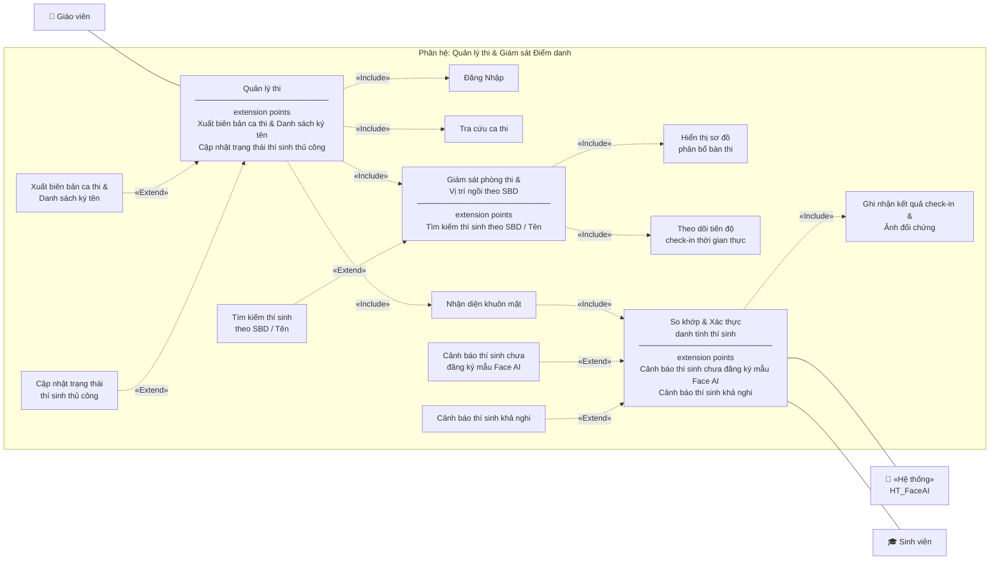

#### B. Phân tích Chi tiết Cấu trúc Sơ đồ:
1. **Tác nhân tham gia (Actors):**
   - **`Giáo viên`**: Giám thị phòng thi — đăng nhập, tra cứu ca thi, điều hành phòng thi, xem sơ đồ chỗ ngồi, tìm kiếm thí sinh, cập nhật trạng thái đặc cách và xuất biên bản.
   - **`Sinh viên`**: Thí sinh tham gia ca thi — ngồi trước webcam quét mặt để nhận diện.
   - **`<<Hệ thống>> HT_FaceAI`**: Dịch vụ AI sinh trắc học — nhận luồng camera, so khớp 1:1 với vector chân dung gốc, kiểm tra giả mạo và kích hoạt các cảnh báo rủi ro.

2. **Cấu trúc 3 Tầng Use Case Cơ sở (Base Use Cases) có Extension Points:**
   - **`Quản lý thi` (Tầng 1 - Trung tâm):**
     - Bao gồm (`<<Include>>`): `Đăng Nhập`, `Tra cứu ca thi`, `Giám sát phòng thi & Vị trí ngồi theo SBD`, `Nhận diện khuôn mặt`.
     - Điểm mở rộng (`extension points`):
       - *Xuất biên bản ca thi & Danh sách ký tên*: Được mở rộng (`<<Extend>>`) khi đóng ca thi để in danh sách điểm danh và ký xác nhận.
       - *Cập nhật trạng thái thí sinh thủ công*: Được mở rộng (`<<Extend>>`) khi có sự cố thiết bị hoặc cần mở bàn đặc cách (Force Check-in).
   - **`Giám sát phòng thi & Vị trí ngồi theo SBD` (Tầng 2 - Điều phối phòng thi):**
     - Bao gồm (`<<Include>>`): `Hiển thị sơ đồ phân bổ bàn thi`, `Theo dõi tiến độ check-in thời gian thực`.
     - Điểm mở rộng (`extension points`):
       - *Tìm kiếm thí sinh theo SBD / Tên*: Được mở rộng (`<<Extend>>`) khi giám thị cần tra cứu nhanh thông tin một thí sinh cụ thể.
   - **`So khớp & Xác thực danh tính thí sinh` (Tầng 3 - Trí tuệ nhân tạo):**
     - Được gọi thông qua `Nhận diện khuôn mặt` (`<<Include>>`).
     - Bao gồm (`<<Include>>`): `Ghi nhận kết quả check-in & Ảnh đối chứng`.
     - Điểm mở rộng (`extension points`):
       - *Cảnh báo thí sinh chưa đăng ký mẫu Face AI*: Được kích hoạt (`<<Extend>>`) khi phát hiện sinh viên chưa có hồ sơ KYC gốc.
       - *Cảnh báo thí sinh khả nghi*: Được kích hoạt (`<<Extend>>`) khi phát hiện giả mạo ảnh/video hoặc độ tương đồng không đạt ngưỡng.

#### C. Bảng đặc tả chi tiết phân hệ Quản lý thi & Giám sát điểm danh:

##### Bảng 2.3. Bảng đặc tả use case Quản lý thi & Giám sát điểm danh xác thực khuôn mặt

| Thuộc tính | Nội dung đặc tả |
| :--- | :--- |
| **Mã use case** | `UC_PROCTOR_01` |
| **Tên use case:** | **Quản lý thi & Giám sát điểm danh xác thực khuôn mặt** |
| **Mô tả sơ lược:** | Cho phép Giáo viên (Giám thị) điều hành ca thi, theo dõi sơ đồ bàn thi và tiến độ check-in thời gian thực, phối hợp với HT_FaceAI để so khớp khuôn mặt thí sinh tự động, xử lý cảnh báo khả nghi và xuất biên bản ca thi. |
| **Actor chính:** | **Giáo viên** |
| **Actor phụ:** | Sinh viên, «Hệ thống» HT_FaceAI |
| **Tiền điều kiện:** | Giáo viên đã đăng nhập tài khoản; ca thi đã được khởi tạo và đến khung giờ làm việc [T_bắt_đầu - 15 phút]. |
| **Hậu điều kiện:** | Toàn bộ thí sinh có mặt được điểm danh và ghi nhận ảnh đối chứng; biên bản ca thi được kết xuất lưu trữ. |

**Luồng sự kiện chính:**

| Người dùng | Hệ thống |
| :--- | :--- |
| 1. Giáo viên thực hiện use case «Đăng Nhập» và chọn chức năng ca thi. | 2. Hệ thống xác thực và gọi use case «Tra cứu ca thi»: Hiển thị thông tin ca thi được phân công. |
| 3. Giáo viên chọn ca thi cần giám sát. | 4. Hệ thống thực hiện use case «Giám sát phòng thi & Vị trí ngồi theo SBD»: Kích hoạt use case «Hiển thị sơ đồ phân bổ bàn thi» và use case «Theo dõi tiến độ check-in thời gian thực» để kết nối Socket.IO theo dõi trạng thái các máy. |
| 5. Sinh viên ngồi vào bàn thi, bật camera để thực hiện use case «Nhận diện khuôn mặt». | 6. Hệ thống thực hiện use case «So khớp & Xác thực danh tính thí sinh»: Gửi ảnh chụp sang HT_FaceAI để kiểm tra Liveness và so khớp vector 512D với Chân dung gốc. |
|  | 7. HT_FaceAI xác nhận danh tính thí sinh chính chủ hợp lệ trong vòng dưới 1 giây. |
|  | 8. Hệ thống thực hiện use case «Ghi nhận kết quả check-in & Ảnh đối chứng»: Lưu vết thời gian check-in kèm ảnh chụp camera vào CSDL. |
|  | 9. Hệ thống cập nhật đổi màu vị trí bàn thi của sinh viên trên sơ đồ phân bổ của Giáo viên sang MÀU XANH LÁ và mở đề thi cho sinh viên. |
| 10. Hết giờ điểm danh, Giáo viên đóng ca thi. | 11. Hệ thống chốt danh sách thí sinh có mặt/vắng mặt và lưu vết ca thi. |

**Luồng thay thế (Luồng ngoại lệ / Extension Points):**

| Người dùng | Hệ thống |
| :--- | :--- |
| **4.1. Tại Extension Point [Tìm kiếm thí sinh theo SBD / Tên] của use case Giám sát: Giáo viên cần kiểm tra vị trí của một thí sinh cụ thể, nhập Tên hoặc SBD vào ô tìm kiếm.** | 4.2. Hệ thống thực hiện use case «Tìm kiếm thí sinh theo SBD / Tên»: Lọc nhanh và làm nhấp nháy vị trí bàn thi tương ứng trên sơ đồ phân bổ bàn thi. |
| **6.1. Tại Extension Point [Cảnh báo thí sinh chưa đăng ký mẫu Face AI] của use case So khớp: HT_FaceAI kiểm tra phát hiện sinh viên chưa hoàn thành đăng ký khuôn mặt KYC.** | 6.2. Hệ thống thực hiện use case «Cảnh báo thí sinh chưa đăng ký mẫu Face AI»: Bật thông báo màu vàng trên màn hình sinh viên và đánh dấu cờ cảnh báo trên màn hình Giáo viên. |
| **6.3. Tại Extension Point [Cảnh báo thí sinh khả nghi] của use case So khớp: HT_FaceAI phát hiện dấu hiệu giả mạo (ảnh in, điện thoại) hoặc độ tương đồng khuôn mặt thấp kéo dài.** | 6.4. Hệ thống thực hiện use case «Cảnh báo thí sinh khả nghi»: Bật cảnh báo ĐỎ khả nghi gian lận lên vị trí bàn thi trên màn hình Giáo viên kèm ảnh chụp đối chiếu. |
| **6.5. Tại Extension Point [Cập nhật trạng thái thí sinh thủ công]: Giáo viên đến tận bàn kiểm tra CCCD/Thẻ sinh viên và bấm "Mở bàn đặc cách (Force Check-in)" hoặc chuyển vị trí bàn máy nếu có sự cố.** | 6.6. Hệ thống thực hiện use case «Cập nhật trạng thái thí sinh thủ công»: Cập nhật trạng thái CHECKED_IN thủ công kèm lưu vết kiểm toán (Audit log) tên cán bộ can thiệp. |
| **10.1. Tại Extension Point [Xuất biên bản ca thi & Danh sách ký tên]: Giáo viên bấm nút "Xuất biên bản ca thi & Danh sách ký tên".** | 10.2. Hệ thống thực hiện use case «Xuất biên bản ca thi & Danh sách ký tên»: Kết xuất file PDF/Excel chuẩn gồm: SBD, Họ tên, MSSV, Vị trí bàn, Giờ check-in, Ảnh đối chứng và chỗ ký tên thí sinh. |


---

### USE CASE 1: ĐĂNG KÝ KHUÔN MẶT (FACE KYC 5 GÓC)

#### A. Sơ đồ Use Case Phân rã Chuẩn Mẫu (Hình Elip 2 ngăn & Extension Points):

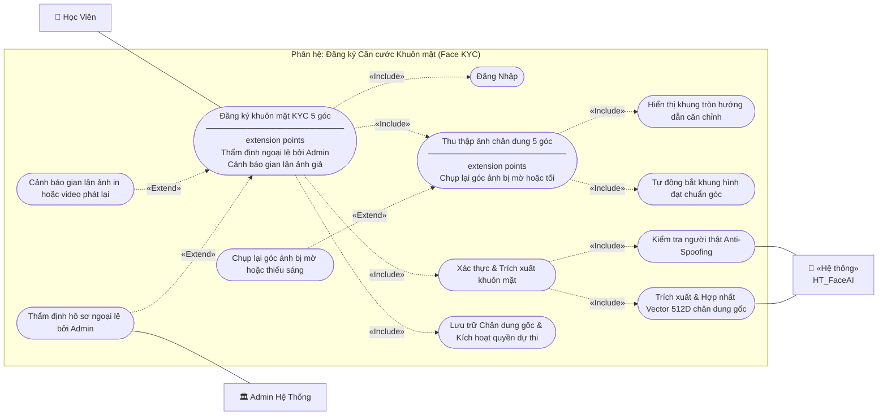

#### B. Phân tích Chi tiết Cấu trúc & Điểm mở rộng:
1. **Tác nhân tham gia:** `Học Viên` (người đăng ký căn cước), `HT_FaceAI` (kiểm tra chống giả mạo Liveness và trích xuất vector 512D), `Admin Hệ Thống` (thẩm định ngoại lệ).
2. **Use Case cơ sở 2 ngăn:** `Đăng ký khuôn mặt KYC 5 góc` chứa 2 điểm mở rộng (`Thẩm định ngoại lệ bởi Admin`, `Cảnh báo gian lận ảnh giả`).
3. **Quan hệ `<<Include>>`:** Bao gồm bắt buộc `Đăng Nhập`, `Thu thập ảnh chân dung 5 góc`, `Xác thực & Trích xuất khuôn mặt`, và `Lưu trữ Chân dung gốc & Kích hoạt quyền dự thi`.
4. **Quan hệ `<<Extend>>`:**
   - `Cảnh báo gian lận ảnh in hoặc video phát lại` mở rộng ngược về `Đăng ký khuôn mặt KYC 5 góc` khi phát hiện giả mạo.
   - `Thẩm định hồ sơ ngoại lệ bởi Admin` mở rộng khi ảnh ranh giới cần đối chiếu CCCD thủ công.
   - `Chụp lại góc ảnh bị mờ hoặc thiếu sáng` mở rộng vào Use Case con `Thu thập ảnh chân dung 5 góc`.

#### C. Bảng đặc tả chi tiết (Chuẩn mẫu báo cáo đồ án tốt nghiệp):

##### Bảng 2.4. Bảng đặc tả use case Đăng ký khuôn mặt KYC 5 góc

| Thuộc tính | Nội dung đặc tả |
| :--- | :--- |
| **Mã use case** | `UC_01` |
| **Tên use case:** | **Đăng ký khuôn mặt KYC 5 góc** |
| **Mô tả sơ lược:** | Cho phép học viên thực hiện đăng ký căn cước khuôn mặt gốc thông qua việc thu thập ảnh 5 góc, kiểm tra Liveness chống giả mạo, trích xuất vector ArcFace 512D chân dung gốc để phục vụ đối chiếu check-in phòng thi. |
| **Actor chính:** | **Học Viên** |
| **Actor phụ:** | «Hệ thống» HT_FaceAI, Admin Hệ Thống |
| **Tiền điều kiện:** | Học viên có tài khoản được cấp trên hệ thống; thiết bị có webcam sẵn sàng hoạt động; phòng đủ sáng, không đeo kính râm hay khẩu trang. |
| **Hậu điều kiện:** | Chân dung gốc 512D được lưu an toàn trong CSDL; trạng thái tài khoản chuyển sang APPROVED và kích hoạt quyền dự thi. |

**Luồng sự kiện chính:**

| Người dùng | Hệ thống |
| :--- | :--- |
| 1. Người dùng thực hiện use case «Đăng Nhập» vào hệ thống với tài khoản sinh viên. | 2. Hệ thống xác thực đăng nhập thành công và hiển thị giao diện cá nhân. |
| 3. Người dùng chọn chức năng "Đăng ký khuôn mặt KYC 5 góc". | 4. Hệ thống thực hiện use case «Thu thập ảnh chân dung 5 góc»: Kích hoạt camera, gọi use case «Hiển thị khung tròn hướng dẫn căn chỉnh» và yêu cầu thực hiện lần lượt 5 góc (Thẳng, Trái, Phải, Ngửa, Cúi). |
| 5. Người dùng hướng khuôn mặt theo từng chỉ dẫn của khung tròn. | 6. Hệ thống thực hiện use case «Tự động bắt khung hình đạt chuẩn góc» cho đủ 5 góc ảnh đạt độ nét và gửi gói ảnh sang máy chủ. |
|  | 7. Hệ thống gọi use case «Xác thực & Trích xuất khuôn mặt»: Yêu cầu HT_FaceAI thực hiện use case «Kiểm tra người thật Anti-Spoofing» để xác minh người thật. |
|  | 8. HT_FaceAI xác nhận người thật hợp lệ và thực hiện use case «Trích xuất & Hợp nhất Vector 512D chân dung gốc». |
|  | 9. Hệ thống thực hiện use case «Lưu trữ Chân dung gốc & Kích hoạt quyền dự thi»: Lưu vector 512D vào CSDL, cập nhật tài khoản sang trạng thái APPROVED. |
|  | 10. Hệ thống hiển thị thông báo "Đăng ký căn cước khuôn mặt thành công" và hoàn tất use case. |

**Luồng thay thế (Luồng ngoại lệ / Extension Points):**

| Người dùng | Hệ thống |
| :--- | :--- |
| **4.1. Tại Extension Point [Chụp lại góc ảnh bị mờ hoặc tối]: Phát hiện góc ảnh bị mờ, rung lắc hoặc thiếu sáng.** | 4.2. Hệ thống thực hiện use case «Chụp lại góc ảnh bị mờ hoặc thiếu sáng»: Giữ nguyên các góc ảnh đã đạt, phát âm thanh nhắc nhở và yêu cầu người dùng chụp lại riêng góc chưa đạt. Sau khi chụp lại đạt, tiếp tục bước 5 của luồng chính. |
| **7.1. Tại Extension Point [Cảnh báo gian lận ảnh giả]: HT_FaceAI phát hiện dấu hiệu giả mạo (ảnh in, video phát lại qua điện thoại, mặt nạ 3D).** | 7.2. Hệ thống thực hiện use case «Cảnh báo gian lận ảnh in hoặc video phát lại»: Phát còi báo động đỏ, từ chối gói ảnh, ghi log cảnh báo gian lận và yêu cầu thực hiện lại trước camera thật. |
| **7.3. Tại Extension Point [Thẩm định ngoại lệ bởi Admin]: Thí sinh có dị tật, can thiệp phẫu thuật y tế hoặc điểm tin cậy AI ở mức ranh giới cần người duyệt.<br>7.4. Admin Hệ Thống mở giao diện đối chiếu ảnh webcam với ảnh CCCD/thẻ sinh viên gốc và bấm "Phê duyệt đặc cách".** | 7.5. Hệ thống thực hiện use case «Thẩm định hồ sơ ngoại lệ bởi Admin»: Chuyển hồ sơ sang trạng thái PENDING_REVIEW và gửi thông báo tới Admin Hệ Thống.<br>7.6. Sau khi Admin phê duyệt, hệ thống cập nhật trạng thái APPROVED cho thí sinh và kết thúc use case. |


---

### USE CASE 2: XÁC THỰC & ĐỐI CHIẾU KHUÔN MẶT (CHECK-IN PHÒNG THI)

#### A. Sơ đồ Use Case Phân rã Chuẩn Mẫu (Hình Elip 2 ngăn & Extension Points):

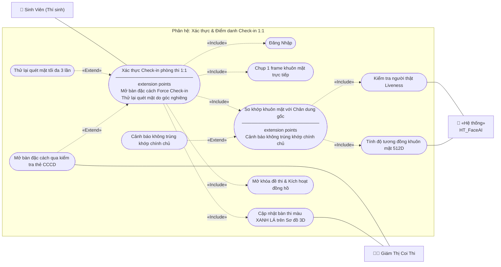

#### B. Phân tích Chi tiết Cấu trúc & Điểm mở rộng:
1. **Tác nhân tham gia:** `Sinh Viên` (ngồi trước webcam quét mặt), `HT_FaceAI` (nhận diện 1 frame trong 1 giây), `Giám Thị Coi Thi` (theo dõi sơ đồ 3D và can thiệp mở bàn).
2. **Use Case cơ sở 2 ngăn:** `Xác thực Check-in phòng thi 1:1` chứa 2 điểm mở rộng (`Mở bàn đặc cách Force Check-in`, `Thử lại quét mặt do góc nghiêng`).
3. **Quan hệ `<<Include>>`:** Bao gồm bắt buộc `Đăng Nhập`, `Chụp 1 frame khuôn mặt trực tiếp`, `So khớp khuôn mặt với Chân dung gốc`, `Cập nhật bàn thi màu XANH LÁ trên Sơ đồ 3D`, và `Mở khóa đề thi & Kích hoạt đồng hồ`.
4. **Quan hệ `<<Extend>>`:**
   - `Mở bàn đặc cách qua kiểm tra thẻ CCCD` mở rộng ngược về Use Case cơ sở khi sinh viên gặp sự cố camera hoặc không quét được.
   - `Thử lại quét mặt tối đa 3 lần` mở rộng khi ảnh chưa đạt góc độ chuẩn.
   - `Cảnh báo không trùng khớp chính chủ` mở rộng vào Use Case con `So khớp khuôn mặt với Chân dung gốc`.

#### C. Bảng đặc tả chi tiết (Chuẩn mẫu báo cáo đồ án tốt nghiệp):

##### Bảng 2.5. Bảng đặc tả use case Xác thực Check-in phòng thi 1:1

| Thuộc tính | Nội dung đặc tả |
| :--- | :--- |
| **Mã use case** | `UC_02` |
| **Tên use case:** | **Xác thực Check-in phòng thi 1:1** |
| **Mô tả sơ lược:** | Cho phép thí sinh xác thực danh tính tại vị trí bàn thi bằng cách chụp 1 frame khuôn mặt đối chiếu với Chân dung gốc KYC 512D trong dưới 1 giây, tự động đổi màu bàn trên Sơ đồ 3D của Giám thị và mở khóa đề thi. |
| **Actor chính:** | **Sinh Viên (Thí sinh)** |
| **Actor phụ:** | «Hệ thống» HT_FaceAI, Giám Thị Coi Thi |
| **Tiền điều kiện:** | Thí sinh đã có hồ sơ khuôn mặt KYC trạng thái APPROVED; ca thi đã đến giờ mở cửa đón thí sinh; thí sinh ngồi đúng số bàn quy định. |
| **Hậu điều kiện:** | Trạng thái thí sinh đổi thành CHECKED_IN; vị trí bàn trên sơ đồ 3D của Giám thị đổi sang màu XANH LÁ; đề thi được mở khóa. |

**Luồng sự kiện chính:**

| Người dùng | Hệ thống |
| :--- | :--- |
| 1. Thí sinh thực hiện use case «Đăng Nhập» và chọn ca thi đang mở. | 2. Hệ thống hiển thị màn hình điểm danh và bật webcam máy trạm. |
| 3. Thí sinh nhìn thẳng vào tâm camera và bấm "Bắt đầu Check-in". | 4. Hệ thống thực hiện use case «Chụp 1 frame khuôn mặt trực tiếp» để lấy ảnh chụp thời gian thực của thí sinh tại bàn thi. |
|  | 5. Hệ thống gọi use case «So khớp khuôn mặt với Chân dung gốc»: Gửi ảnh frame vừa chụp kèm mã thí sinh sang HT_FaceAI. |
|  | 6. HT_FaceAI thực hiện use case «Kiểm tra người thật Liveness» và use case «Tính độ tương đồng khuôn mặt 512D» (Cosine Similarity với vector gốc KYC). |
|  | 7. HT_FaceAI xác nhận độ tương đồng đạt ngưỡng chuẩn (> 0.82) trong thời gian dưới 1 giây. |
|  | 8. Hệ thống thực hiện use case «Cập nhật bàn thi màu XANH LÁ trên Sơ đồ 3D»: Gửi sự kiện Socket.IO đổi màu bàn của thí sinh sang màu XANH LÁ trên màn hình giám sát của Giám Thị. |
|  | 9. Hệ thống thực hiện use case «Mở khóa đề thi & Kích hoạt đồng hồ»: Mở giao diện làm bài thi và bắt đầu đếm ngược thời gian ca thi. |

**Luồng thay thế (Luồng ngoại lệ / Extension Points):**

| Người dùng | Hệ thống |
| :--- | :--- |
| **6.1. Tại Extension Point [Thử lại quét mặt do góc nghiêng]: AI báo độ tương đồng không đạt do góc ngồi bị lệch, ngược sáng hoặc biểu cảm chưa chuẩn (dưới 3 lần).<br>6.2. Thí sinh điều chỉnh lại tư thế ngồi thẳng và bấm "Thử lại".** | 6.3. Hệ thống thực hiện use case «Thử lại quét mặt tối đa 3 lần»: Hiển thị thông báo hướng dẫn thí sinh ngồi thẳng, chỉnh lại góc camera và cho phép thử lại (hiển thị số lần còn lại 1/3, 2/3). Quay lại bước 3 luồng chính. |
| **6.4. Tại Extension Point [Cảnh báo không trùng khớp chính chủ] của use case So khớp: Thí sinh quét mặt thất bại cả 3 lần hoặc AI phát hiện người ngồi trước máy có khuôn mặt hoàn toàn khác với Chân dung gốc KYC (nghi vấn thi hộ).** | 6.5. Hệ thống thực hiện use case «Cảnh báo không trùng khớp chính chủ»: Khóa quyền tự điểm danh của máy trạm, đổi màu bàn thi sang MÀU ĐỎ NHẤP NHÁY và phát chuông cảnh báo tới Dashboard Giám Thị Coi Thi. |
| **6.6. Tại Extension Point [Mở bàn đặc cách Force Check-in]: Thí sinh gặp sự cố camera máy trạm hoặc khuôn mặt có thay đổi tạm thời sau phẫu thuật/chấn thương.<br>6.7. Giám Thị Coi Thi đến trực tiếp bàn thi, đối chiếu thẻ CCCD/Thẻ sinh viên và thực hiện use case «Mở bàn đặc cách qua kiểm tra thẻ CCCD»: Nhấn nút "Force Check-in" trên giao diện giám thị và nhập mã xác nhận.** | 6.8. Hệ thống ghi nhận trạng thái CHECKED_IN (kèm vết kiểm toán tên giám thị can thiệp), đổi bàn 3D sang màu XANH LÁ và mở khóa đề thi (tiếp tục bước 9 luồng chính). |


---

### USE CASE 3: LÀM BÀI THI TRỰC TUYẾN (GIÁM SÁT AN TOÀN & TỰ LƯU BÀI)

#### A. Sơ đồ Use Case Phân rã Chuẩn Mẫu (Hình Elip 2 ngăn & Extension Points):

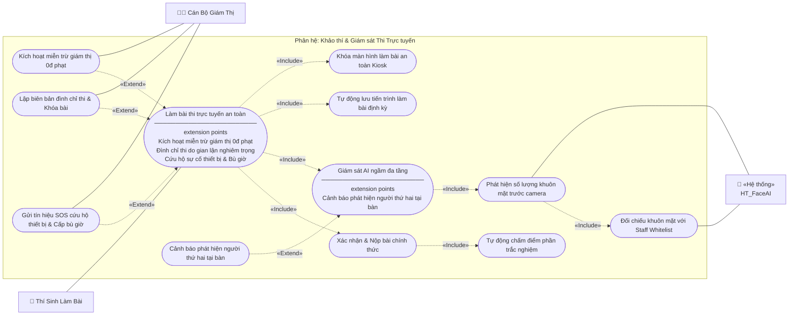

#### B. Phân tích Chi tiết Cấu trúc & Điểm mở rộng:
1. **Tác nhân tham gia:** `Thí Sinh Làm Bài` (người làm bài thi), `HT_FaceAI` (giám sát ngầm chống tráo người), `Cán Bộ Giám Thị` (nhận tín hiệu SOS, đình chỉ thi hoặc duyệt miễn trừ).
2. **Use Case cơ sở 2 ngăn:** `Làm bài thi trực tuyến an toàn` chứa 3 điểm mở rộng (`Kích hoạt miễn trừ giám thị 0đ phạt`, `Đình chỉ thi do gian lận nghiêm trọng`, `Cứu hộ sự cố thiết bị & Bù giờ`).
3. **Quan hệ `<<Include>>`:** Bao gồm bắt buộc `Khóa màn hình làm bài an toàn Kiosk`, `Tự động lưu tiến trình làm bài định kỳ`, `Giám sát AI ngầm đa tầng`, và `Xác nhận & Nộp bài chính thức` (tự động chấm điểm trắc nghiệm).
4. **Quan hệ `<<Extend>>`:**
   - `Kích hoạt miễn trừ giám thị 0đ phạt` mở rộng khi cán bộ coi thi đến gần kiểm tra bàn thi (khớp Staff Whitelist).
   - `Lập biên bản đình chỉ thi & Khóa bài` mở rộng khi thí sinh vi phạm nghiêm trọng (đổi tab nhiều lần / tráo người).
   - `Gửi tín hiệu SOS cứu hộ thiết bị & Cấp bù giờ` mở rộng khi máy tính sập nguồn / hỏng phím.
   - `Cảnh báo phát hiện người thứ hai tại bàn` mở rộng vào Use Case con `Giám sát AI ngầm đa tầng`.

#### C. Bảng đặc tả chi tiết (Chuẩn mẫu báo cáo đồ án tốt nghiệp):

##### Bảng 2.6. Bảng đặc tả use case Làm bài thi trực tuyến an toàn

| Thuộc tính | Nội dung đặc tả |
| :--- | :--- |
| **Mã use case** | `UC_03` |
| **Tên use case:** | **Làm bài thi trực tuyến an toàn** |
| **Mô tả sơ lược:** | Cho phép thí sinh làm bài thi trong môi trường bảo mật Kiosk toàn màn hình, tự động lưu tiến trình ngầm, được HT_FaceAI giám sát ngầm đa tầng chống gian lận, hỗ trợ xử lý sự cố thiết bị và tự động chấm điểm trắc nghiệm khi nộp bài. |
| **Actor chính:** | **Thí Sinh Làm Bài** |
| **Actor phụ:** | «Hệ thống» HT_FaceAI, Cán Bộ Giám Thị |
| **Tiền điều kiện:** | Thí sinh đã check-in thành công; đề thi đã được mở khóa; đồng hồ ca thi bắt đầu đếm ngược. |
| **Hậu điều kiện:** | Toàn bộ bài làm được đóng băng và lưu trữ an toàn trong CSDL; điểm phần trắc nghiệm được chấm ngay lập tức; biên bản vi phạm (nếu có) được ghi nhận minh bạch. |

**Luồng sự kiện chính:**

| Người dùng | Hệ thống |
| :--- | :--- |
| 1. Thí sinh bắt đầu ca thi trên màn hình an toàn. | 2. Hệ thống thực hiện use case «Khóa màn hình làm bài an toàn Kiosk»: Chiếm toàn màn hình, vô hiệu hóa phím tắt hệ thống (Alt+Tab, Windows, F12, PrintScreen) và chặn mở ứng dụng khác. |
| 3. Thí sinh đọc đề thi và click chọn phương án trả lời hoặc nhập câu trả lời tự luận/mã nguồn. | 4. Hệ thống thực hiện use case «Tự động lưu tiến trình làm bài định kỳ»: Cứ mỗi 10 giây (hoặc ngay khi thí sinh click chọn đáp án), tự động mã hóa và gửi trạng thái bài thi lên CSDL máy chủ. |
|  | 5. Hệ thống chạy nền use case «Giám sát AI ngầm đa tầng»: Định kỳ mỗi 15 giây chụp 1 frame ngầm gửi sang HT_FaceAI. |
|  | 6. HT_FaceAI thực hiện use case «Phát hiện số lượng khuôn mặt trước camera» và so khớp với vector thí sinh. Nếu chỉ có đúng 1 thí sinh chính chủ, hệ thống duy trì trạng thái an toàn bình thường. |
| 7. Khi hoàn thành bài làm (hoặc hết thời gian làm bài), thí sinh bấm nút "Nộp bài". | 8. Hệ thống hiển thị hộp thoại xác nhận số lượng câu đã trả lời và câu chưa trả lời. |
| 9. Thí sinh bấm xác nhận nộp bài. | 10. Hệ thống thực hiện use case «Xác nhận & Nộp bài chính thức»: Đóng băng toàn bộ bài làm, vô hiệu hóa quyền chỉnh sửa và giải phóng chế độ Kiosk. |
|  | 11. Hệ thống thực hiện use case «Tự động chấm điểm phần trắc nghiệm»: Đối chiếu đáp án thí sinh với barem điểm chuẩn của đề thi, tính điểm trắc nghiệm tức thì và hiển thị thông báo nộp bài thành công. |

**Luồng thay thế (Luồng ngoại lệ / Extension Points):**

| Người dùng | Hệ thống |
| :--- | :--- |
| **5.1. Tại Extension Point [Cảnh báo phát hiện người thứ hai tại bàn] của use case Giám sát AI: HT_FaceAI phát hiện có từ 2 khuôn mặt trở lên xuất hiện trước camera bàn thi.<br>5.2. HT_FaceAI thực hiện use case «Đối chiếu khuôn mặt với Staff Whitelist»: Kiểm tra xem khuôn mặt thứ hai có khớp với cán bộ coi thi đã đăng ký không.<br>5.3. Nếu KHÔNG thuộc Staff Whitelist: Hệ thống thực hiện use case «Cảnh báo phát hiện người thứ hai tại bàn», trừ điểm uy tín thí sinh, bật còi báo động VÀNG lên màn hình Giám thị kèm ảnh bằng chứng.** | 5.4. Tại Extension Point [Kích hoạt miễn trừ giám thị 0đ phạt]: Nếu khuôn mặt thứ hai KHỚP Staff Whitelist, hệ thống thực hiện use case «Kích hoạt miễn trừ giám thị 0đ phạt»: Ghi nhận 0 điểm phạt, thông báo "Cán bộ coi thi đang kiểm tra bàn" và không trừ uy tín thí sinh. |
| **5.5. Tại Extension Point [Đình chỉ thi do gian lận nghiêm trọng]: Thí sinh cố tình tráo người, tái diễn vi phạm chuyển tab quá số lần cho phép hoặc AI phát hiện gian lận nghiêm trọng.<br>5.6. Cán bộ Giám thị nhấn nút "Đình chỉ thi" trên Dashboard.** | 5.7. Hệ thống thực hiện use case «Lập biên bản đình chỉ thi & Khóa bài»: Ngắt kết nối làm bài, đóng băng bài thi, xuất biên bản kỷ luật có chữ ký số của giám thị và hủy kết quả ca thi. |
| **3.1. Tại Extension Point [Cứu hộ sự cố thiết bị & Bù giờ]: Máy trạm bị sự cố sập nguồn, mất mạng hoặc hỏng bàn phím.<br>3.2. Thí sinh báo giám thị hoặc bấm nút SOS cứu hộ thiết bị.<br>3.3. Cán bộ Giám thị hỗ trợ đổi máy trạm cho thí sinh, thực hiện use case «Gửi tín hiệu SOS cứu hộ thiết bị & Cấp bù giờ»: Nhập số phút bù giờ gián đoạn (tối đa 15 phút) trên màn hình giám sát.** | 3.4. Hệ thống tải lại trạng thái bài làm đã tự động lưu gần nhất lên máy mới, cộng bù thời gian vào đồng hồ và cho phép thí sinh tiếp tục làm bài từ bước 3 luồng chính. |


---

### USE CASE 4: LÀM BÀI KIỂM TRA TƯƠNG TÁC (QUIZ ARENA)

#### A. Sơ đồ Use Case Phân rã Chuẩn Mẫu (Hình Elip 2 ngăn & Extension Points):

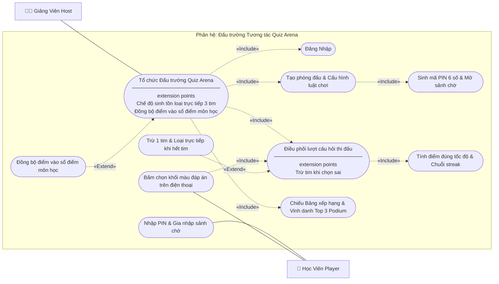

#### B. Phân tích Chi tiết Cấu trúc & Điểm mở rộng:
1. **Tác nhân tham gia:** `Giảng Viên Host` (chủ trì phòng thi, điều phối câu hỏi), `Học Viên Player` (bấm đáp án trên điện thoại).
2. **Use Case cơ sở 2 ngăn:** `Tổ chức Đấu trường Quiz Arena` chứa 2 điểm mở rộng (`Chế độ sinh tồn loại trực tiếp 3 tim`, `Đồng bộ điểm vào sổ điểm môn học`).
3. **Quan hệ `<<Include>>`:** Bao gồm bắt buộc `Đăng Nhập`, `Tạo phòng đấu & Cấu hình luật chơi` (sinh mã PIN), `Điều phối lượt câu hỏi thi đấu`, và `Chiếu Bảng xếp hạng & Vinh danh Top 3 Podium`.
4. **Quan hệ `<<Extend>>`:**
   - `Đồng bộ điểm vào sổ điểm môn học` mở rộng ngược về Use Case cơ sở khi giảng viên muốn chuyển điểm Quiz thành điểm kiểm tra.
   - `Trừ 1 tim & Loại trực tiếp khi hết tim` mở rộng vào Use Case con `Điều phối lượt câu hỏi thi đấu` khi học viên trả lời sai trong chế độ 3 tim.

#### C. Bảng đặc tả chi tiết (Chuẩn mẫu báo cáo đồ án tốt nghiệp):

##### Bảng 2.7. Bảng đặc tả use case Tổ chức Đấu trường Quiz Arena

| Thuộc tính | Nội dung đặc tả |
| :--- | :--- |
| **Mã use case** | `UC_04` |
| **Tên use case:** | **Tổ chức Đấu trường Quiz Arena** |
| **Mô tả sơ lược:** | Cho phép Giảng viên (Host) tổ chức giải đấu trắc nghiệm tương tác thời gian thực; sinh viên (Player) gia nhập bằng mã PIN qua điện thoại/máy tính, bấm chọn 4 khối màu đáp án đua tốc độ, hệ thống tính điểm streak và vinh danh Top 3 trên bục Podium. |
| **Actor chính:** | **Giảng Viên Host** |
| **Actor phụ:** | Học Viên Player |
| **Tiền điều kiện:** | Giảng viên đã đăng nhập và có bộ câu hỏi trắc nghiệm hợp lệ; phòng học có máy chiếu và đường truyền Internet ổn định. |
| **Hậu điều kiện:** | Trận đấu hoàn thành; bảng xếp hạng chi tiết được lưu; Top 3 được vinh danh và điểm số có thể đồng bộ vào sổ điểm môn học. |

**Luồng sự kiện chính:**

| Người dùng | Hệ thống |
| :--- | :--- |
| 1. Giảng viên Host thực hiện use case «Đăng Nhập» và chọn chức năng Quiz Arena. | 2. Hệ thống thực hiện use case «Tạo phòng đấu & Cấu hình luật chơi»: Cho phép giảng viên chọn đề trắc nghiệm, cài đặt thời gian mỗi câu (10s–30s) và kích hoạt phòng thi đấu. |
|  | 3. Hệ thống thực hiện use case «Sinh mã PIN 6 số & Mở sảnh chờ»: Khởi tạo phòng Socket.IO thời gian thực, cấp mã PIN 6 số ngẫu nhiên (VD: 824915) và chiếu màn hình chờ sảnh đấu lên máy chiếu. |
| 4. Học viên Player dùng điện thoại/laptop truy cập link Quiz, nhập mã PIN và tên người chơi để gia nhập sảnh đấu. | 5. Hệ thống ghi nhận người chơi và cập nhật danh sách người tham gia lên màn hình chiếu lớp học theo thời gian thực. |
| 6. Khi người chơi đã vào đủ, Giảng viên Host bấm nút "Bắt đầu trận đấu". | 7. Hệ thống thực hiện use case «Điều phối lượt câu hỏi thi đấu»: Chiếu nội dung câu hỏi lên màn hình máy chiếu lớp học; đồng thời truyền lệnh đồng bộ về màn hình điện thoại học viên. |
| 8. Học viên Player thực hiện use case «Bấm chọn khối màu đáp án trên điện thoại»: Nhìn câu hỏi trên màn chiếu và bấm nhanh 1 trong 4 khối màu sắc (Đỏ, Lam, Vàng, Lục) tương ứng với A, B, C, D trên điện thoại. | 9. Hệ thống thực hiện use case «Tính điểm đúng tốc độ & Chuỗi streak»: Đánh giá câu trả lời, cộng điểm cơ bản cộng điểm thưởng tốc độ và nhân hệ số chuỗi trả lời đúng liên tiếp (Streak). |
|  | 10. Hết thời gian từng câu hỏi, hệ thống chiếu biểu đồ phân bố đáp án của cả lớp và bảng xếp hạng Top 10 tức thời (lặp lại bước 7–10 đến hết bộ câu hỏi). |
|  | 11. Kết thúc câu hỏi cuối cùng, hệ thống thực hiện use case «Chiếu Bảng xếp hạng & Vinh danh Top 3 Podium»: Phát hiệu ứng âm thanh chiến thắng, pháo hoa đồ họa và vinh danh 3 thí sinh xuất sắc nhất lên bục Podium 3 cấp bậc. |

**Luồng thay thế (Luồng ngoại lệ / Extension Points):**

| Người dùng | Hệ thống |
| :--- | :--- |
| **8.1. Tại Extension Point [Trừ tim khi chọn sai / Chế độ sinh tồn loại trực tiếp 3 tim]: Giảng viên bật luật chơi sinh tồn và học viên trả lời sai hoặc quá thời gian.** | 8.2. Hệ thống thực hiện use case «Trừ 1 tim & Loại trực tiếp khi hết tim»: Trừ 1 tim sinh mạng của học viên, reset điểm Streak về 0. Nếu học viên mất hết 3 tim, hệ thống khóa quyền bấm đáp án các câu tiếp theo (Knock-out) và chuyển học viên sang chế độ khán giả quan sát. |
| **11.1. Tại Extension Point [Đồng bộ điểm vào sổ điểm môn học]: Trận đấu kết thúc và giảng viên muốn lấy điểm Quiz làm điểm chuyên cần / kiểm tra miệng.<br>11.2. Giảng viên bấm nút "Đồng bộ vào sổ điểm".** | 11.3. Hệ thống thực hiện use case «Đồng bộ điểm vào sổ điểm môn học»: Quy đổi điểm số Quiz sang thang điểm 10 theo phổ điểm của lớp và tự động ghi vào CSDL sổ điểm chính thức của học phần. |


---

### USE CASE 5: XEM LỊCH THI & SỐ BÁO DANH (SBD)

#### A. Sơ đồ Use Case Phân rã Chuẩn Mẫu (Hình Elip 2 ngăn & Extension Points):

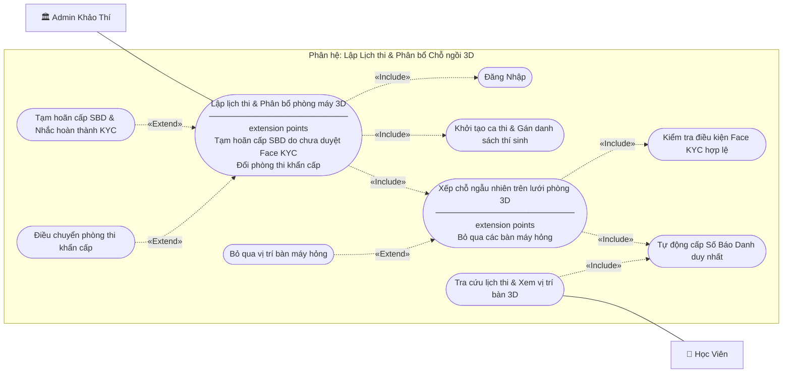

#### B. Phân tích Chi tiết Cấu trúc & Điểm mở rộng:
1. **Tác nhân tham gia:** `Admin Khảo Thí` (khởi tạo ca thi, vận hành thuật toán xếp chỗ 3D), `Học Viên` (tra cứu lịch thi cá nhân).
2. **Use Case cơ sở 2 ngăn:** `Lập lịch thi & Phân bổ phòng máy 3D` chứa 2 điểm mở rộng (`Tạm hoãn cấp SBD do chưa duyệt Face KYC`, `Đổi phòng thi khẩn cấp`).
3. **Quan hệ `<<Include>>`:** Bao gồm bắt buộc `Đăng Nhập`, `Khởi tạo ca thi & Gán danh sách thí sinh`, `Xếp chỗ ngẫu nhiên trên lưới phòng 3D` (kiểm tra KYC & tự sinh SBD).
4. **Quan hệ `<<Extend>>`:**
   - `Tạm hoãn cấp SBD & Nhắc hoàn thành KYC` mở rộng ngược về Use Case cơ sở khi sinh viên chưa hoàn tất Face KYC.
   - `Bỏ qua vị trí bàn máy hỏng` mở rộng vào Use Case con `Xếp chỗ ngẫu nhiên trên lưới phòng 3D`.
   - `Điều chuyển phòng thi khẩn cấp` mở rộng khi phòng máy xảy ra sự cố điện lưới.

#### C. Bảng đặc tả chi tiết (Chuẩn mẫu báo cáo đồ án tốt nghiệp):

##### Bảng 2.8. Bảng đặc tả use case Lập lịch thi & Phân bổ phòng máy 3D

| Thuộc tính | Nội dung đặc tả |
| :--- | :--- |
| **Mã use case** | `UC_05` |
| **Tên use case:** | **Lập lịch thi & Phân bổ phòng máy 3D** |
| **Mô tả sơ lược:** | Cho phép Admin Khảo thí khởi tạo ca thi chính thức, kiểm tra điều kiện Face KYC, chạy thuật toán phân bổ bàn thi ngẫu nhiên trên sơ đồ phòng máy 3D (bỏ qua máy hỏng), tự động sinh SBD duy nhất và công bố cho sinh viên tra cứu chỗ ngồi trực quan. |
| **Actor chính:** | **Admin Khảo Thí** |
| **Actor phụ:** | Học Viên |
| **Tiền điều kiện:** | Admin Khảo thí đã đăng nhập; danh sách sinh viên dự thi và cấu hình phòng máy 3D đã được khởi tạo trong hệ thống. |
| **Hậu điều kiện:** | Ca thi được công bố lịch chính thức; 100% sinh viên đủ điều kiện được cấp SBD và gắn tọa độ bàn ngồi trên mô hình 3D. |

**Luồng sự kiện chính:**

| Người dùng | Hệ thống |
| :--- | :--- |
| 1. Admin Khảo thí thực hiện use case «Đăng Nhập» với phân quyền quản trị khảo thí. | 2. Hệ thống xác thực và điều hướng tới giao diện quản lý lịch thi. |
| 3. Admin chọn chức năng Quản lý lịch thi và thực hiện use case «Khởi tạo ca thi & Gán danh sách thí sinh»: Khai báo tên môn thi, ngày thi, ca thi, thời lượng, chọn phòng máy 3D và import danh sách sinh viên đăng ký học phần. | 4. Hệ thống khởi tạo hồ sơ ca thi và liên kết danh sách sinh viên vào ca thi. |
| 5. Admin bấm nút "Phân bổ chỗ ngồi tự động", hệ thống thực hiện use case «Xếp chỗ ngẫu nhiên trên lưới phòng 3D». | 6. Hệ thống thực hiện use case «Kiểm tra điều kiện Face KYC hợp lệ»: Quét toàn bộ danh sách thí sinh, lọc ra các sinh viên đã có ảnh KYC trạng thái APPROVED. |
|  | 7. Hệ thống thực hiện use case «Tự động cấp Số Báo Danh duy nhất»: Đánh mã SBD chuẩn hóa (VD: SBD-001, SBD-002) kèm tọa độ vị trí bàn (Hàng, Cột) trên sơ đồ lưới bàn thi 3D. |
| 8. Admin kiểm tra tổng thể sơ đồ phân bổ và bấm "Xuất bản lịch thi". | 9. Hệ thống chuyển trạng thái ca thi sang PUBLISHED và gửi thông báo lịch thi tới toàn thể sinh viên. |
| 10. Học viên thực hiện use case «Tra cứu lịch thi & Xem vị trí bàn 3D»: Đăng nhập vào mục Lịch thi, tra cứu SBD, giờ phát đề. | 11. Hệ thống hiển thị mô hình phòng thi 3D trực quan, đánh dấu nổi bật vị trí bàn ngồi (Hàng R - Cột C) của học viên kèm đồng hồ đếm ngược. |

**Luồng thay thế (Luồng ngoại lệ / Extension Points):**

| Người dùng | Hệ thống |
| :--- | :--- |
| **6.1. Tại Extension Point [Tạm hoãn cấp SBD do chưa duyệt Face KYC]: Quá trình kiểm tra phát hiện sinh viên chưa đăng ký hoặc chưa được duyệt ảnh Face KYC.<br>6.2. Sinh viên đăng nhập thấy vị trí bàn bị khóa kèm link nhắc nhở, sinh viên thực hiện chụp ảnh KYC 5 góc bổ sung.** | 6.3. Hệ thống thực hiện use case «Tạm hoãn cấp SBD & Nhắc hoàn thành KYC»: Tạm thời giữ lại không xếp bàn và không cấp SBD cho sinh viên này, chuyển sang danh sách cảnh báo "Chưa hoàn thành KYC", đồng thời gửi thông báo hối thúc sinh viên chụp ảnh 5 góc trước giờ đóng ca thi. Sau khi sinh viên hoàn thành và được duyệt KYC, hệ thống tự động xếp bổ sung chỗ ngồi. |
| **5.1. Tại Extension Point [Bỏ qua các bàn máy hỏng] của use case Xếp chỗ: Phòng thi có các vị trí máy tính bị đánh dấu hỏng hóc hoặc mất kết nối.** | 5.2. Hệ thống thực hiện use case «Bỏ qua vị trí bàn máy hỏng»: Thuật toán tự động cô lập các tọa độ bàn hỏng (hiển thị màu xám khóa) và chỉ phân bổ thí sinh vào các vị trí máy hoạt động tốt, đảm bảo không có thí sinh nào bị phân vào bàn hỏng. |
| **3.1. Tại Extension Point [Đổi phòng thi khẩn cấp]: Phòng thi đã lên lịch gặp sự cố điện nước hoặc mất mạng đột xuất trước giờ thi.<br>3.2. Admin thực hiện use case «Điều chuyển phòng thi khẩn cấp»: Chọn phòng thi dự phòng 3D mới và bấm "Điều chuyển ca thi".** | 3.3. Hệ thống tự động tính toán lại tọa độ bàn ngồi, cập nhật SBD tương ứng và phát thông báo khẩn cấp tới ứng dụng của thí sinh và giám thị. |


---

### USE CASE 6: SOẠN THẢO & QUẢN LÝ ĐỀ THI (ASSESSMENT STUDIO)

#### A. Sơ đồ Use Case Phân rã Chuẩn Mẫu (Hình Elip 2 ngăn & Extension Points):

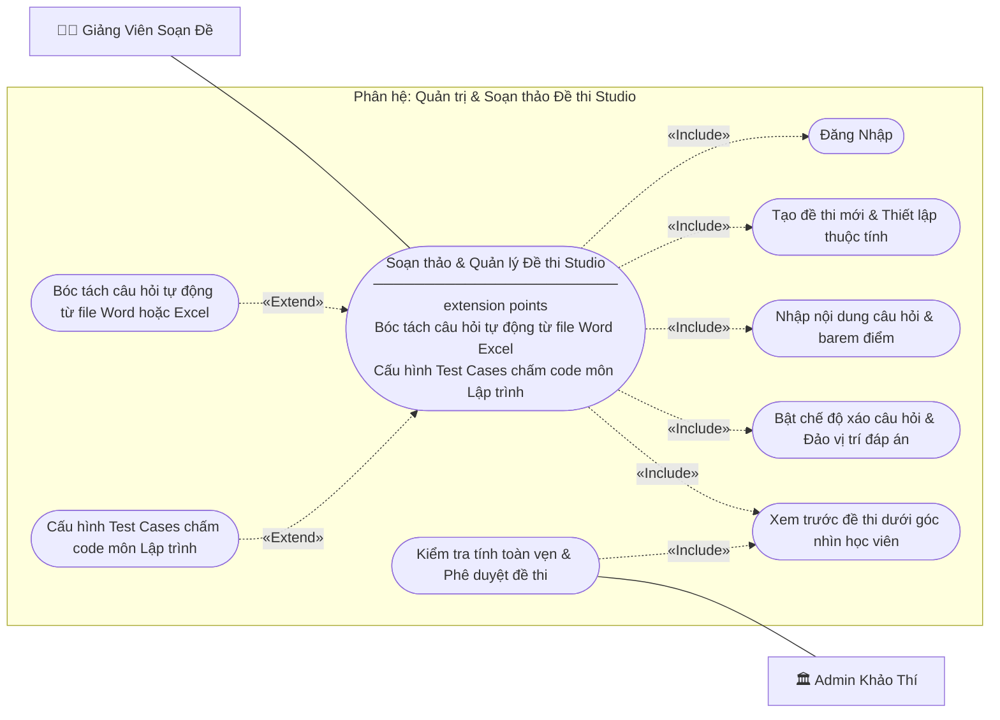

#### B. Phân tích Chi tiết Cấu trúc & Điểm mở rộng:
1. **Tác nhân tham gia:** `Giảng Viên Soạn Đề` (tạo đề thi, cấu hình đảo câu), `Admin Khảo Thí` (phê duyệt đề thi đưa vào ca thi chính thức).
2. **Use Case cơ sở 2 ngăn:** `Soạn thảo & Quản lý Đề thi Studio` chứa 2 điểm mở rộng (`Bóc tách câu hỏi tự động từ file Word Excel`, `Cấu hình Test Cases chấm code môn Lập trình`).
3. **Quan hệ `<<Include>>`:** Bao gồm bắt buộc `Đăng Nhập`, `Tạo đề thi mới & Thiết lập thuộc tính`, `Nhập nội dung câu hỏi & barem điểm`, `Bật chế độ xáo câu hỏi & Đảo vị trí đáp án`, và `Xem trước đề thi dưới góc nhìn học viên`.
4. **Quan hệ `<<Extend>>`:**
   - `Bóc tách câu hỏi tự động từ file Word hoặc Excel` mở rộng ngược về Use Case cơ sở khi giảng viên import đề thi có sẵn.
   - `Cấu hình Test Cases chấm code môn Lập trình` mở rộng khi soạn đề cho môn Tin học/Lập trình.

#### C. Bảng đặc tả chi tiết (Chuẩn mẫu báo cáo đồ án tốt nghiệp):

##### Bảng 2.9. Bảng đặc tả use case Soạn thảo & Quản lý Đề thi Studio

| Thuộc tính | Nội dung đặc tả |
| :--- | :--- |
| **Mã use case** | `UC_06` |
| **Tên use case:** | **Soạn thảo & Quản lý Đề thi Studio** |
| **Mô tả sơ lược:** | Cho phép Giảng viên soạn thảo ngân hàng đề thi đa dạng (nhập tay, bóc tách Word/Excel tự động trong 2 giây, cấu hình test cases chấm code tự động), thiết lập ma trận xáo trộn câu/đáp án, xem trước trực quan và trình Admin Khảo thí thẩm định phê duyệt. |
| **Actor chính:** | **Giảng Viên Soạn Đề** |
| **Actor phụ:** | Admin Khảo Thí |
| **Tiền điều kiện:** | Giảng viên đã đăng nhập và được cấp quyền biên soạn đề thi cho học phần phụ trách. |
| **Hậu điều kiện:** | Đề thi hoàn chỉnh được mã hóa lưu trữ ở trạng thái APPROVED sau khi Admin phê duyệt, sẵn sàng gán vào ca thi chính thức. |

**Luồng sự kiện chính:**

| Người dùng | Hệ thống |
| :--- | :--- |
| 1. Giảng viên thực hiện use case «Đăng Nhập» và truy cập Assessment Studio. | 2. Hệ thống hiển thị bảng điều khiển quản lý đề thi học phần. |
| 3. Giảng viên thực hiện use case «Tạo đề thi mới & Thiết lập thuộc tính»: Đặt tên đề, chọn học phần, cấu hình thời gian làm bài, thang điểm tổng và tỷ lệ trắc nghiệm/tự luận/code. | 4. Hệ thống khởi tạo bộ khung đề thi và mở giao diện biên tập câu hỏi. |
| 5. Giảng viên thực hiện use case «Nhập nội dung câu hỏi & barem điểm»: Nhập câu hỏi, các phương án lựa chọn A-B-C-D, đánh dấu đáp án đúng và nhập barem điểm chi tiết cho từng câu. | 6. Hệ thống tự động kiểm tra tính hợp lệ của câu hỏi (đáp án, tổng điểm) sau mỗi thao tác lưu. |
| 7. Giảng viên kích hoạt use case «Bật chế độ xáo câu hỏi & Đảo vị trí đáp án»: Kích hoạt thuật toán xáo trộn ngẫu nhiên vị trí câu hỏi và hoán vị các phương án đáp án. | 8. Hệ thống ghi nhận cấu hình ma trận xáo trộn để sinh các mã đề thi khác nhau khi phát cho thí sinh. |
| 9. Giảng viên thực hiện use case «Xem trước đề thi dưới góc nhìn học viên»: Kiểm tra giao diện hiển thị câu hỏi, hình ảnh đính kèm và đồng hồ đếm ngược như khi thí sinh làm bài thật. | 10. Hệ thống dựng giao diện làm bài mẫu chuẩn Kiosk để giảng viên rà soát độ chính xác của đề. |
| 11. Giảng viên bấm "Lưu và Trình duyệt". | 12. Hệ thống lưu cấu trúc đề thi vào CSDL ở trạng thái PENDING_APPROVAL và gửi thông báo tới Admin Khảo thí. |
| 13. Admin Khảo thí mở đề thi, kiểm tra use case «Xem trước đề thi dưới góc nhìn học viên» và thực hiện use case «Kiểm tra tính toàn vẹn & Phê duyệt đề thi»: Xác nhận đề đủ chuẩn và bấm "Phê duyệt đề thi". | 14. Hệ thống chuyển trạng thái đề thi thành APPROVED và mở khóa quyền phân bổ vào các ca thi chính thức. |

**Luồng thay thế (Luồng ngoại lệ / Extension Points):**

| Người dùng | Hệ thống |
| :--- | :--- |
| **5.1. Tại Extension Point [Bóc tách câu hỏi tự động từ file Word Excel]: Giảng viên có sẵn file đề thi định dạng .docx hoặc .xlsx chuẩn và không muốn gõ tay từng câu.<br>5.2. Giảng viên tải file lên hệ thống.** | 5.3. Hệ thống kích hoạt use case «Bóc tách câu hỏi tự động từ file Word hoặc Excel»: Trình phân tích đề (Document Parser) tự động nhận diện câu hỏi, các phương án đáp án, đáp án đúng và lời giải chỉ trong 2 giây, sau đó đẩy lên giao diện Studio để giảng viên duyệt lại. Quay lại bước 7 luồng chính. |
| **5.4. Tại Extension Point [Cấu hình Test Cases chấm code môn Lập trình]: Đề thi thuộc các môn Tin học / Lập trình cần chấm bài tự động bằng mã nguồn.<br>5.5. Giảng viên thêm loại câu hỏi lập trình và thực hiện use case «Cấu hình Test Cases chấm code môn Lập trình»: Khai báo các bộ Test Case (Input/Output chuẩn, các test ẩn), giới hạn thời gian CPU (Time Limit) và bộ nhớ RAM (Memory Limit).** | 5.6. Hệ thống lưu trữ các bộ Test Case vào CSDL chấm mã nguồn an toàn Sandbox và tích hợp vào đề thi. Tiếp tục bước 7 luồng chính. |


---

### USE CASE 7: QUẢN LÝ CƠ CẤU & PHÒNG THI 3D

#### A. Sơ đồ Use Case Phân rã Chuẩn Mẫu (Hình Elip 2 ngăn & Extension Points):

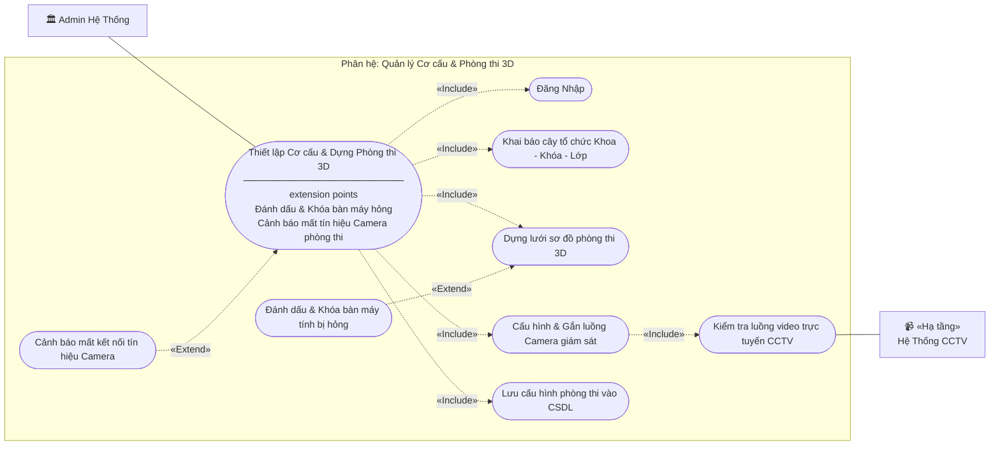

#### B. Phân tích Chi tiết Cấu trúc & Điểm mở rộng:
1. **Tác nhân tham gia:** `Admin Hệ Thống` (thiết lập cơ cấu, vẽ lưới phòng 3D), `Hệ Thống CCTV` (cung cấp luồng video trực tuyến).
2. **Use Case cơ sở 2 ngăn:** `Thiết lập Cơ cấu & Dựng Phòng thi 3D` chứa 2 điểm mở rộng (`Đánh dấu & Khóa bàn máy hỏng`, `Cảnh báo mất tín hiệu Camera phòng thi`).
3. **Quan hệ `<<Include>>`:** Bao gồm bắt buộc `Đăng Nhập`, `Khai báo cây tổ chức Khoa - Khóa - Lớp`, `Dựng lưới sơ đồ phòng thi 3D`, `Cấu hình & Gắn luồng Camera giám sát`, và `Lưu cấu hình phòng thi vào CSDL`.
4. **Quan hệ `<<Extend>>`:**
   - `Đánh dấu & Khóa bàn máy tính bị hỏng` mở rộng vào Use Case con `Dựng lưới sơ đồ phòng thi 3D` khi khảo sát thấy máy hỏng.
   - `Cảnh báo mất kết nối tín hiệu Camera` mở rộng ngược về Use Case cơ sở khi đứt luồng RTSP.

#### C. Bảng đặc tả chi tiết (Chuẩn mẫu báo cáo đồ án tốt nghiệp):

##### Bảng 2.10. Bảng đặc tả use case Thiết lập Cơ cấu & Dựng Phòng thi 3D

| Thuộc tính | Nội dung đặc tả |
| :--- | :--- |
| **Mã use case** | `UC_07` |
| **Tên use case:** | **Thiết lập Cơ cấu & Dựng Phòng thi 3D** |
| **Mô tả sơ lược:** | Cho phép Admin Hệ thống số hóa cây cơ cấu đào tạo (Khoa - Khóa - Lớp), thiết kế mô hình lưới phòng thi 3D tương tác, đánh dấu cô lập bàn hỏng và kết nối, kiểm tra luồng video Camera CCTV giám sát. |
| **Actor chính:** | **Admin Hệ Thống** |
| **Actor phụ:** | «Hạ tầng» Hệ Thống CCTV |
| **Tiền điều kiện:** | Admin Hệ thống đã đăng nhập với quyền quản trị hạ tầng thi. |
| **Hậu điều kiện:** | Cây cơ cấu đào tạo và mô hình lưới phòng thi 3D tích hợp camera được lưu trữ an toàn, sẵn sàng phục vụ xếp chỗ và giám sát thi. |

**Luồng sự kiện chính:**

| Người dùng | Hệ thống |
| :--- | :--- |
| 1. Admin Hệ thống thực hiện use case «Đăng Nhập» vào phân hệ quản trị hạ tầng. | 2. Hệ thống xác thực và mở bảng điều khiển quản lý cơ sở vật chất phòng thi. |
| 3. Admin thực hiện use case «Khai báo cây tổ chức Khoa - Khóa - Lớp»: Thiết lập danh mục Khoa chuyên ngành, các Khóa đào tạo và sơ đồ các Lớp sinh viên trong trường. | 4. Hệ thống lưu cấu trúc cây cơ cấu tổ chức đào tạo vào CSDL quan hệ. |
| 5. Admin chọn mục Quản lý phòng thi và thực hiện use case «Dựng lưới sơ đồ phòng thi 3D»: Nhập tên phòng (VD: Lab P302), số hàng bàn (5 hàng) và số cột bàn (8 cột). | 6. Hệ thống dựng trực quan mô hình lưới 3D với 40 vị trí máy, cửa ra vào, bục giảng và lối đi trung tâm. |
| 7. Admin thực hiện use case «Cấu hình & Gắn luồng Camera giám sát»: Nhập địa chỉ RTSP/HLS của camera góc rộng và camera cận cảnh gắn trong phòng thi. | 8. Hệ thống gọi use case «Kiểm tra luồng video trực tuyến CCTV»: Gửi yêu cầu kết nối tới Hạ tầng Camera CCTV để giải mã luồng video và hiển thị khung xem trước (Live Stream Preview). |
| 9. Admin xác nhận hình ảnh camera rõ nét, bao quát toàn bộ các bàn thi và không có điểm mù, sau đó bấm "Lưu phòng thi". | 10. Hệ thống thực hiện use case «Lưu cấu hình phòng thi vào CSDL»: Lưu trữ tọa độ lưới bàn và thông số luồng camera, hiển thị thông báo thiết lập phòng thi thành công. |

**Luồng thay thế (Luồng ngoại lệ / Extension Points):**

| Người dùng | Hệ thống |
| :--- | :--- |
| **5.1. Tại Extension Point [Đánh dấu & Khóa bàn máy hỏng] của use case Dựng 3D: Admin khảo sát thấy tại phòng có một số máy trạm bị hỏng phần cứng hoặc nguồn điện.<br>5.2. Admin click chuột trực tiếp vào các ô bàn hỏng trên sơ đồ 3D.** | 5.3. Hệ thống thực hiện use case «Đánh dấu & Khóa bàn máy tính bị hỏng»: Đổi màu các bàn này sang MÀU XÁM KHOÁ, gắn cờ DISABLED để thuật toán xếp chỗ tự động tuyệt đối không phân sinh viên vào các bàn này. Quay lại bước 7 luồng chính. |
| **8.1. Tại Extension Point [Cảnh báo mất tín hiệu Camera phòng thi]: Luồng kết nối tới Camera CCTV bị ngắt quãng, sai thông tin IP/RTSP hoặc mất nguồn camera.** | 8.2. Hệ thống thực hiện use case «Cảnh báo mất kết nối tín hiệu Camera»: Bật thông báo lỗi kết nối camera, hiển thị icon mất tín hiệu và hướng dẫn kỹ thuật viên kiểm tra nguồn điện mạng của camera trước khi cho phép lưu cấu hình phòng thi. |


---

### USE CASE 8: CHẤM ĐIỂM, RÀ SOÁT BẢNG ĐIỂM & CÔNG BỐ ĐIỂM / PHÚC KHẢO

#### A. Sơ đồ Use Case Phân rã Chuẩn Mẫu (Hình Elip 2 ngăn & Extension Points):

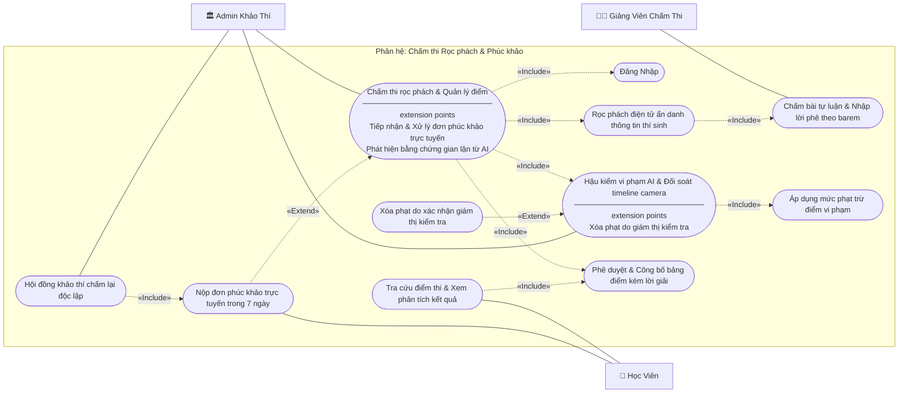

#### B. Phân tích Chi tiết Cấu trúc & Điểm mở rộng:
1. **Tác nhân tham gia:** `Giảng Viên Chấm Thi` (chấm bài tự luận rọc phách), `Admin Khảo Thí` (hậu kiểm vi phạm AI, duyệt công bố điểm), `Học Viên` (xem điểm, nộp phúc khảo).
2. **Use Case cơ sở 2 ngăn:** `Chấm thi rọc phách & Quản lý điểm` chứa 2 điểm mở rộng (`Tiếp nhận & Xử lý đơn phúc khảo trực tuyến`, `Phát hiện bằng chứng gian lận từ AI`).
3. **Quan hệ `<<Include>>`:** Bao gồm bắt buộc `Đăng Nhập`, `Rọc phách điện tử ẩn danh thông tin thí sinh` (gắn liền chấm bài tự luận), `Hậu kiểm vi phạm AI & Đối soát timeline camera`, và `Phê duyệt & Công bố bảng điểm kèm lời giải`.
4. **Quan hệ `<<Extend>>`:**
   - `Nộp đơn phúc khảo trực tuyến trong 7 ngày` mở rộng ngược về Use Case cơ sở khi học viên khiếu nại điểm thi.
   - `Xóa phạt do xác nhận giám thị kiểm tra` mở rộng vào Use Case con `Hậu kiểm vi phạm AI`.
   - `Hội đồng khảo thí chấm lại độc lập` bao gồm bắt buộc vào quy trình xử lý đơn phúc khảo.

#### C. Bảng đặc tả chi tiết (Chuẩn mẫu báo cáo đồ án tốt nghiệp):

##### Bảng 2.11. Bảng đặc tả use case Chấm thi rọc phách & Quản lý điểm

| Thuộc tính | Nội dung đặc tả |
| :--- | :--- |
| **Mã use case** | `UC_08` |
| **Tên use case:** | **Chấm thi rọc phách & Quản lý điểm** |
| **Mô tả sơ lược:** | Cho phép rọc phách ẩn danh điện tử bài thi tự luận/code để giảng viên chấm công tâm, Admin đối soát bằng chứng vi phạm từ HT_FaceAI, áp dụng quy chế trừ điểm, công bố điểm kèm lời giải chi tiết và tiếp nhận, giải quyết đơn phúc khảo trực tuyến trong 7 ngày. |
| **Actor chính:** | **Admin Khảo Thí** |
| **Actor phụ:** | Giảng Viên Chấm Thi, Học Viên, Hội Đồng Phúc Khảo |
| **Tiền điều kiện:** | Ca thi đã kết thúc; toàn bộ bài thi trắc nghiệm đã được chấm tự động; các bài thi tự luận/code đã nộp về máy chủ. |
| **Hậu điều kiện:** | Bảng điểm chính thức được phê duyệt và công bố; học viên xem được kết quả thi kèm giải thích và có thể nộp đơn phúc khảo trực tuyến. |

**Luồng sự kiện chính:**

| Người dùng | Hệ thống |
| :--- | :--- |
| 1. Admin Khảo thí thực hiện use case «Đăng Nhập» và đóng cổng nộp bài ca thi. | 2. Hệ thống thực hiện use case «Rọc phách điện tử ẩn danh thông tin thí sinh»: Tự động mã hóa ẩn danh toàn bộ Họ tên, MSSV, Lớp thành các Mã phách ngẫu nhiên (VD: #PHACH_8192) cho các bài thi tự luận và code. |
| 3. Giảng Viên Chấm Thi truy cập giao diện rọc phách và thực hiện use case «Chấm bài tự luận & Nhập lời phê theo barem»: Xem bài làm ẩn danh, chấm điểm từng tiêu chí theo barem điểm và nhập lời nhận xét chi tiết. | 4. Sau khi chấm xong, hệ thống tự động ghép phách và tính điểm tổng kết tạm thời của ca thi. |
| 5. Admin Khảo thí thực hiện use case «Hậu kiểm vi phạm AI & Đối soát timeline camera»: Mở Integrity Report để rà soát danh sách các vi phạm gian lận mà AI và camera CCTV ghi nhận trong ca thi (quay cóp, người thứ hai, đổi tab). | 6. Hệ thống hiển thị dòng thời gian vi phạm kèm ảnh chụp bằng chứng từ webcam và CCTV. |
| 7. Admin đối soát bằng chứng hình ảnh và xác nhận thực hiện use case «Áp dụng mức phạt trừ điểm vi phạm»: Trừ điểm theo khung quy chế (khiển trách trừ 25%, cảnh cáo trừ 50%, đình chỉ cho 0 điểm). | 8. Hệ thống cập nhật điểm trừ kỷ luật và tính toán lại điểm số cuối cùng sau điều chỉnh. |
| 9. Admin thực hiện use case «Phê duyệt & Công bố bảng điểm kèm lời giải»: Bấm phê duyệt điểm chính thức. | 10. Hệ thống chuyển trạng thái điểm sang PUBLISHED, gửi thông báo kết quả thi qua hệ thống và email tới sinh viên. |
| 11. Học viên thực hiện use case «Tra cứu điểm thi & Xem phân tích kết quả»: Đăng nhập vào mục Kết quả thi. | 12. Hệ thống hiển thị điểm số chính thức, điểm uy tín, bảng phân tích điểm mạnh/yếu và toàn bộ đáp án đúng kèm lời giải chi tiết của đề thi. |

**Luồng thay thế (Luồng ngoại lệ / Extension Points):**

| Người dùng | Hệ thống |
| :--- | :--- |
| **5.1. Tại Extension Point [Xóa phạt do giám thị kiểm tra] của use case Hậu kiểm: Bằng chứng AI ghi nhận có người thứ hai tiếp cận bàn thi, nhưng kiểm tra timeline xác nhận đó là Cán bộ coi thi đang kiểm tra thẻ dự thi (có cờ STAFF_EXEMPTION).** | 5.2. Admin thực hiện use case «Xóa phạt do xác nhận giám thị kiểm tra»: Hủy bỏ cảnh báo của AI, khôi phục 100% điểm số ban đầu của thí sinh và ghi nhận lý do vào nhật ký kiểm toán. |
| **11.1. Tại Extension Point [Tiếp nhận & Xử lý đơn phúc khảo trực tuyến]: Sau khi công bố điểm, học viên đối chiếu lời giải và nhận thấy điểm tự luận chưa thỏa đáng.<br>11.2. Trong thời hạn 7 ngày, học viên thực hiện use case «Nộp đơn phúc khảo trực tuyến trong 7 ngày»: Chọn câu cần phúc khảo, nhập lý do giải trình và gửi đơn lên hệ thống.<br>11.3. Hội đồng khảo thí thực hiện use case «Hội đồng khảo thí chấm lại độc lập»: Mở lại bài làm rọc phách, triệu tập 2 cán bộ chấm độc lập và đối soát lại video camera bàn thi.** | 11.4. Hệ thống khóa điểm bài thi ở trạng thái CHỜ PHÚC KHẢO và chuyển hồ sơ tới Hội đồng khảo thí.<br>11.5. Sau khi Hội đồng khảo thí thống nhất điểm mới, hệ thống cập nhật bảng điểm chính thức và gửi phản hồi cho học viên. |


---

## 2.3 BIỂU ĐỒ TUẦN TỰ (ĐỦ 8 SEQUENCE DIAGRAMS — ĐỒNG BỘ 100% VỚI USE CASE & ACTIVITY)

> ### 💡 Ý NGHĨA 4 KÝ HIỆU ĐƯỜNG SỐNG THEO TIÊU CHUẨN VISUAL PARADIGM & ENTERPRISE ARCHITECT
> Trong biểu đồ tuần tự (Sequence Diagram), các đối tượng tham gia được phân chia thành **4 loại đường sống chuẩn kiến trúc BCE (Boundary - Control - Entity)**:
>
> 1. **Actor Lifeline (Tác nhân):** Ký hiệu người que (`Stick Figure`), đại diện cho con người (Sinh viên, Giảng viên, Giám thị, Admin) hoặc hệ thống ngoại vi chủ động kích phát nghiệp vụ.
> 2. **Boundary Lifeline (B - Tầng Biên/Giao diện):** Ký hiệu hình tròn có vách đứng bên trái (`├○`), đại diện cho màn hình trang web, Biểu mẫu (`Form`), Hộp thoại (`Modal`) hoặc UI Component. Chịu trách nhiệm nhận tương tác, validate dữ liệu và gửi request sang Controller.
> 3. **Control Lifeline (C - Tầng Điều khiển/Nghiệp vụ):** Ký hiệu hình tròn có mũi tên xoay tròn phía trên đỉnh (`⟳○`), đại diện cho Controller, Service logic, API Endpoint, WebSocket Gateway. Điều phối quy trình nghiệp vụ, gọi AI/Camera và tương tác với CSDL.
> 4. **Entity Lifeline (E - Tầng Thực thể/Dữ liệu bền vững):** Ký hiệu hình tròn có gạch chân ngang bên dưới (`_○`), đại diện cho các bảng CSDL (PostgreSQL, MongoDB), Data Model, ORM Repository thực hiện các thao tác CRUD và bảo toàn trạng thái.

| Ký hiệu | Loại Đường Sống | Stereotype BCE | Thành Phần Đại Diện | Trách Nhiệm Trong Mã Nguồn |
| :---: | :--- | :---: | :--- | :--- |
| 👤 | **Actor Lifeline** | `«Actor»` | Sinh viên, Giảng viên, Admin, Giám thị | Khởi phát thao tác, nhập liệu, gửi yêu cầu |
| ├○ | **Boundary Lifeline** | `«Boundary»` | Page, Form, Modal, UI Component | Nhận tương tác, hiển thị camera, bắt sự kiện, gửi request |
| ⟳○ | **Control Lifeline** | `«Control»` | Controller, Service, API, Socket Gateway | Xử lý logic, phân quyền, điều phối AI, tương tác DB |
| _○ | **Entity Lifeline** | `«Entity»` | Bảng CSDL, Data Model, ORM Repository | Lưu trữ dữ liệu bền vững, truy vấn CRUD |

---


> Mỗi Use Case cốt lõi ở mục 2.2 đều có một Biểu đồ tuần tự tương ứng (SD-01 đến SD-08) mô tả dòng trao đổi thông tin chính xác từng bước, phản ánh đầy đủ luồng chính và các nhánh mở rộng (Extension Points).

---

### SD-01: Quy trình Đăng ký khuôn mặt KYC 5 góc (Ứng với UC-01)

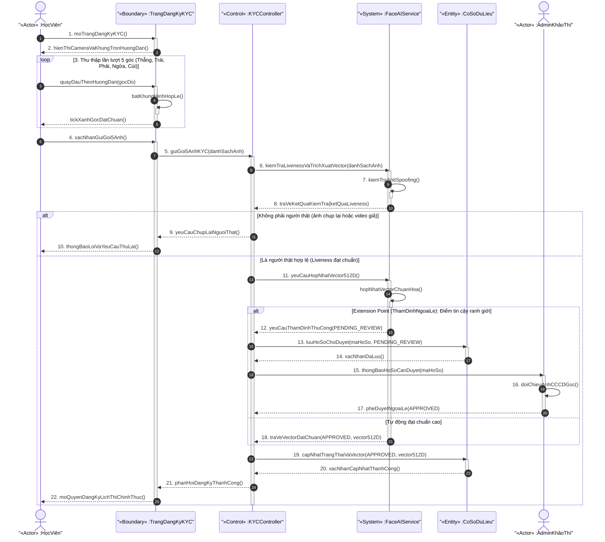

> #### 🔍 ĐẶC TẢ TUẦN TỰ LUỒNG THỰC THI MÃ NGUỒN — SD-01
> * **Vào Trang (URL Route):** `/student/kyc-register`  
> * **Form / Modal / Component:** `FormFaceCaptureModal (Modal chụp ảnh 5 góc) & Component WebcamOvalGuideOverlay`  
>
> ##### (A) Bảng Danh Sách Đường Sống (Lifelines) Chuẩn BCE:
>
> | Stereotype BCE | Tên Đường Sống (Lifeline) | Trách Nhiệm Trong Mã Nguồn (Làm gì) |
> | :---: | :--- | :--- |
| **«Actor»** | `HV :HọcViên` | Thí sinh thao tác trước camera, quay đầu theo 5 góc chỉ dẫn. |
| **«Boundary»** | `UI :TrangDangKyKYC` | Component KycCaptureView.vue, hiển thị webcam, khung oval và bắt sự kiện chụp. |
| **«Control»** | `Ctr :KYCController` | Controller KycController.ts (API POST /api/v1/kyc/upload-portrait), điều phối kiểm tra và lưu trữ. |
| **«System»** | `AI :FaceAIService` | Microservice AI (InsightFace/ArcFace), phân tích Liveness Anti-spoofing và trích xuất vector 512D. |
| **«Entity»** | `DB :CoSoDuLieu` | Bảng StudentFaceProfiles & FaceVectors512D, lưu trữ bền vững vector và trạng thái APPROVED. |
| **«Actor»** | `Admin :AdminKhảoThí` | Cán bộ khảo thí thẩm định thủ công các hồ sơ nghi vấn/chấn thương tại trang /admin/kyc-approvals. |

> ##### (B) Bảng Tuần Tự Luồng Mã Nguồn Đi (Vào trang nào, form nào, làm gì):
>
> | Bước | Hàm / API Request | Gửi $
ightarrow$ Nhận (BCE) | Chi Tiết Hành Vi Mã Nguồn (Vào Form nào, xử lý logic gì, truy vấn gì) |
> | :---: | :--- | :--- | :--- |
| **1-2** | `moTrangDangKyKYC() -> hienThiCameraVaKhungTronHuongDan()` | `HV -> UI` | Học viên truy cập /student/kyc-register. FormFormFaceCaptureModal khởi động, xin quyền truy cập webcam (navigator.mediaDevices.getUserMedia) và kích hoạt khung oval hướng dẫn góc nhìn số 1 (Nhìn thẳng). |
| **3** | `quayDauTheoHuongDan(gocDo) -> batKhungHinhHopLe() -> tickXanhGocDatChuan()` | `HV -> UI -> UI -> HV` | Thực hiện lần lượt 5 góc (Thẳng, Trái, Phải, Ngửa, Cúi). Canvas trên UI tự động phân tích độ sắc nét (sharpness > 0.8), crop frame đạt chuẩn và hiển thị tick xanh hoàn thành từng góc. |
| **4-5** | `xacNhanGuiGoi5Anh() -> guiGoi5AnhKYC(danhSachAnh)` | `HV -> UI -> Ctr` | Học viên nhấn nút "Hoàn thành & Gửi duyệt". Form đóng gói 5 ảnh Base64 gửi HTTP POST multipart/form-data lên KYCController. |
| **6-8** | `kiemTraLivenessVaTrichXuatVector() -> kiemTraAntiSpoofing()` | `Ctr -> AI` | Controller chuyển tiếp gói ảnh sang FaceAIService. AI chạy mạng nơ-ron tích chập kiểm tra Liveness Anti-Spoofing chống ảnh in, video phát lại qua điện thoại và mặt nạ 3D. |
| **9-10** | `[Alt: Giả mạo] yeuCauChupLaiNguoiThat() -> thongBaoLoiVaYeuCauThuLai()` | `Ctr -> UI -> HV` | Nếu phát hiện giả mạo: Ctr trả mã lỗi 400 INVALID_LIVENESS. UI bật alert màu đỏ yêu cầu người thật thực hiện lại. |
| **11-18** | `[Alt: ThamDinhNgoaiLe] yeuCauHopNhatVector512D() -> yeuCauThamDinhThuCong()` | `Ctr -> AI -> DB -> Admin` | Nếu là người thật: AI hợp nhất vector 512D. Nếu điểm tin cậy ở ranh giới (0.75 - 0.82), lưu hồ sơ PENDING_REVIEW, gửi thông báo tới Admin. Admin mở modal đối chiếu CCCD gốc và bấm Duyệt ngoại lệ. |
| **19-22** | `capNhatTrangThaiVaVector(APPROVED) -> phanHoiDangKyThanhCong()` | `Ctr -> DB -> UI -> HV` | Controller ghi vector 512D vào bảng StudentFaceProfiles, cập nhật APPROVED. UI hiển thị thông báo thành công và mở quyền tham gia ca thi. |


### SD-02: Quy trình Điểm danh quét mặt Check-in 1:1 mở đề thi (Ứng với UC-02)

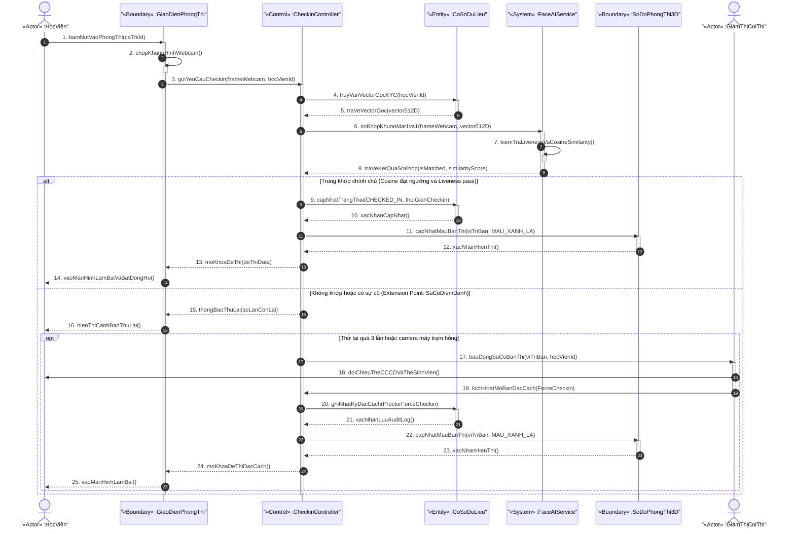

> #### 🔍 ĐẶC TẢ TUẦN TỰ LUỒNG THỰC THI MÃ NGUỒN — SD-02
> * **Vào Trang (URL Route):** `/exam/check-in/:sessionId`  
> * **Form / Modal / Component:** `FormCheckInFaceScanModal (Modal quét khuôn mặt 1 frame) & CanvasRoom3DGrid trên máy Giám thị`  
>
> ##### (A) Bảng Danh Sách Đường Sống (Lifelines) Chuẩn BCE:
>
> | Stereotype BCE | Tên Đường Sống (Lifeline) | Trách Nhiệm Trong Mã Nguồn (Làm gì) |
> | :---: | :--- | :--- |
| **«Actor»** | `HV :HọcViên` | Thí sinh ngồi trước máy tính phòng thi bấm check-in. |
| **«Boundary»** | `UI :GiaoDienPhongThi` | Component CheckInScanView.vue chứa Form quét mặt và webcam trực tiếp. |
| **«Control»** | `Ctr :CheckinController` | Controller CheckInController.ts (API POST /api/v1/exam/check-in), tiếp nhận frame và so khớp. |
| **«Entity»** | `DB :CoSoDuLieu` | Bảng ExamCandidates & StudentFaceProfiles, chứa vector KYC gốc và ghi nhận trạng thái CHECKED_IN. |
| **«System»** | `AI :FaceAIService` | Engine so khớp khuôn mặt 1:1, tính khoảng cách Cosine Similarity trong dưới 1 giây. |
| **«Boundary»** | `Sodo :SoDoPhongThi3D` | Component ProctorRoom3DCanvas.vue trên máy Giám thị, hiển thị lưới bàn thi thời gian thực. |
| **«Actor»** | `Proctor :GiámThịCoiThi` | Cán bộ giám sát phòng thi, tiếp nhận cảnh báo và xử lý sự cố. |

> ##### (B) Bảng Tuần Tự Luồng Mã Nguồn Đi (Vào trang nào, form nào, làm gì):
>
> | Bước | Hàm / API Request | Gửi $
ightarrow$ Nhận (BCE) | Chi Tiết Hành Vi Mã Nguồn (Vào Form nào, xử lý logic gì, truy vấn gì) |
> | :---: | :--- | :--- | :--- |
| **1-2** | `bamNutVaoPhongThi(caThiId) -> chupKhungHinhWebcam()` | `HV -> UI` | Thí sinh truy cập /exam/check-in/:sessionId, bấm nút "Check-in vào phòng thi". UI bật camera và tự động chụp 1 frame chân dung trực tiếp. |
| **3-5** | `guiYeuCauCheckin(frame, hocVienId) -> truyVanVectorGocKYC()` | `UI -> Ctr -> DB` | UI gửi frame ảnh lên CheckinController. Controller truy vấn CSDL lấy vector ArcFace 512D gốc của thí sinh. |
| **6-8** | `soKhopKhuonMat1va1() -> kiemTraLivenessVaCosineSimilarity()` | `Ctr -> AI` | Controller gửi frame vừa chụp và vector gốc sang FaceAIService. AI tính độ tương đồng Cosine Similarity trong thời gian < 800ms. |
| **Alt 1** | `[Alt: ThuLai] hienThiSoLanConLai(1/3, 2/3) -> thuLaiQuetMat()` | `Ctr -> UI -> HV` | Nếu độ tương đồng < 0.82 do ngồi lệch góc hoặc thiếu sáng: UI cho phép thí sinh điều chỉnh lại tư thế và thử lại tối đa 3 lần. |
| **Alt 2** | `[Alt: CanhBaoKhongKhop] canhBaoDo() -> chuongBaoDongGiamThi()` | `Ctr -> UI -> Sodo` | Nếu quá 3 lần hoặc phát hiện tráo người: UI khóa nút quét mặt, Ctr gửi sự kiện Socket.IO đổi bàn thi sang MÀU ĐỎ nhấp nháy trên máy Giám thị. |
| **Alt 3** | `[Alt: ForceCheckIn] moBanDacCach(CCCD) -> ghiNhanAuditLog()` | `Proctor -> Sodo -> Ctr -> DB` | Giám thị đến tận bàn kiểm tra thẻ CCCD bản cứng, mở FormForceCheckInModal trên thiết bị giám thị, nhập lý do và bấm xác nhận mở bàn đặc cách. |
| **9-11** | `capNhatTrangThaiCHECKED_IN() -> doiMauBanXanhLa() -> moKhoaDeThi()` | `Ctr -> DB -> Sodo -> UI` | Xác thực thành công: Ctr cập nhật trạng thái CHECKED_IN vào CSDL, phát WebSocket đổi bàn sang MÀU XANH LÁ trên Sơ đồ 3D và mở khóa đề thi sang trang /exam/take/:examId. |


### SD-03: Quy trình Làm bài thi an toàn, Tự lưu bài & Giám sát AI (Ứng với UC-03)

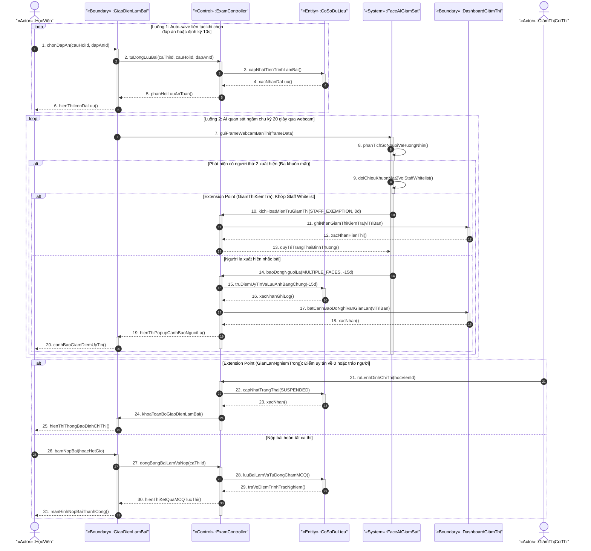

> #### 🔍 ĐẶC TẢ TUẦN TỰ LUỒNG THỰC THI MÃ NGUỒN — SD-03
> * **Vào Trang (URL Route):** `/exam/secure-take/:examId`  
> * **Form / Modal / Component:** `FormKioskExamContainer (Chế độ Kiosk khóa toàn màn hình), QuestionSheetComponent & Dashboard Giám thị LiveWall`  
>
> ##### (A) Bảng Danh Sách Đường Sống (Lifelines) Chuẩn BCE:
>
> | Stereotype BCE | Tên Đường Sống (Lifeline) | Trách Nhiệm Trong Mã Nguồn (Làm gì) |
> | :---: | :--- | :--- |
| **«Actor»** | `HV :HọcViên` | Thí sinh làm bài thi trắc nghiệm/tự luận/code. |
| **«Boundary»** | `PC :GiaoDienLamBai` | Component SecureExamKioskView.vue khóa toàn màn hình Kiosk. |
| **«Control»** | `Ctr :ExamController` | Controller ExamRuntimeController.ts, điều phối lưu bài và chấm điểm. |
| **«Entity»** | `DB :CoSoDuLieu` | Bảng ExamAnswers, ExamSubmissions, ExamViolationLogs. |
| **«System»** | `AI :FaceAIGiamSat` | Dịch vụ AI chạy nền phân tích Head Pose, Face Count và đối chiếu Staff Whitelist. |
| **«Boundary»** | `Dash :DashboardGiámThị` | Component ProctorLiveMonitor.vue hiển thị trạng thái và còi báo động. |
| **«Actor»** | `Proctor :GiámThịCoiThi` | Cán bộ coi thi trực tiếp điều hành phòng thi. |

> ##### (B) Bảng Tuần Tự Luồng Mã Nguồn Đi (Vào trang nào, form nào, làm gì):
>
> | Bước | Hàm / API Request | Gửi $
ightarrow$ Nhận (BCE) | Chi Tiết Hành Vi Mã Nguồn (Vào Form nào, xử lý logic gì, truy vấn gì) |
> | :---: | :--- | :--- | :--- |
| **1-6** | `[Luồng 1] chonDapAn() -> tuDongLuuBai() -> capNhatTienTrinhLamBai()` | `HV -> PC -> Ctr -> DB` | Thí sinh click chọn đáp án trên QuestionSheetComponent. PC gửi ngay request POST /api/v1/exam/autosave. Ctr ghi trạng thái vào CSDL và phản hồi 200 SAVED, PC hiện icon đám mây xanh an toàn. |
| **7-8** | `[Luồng 2] guiFrameWebcamBanThi() -> phanTichSoNguoiVaHuongNhin()` | `PC -> AI` | Web Worker trên PC định kỳ mỗi 15-20s ngầm trích xuất 1 frame gửi sang FaceAIGiamSat để đếm số khuôn mặt và góc nghiêng đầu. |
| **9-11** | `[Alt: GiamThiKiemTra] doiChieuStaffWhitelist() -> STAFF_EXEMPTION(0đ)` | `AI -> Ctr -> Dash` | Nếu AI thấy có khuôn mặt thứ 2: Đối chiếu với danh sách cán bộ coi thi (Staff Whitelist). Khớp giám thị -> Kích hoạt miễn trừ 0đ phạt, hiển thị thông báo Giám thị đang kiểm tra bàn. |
| **12-14** | `[Alt: NguoiLa] canhBaoNguoiThuHai() -> phatChuongVang() -> truUyTin()` | `AI -> Ctr -> Dash -> PC` | Khuôn mặt thứ 2 không thuộc Whitelist: Ctr phát chuông báo động VÀNG lên màn hình Giám thị kèm ảnh snapshot và trừ 15 điểm uy tín thí sinh. |
| **15-18** | `[Alt: DinhChiThi] phatHienGianLanNghiemTrong() -> khoaToanBoBaiThi()` | `Proctor -> Dash -> Ctr -> PC` | Thí sinh tráo người hoặc đổi tab quá 3 lần: Giám thị bấm "Đình chỉ thi". Ctr khóa hoàn toàn màn hình làm bài và lập biên bản kỷ luật có chữ ký số. |
| **19-22** | `[Alt: SuCoThietBi] guiTinHieuSOS() -> doiMayTramVaCongBuGio(15p)` | `HV -> PC -> Dash -> Proctor -> Ctr` | Máy tính thí sinh sập nguồn: Thí sinh bấm nút SOS. Giám thị hỗ trợ đổi máy trạm, bấm "Cộng bù giờ (15 phút)". Ctr tải lại tiến trình đã lưu và cộng giờ vào đồng hồ. |
| **23-28** | `bamNutNopBai() -> xacNhanNopChinhThuc() -> tuDongChamMCQ()` | `HV -> PC -> Ctr -> DB` | Thí sinh bấm Nộp bài. ModalSubmitConfirm hiện số câu đã làm. Thí sinh xác nhận -> Ctr đóng băng bài thi, chấm tự động 100% câu trắc nghiệm và hiển thị điểm sơ bộ. |


### SD-04: Quy trình Thi đấu Đấu trường Quiz Arena thời gian thực (Ứng với UC-04)

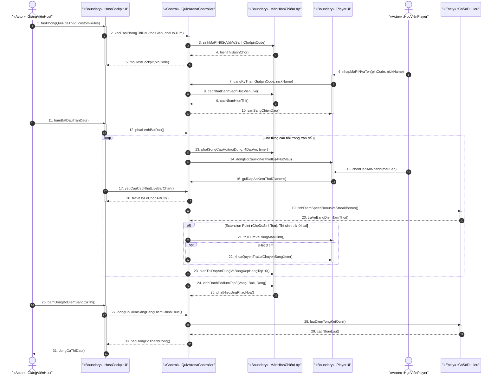

> #### 🔍 ĐẶC TẢ TUẦN TỰ LUỒNG THỰC THI MÃ NGUỒN — SD-04
> * **Vào Trang (URL Route):** `Host: /teacher/quiz-arena/host/:quizId | Máy chiếu: /quiz/projector/:pinCode | Thí sinh: /quiz/arena/:pinCode`  
> * **Form / Modal / Component:** `FormHostControlCockpit, FormPlayerJoinModal & FormPlayerColorPad (4 khối màu sắc lớn)`  
>
> ##### (A) Bảng Danh Sách Đường Sống (Lifelines) Chuẩn BCE:
>
> | Stereotype BCE | Tên Đường Sống (Lifeline) | Trách Nhiệm Trong Mã Nguồn (Làm gì) |
> | :---: | :--- | :--- |
| **«Actor»** | `Host :GiảngViênHost` | Giảng viên chủ trì, điều phối các lượt câu hỏi thi đấu. |
| **«Boundary»** | `HostUI :HostCockpitUI` | Giao diện quản lý trận đấu của Host (HostCockpitView.vue). |
| **«Control»** | `Ctr :QuizArenaController` | WebSocket Gateway Controller (Socket.IO Room arena:PIN). |
| **«Boundary»** | `Screen :MànHìnhChiếuLớp` | Giao diện máy chiếu lớp học ProjectorView.vue, chiếu câu hỏi và bảng xếp hạng. |
| **«Boundary»** | `PlayUI :PlayerUI` | Giao diện web mobile PlayerPadView.vue trên điện thoại học viên. |
| **«Actor»** | `Player :HọcViênPlayer` | Học viên tham gia thi đấu đua tốc độ chọn đáp án. |
| **«Entity»** | `DB :CoSoDuLieu` | Bảng QuizRooms, QuizParticipants, Gradebook (Sổ điểm học phần). |

> ##### (B) Bảng Tuần Tự Luồng Mã Nguồn Đi (Vào trang nào, form nào, làm gì):
>
> | Bước | Hàm / API Request | Gửi $
ightarrow$ Nhận (BCE) | Chi Tiết Hành Vi Mã Nguồn (Vào Form nào, xử lý logic gì, truy vấn gì) |
> | :---: | :--- | :--- | :--- |
| **1-5** | `taoPhongQuiz() -> sinhMaPIN6SoVaMoSanhCho()` | `Host -> HostUI -> Ctr -> Screen` | Giảng viên mở /teacher/quiz-arena/host, cài đặt luật 3 tim và bấm Mở phòng. Ctr tạo Socket.IO Room, sinh mã PIN 6 số (VD: 824915) chiếu lên màn hình máy chiếu lớp học. |
| **6-10** | `nhapMaPINVaTen() -> dangKyThamGia() -> capNhatLive()` | `Player -> PlayUI -> Ctr -> Screen` | Học viên vào /quiz/arena trên điện thoại, nhập PIN và tên hiển thị. Ctr phát sự kiện player:joined, máy chiếu lớp học cập nhật danh sách avatar tức thời. |
| **11-14** | `bamBatDauTranDau() -> chieuCauHoiVaDongHo() -> hienThi4KhoiMau()` | `Host -> HostUI -> Ctr -> Screen & PlayUI` | Host bấm Bắt đầu. Ctr phát lệnh đếm ngược 3-2-1. Máy chiếu chiếu đề bài và đồng hồ 15s. Màn hình điện thoại học viên hiển thị 4 khối màu sắc lớn (Đỏ, Lam, Vàng, Lục). |
| **15-18** | `bamChonKhoiMau() -> tinhDiemSpeedVaStreak()` | `Player -> PlayUI -> Ctr` | Học viên nhìn đề trên bảng và bấm nhanh khối màu trên điện thoại. Ctr ghi nhận thời gian bấm theo mili-giây, tính điểm đúng kết hợp điểm thưởng tốc độ và hệ số chuỗi Streak. |
| **19-21** | `[Alt: CheDoSinhTon] tru1Tim() -> knockOut()` | `Ctr -> PlayUI` | Nếu chọn sai ở chế độ sinh tồn: Ctr trừ 1 tim và reset Streak. Mất cả 3 tim -> PlayUI khóa quyền bấm các câu tiếp theo, chuyển học viên sang chế độ khán giả (Spectator). |
| **22-25** | `chieuBieuDoVaTop10() -> chieuPodiumTop3()` | `Ctr -> Screen` | Hết thời gian từng câu: Máy chiếu hiển thị biểu đồ chọn đáp án và Top 10 dẫn đầu. Sau câu hỏi cuối: Kích hoạt nhạc chiến thắng và vinh danh Top 3 lên bục Podium 3 cấp bậc. |
| **26-28** | `[Alt: DongBoDiem] bamDongBoDiemMonHoc() -> luuBangDiemLop()` | `Host -> HostUI -> Ctr -> DB` | Giảng viên bấm Đồng bộ điểm. Ctr tự động quy đổi điểm số trận đấu sang thang điểm 10 theo phổ điểm của lớp và ghi vào bảng Gradebook trong CSDL. |


### SD-05: Quy trình Xem lịch thi, Số báo danh & Sơ đồ bàn 3D (Ứng với UC-05)

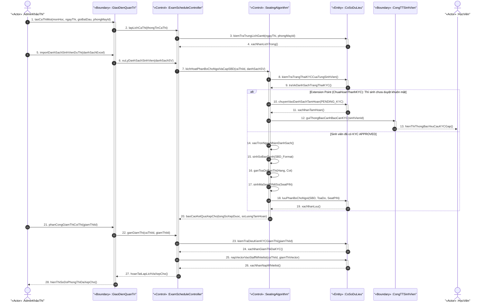

> #### 🔍 ĐẶC TẢ TUẦN TỰ LUỒNG THỰC THI MÃ NGUỒN — SD-05
> * **Vào Trang (URL Route):** `Admin: /admin/exam-scheduler | Học viên: /student/my-exam-schedules`  
> * **Form / Modal / Component:** `FormCreateExamSessionModal, FormUploadStudentListModal, CanvasRoom3DSeatingPlan & StudentSeatCardViewer`  
>
> ##### (A) Bảng Danh Sách Đường Sống (Lifelines) Chuẩn BCE:
>
> | Stereotype BCE | Tên Đường Sống (Lifeline) | Trách Nhiệm Trong Mã Nguồn (Làm gì) |
> | :---: | :--- | :--- |
| **«Actor»** | `Admin :AdminKhảoThí` | Cán bộ phòng Khảo thí thiết lập lịch thi và chạy thuật toán xếp chỗ. |
| **«Boundary»** | `UI :GiaoDienQuanTri` | Component ExamScheduleAdminView.vue chứa Gantt Chart và ma trận phòng thi. |
| **«Control»** | `Ctr :ExamScheduleController` | Controller ExamScheduleController.ts (API POST /api/v1/exam-schedule/create). |
| **«Control»** | `Algo :SeatingAlgorithm` | Module thuật toán phân bổ bàn thi ngẫu nhiên và cấp số báo danh tự động. |
| **«Entity»** | `DB :CoSoDuLieu` | Bảng ExamSessions, ExamRooms, StudentFaceProfiles, ExamSeatingAllocations. |
| **«Boundary»** | `Portal :CongTTSinhVien` | Component StudentExamScheduleView.vue cho thí sinh tra cứu. |
| **«Actor»** | `HV :HọcViên` | Thí sinh tra cứu SBD, phòng thi và mô hình 3D chỗ ngồi. |

> ##### (B) Bảng Tuần Tự Luồng Mã Nguồn Đi (Vào trang nào, form nào, làm gì):
>
> | Bước | Hàm / API Request | Gửi $
ightarrow$ Nhận (BCE) | Chi Tiết Hành Vi Mã Nguồn (Vào Form nào, xử lý logic gì, truy vấn gì) |
> | :---: | :--- | :--- | :--- |
| **1-4** | `taoCaThiMoi() -> kiemTraTrungLichGantt()` | `Admin -> UI -> Ctr -> DB` | Admin mở /admin/exam-scheduler, chọn môn thi, ngày thi, giờ phát đề và phòng máy. Ctr quét CSDL kiểm tra xung đột phòng máy và ca thi trên Gantt Chart. |
| **5-7** | `importDanhSachSinhVienDuThi() -> kichHoatPhanBoChoNgoi()` | `Admin -> UI -> Ctr -> Algo` | Admin tải lên file Excel danh sách thí sinh. Ctr chuyển danh sách sang SeatingAlgorithm để khởi động thuật toán xếp chỗ. |
| **8-9** | `kiemTraTrangThaiKYCCuaTungSinhVien()` | `Algo -> DB` | Thuật toán kiểm tra điều kiện căn cước khuôn mặt: Quét bảng StudentFaceProfiles để lọc các thí sinh đã có trạng thái APPROVED. |
| **10-12** | `[Alt: ChuaHoanThanhKYC] tamHoanCapSBD() -> guiThongBaoNhacNho()` | `Algo -> Ctr -> DB` | Thí sinh chưa hoàn thành chụp KYC 5 góc: Thuật toán tạm hoãn cấp SBD, đưa vào danh sách cảnh báo thiếu căn cước và gửi email/thông báo nhắc chụp bổ sung trước ngày thi. |
| **13-15** | `[Alt: BoQuaBanHong] layDanhSachBanHong() -> loaiBoViTriKhoa()` | `Algo -> DB` | Thuật toán truy vấn các bàn máy tính có cờ is_disabled: true (màu xám trên sơ đồ 3D), cô lập các vị trí này và chỉ xếp thí sinh vào bàn hoạt động tốt. |
| **16-18** | `xaoTronNgauNhienVaCapSBD() -> luuPhanBoChoNgoi()` | `Algo -> Ctr -> DB` | Thuật toán xáo trộn ngẫu nhiên sinh viên vào các vị trí bàn tốt, tự động đánh mã SBD duy nhất (SBD-001...) và lưu tọa độ (Hàng, Cột) vào CSDL. |
| **19-22** | `xuatBanLichThi() -> traCuuLichThi() -> dungMoHinh3D()` | `Admin -> UI -> Ctr -> Portal -> HV` | Admin bấm Xuất bản lịch thi. Ca thi chuyển sang PUBLISHED. Thí sinh đăng nhập Cổng sinh viên, xem SBD và mô hình 3D phòng thi đánh dấu vị trí bàn ngồi cụ thể. |


### SD-06: Quy trình Soạn thảo đề thi & Bóc tách đề từ file Word/Excel (Ứng với UC-06)

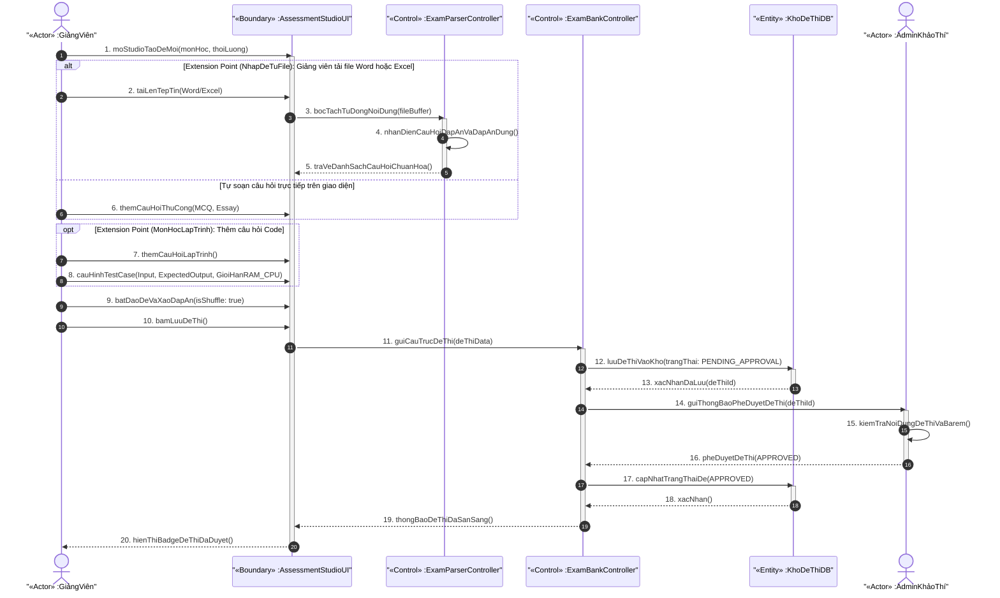

> #### 🔍 ĐẶC TẢ TUẦN TỰ LUỒNG THỰC THI MÃ NGUỒN — SD-06
> * **Vào Trang (URL Route):** `Giảng viên: /teacher/assessment-studio/:examId | Admin: /admin/exam-approval/:examId`  
> * **Form / Modal / Component:** `FormQuestionBuilderModal, FormDocumentUploadModal (Bóc tách Word/Excel 2s), FormCodingTestCaseModal & ModalLiveExamPreview`  
>
> ##### (A) Bảng Danh Sách Đường Sống (Lifelines) Chuẩn BCE:
>
> | Stereotype BCE | Tên Đường Sống (Lifeline) | Trách Nhiệm Trong Mã Nguồn (Làm gì) |
> | :---: | :--- | :--- |
| **«Actor»** | `GV :GiảngViên` | Giảng viên bộ môn biên soạn ngân hàng đề thi. |
| **«Boundary»** | `Studio :AssessmentStudioUI` | Component AssessmentStudioView.vue kéo thả câu hỏi trực quan. |
| **«Control»** | `Parser :ExamParserController` | Module bóc tách tài liệu tự động bằng Regex & NLP (DocumentParser.ts). |
| **«Control»** | `Ctr :ExamBankController` | Controller ExamBankController.ts (API POST /api/v1/exam-bank/save). |
| **«Entity»** | `DB :KhoDeThiDB` | Kho đề thi MongoDB (Collection ExamTemplates & Questions). |
| **«Actor»** | `Admin :AdminKhảoThí` | Cán bộ khảo thí kiểm tra tính toàn vẹn và phê duyệt đề thi. |

> ##### (B) Bảng Tuần Tự Luồng Mã Nguồn Đi (Vào trang nào, form nào, làm gì):
>
> | Bước | Hàm / API Request | Gửi $
ightarrow$ Nhận (BCE) | Chi Tiết Hành Vi Mã Nguồn (Vào Form nào, xử lý logic gì, truy vấn gì) |
> | :---: | :--- | :--- | :--- |
| **1** | `moStudioTaoDeMoi(monHoc, thoiLuong)` | `GV -> Studio` | Giảng viên mở /teacher/assessment-studio, khởi tạo đề thi mới với tên môn học, thời lượng làm bài và thang điểm tổng. |
| **2-5** | `[Alt: NhapDeTuFile] taiLenTepTin(Word/Excel) -> bocTachTuDong()` | `GV -> Studio -> Parser -> Studio` | Giảng viên tải lên file .docx hoặc .xlsx. ExamParserController phân tích cú pháp tiêu đề câu hỏi, các đáp án A/B/C/D, đáp án đúng và lời giải trong 2 giây, trả về danh sách câu hỏi hoàn chỉnh lên Studio. |
| **6-8** | `[Alt: MonHocLapTrinh] themCauHoiLapTrinh() -> cauHinhTestCase()` | `GV -> Studio` | Giảng viên thêm loại câu hỏi Coding Problem, mở FormCodingTestCaseModal khai báo bộ Test Cases (Input/Output chuẩn, Output ẩn) và giới hạn tài nguyên RAM/CPU. |
| **9-11** | `batDaoDeVaXaoDapAn() -> moXemTruocLivePreview()` | `GV -> Studio` | Giảng viên kích hoạt cờ tự động xáo câu hỏi và đảo đáp án. Bấm "Live Preview" để kiểm tra trải nghiệm giao diện làm bài dưới góc nhìn của học viên. |
| **12-14** | `bamLuuDeThi() -> luuDeThiChoDuyet(PENDING_APPROVAL)` | `GV -> Studio -> Ctr -> DB` | Giảng viên bấm Lưu đề thi. Controller mã hóa cấu trúc đề thi, lưu vào MongoDB ở trạng thái PENDING_APPROVAL và gửi thông báo tới Admin Khảo thí. |
| **15-18** | `moKiemDinhVaPheDuyet() -> capNhatTrangThai(APPROVED)` | `Admin -> Studio -> Ctr -> DB` | Admin Khảo thí mở giao diện thẩm định đề thi, kiểm tra ma trận câu hỏi và bấm "Phê duyệt đề thi". Controller cập nhật trạng thái APPROVED, sẵn sàng gán vào ca thi. |


### SD-07: Quy trình Thiết lập sơ đồ phòng thi 3D & Camera giám sát (Ứng với UC-07)

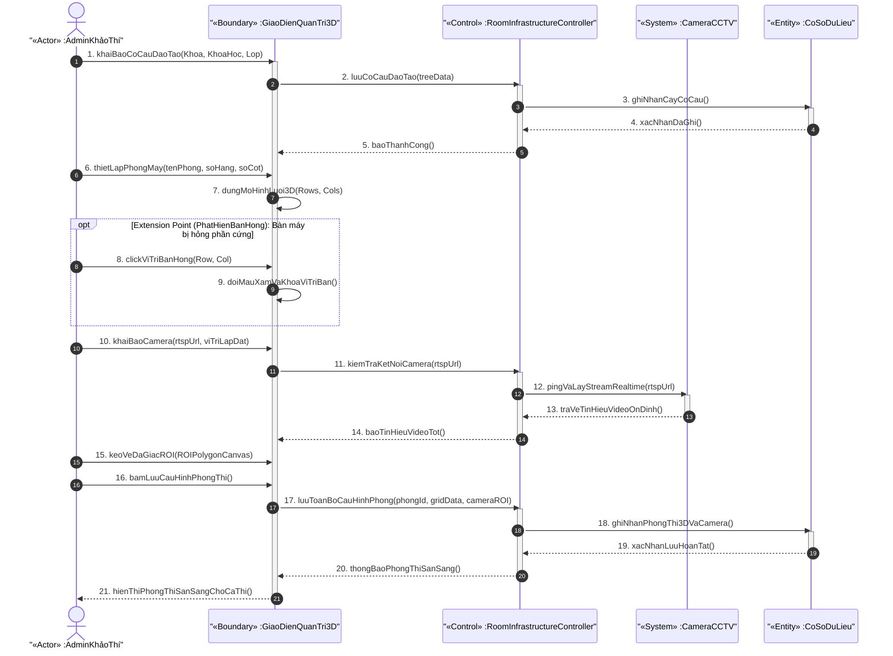

> #### 🔍 ĐẶC TẢ TUẦN TỰ LUỒNG THỰC THI MÃ NGUỒN — SD-07
> * **Vào Trang (URL Route):** `/admin/room-layout-3d`  
> * **Form / Modal / Component:** `FormFacultyClassTreeModal, FormRoom3DDesigner (Lưới 3D Three.js) & FormCameraRtspConfigModal`  
>
> ##### (A) Bảng Danh Sách Đường Sống (Lifelines) Chuẩn BCE:
>
> | Stereotype BCE | Tên Đường Sống (Lifeline) | Trách Nhiệm Trong Mã Nguồn (Làm gì) |
> | :---: | :--- | :--- |
| **«Actor»** | `Admin :AdminKhảoThí` | Cán bộ quản trị hạ tầng và phân cấp đào tạo. |
| **«Boundary»** | `UI :GiaoDienQuanTri3D` | Component RoomLayoutDesigner3D.vue dựng lưới bàn máy 3D tương tác. |
| **«Control»** | `Ctr :RoomInfrastructureController` | Controller RoomManagementController.ts xử lý cơ cấu và phòng thi. |
| **«System»** | `Camera :CameraCCTV` | Hạ tầng Camera giám sát phòng thi (RTSP/HLS Stream Gateway). |
| **«Entity»** | `DB :CoSoDuLieu` | Bảng Faculties, Courses, Classes, ExamRooms, RoomSeats3D, RoomCameras. |

> ##### (B) Bảng Tuần Tự Luồng Mã Nguồn Đi (Vào trang nào, form nào, làm gì):
>
> | Bước | Hàm / API Request | Gửi $
ightarrow$ Nhận (BCE) | Chi Tiết Hành Vi Mã Nguồn (Vào Form nào, xử lý logic gì, truy vấn gì) |
> | :---: | :--- | :--- | :--- |
| **1-5** | `khaiBaoCoCauDaoTao(Khoa, KhoaHoc, Lop) -> ghiNhanCayCoCau()` | `Admin -> UI -> Ctr -> DB` | Admin truy cập /admin/room-layout-3d, mở FormFacultyClassTreeModal khai báo danh mục Khoa chuyên ngành, Khóa đào tạo và các Lớp sinh viên. CSDL lưu trữ cây tổ chức quan hệ. |
| **6-7** | `thietLapPhongMay(tenPhong, soHang: 5, soCot: 8) -> dungMoHinhLuoi3D()` | `Admin -> UI -> UI` | Admin nhập thông số phòng máy (5 hàng bàn x 8 cột bàn). UI sử dụng Three.js dựng trực quan mô hình lưới 3D với 40 vị trí máy, cửa ra vào và bục giảng. |
| **8-9** | `[Alt: PhatHienBanHong] clickViTriBanHong() -> doiMauXamVaKhoa()` | `Admin -> UI -> UI` | Admin click trực tiếp vào ô bàn máy tính bị hỏng nguồn/mạng. UI lập tức đổi màu bàn sang MÀU XÁM KHOÁ, gắn cờ is_disabled: true để thuật toán xếp chỗ không phân sinh viên vào. |
| **10-14** | `khaiBaoCamera(rtspUrl) -> kiemTraKetNoiCamera() -> hienThiLivePreview()` | `Admin -> UI -> Ctr -> Camera` | Admin nhập địa chỉ RTSP camera góc rộng phòng thi. Ctr gửi yêu cầu kiểm tra tới Camera CCTV. Nếu kết nối ổn định, hiển thị khung xem trước Live Stream Preview. |
| **15-18** | `bamNutLuuPhongThi() -> luuCauHinhPhong3DVaCamera()` | `Admin -> UI -> Ctr -> DB` | Admin bấm "Lưu phòng thi". Controller lưu tọa độ lưới bàn 3D, danh sách bàn hỏng và cấu hình luồng camera vào CSDL, hiển thị thông báo tạo phòng thành công. |


### SD-08: Quy trình Chấm thi rọc phách ẩn danh, Hậu kiểm vi phạm & Phúc khảo (Ứng với UC-08)

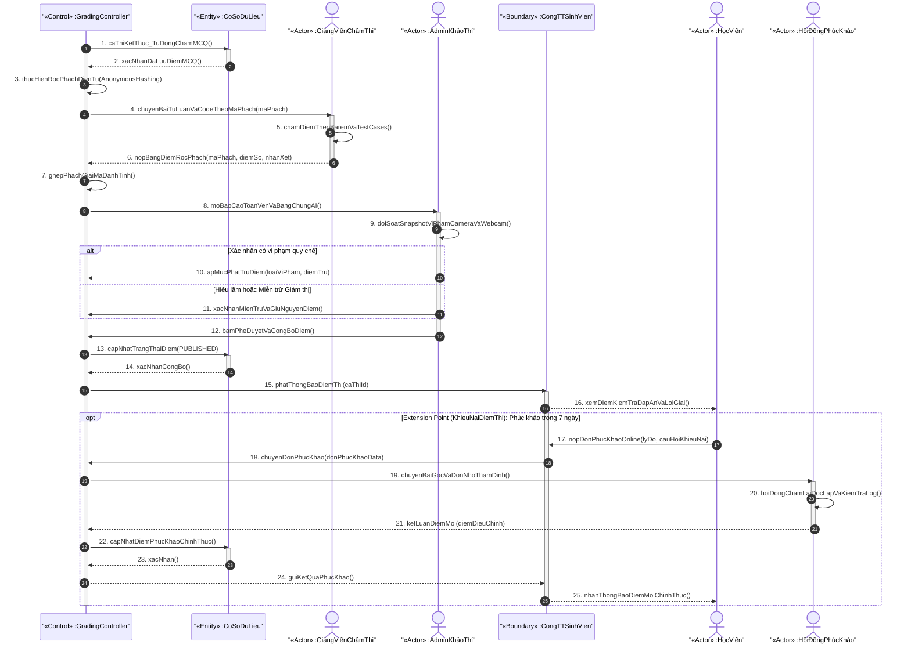

> #### 🔍 ĐẶC TẢ TUẦN TỰ LUỒNG THỰC THI MÃ NGUỒN — SD-08
> * **Vào Trang (URL Route):** `Giảng viên: /grading/blind-evaluation/:examId | Admin: /grading/integrity-audit/:examId | Thí sinh: /student/exam-results/:examId`  
> * **Form / Modal / Component:** `FormBlindGradingSheet (Phiếu chấm tự luận rọc phách), FormIntegrityTimelineModal & FormAppealSubmissionModal (Đơn phúc khảo 7 ngày)`  
>
> ##### (A) Bảng Danh Sách Đường Sống (Lifelines) Chuẩn BCE:
>
> | Stereotype BCE | Tên Đường Sống (Lifeline) | Trách Nhiệm Trong Mã Nguồn (Làm gì) |
> | :---: | :--- | :--- |
| **«Control»** | `Ctr :GradingController` | Controller GradingController.ts, điều phối chấm trắc nghiệm, rọc phách và giải mã. |
| **«Entity»** | `DB :CoSoDuLieu` | Bảng ExamSubmissions, ExamGrades, ExamViolations, ExamAppeals. |
| **«Actor»** | `GV :GiảngViênChấmThi` | Giảng viên đọc bài tự luận/code rọc phách và chấm điểm công tâm. |
| **«Actor»** | `Admin :AdminKhảoThí` | Cán bộ khảo thí đối soát bằng chứng AI và duyệt công bố điểm. |
| **«Boundary»** | `Portal :CongTTSinhVien` | Component StudentExamResultView.vue hiển thị bảng điểm và nộp phúc khảo. |
| **«Actor»** | `HV :HọcViên` | Thí sinh tra cứu điểm thi, xem lời giải và nộp đơn phúc khảo trực tuyến. |
| **«Actor»** | `Board :HộiĐồngPhúcKhảo` | Hội đồng khảo thí tổ chức chấm lại độc lập khi có đơn khiếu nại. |

> ##### (B) Bảng Tuần Tự Luồng Mã Nguồn Đi (Vào trang nào, form nào, làm gì):
>
> | Bước | Hàm / API Request | Gửi $
ightarrow$ Nhận (BCE) | Chi Tiết Hành Vi Mã Nguồn (Vào Form nào, xử lý logic gì, truy vấn gì) |
> | :---: | :--- | :--- | :--- |
| **1-2** | `caThiKetThuc_TuDongChamMCQ() -> luuDiemMCQ()` | `Ctr -> DB` | Ngay khi ca thi đóng: Động cơ tự động đối chiếu đáp án và chấm 100% câu trắc nghiệm khách quan trong < 100ms, ghi điểm vào CSDL. |
| **3-6** | `thucHienRocPhachDienTu() -> chamDiemTheoBarem() -> nopBangDiem()` | `Ctr -> GV -> Ctr` | Ctr mã hóa ẩn danh Họ tên, MSSV thành Mã phách ngẫu nhiên (#PHACH_xxxx). Giảng viên mở FormBlindGradingSheet đọc bài tự luận, nhập điểm theo barem và gửi bảng điểm phách. |
| **7-11** | `ghepPhachGiaiMa() -> doiSoatSnapshotViPhamCamera() -> apDungKhungTruDiem()` | `Ctr -> Admin -> DB` | Ctr ghép phách tính điểm tổng kết. Admin mở FormIntegrityTimelineModal rà soát các cờ vi phạm AI. Nếu xác nhận gian lận: Áp dụng khung trừ 25%, 50% hoặc hủy điểm. |
| **12-14** | `[Alt: XoaPhatGiamThi] xacNhanGiamThiKiemTra() -> xoaPhatVaKhoiPhucDiem()` | `Admin -> Ctr -> DB` | Nếu ảnh vi phạm là Cán bộ coi thi đang kiểm tra thẻ: Admin bấm "Xác nhận Giám thị kiểm tra". Ctr xóa phạt, khôi phục 100% điểm và lưu vết kiểm toán. |
| **15-18** | `pheDuyetVaCongBoDiem() -> traCuuDiemThiVaDapAn()` | `Admin -> Ctr -> Portal -> HV` | Admin bấm "Phê duyệt & Công bố điểm". Ctr đổi trạng thái PUBLISHED và gửi email tới học viên. Học viên vào Cổng sinh viên xem điểm và lời giải chi tiết từng câu. |
| **19-24** | `[Alt: PhucKhao7Ngay] nopDonPhucKhao() -> toChucChamLaiDocLap() -> capNhatDiemMoi()` | `HV -> Portal -> Ctr -> Board -> DB` | Trong 7 ngày, học viên mở FormAppealSubmissionModal gửi đơn phúc khảo. Ctr khóa điểm CHỜ PHÚC KHẢO. Hội đồng gồm 2 cán bộ chấm lại độc lập, xem video camera và chốt điểm mới vào CSDL. |


## 2.4 BIỂU ĐỒ HOẠT ĐỘNG (ĐỦ 8 ACTIVITY DIAGRAMS — ĐỒNG BỘ 100% VỚI USE CASE & SEQUENCE)

> Mỗi Use Case cốt lõi ở mục 2.2 đều có một Biểu đồ hoạt động tương ứng (AD-01 đến AD-08) dạng Làn bơi (Swimlanes) thể hiện quy trình nghiệp vụ rõ ràng từ nút Bắt đầu đến nút Kết thúc, phản ánh đầy đủ các điểm rẽ nhánh quyết định (Extension Points).

---

### AD-01: Quy trình Đăng ký Căn cước Khuôn mặt KYC 5 góc (Ứng với UC-01)
* **Các làn bơi (Swimlanes):** `Học Viên` | `Giao Diện Web` | `Face AI Service` | `Admin Hệ Thống`.
* **Quy trình hoạt động:**
  1. *(Làn Học viên)* Truy cập trang Đăng ký khuôn mặt KYC $\rightarrow$ Cho phép bật camera.
  2. *(Làn Giao diện Web)* Hiện khung tròn căn chỉnh và lời nhắc góc chụp đầu tiên.
  3. *(Làn Học viên)* Điều chỉnh đầu theo 5 góc: Nhìn thẳng $\rightarrow$ Quay trái $\rightarrow$ Quay phải $\rightarrow$ Ngửa lên $\rightarrow$ Cúi xuống.
  4. *(Làn Giao diện Web)* Tự động bắt ảnh khi góc đạt chuẩn $\rightarrow$ Gửi 5 ảnh sang AI.
  5. *(Làn Face AI)* Kiểm tra tính người thật (Liveness) $\rightarrow$ **Rẽ nhánh quyết định**:
     - *Nếu phát hiện ảnh giả / video giả:* Báo lỗi, yêu cầu quay lại bước 3 để chụp lại người thật.
     - *Nếu là người thật hợp lệ:* Trích xuất bản đồ khuôn mặt và hợp nhất thành Chân dung gốc $\rightarrow$ **Rẽ nhánh kiểm tra**:
       + *Trường hợp cần thẩm định ngoại lệ [Extension Point: `ThamDinhNgoaiLe`]:* Chuyển hồ sơ sang làn Admin Hệ Thống.
       + *Trường hợp tự động đạt chuẩn cao:* Chuyển thẳng sang phê duyệt APPROVED.
  6. *(Làn Admin)* Nhận hồ sơ PENDING: Admin đối chiếu ảnh CCCD gốc và Phê duyệt ngoại lệ $\rightarrow$ Cập nhật trạng thái APPROVED.
  7. *(Làn Học viên)* Nhận thông báo kích hoạt quyền dự thi thành công $\rightarrow$ [KẾT THÚC].


#### Prompt cho Visual Paradigm AI (AD-01)
> **Cách dùng trong Visual Paradigm:** Chọn `Diagram type: Activity Diagram`, dán đoạn kịch bản dưới đây vào ô **Topic:** và bấm Generate:
```text
Tiêu đề: Sơ đồ hoạt động Đăng ký khuôn mặt KYC 5 góc (Chuẩn gọn)
Các làn bơi: Sinh Viên | Hệ Thống Web/Backend | Face AI Service | Admin Hệ Thống
Quy trình các bước:
● Bắt đầu tại làn Sinh Viên
1. Sinh Viên truy cập trang KYC & cấp quyền camera
2. Bật camera, hiển thị khung oval 3D hướng dẫn 5 góc
3. Sinh Viên điều chỉnh 5 góc đầu theo visual tracker
4. Tự động bắt 5 khung hình chân dung & gửi sang Face AI
5. Kiểm tra tính người thật (Anti-Spoofing Liveness)
5.1. Quyết định: Là người thật hợp lệ?
   - [F]: 5.2. Cảnh báo ảnh in/video giả mạo -> Quay lại bước 3
   - [T]: 6. Trích xuất vector 512D & Tạo chân dung gốc
6.1. Quyết định: Chất lượng ảnh đạt chuẩn >= 90%?
   - [T]: 7. Cập nhật hồ sơ APPROVED
   - [F]: 6.2. Chuyển hồ sơ trạng thái PENDING -> 6.3. Admin đối chiếu ảnh CCCD gốc & Duyệt thủ công -> Chuyển sang bước 7
8. Hiển thị thông báo kích hoạt quyền dự thi thành công
◉ Kết thúc tại làn Sinh Viên
```

#### Mã PlantUML Activity Diagram (AD-01)
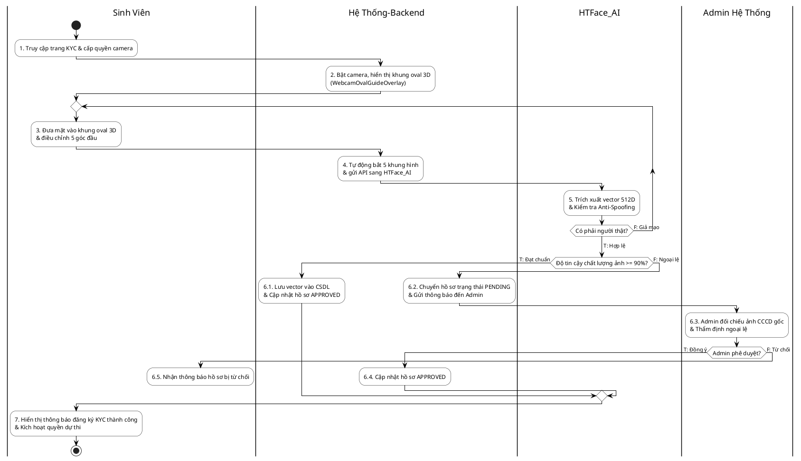

---

### AD-02: Quy trình Điểm danh Check-in 1:1 vào phòng thi (Ứng với UC-02)
* **Các làn bơi (Swimlanes):** `Học Viên` | `Giao Diện Phòng Thi` | `Face AI Service` | `Giám Thị Coi Thi`.
* **Quy trình hoạt động:**
  1. *(Làn Học viên)* Đến giờ thi, mở phòng thi và bấm nút "Check-in khuôn mặt".
  2. *(Làn Giao diện Phòng thi)* Bật camera chụp 1 ảnh khuôn mặt trực tiếp gửi sang AI.
  3. *(Làn Face AI)* So sánh ảnh vừa chụp với Chân dung gốc đã lưu $\rightarrow$ **Rẽ nhánh quyết định**:
     - *Nếu trùng khớp chính chủ:* Xác nhận điểm danh thành công trong 1 giây.
     - *Nếu độ trùng khớp không đạt (Nghi ngờ thi hộ):* Báo lỗi không khớp và cho phép thử lại $\rightarrow$ **Rẽ nhánh kiểm tra [Extension Point: `SuCoDiemDanh`]**:
       + *Chưa quá 3 lần:* Quay lại hướng dẫn học viên căn chỉnh khuôn mặt chụp lại.
       + *Thất bại quá 3 lần hoặc camera hỏng:* Chuyển tín hiệu sự cố sang làn Giám thị coi thi.
  4. *(Làn Giám thị)*:
     - Với trường hợp trùng khớp: Sơ đồ phòng thi 3D cập nhật chiếc bàn tương ứng sang màu XANH LÁ.
     - Với trường hợp sự cố quá 3 lần: Giám thị lại gần kiểm tra CCCD trực tiếp và bấm Mở bàn đặc cách (Force Check-in) $\rightarrow$ Sơ đồ 3D đổi màu xanh.
  5. *(Làn Giao diện Phòng thi)* Mở khóa đề thi và bắt đầu đếm ngược thời gian làm bài $\rightarrow$ [KẾT THÚC].


#### Prompt cho Visual Paradigm AI (AD-02)
> **Cách dùng trong Visual Paradigm:** Chọn `Diagram type: Activity Diagram`, dán đoạn kịch bản dưới đây vào ô **Topic:** và bấm Generate:
```text
Tiêu đề: Sơ đồ hoạt động Check-in phòng thi 1:1 mở đề thi (Chuẩn gọn)
Các làn bơi: Thí Sinh | Hệ Thống Phòng Thi | Face AI Service | Giám Thị Coi Thi
Quy trình các bước:
● Bắt đầu tại làn Thí Sinh
1. Thí Sinh vào phòng thi & nhấn nút 'Check-in khuôn mặt'
2. Bật camera & chụp 1 ảnh khuôn mặt gửi sang Face AI
3. Trích xuất vector & Tính độ tương đồng Cosine với KYC gốc
3.1. Quyết định: Độ tương đồng Cosine >= 85% (Đúng người)?
   - [T]: 4. Cập nhật điểm danh THÀNH CÔNG -> 4.1. Sơ đồ bàn 3D đổi màu XANH LÁ -> 5. Mở khóa đề thi & Đếm ngược thời gian -> 6. Thí Sinh bắt đầu làm bài -> ◉ Kết thúc
   - [F]: 3.2. Báo lỗi xác thực thất bại
3.3. Quyết định: Số lần thử lại <= 3 lần?
   - [T]: 3.4. Cảnh báo căn chỉnh góc mặt và ánh sáng -> Thí Sinh quét lại -> Quay lại bước 2
   - [F]: 3.5. Khóa tự động check-in & Gửi cảnh báo lên Dashboard Giám thị
7. Giám thị đến bàn kiểm tra CCCD/Thẻ sinh viên trực tiếp
7.1. Quyết định: Giám thị đồng ý Force Check-in?
   - [T]: 7.2. Giám thị nhấn 'Force Check-in' duyệt đặc cách -> Chuyển sang bước 4.1
   - [F]: 7.3. Lập biên bản đình chỉ thi -> ◉ Kết thúc
```

#### Mã PlantUML Activity Diagram (AD-02)
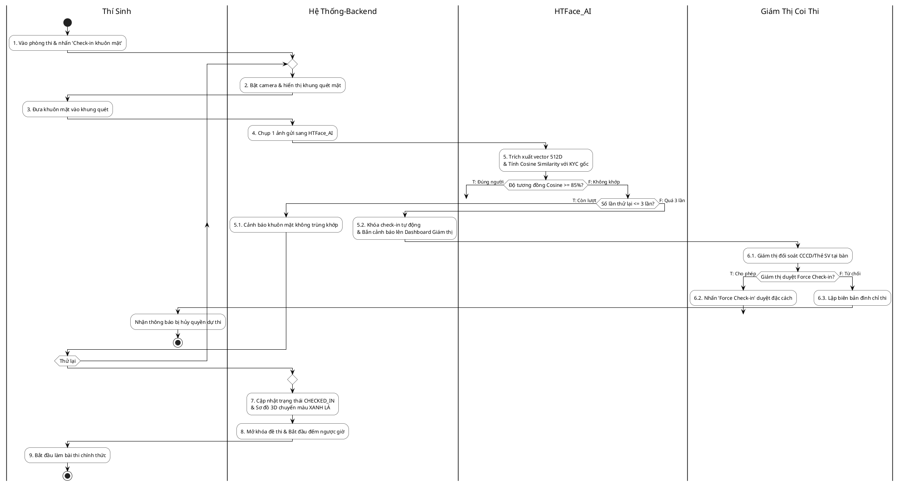

---

### AD-03: Quy trình Làm bài thi trực tuyến & Giám sát an toàn (Ứng với UC-03)
* **Các làn bơi (Swimlanes):** `Học Viên` | `Hệ Thống Làm Bài` | `Face AI Giám Sát` | `Giám Thị Coi Thi`.
* **Quy trình hoạt động:**
  1. *(Làn Học viên)* Đọc câu hỏi và thao tác trả lời trên màn hình khóa an toàn.
  2. *(Làn Hệ thống Làm bài)* Nhận từng click chọn đáp án $\rightarrow$ Tự động lưu bài liên tục (Auto-save).
  3. *(Làn Face AI)* Song song định kỳ 15-20 giây chụp ảnh kiểm tra ngầm $\rightarrow$ **Rẽ nhánh phát hiện**:
     - *Nếu bình thường:* Tiếp tục quan sát ngầm.
     - *Nếu thấy có người thứ hai lại gần bàn thi:* Quét mặt người thứ hai:
       + *Nếu là Giám thị đi qua [Extension Point: `GiamThiKiemTra`]:* Kích hoạt **Miễn trừ giám thị (0đ phạt)** $\rightarrow$ Ghi nhận bình thường.
       + *Nếu là người lạ:* Báo động đỏ lên Dashboard Giám thị và hiện cảnh báo nhắc nhở thí sinh.
  4. *(Làn Giám thị)* Xử lý tình huống phát sinh:
     - *Nếu phát hiện gian lận nặng [Extension Point: `GianLanNghiemTrong`]:* Ra lệnh Đình chỉ thi và khóa đề thi của thí sinh.
     - *Nếu thí sinh gửi tín hiệu SOS [Extension Point: `SuCoThietBi`]:* Kiểm tra sự cố máy tính và cấp thời gian bù giờ.
  5. *(Làn Học viên)* Làm xong bấm nộp bài (hoặc hết giờ máy tự động nộp bài).
  6. *(Làn Hệ thống Làm bài)* Chốt bài làm, chấm điểm phần trắc nghiệm tức thì $\rightarrow$ [KẾT THÚC].


#### Prompt cho Visual Paradigm AI (AD-03)
> **Cách dùng trong Visual Paradigm:** Chọn `Diagram type: Activity Diagram`, dán đoạn kịch bản dưới đây vào ô **Topic:** và bấm Generate:
```text
Tiêu đề: Sơ đồ hoạt động Làm bài thi an toàn & Giám sát AI ngầm (Chuẩn gọn)
Các làn bơi: Thí Sinh | Hệ Thống Làm Bài | Face AI Giám Sát | Giám Thị Coi Thi
Quy trình các bước:
● Bắt đầu tại làn Thí Sinh
1. Thí Sinh làm bài trên màn hình khóa an toàn Fullscreen
[Phân nhánh song song - Fork]
--- Nhánh 1 (Làm bài):
1.1. Thí Sinh click chọn đáp án các câu hỏi
1.2. Tự động lưu bài làm (Auto-Save 30s) lên máy chủ
1.3. Thí Sinh nhấn 'Nộp bài thi' hoặc Hết giờ làm bài
--- Nhánh 2 (Giám sát ngầm):
2.1. Chụp lén khung hình camera định kỳ mỗi 15 giây
2.2. Phân tích khuôn mặt: phát hiện quay mặt, vắng mặt, 2 người
2.3. Quyết định: Có hành vi bất thường?
   - [F]: Tiếp tục chu kỳ giám sát ngầm
   - [T]: 2.4. Quyết định: Người thứ 2 là Giám thị đi kiểm tra?
        - [T]: Kích hoạt Miễn trừ Giám thị (0 điểm phạt) & Ghi log an toàn
        - [F]: Chụp snapshot, ghi log vi phạm & Gửi cảnh báo WebSocket lên Dashboard Giám thị
3. Giám thị quan sát Dashboard -> 3.1. Quyết định: Mức độ vi phạm?
   - [Nhẹ]: 3.2. Gửi tin nhắn cảnh cáo trực tiếp lên màn hình thí sinh
   - [Nặng]: 3.3. Nhấn 'Đình chỉ thi' khóa bài từ xa & Lập biên bản
[Gộp nhánh song song - Join]
4. Chốt bài nộp, tổng hợp số lỗi vi phạm & Niêm phong bài thi
◉ Kết thúc tại làn Hệ Thống
```

#### Mã PlantUML Activity Diagram (AD-03)
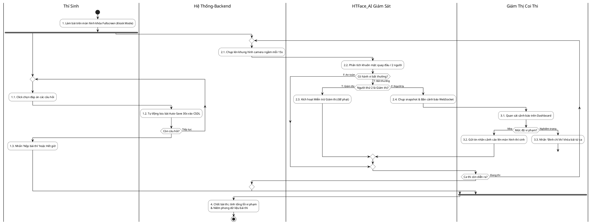

---

### AD-04: Quy trình Đấu trường Trắc nghiệm Tương tác Quiz Arena (Ứng với UC-04)
* **Các làn bơi (Swimlanes):** `Giảng Viên Host` | `Hệ Thống Máy Chủ` | `Học Viên Player`.
* **Quy trình hoạt động:**
  1. *(Làn Giảng viên)* Chọn bộ đề Quiz, cài đặt luật chơi (đua tốc độ, 3 tim) và bấm mở phòng thi đấu.
  2. *(Làn Hệ thống)* Tạo mã PIN 6 số ngẫu nhiên (VD: `824915`) và mở sảnh chờ.
  3. *(Làn Học viên)* Dùng điện thoại/máy tính nhập mã PIN và tên để vào phòng chờ.
  4. *(Làn Hệ thống)* Hiện tên học viên sinh động lên màn hình chiếu của lớp.
  5. *(Làn Giảng viên)* Thấy cả lớp đông đủ, bấm "Bắt đầu trận đấu".
  6. *(Vòng lặp mỗi câu hỏi)*:
     - Hệ thống đếm ngược 3-2-1 và chiếu câu hỏi lên màn hình.
     - Học viên nhìn câu hỏi và bấm 1 trong 4 khối màu sắc trên máy mình.
     - Hệ thống tính điểm đúng kèm điểm thưởng tốc độ và chuỗi đúng liên tiếp.
     - **Nếu học viên chọn sai trong chế độ 3 tim [Extension Point: `CheDoSinhTon`]:** Bị trừ 1 tim; nếu hết 3 tim thì bị loại trực tiếp (Knock-out).
     - Chiếu biểu đồ tỷ lệ chọn đáp án của cả lớp và Bảng xếp hạng Top 10 dẫn đầu.
  7. *(Hết toàn bộ câu hỏi)* Hệ thống phát nhạc chiến thắng và bắn pháo hoa tôn vinh Top 3 lên Bục Podium.
  8. **Nếu giảng viên muốn lấy điểm làm bài kiểm tra [Extension Point: `DongBoDiemSo`]:** Giảng viên bấm "Đồng bộ điểm môn học" $\rightarrow$ Hệ thống lưu vào bảng điểm chính thức của lớp $\rightarrow$ [KẾT THÚC].


#### Prompt cho Visual Paradigm AI (AD-04)
> **Cách dùng trong Visual Paradigm:** Chọn `Diagram type: Activity Diagram`, dán đoạn kịch bản dưới đây vào ô **Topic:** và bấm Generate:
```text
Tiêu đề: Sơ đồ hoạt động Đấu trường Quiz Arena thời gian thực (Chuẩn gọn)
Các làn bơi: Giảng Viên Host | Máy Chủ Quiz Realtime | Học Viên Player
Quy trình các bước:
● Bắt đầu tại làn Giảng Viên Host
1. Giảng Viên chọn bộ đề, cấu hình luật 3 tim & mở phòng đấu
2. Khởi tạo phòng, sinh mã PIN 6 số & mã QR phòng chơi
3. Học Viên nhập PIN/quét QR vào sảnh chờ, đặt tên & avatar
4. Hiển thị danh sách thí sinh Real-time lên màn hình sảnh chờ
5. Giảng Viên nhấn 'Start Battle' bắt đầu thi đấu
[Vòng lặp mỗi câu hỏi]:
6. Đồng bộ đẩy câu hỏi & Bắt đầu đếm ngược 15 giây
7. Học Viên đọc câu hỏi & click chọn đáp án
8. Tính điểm = Điểm đúng + Bonus tốc độ phản hồi (ms)
8.1. Quyết định: Học viên trả lời sai khi bật chế độ 3 tim?
   - [T]: Trừ 1 tim; nếu hết 3 tim chuyển sang chế độ Spectator
   - [F]: Cộng điểm & Duy trì chuỗi Streak thắng liên tiếp
9. Hết giờ: Công bố đáp án đúng & Bảng xếp hạng Top 5 tức thì
10. Giảng Viên nhấn chuyển câu hỏi tiếp theo
10.1. Quyết định: Còn câu hỏi trong bộ đề?
   - [T]: Quay lại bước 6
   - [F]: 11. Vinh danh Bục Podium Top 3 chung cuộc (Vàng, Bạc, Đồng)
12. Giảng Viên xuất file Excel báo cáo phân tích câu hỏi
◉ Kết thúc tại làn Giảng Viên
```

#### Mã PlantUML Activity Diagram (AD-04)
```plantuml
@startuml
skinparam conditionStyle inside
skinparam ActivityBackgroundColor #FFFFFF
skinparam ActivityBorderColor #000000
skinparam ActivityFontName Arial
skinparam ActivityFontSize 12
skinparam ArrowColor #000000

|Giảng Viên Host|
start
:1. Chọn bộ đề, cấu hình 3 tim sinh tồn & mở phòng;

|Hệ Thống-Backend|
:2. Khởi tạo phòng, sinh PIN 6 số & mã QR;

|Học Viên Player|
:3. Nhập PIN/quét QR vào phòng, đặt avatar;

|Hệ Thống-Backend|
:4. Cập nhật danh sách thí sinh Real-time lên sảnh;

|Giảng Viên Host|
:5. Nhấn 'Start Battle' bắt đầu thi đấu;

|Hệ Thống-Backend|
repeat
  :6. Đồng bộ đẩy câu hỏi & Countdown 15s;
  |Học Viên Player|
  :7. Đọc câu hỏi & click chọn đáp án;
  |Hệ Thống-Backend|
  :8. Tính điểm = Đúng + Bonus tốc độ (ms);
  if (Trả lời sai khi bật chế độ 3 tim?) then (T: Sai)
    :8.1. Trừ 1 tim;
Hết 3 tim chuyển sang Spectator;
  else (F: Đúng)
    :8.2. Cộng điểm & Tăng streak chuỗi thắng;
  endif
  :9. Hết giờ: Công bố đáp án & Leaderboard Top 5;
  |Giảng Viên Host|
  :10. Nhấn chuyển sang câu hỏi tiếp theo;
repeat while (Còn câu hỏi trong bộ đề?) is (T: Còn câu)
-> F: Hết đề;

|Hệ Thống-Backend|
:11. Vinh danh Bục Podium Top 3 chung cuộc;

|Giảng Viên Host|
:12. Xuất file Excel báo cáo thống kê;
stop
@enduml
```

---

### AD-05: Quy trình Lập lịch ca thi, Xếp bàn 3D & Cấp Số báo danh (Ứng với UC-05)
* **Các làn bơi (Swimlanes):** `Admin Hệ Thống` | `Thuật Toán Xếp Chỗ 3D` | `Học Viên`.
* **Quy trình hoạt động:**
  1. *(Làn Admin)* Tạo ca thi mới: chọn môn thi, ngày thi, thời lượng, phòng máy 3D và gán danh sách sinh viên.
  2. *(Làn Thuật toán Xếp chỗ)* Kiểm tra điều kiện khuôn mặt KYC của từng sinh viên:
     - *Nếu sinh viên chưa duyệt KYC [Extension Point: `ChuaHoanThanhKYC`]:* Tạm hoãn xếp chỗ, hệ thống gửi thông báo yêu cầu sinh viên hoàn thiện chụp 5 góc mặt.
     - *Nếu sinh viên đã KYC APPROVED:* Xáo trộn ngẫu nhiên sinh viên vào các vị trí bàn còn tốt trên lưới 3D $\rightarrow$ Tự động cấp Số Báo Danh (SBD) duy nhất.
  3. *(Làn Admin)* Phân công Giảng viên coi thi và bấm xuất bản lịch thi.
  4. *(Làn Học viên)* Đăng nhập vào mục "Lịch thi của tôi" $\rightarrow$ **Rẽ nhánh**:
     - *Nếu đã được xếp chỗ:* Xem giờ thi, phòng máy, SBD và sơ đồ bàn 3D chỉ rõ chỗ ngồi của mình kèm đồng hồ đếm ngược $\rightarrow$ [KẾT THÚC].
     - *Nếu bị tạm hoãn:* Nhận thông báo hướng dẫn chụp ảnh KYC để được xếp bổ sung $\rightarrow$ [KẾT THÚC].


#### Prompt cho Visual Paradigm AI (AD-05)
> **Cách dùng trong Visual Paradigm:** Chọn `Diagram type: Activity Diagram`, dán đoạn kịch bản dưới đây vào ô **Topic:** và bấm Generate:
```text
Tiêu đề: Sơ đồ hoạt động Lập lịch ca thi & Phân bổ phòng máy 3D (Chuẩn gọn)
Các làn bơi: Admin Khảo Thí | Thuật Toán Xếp Chỗ 3D | Thí Sinh
Quy trình các bước:
● Bắt đầu tại làn Admin Khảo Thí
1. Admin tạo ca thi: chọn môn, ngày giờ, phòng máy 3D & DS lớp
2. Kiểm tra tính khả dụng của phòng thi & xung đột lịch
2.1. Quyết định: Phòng máy bị trùng lịch hoặc quá tải?
   - [T]: Báo lỗi xung đột lịch thi -> Admin chọn lại phòng/giờ -> Quay lại bước 1
   - [F]: 3. Tải ma trận phòng 3D (loại bỏ máy hỏng/bảo trì)
4. Lọc danh sách thí sinh theo trạng thái Face KYC
4.1. Quyết định: Sinh viên đã duyệt KYC APPROVED?
   - [F]: 4.2. Tạm hoãn xếp chỗ bàn thi & Bắn thông báo bổ sung KYC
   - [T]: 5. Áp dụng thuật toán xáo trộn & Phân bổ so-le chống nhìn bài
6. Cấp Số Báo Danh (SBD) duy nhất & Gán tọa độ bàn máy 3D
7. Admin xem trước sơ đồ phòng 3D & Nhấn 'Xuất bản lịch thi chính thức'
8. Thí Sinh nhận thông báo, đăng nhập xem SBD & vị trí bàn máy 3D
◉ Kết thúc tại làn Thí Sinh
```

#### Mã PlantUML Activity Diagram (AD-05)
```plantuml
@startuml
skinparam conditionStyle inside
skinparam ActivityBackgroundColor #FFFFFF
skinparam ActivityBorderColor #000000
skinparam ActivityFontName Arial
skinparam ActivityFontSize 12
skinparam ArrowColor #000000

|Admin Khảo Thí|
start
repeat
  :1. Tạo ca thi: chọn môn, ngày giờ & phòng 3D;
  |Hệ Thống-Backend|
  :2. Kiểm tra tính khả dụng & xung đột lịch;
backward: 2.1. Hiển thị cảnh báo xung đột lịch thi;
repeat while (Phòng máy bị trùng lịch hoặc quá tải?) is (T: Bị trùng)
-> F: Khả dụng;

:3. Tải ma trận phòng 3D (loại bỏ máy hỏng);
:4. Lọc danh sách thí sinh theo trạng thái Face KYC;

|Thuật Toán Xếp Chỗ 3D|
if (Sinh viên đã duyệt KYC APPROVED?) then (T: Đã duyệt)
  :5. Áp dụng thuật toán xáo trộn & Xếp so-le chống nhìn bài;
  :6. Cấp SBD duy nhất & Gán tọa độ bàn 3D;
  |Admin Khảo Thí|
  :7. Xem trước sơ đồ 3D & Nhấn 'Xuất bản lịch';
  |Hệ Thống-Backend|
  :8. Gửi thông báo lịch thi tới thí sinh;
  |Thí Sinh|
  :9. Đăng nhập xem giờ thi, SBD & vị trí bàn 3D;
  stop
else (F: Chưa KYC)
  |Thuật Toán Xếp Chỗ 3D|
  :Tạm hoãn xếp chỗ bàn thi;
  |Thí Sinh|
  :Nhận thông báo cần chụp bổ sung 5 góc mặt KYC;
  stop
endif
@enduml
```

---

### AD-06: Quy trình Soạn thảo & Quản lý Đề thi trong Studio (Ứng với UC-06)
* **Các làn bơi (Swimlanes):** `Giảng Viên` | `Trình Phân Tích Đề Thi` | `Admin Khảo Thí`.
* **Quy trình hoạt động:**
  1. *(Làn Giảng viên)* Truy cập Assessment Studio và bấm "Tạo đề thi mới".
  2. *(Làn Giảng viên)* Lựa chọn phương thức nhập câu hỏi $\rightarrow$ **Rẽ nhánh**:
     - *Tải tệp Word/Excel có sẵn [Extension Point: `NhapDeTuFile`]:* Tải file lên $\rightarrow$ Sang làn Trình Phân tích Đề thi: bóc tách tự động câu hỏi, các đáp án và đáp án đúng trong 2 giây.
     - *Tự gõ thủ công:* Nhập từng câu hỏi trắc nghiệm/tự luận trên giao diện kéo thả.
  3. *(Làn Giảng viên)* Kiểm tra loại câu hỏi: nếu là môn Lập trình [Extension Point: `MonHocLapTrinh`] $\rightarrow$ Cấu hình bộ Test Cases (đầu vào, đầu ra mong đợi, giới hạn RAM/CPU).
  4. *(Làn Giảng viên)* Bật tùy chọn *Tự động xáo câu hỏi* và *Đảo vị trí đáp án*.
  5. *(Làn Giảng viên)* Bấm "Xem trước đề thi" để làm thử nghiệm dưới góc nhìn học viên $\rightarrow$ Bấm lưu đề thi.
  6. *(Làn Admin)* Nhận thông báo có đề mới $\rightarrow$ Kiểm tra tính toàn vẹn và Phê duyệt đề thi đưa vào ca thi chính thức $\rightarrow$ [KẾT THÚC].


#### Prompt cho Visual Paradigm AI (AD-06)
> **Cách dùng trong Visual Paradigm:** Chọn `Diagram type: Activity Diagram`, dán đoạn kịch bản dưới đây vào ô **Topic:** và bấm Generate:
```text
Tiêu đề: Sơ đồ hoạt động Soạn thảo & Quản lý Đề thi Studio (Chuẩn gọn)
Các làn bơi: Giảng Viên Soạn Đề | Assessment Studio | Hội Đồng Thẩm Định
Quy trình các bước:
● Bắt đầu tại làn Giảng Viên Soạn Đề
1. Giảng Viên vào Assessment Studio & bấm 'Tạo đề thi mới'
1.1. Quyết định: Phương thức nhập liệu đề thi?
   - [Import File]: Tải Word/Excel -> Regex Parser bóc tách câu hỏi, đáp án trong 2s
   - [AI Trợ lý]: Tải PDF bài giảng -> AI sinh câu hỏi theo ma trận Bloom
   - [Gõ thủ công]: Nhập câu hỏi trực tiếp trên Form Editor phong phú
2. Kiểm tra tính toàn vẹn: Mỗi câu có đáp án đúng, chống trùng lặp
3. Bật cấu hình bảo mật: Đảo thứ tự câu hỏi & Xáo trộn phương án đáp án
4. Giảng Viên xem trước đề thi & Nhấn 'Gửi phê duyệt đề thi'
5. Hội Đồng Thẩm Định mở kho đề PENDING & kiểm tra ma trận đề
5.1. Quyết định: Đề thi đạt chuẩn chất lượng khảo thí?
   - [F]: 5.2. Từ chối phê duyệt & Ghi chú lỗi -> Giảng viên sửa lại đề -> Quay lại bước 4
   - [T]: 5.3. Nhấn 'Phê duyệt APPROVED' & Niêm phong vào Ngân hàng đề thi
◉ Kết thúc tại làn Hội Đồng
```

#### Mã PlantUML Activity Diagram (AD-06)
```plantuml
@startuml
skinparam conditionStyle inside
skinparam ActivityBackgroundColor #FFFFFF
skinparam ActivityBorderColor #000000
skinparam ActivityFontName Arial
skinparam ActivityFontSize 12
skinparam ArrowColor #000000

|Giảng Viên Soạn Đề|
start
:1. Vào Assessment Studio & bấm 'Tạo đề mới';
if (Phương thức nhập liệu đề thi?) then (Tự gõ)
  :Tự gõ câu hỏi thủ công trên Editor;
else if (Import File) then (Word/Excel)
  :Tải lên file Word/Excel có sẵn;
  |Hệ Thống-Backend (Studio)|
  :Regex Parser bóc tách tự động trong 2s;
else (AI Trợ lý)
  |Giảng Viên Soạn Đề|
  :Tải lên PDF bài giảng;
  |Hệ Thống-Backend (Studio)|
  :AI sinh bộ câu hỏi theo ma trận Bloom;
endif

|Hệ Thống-Backend (Studio)|
:2. Kiểm tra tính toàn vẹn câu hỏi & đáp án;

|Giảng Viên Soạn Đề|
:3. Bật bảo mật: Đảo câu hỏi & Xáo đáp án;
repeat
  :4. Xem trước đề thi & Bấm 'Gửi phê duyệt';
  |Hội Đồng Thẩm Định|
  :5. Mở kho đề PENDING & Kiểm tra ma trận;
backward: 5.1. Từ chối phê duyệt & Ghi chú yêu cầu sửa;
|Giảng Viên Soạn Đề|
Tiếp nhận ghi chú & Hiệu chỉnh lại đề;
repeat while (Đề thi đạt chuẩn chất lượng khảo thí?) is (F: Chưa đạt)
-> T: Đạt chuẩn;

|Hội Đồng Thẩm Định|
:5.2. Nhấn 'Phê duyệt APPROVED' & Niêm phong ngân hàng đề;

|Hệ Thống-Backend (Studio)|
:6. Thông báo đề thi đã được phê duyệt thành công;
stop
@enduml
```

---

### AD-07: Quy trình Thiết lập Cơ cấu tổ chức & Phòng thi 3D (Ứng với UC-07)
* **Các làn bơi (Swimlanes):** `Admin Hệ Thống` | `Hệ Thống Dựng Hình 3D` | `Hạ Tầng Camera CCTV`.
* **Quy trình hoạt động:**
  1. *(Làn Admin)* Khai báo cây tổ chức đào tạo: Khoa $\rightarrow$ Khóa học $\rightarrow$ Lớp học.
  2. *(Làn Admin)* Chọn tạo phòng thi mới, nhập thông tin: Tên phòng, số hàng bàn, số cột bàn.
  3. *(Làn Hệ thống Dựng hình 3D)* Tự động tạo lập sơ đồ phòng thi 3D trực quan theo lưới bàn.
  4. *(Làn Admin)* Khảo sát phòng máy $\rightarrow$ **Rẽ nhánh kiểm tra [Extension Point: `PhatHienBanHong`]**:
     - *Nếu có bàn máy tính bị hỏng:* Click chuột đánh dấu bàn hỏng $\rightarrow$ Hệ thống 3D đổi màu bàn sang màu xám và khóa không cho xếp chỗ.
     - *Nếu không có bàn hỏng:* Giữ nguyên toàn bộ bàn khả dụng.
  5. *(Làn Admin)* Nhập địa chỉ camera quan sát của phòng máy.
  6. *(Làn Hạ tầng Camera)* Kiểm tra luồng tín hiệu hình ảnh $\rightarrow$ Xác nhận kết nối thành công.
  7. *(Làn Admin)* Bấm "Lưu phòng thi" $\rightarrow$ Hệ thống lưu vào CSDL sẵn sàng tổ chức thi $\rightarrow$ [KẾT THÚC].


#### Prompt cho Visual Paradigm AI (AD-07)
> **Cách dùng trong Visual Paradigm:** Chọn `Diagram type: Activity Diagram`, dán đoạn kịch bản dưới đây vào ô **Topic:** và bấm Generate:
```text
Tiêu đề: Sơ đồ hoạt động Thiết lập Cơ cấu & Dựng Phòng thi 3D (Chuẩn gọn)
Các làn bơi: Admin Hệ Thống | Hệ Thống Dựng Hình 3D | Hạ Tầng Camera CCTV
Quy trình các bước:
● Bắt đầu tại làn Admin Hệ Thống
1. Khai báo cây cơ cấu đào tạo: Khoa -> Khóa học -> Lớp học
2. Mở '3D Room Builder', nhập kích thước phòng & số hàng x cột bàn
3. Tự động dựng lưới phòng 3D: Bàn thi, máy tính PC, bàn giám thị
4. Admin kéo thả điều chỉnh bàn máy
4.1. Quyết định: Có máy tính nào bị hỏng/lỗi?
   - [T]: Click đánh dấu bàn hỏng -> Đổi màu máy sang XÁM KHÓA
   - [F]: Giữ nguyên toàn bộ bàn máy khả dụng
5. Nhập URL luồng RTSP camera CCTV quan sát toàn cảnh phòng
6. Mô phỏng nón quét góc nhìn FOV kiểm tra điểm mù trong không gian 3D
6.1. Quyết định: Có điểm mù góc khuất vị trí thí sinh?
   - [T]: Cảnh báo vùng khuất -> Admin xoay chỉnh góc quay camera -> Quay lại bước 6
   - [F]: Xác nhận góc quét bao phủ tối ưu
7. Admin nhấn 'Lưu cấu hình phòng thi 3D'
8. Xuất bản tọa độ 3D & Sơ đồ phòng thi vào CSDL phục vụ giám sát
◉ Kết thúc tại làn Admin
```

#### Mã PlantUML Activity Diagram (AD-07)
```plantuml
@startuml
skinparam conditionStyle inside
skinparam ActivityBackgroundColor #FFFFFF
skinparam ActivityBorderColor #000000
skinparam ActivityFontName Arial
skinparam ActivityFontSize 12
skinparam ArrowColor #000000

|Admin Hệ Thống|
start
:1. Khai báo cây đào tạo: Khoa -> Khóa -> Lớp;
:2. Mở '3D Builder', nhập kích thước & lưới bàn;

|Hệ Thống-Backend|
:3. Tự động dựng lưới phòng 3D trực quan;

|Admin Hệ Thống|
:4. Kéo thả chuột kiểm tra tình trạng bàn máy;
if (Có máy tính nào bị hỏng/lỗi?) then (T: Có máy hỏng)
  :Click đánh dấu bàn máy bị hỏng;
  |Hệ Thống-Backend|
  :Cập nhật màu máy sang XÁM KHÓA;
else (F: Bình thường)
endif

|Admin Hệ Thống|
:5. Nhập URL RTSP camera CCTV giám sát;
repeat
  |Hệ Thống-Backend|
  :6. Mô phỏng nón quét FOV kiểm tra điểm mù;
backward: |Admin Hệ Thống|
6.1. Xoay chỉnh góc quay / Thêm camera phụ;
repeat while (Có điểm mù góc khuất vị trí thí sinh?) is (T: Bị điểm mù)
-> F: Bao phủ tối ưu;

|Admin Hệ Thống|
:7. Nhấn 'Lưu cấu hình phòng thi 3D';

|Hệ Thống-Backend|
:8. Xuất bản tọa độ 3D & Sơ đồ phòng vào CSDL;
stop
@enduml
```

---

### AD-08: Quy trình Chấm thi rọc phách, Hậu kiểm vi phạm & Phúc khảo (Ứng với UC-08)
* **Các làn bơi (Swimlanes):** `Hệ Thống Tự Động` | `Giảng Viên Chấm Thi` | `Admin Khảo Thí` | `Học Viên & Hội Đồng`.
* **Quy trình hoạt động:**
  1. *(Làn Hệ thống Tự động)* Ca thi kết thúc $\rightarrow$ Tự động chấm 100% câu hỏi trắc nghiệm ngay lập tức.
  2. *(Làn Hệ thống Tự động)* Rọc phách điện tử: ẩn danh tên và MSSV thành Mã phách #xxxx $\rightarrow$ Chuyển bài tự luận/code cho Giảng viên.
  3. *(Làn Giảng viên Chấm thi)* Mở bài thi ẩn danh $\rightarrow$ Chấm điểm và nhận xét công tâm theo barem điểm.
  4. *(Làn Admin Khảo thí)* Đối soát dòng thời gian và ảnh chụp vi phạm từ AI $\rightarrow$ **Rẽ nhánh**:
     - *Nếu vi phạm thật:* Áp dụng mức trừ điểm theo quy định.
     - *Nếu là hiểu lầm (Giám thị đi kiểm tra):* Bỏ qua và giữ nguyên điểm số.
  5. *(Làn Admin Khảo thí)* Bấm "Phê duyệt & Công bố điểm thi".
  6. *(Làn Học viên & Hội đồng)* Học viên đăng nhập xem điểm thi và lời giải chi tiết $\rightarrow$ **Rẽ nhánh [Extension Point: `KhieuNaiDiemThi`]**:
     - *Nếu đồng ý với điểm số:* Hoàn tất môn học $\rightarrow$ [KẾT THÚC].
     - *Nếu có thắc mắc trong 7 ngày:* Bấm "Nộp đơn phúc khảo trực tuyến" $\rightarrow$ Hội đồng khảo thí chấm lại độc lập và đối soát camera $\rightarrow$ Cập nhật điểm mới và phản hồi trực tiếp cho học viên $\rightarrow$ [KẾT THÚC].


#### Prompt cho Visual Paradigm AI (AD-08)
> **Cách dùng trong Visual Paradigm:** Chọn `Diagram type: Activity Diagram`, dán đoạn kịch bản dưới đây vào ô **Topic:** và bấm Generate:
```text
Tiêu đề: Sơ đồ hoạt động Chấm thi rọc phách & Hậu kiểm vi phạm AI (Chuẩn gọn)
Các làn bơi: Hệ Thống Tự Động | Giảng Viên Chấm Thi | Admin Khảo Thí | Thí Sinh & Hội Đồng
Quy trình các bước:
● Bắt đầu tại làn Hệ Thống Tự Động khi ca thi kết thúc
1. Tự động chấm điểm 100% các câu hỏi trắc nghiệm khách quan
2. Rọc phách điện tử: Ẩn danh tên thí sinh thành Mã phách #PHACH-xxxx
3. Giảng Viên mở bài ẩn danh -> Chấm tự luận & code theo barem chuẩn
4. Nhập điểm và nhận xét công tâm -> Hoàn thành chấm bài
5. Admin mở Dashboard 'Hậu kiểm vi phạm AI' -> Đối soát Timeline & ảnh chụp
5.1. Quyết định: Xác nhận có vi phạm gian lận thi cử?
   - [T]: Áp dụng mức trừ điểm phạt (25%, 50%, 0đ) & Lập biên bản
   - [F]: Bác bỏ cảnh báo dương tính giả & Giữ nguyên điểm thi gốc
6. Admin nhấn 'Khớp phách & Công bố Điểm thi chính thức'
7. Thí Sinh đăng nhập xem điểm thi & Bảng giải thích chi tiết
7.1. Quyết định: Thí Sinh có nộp đơn phúc khảo trong 48h?
   - [F]: Hoàn tất môn học & Lưu sổ điểm học vụ -> ◉ Kết thúc
   - [T]: 7.2. Nộp đơn trực tuyến -> 7.3. Hội đồng phúc khảo chấm lại độc lập -> 7.4. Ban hành điểm mới & Cập nhật học vụ -> ◉ Kết thúc
```

#### Mã PlantUML Activity Diagram (AD-08)
```plantuml
@startuml
skinparam conditionStyle inside
skinparam ActivityBackgroundColor #FFFFFF
skinparam ActivityBorderColor #000000
skinparam ActivityFontName Arial
skinparam ActivityFontSize 12
skinparam ArrowColor #000000

|Hệ Thống-Backend|
start
:1. Tự động chấm 100% câu hỏi trắc nghiệm;
:2. Rọc phách điện tử: Ẩn danh thành #PHACH-xxxx;

|Giảng Viên Chấm Thi|
:3. Mở bài ẩn danh: Chấm tự luận & code theo barem;
:4. Nhập điểm và nhận xét công tâm -> Hoàn thành;

|Admin Khảo Thí|
:5. Mở Dashboard 'Hậu kiểm vi phạm AI';
if (Xác nhận có vi phạm gian lận thi cử?) then (T: Vi phạm thật)
  :5.1. Áp dụng trừ điểm phạt (25%, 50%, 0đ);
else (F: Dương tính giả)
  :5.2. Bác bỏ cảnh báo & Giữ nguyên điểm gốc;
endif

|Hệ Thống-Backend|
:6. Khớp phách & Công bố Điểm thi chính thức;

|Thí Sinh & Hội Đồng|
:7. Đăng nhập xem điểm thi & Bảng giải thích;
if (Có nộp đơn khiếu nại phúc khảo trong 48h?) then (T: Khiếu nại)
  :8.1. Nộp đơn phúc khảo trực tuyến trong 48h;
  |Admin Khảo Thí|
  :8.2. Chuyển đơn cho Hội đồng phúc khảo chấm lại;
  |Thí Sinh & Hội Đồng|
  :8.3. Hội đồng ban hành điểm mới & Cập nhật học vụ;
  stop
else (F: Đồng ý kết quả)
  :Hoàn tất môn học & Lưu sổ điểm học vụ;
  stop
endif
@enduml
```

---

## 2.5 BẢNG KIỂM TRA ĐẦU RA BÁO CÁO (CHECKLIST CHO BẠN)

| STT | Nội dung trong báo cáo | Trạng thái | Hướng dẫn cụ thể |
|:---:|:---|:---:|:---|
| 1 | **Biểu đồ Use Case tổng quát** | Đã có hình | Vẽ lại đúng theo hình ảnh bạn đã gửi (dùng Visio/Visual Paradigm). |
| 2 | **8 Biểu đồ Use Case phân rã** | 8 sơ đồ | Vẽ theo hướng dẫn tại **Mục 2.2** (từ UC-01 đến UC-08, có thể hiện ngăn `extension points`). |
| 3 | **8 Bảng đặc tả Use Case chi tiết** | 8 bảng | Sao chép nguyên văn 8 bảng tại **Mục 2.2** (đã có trường Extension Points) vào dưới mỗi sơ đồ phân rã. |
| 4 | **8 Biểu đồ tuần tự (Sequence Diagram)** | 8 sơ đồ | Vẽ theo các bước thông điệp đã liệt kê sẵn tại **Mục 2.3** (từ SD-01 đến SD-08, đồng bộ 100% với Use Case). |
| 5 | **8 Biểu đồ hoạt động (Activity Diagram)** | 8 sơ đồ | Vẽ theo các làn bơi (Swimlanes) đã liệt kê sẵn tại **Mục 2.4** (từ AD-01 đến AD-08, đồng bộ 100% với Sequence). |
