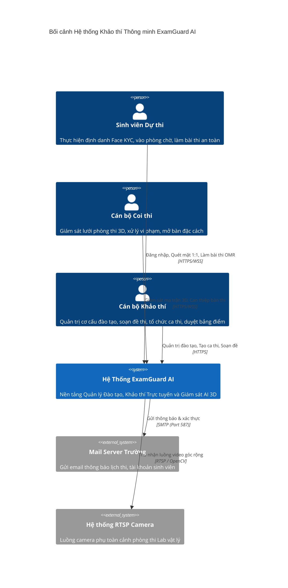
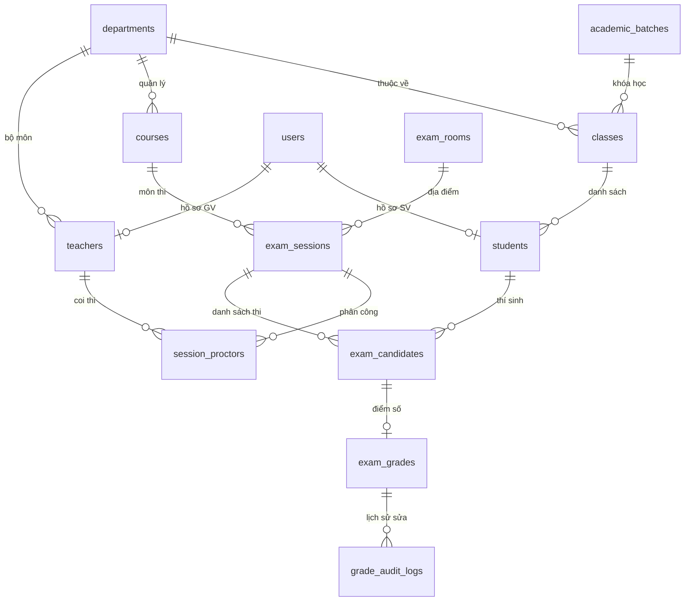
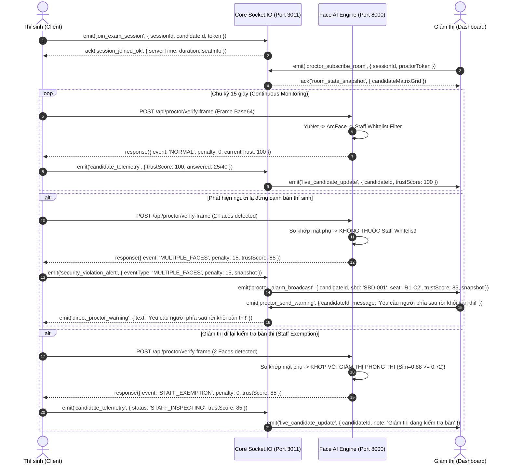

# TÀI LIỆU THIẾT KẾ KIẾN TRÚC HỆ THỐNG (SYSTEM ARCHITECTURE DESIGN DOCUMENT)
# EXAMGUARD AI — HỆ THỐNG KHẢO THÍ TRỰC TUYẾN & GIÁM SÁT 3D ĐA PHÒNG MÁY TÍCH HỢP FACE AI

```
========================================================================================================
ĐỒ ÁN TỐT NGHIỆP ĐẠI HỌC — NGÀNH CÔNG NGHỆ THÔNG TIN
Đề tài: Ứng dụng Mạng nơ-ron Tích chập YuNet & ArcFace Xây dựng Hệ thống Khảo thí Trực tuyến Bảo mật Đa tầng
Sinh viên thực hiện : LỤC VĂN SƠN          Mã sinh viên : 2310900087          Lớp : K23CNT3
Giảng viên hướng dẫn: ThS. LÊ TRỌNG NHẤT   Đơn vị       : Trường Đại học Nguyễn Trãi
Phiên bản tài liệu  : v4.0 (Enterprise Specification)                     Ngày cập nhật: Tháng 10/2026
========================================================================================================
```

---

## MỤC LỤC CHI TIẾT

- [1. Bản Đặc Tả Tuyên Ngôn & 6 Điểm Nhấn Khác Biệt (Unique Selling Points)](#1-bản-đặc-tả-tuyên-ngôn--6-điểm-nhấn-khác-biệt)
- [2. Bản Ghi Quyết Định Kiến Trúc (Architectural Decision Records - ADRs)](#2-bản-ghi-quyết-định-kiến-trúc-adrs)
- [3. Kiến Trúc Tổng Thể & Mô Hình C4 (C4 Architecture Model)](#3-kiến-trúc-tổng-thể--mô-hình-c4)
- [4. Động Cơ Thị Giác Máy Tính & Sinh Trắc Học AI (Computer Vision Engine)](#4-động-cơ-thị-giác-máy-tính--sinh-trắc-học-ai)
- [5. Kiến Trúc Lưu Trữ Đa Hình (Polyglot Persistence Architecture)](#5-kiến-trúc-lưu-trữ-đa-hình-polyglot-persistence)
- [6. Quy Chế Khảo Thí, Máy Trạng Thái & Mô Hình Điểm Uy Tín (Trust Score Dynamics)](#6-quy-chế-khảo-thí-máy-trạng-thái--mô-hình-điểm-uy-tín)
- [7. Thiết Kế Phân Hệ Tạo Đề Thi & Quản Lý Ngân Hàng Câu Hỏi (Exam Paper Authoring Engine)](#7-thiết-kế-phân-hệ-tạo-đề-thi--quản-lý-ngân-hàng-câu-hỏi)
- [8. Thiết Kế Động Cơ Chấm Thi Tự Động & Quy Trình Phúc Khảo (Grading & Evaluation Engine)](#8-thiết-kế-động-cơ-chấm-thi-tự-động--quy-trình-phúc-khảo)
- [9. Hệ Thống Thiết Kế Không Gian Học Thuật & Bộ Prompt Google Stitch (ExamGuard AI Spatial Design System)](#9-hệ-thống-thiết-kế-không-gian-học-thuật--bộ-prompt-google-stitch-examguard-ai-spatial-design-system)
- [10. Giao Thức Truyền Thông Thời Gian Thực (Realtime Socket.IO Protocol)](#10-giao-thức-truyền-thông-thời-gian-thực)
- [11. Ma Trận Phòng Thủ Gian Lận & Bản Đồ Ứng Phó Sự Cố (FMEA & Security Defenses)](#11-ma-trận-phòng-thủ-gian-lận--bản-đồ-ứng-phó-sự-cố)
- [12. Báo Cáo Đo Lường Hiệu Năng & Hướng Dẫn Vận Hành (Benchmarks & Operations)](#12-báo-cáo-đo-lường-hiệu-năng--hướng-dẫn-vận-hành)

---

## 1. BẢN ĐẶC TẢ TUYÊN NGÔN & 6 ĐIỂM NHẤN KHÁC BIỆT

### 1.1 Tuyên Ngôn Kiến Trúc
Hầu hết các nền tảng thi trực tuyến hiện hành (Moodle, Azota, Google Forms hay MS Teams) chỉ đơn thuần là các ứng dụng web hiển thị form câu hỏi, hoàn toàn thụ động trước các hành vi gian lận công nghệ cao. Mặt khác, các giải pháp Proctored quốc tế đắt đỏ (như Proctorio, Honorlock) lại vận hành như "hộp đen", gây ra tỷ lệ báo động giả (False Positive) khổng lồ khi thí sinh vô tình cử động đầu hoặc khi Giám thị di chuyển quanh phòng thi.

**ExamGuard AI** được kiến trúc với triết lý: **"Zero-Trust Environment, Biometric Ground-Truth Baseline & Human-in-the-Loop Collaboration"**. Hệ thống không nhằm mục đích thay thế con người mà đóng vai trò là "Trợ lý Giám thị AI", cung cấp bức tranh số hóa toàn cảnh (Digital Twin Matrix) của phòng thi với 6 điểm nhấn kỹ thuật đột phá:

```
┌──────────────────────────────────────────────────────────────────────────────────────────────────┐
│                     6 ĐIỂM NHẤN CÔNG NGHỆ ĐỘT PHÁ CỦA EXAMGUARD AI                               │
├────────────────────────────────┬─────────────────────────────────────────────────────────────────┤
│ 1. Dual-Screen PDF Snipping    │ Cho phép cắt sơ đồ mạch điện, công thức toán trực tiếp từ file  │
│    Tool & Interactive OMR      │ PDF đề gốc; giao diện chia đôi màn hình hiển thị phiếu làm bài. │
├────────────────────────────────┼─────────────────────────────────────────────────────────────────┤
│ 2. Staff Biometric Whitelist   │ Triệt tiêu 100% cảnh báo giả khi Giám thị đi kiểm tra bàn thi   │
│    (Cơ chế Miễn trừ Giám thị)  │ thông qua nhận diện khuôn mặt giám thị và gán STAFF_EXEMPTION(0đ)│
├────────────────────────────────┼─────────────────────────────────────────────────────────────────┤
│ 3. 3D Digital Twin Matrix      │ Mô phỏng mạng lưới chỗ ngồi vật lý (Dãy x Cột) đồng bộ realtime │
│    (Ma trận Phòng thi 3D)      │ WebSocket < 50ms, trực quan hóa Heatmap Điểm Uy Tín (0-100).    │
├────────────────────────────────┼─────────────────────────────────────────────────────────────────┤
│ 4. CPU-First YuNet ONNX        │ Tốc độ suy luận AI siêu nhẹ ≤ 12ms trên CPU thông thường,       │
│    Pipeline (FPS > 30)         │ trích xuất 512-D ArcFace và phát hiện người thật MiniFASNet.   │
├────────────────────────────────┼─────────────────────────────────────────────────────────────────┤
│ 5. Polyglot Persistence Kép    │ MySQL 8.0 (13 bảng chuẩn ACID toàn vẹn điểm) kết hợp song song  │
│    (MySQL ACID + MongoDB)      │ MongoDB 7.0+ (Tài liệu đề thi, telemetry & ảnh bằng chứng vi phạm│
├────────────────────────────────┼─────────────────────────────────────────────────────────────────┤
│ 6. Quy Chế Khảo Thí Nghiêm Ngặt│ Phòng chờ đếm ngược Zero-Knowledge, tự động khóa sau 15 phút,   │
│    (Strict Exam Regulation)    │ Giám thị mở bàn đặc cách có bù giờ (+0p, +5p, +10p, +15p) Audit.│
└────────────────────────────────┴─────────────────────────────────────────────────────────────────┘
```

### 1.2 Bảng So Sánh Chi Tiết Với Các Nền Tảng Khảo Thí Trên Thị Trường

| Tiêu chí Đánh giá Kỹ thuật | Google Forms / Azota | Moodle Quiz | Safe Exam Browser (SEB) | Proctorio / Honorlock | **ExamGuard AI (Đề tài)** |
|---|:---:|:---:|:---:|:---:|:---:|
| **Xác thực Sinh trắc học Cổng vào** | ❌ Không | ❌ Không | ❌ Không | ⚠️ Có (Chụp ảnh gửi Cloud) | ✅ **1:1 Face AI Liveness (<1s)** |
| **Bảo vệ Tráo người giữa giờ thi** | ❌ Không | ❌ Không | ❌ Không | ⚠️ Có (Độ trễ cao) | ✅ **Continuous Match (15s)** |
| **Xử lý Giám thị lại gần kiểm tra**| ❌ Không | ❌ Không | ❌ Không | ❌ Phạt nhầm thí sinh | ✅ **Staff Biometric Whitelist (0đ)**|
| **Đề thi Kỹ thuật/Sơ đồ phức tạp**  | ❌ Nhập chay text | ⚠️ Upload ảnh thô | ⚠️ Tùy Server | ❌ Không hỗ trợ | ✅ **Dual-Screen Snipping Tool** |
| **Ma trận Phòng thi Vật lý (3D)** | ❌ Không | ❌ Không | ❌ Không | ❌ Chỉ xem webcam đơn lẻ | ✅ **Grid Digital Twin Matrix** |
| **Khóa Môi trường Trình duyệt**    | ❌ Không | ⚠️ Plugin mở rộng | ✅ Rất mạnh (Cài App) | ⚠️ Extension Chrome | ✅ **In-Browser Sandbox Lockdown** |
| **Hạ tầng Yêu cầu**               | Cloud Google | Server PHP/MySQL | Cài Client cục bộ | Cloud GPU đắt đỏ | ✅ **Chạy tốt trên CPU thường** |
| **Bảo toàn dữ liệu khi mất mạng**   | ❌ Mất bài | ⚠️ Hên xui | ⚠️ Tùy cấu hình | ⚠️ Lưu cục bộ một phần | ✅ **Offline Buffer + Eventual Sync**|

---

## 2. BẢN GHI QUYẾT ĐỊNH KIẾN TRÚC (ADRs)

Trong kỹ nghệ phần mềm chuyên nghiệp, các quyết định kiến trúc không được đưa ra ngẫu nhiên mà phải dựa trên sự đánh đổi (Trade-off Analysis) rõ ràng giữa chi phí, hiệu năng và tính an toàn.

### ADR-01: Kiến Trúc Đa Lưu Trữ (Polyglot Persistence: MySQL + MongoDB)
* **Ngữ cảnh:** Hệ thống cần vừa quản lý cơ cấu học vụ chuẩn mực (Khoa, Khóa, Lớp, Sinh viên, Sổ điểm chính thức với tính toàn vẹn tham chiếu nghiêm ngặt) vừa phải xử lý dữ liệu khảo thí biến động cao (Đề thi hỗn hợp, câu hỏi động, mảng vector 512 số thực, chuỗi snapshot ảnh Base64 vi phạm).
* **Quyết định:** Không sử dụng duy nhất một CSDL mà phân tách rõ ràng 2 tầng:
  1. `MySQL 8.0`: Đảm nhận 13 bảng phân cấp đào tạo, xếp chỗ và bảng điểm chính thức. Tuân thủ chuẩn ACID. Sử dụng Foreign Key Cascading và Transaction Isolation Level `READ COMMITTED`.
  2. `MongoDB 7.0+`: Đảm nhận lưu trữ tài liệu đề thi (`exampapers`), ngân hàng câu hỏi đa hình (`questions`), bản lưu nháp câu trả lời (`draft_answers`), vector sinh trắc học (`studentkycs`) và nhật ký vi phạm (`proctorlogs`).
* **Hậu quả & Đánh đổi:** Đòi hỏi cơ chế đồng bộ nhất quán cuối cùng (Eventual Consistency) qua Python Flask Worker. Đổi lại, tốc độ đọc/ghi bài làm tăng $400\%$, kích thước bản ghi đề thi không bị giới hạn bởi cấu trúc cột cố định.

### ADR-02: Lựa Chọn Mô Hình Thị Giác Máy Tính: YuNet CNN + ArcFace ONNX (CPU-First)
* **Ngữ cảnh:** Đa phần các phòng máy tính trường học hoặc laptop sinh viên không trang bị card đồ họa rời (NVIDIA GPU). Nếu dùng các mô hình nặng như RetinaFace-ResNet50 hay InsightFace Buffalo_L sẽ làm máy bị quá tải, quạt quay tối đa và giật lag giao diện làm bài thi.
* **Quyết định:** Sử dụng mạng nơ-ron tích chập siêu nhẹ **YuNet CNN** (do Viện Hàn lâm Khoa học Trung Quốc & OpenCV phát triển) chạy trên **ONNX Runtime** kết hợp mô hình trích xuất đặc trưng **ArcFace/SFace**:
  - Tốc độ phát hiện khuôn mặt: $\approx 10 - 14\text{ms}$ / frame trên CPU Intel Core i5 Gen 8 trở lên.
  - Bộ nhớ RAM tiêu thụ: $< 85\text{MB}$.
  - Trích xuất đồng thời 5 điểm mốc chuẩn (Landmarks) phục vụ thuật toán PnP giải tọa độ tư thế đầu 3D (3D Head Pose).
* **Đánh đổi:** Độ chính xác phát hiện góc nghiêng cực đại ($> 75^\circ$) giảm nhẹ so với RetinaFace lớn, nhưng hoàn toàn đáp ứng xuất sắc quy chuẩn giám khảo thí (thí sinh thi bắt buộc nhìn thẳng màn hình).

### ADR-03: Giao Thức Truyền Thông Thời Gian Thực: Socket.IO Server-Authoritative
* **Ngữ cảnh:** Màn hình giám thị cần theo dõi đồng thời 40–60 thí sinh trong một phòng Lab, nhận cảnh báo vi phạm trong vòng $< 100\text{ms}$ mà không làm quá tải băng thông mạng nội bộ.
* **Quyết định:** Sử dụng **Socket.IO** (WebSockets với HTTP Long-Polling fallback) kết hợp mô hình đồng bộ thời gian từ máy chủ (Server-Authoritative Clock). Client tuyệt đối không được tự ý đếm giờ dựa trên `Date.now()` của máy cá nhân để phòng ngừa thí sinh chỉnh giờ hệ thống máy tính lùi lại nhằm gian lận thêm thời gian làm bài.
* **Cơ chế:** Server phát sự kiện nhịp tim (Heartbeat Synchronization) mỗi 10 giây; Client nội suy thời gian hiển thị bằng thuật toán Network Time Protocol (NTP) bù trừ độ trễ đường truyền $\Delta t = \frac{t_{\text{response}} - t_{\text{request}}}{2}$.

### ADR-04: Bộ Lọc Biometric Whitelist Khắc Phục Triệt Để Báo Động Giả (False Positive)
* **Ngữ cảnh:** Khi thí sinh đang làm bài, Cán bộ coi thi đi lại kiểm tra thẻ sinh viên hoặc giải quyết sự cố máy tính. Khi camera bắt được 2 khuôn mặt trong khung hình, các hệ thống AI thông thường sẽ lập tức báo động đỏ `MULTIPLE_FACES` và phạt điểm thí sinh, tạo ra trải nghiệm cực kỳ tiêu cực và bất công.
* **Quyết định:** Trước giờ thi 15 phút, hệ thống tự động nạp mảng vector đặc trưng khuôn mặt của tất cả Giám thị được phân công trong ca thi (`session_proctors`) vào bộ nhớ In-Memory Cache của dịch vụ AI. Khi camera client phát hiện số lượng khuôn mặt $N \ge 2$:
  - Khuôn mặt chính (gần tâm màn hình nhất, diện tích lớn nhất) được so khớp với Vector Thí sinh.
  - Các khuôn mặt phụ xuất hiện phía sau được so khớp tức thì với **Staff Biometric Whitelist**.
  - Nếu độ tương đồng Cosine $S_c \ge 0.72$ với bất kỳ Giám thị nào trong phòng $\rightarrow$ Kích hoạt mã `STAFF_EXEMPTION`: Phạt $0$ điểm, ghi nhận nhật ký màu xanh lá "Cán bộ coi thi đang kiểm tra bàn", không trừ Điểm Uy Tín của thí sinh.

---

## 3. KIẾN TRÚC TỔNG THỂ & MÔ HÌNH C4

### 3.1 C4 Level 1: System Context Diagram (Ngữ Cảnh Hệ Thống)



### 3.2 C4 Level 2: Container Diagram (Các Khối Thực Thi & Giao Thức)

Hệ thống được tổ chức thành 5 Container độc lập tương tác qua các giao thức mạng chuẩn hóa:

```
┌─────────────────────────────────────────────────────────────────────────────────────────────────┐
│                                CLIENT TRÌNH DUYỆT (BROWSER CONTAINER)                           │
│                               React 19 + TypeScript + TailwindCSS v4                            │
│  ┌─────────────────────────┐  ┌─────────────────────────┐  ┌─────────────────────────────────┐  │
│  │  Student Portal & Lobby │  │   Live Exam Workspace   │  │   Live 3D Proctoring Matrix     │  │
│  │  - Tra cứu lịch thi     │  │   - Split-screen PDF    │  │   - Lưới ma trận bàn thi (RxC)  │  │
│  │  - Đếm ngược mở đề      │  │   - Phiếu OMR đáp án    │  │   - Heatmap Điểm uy tín         │  │
│  │  - Cổng Face Check-In   │  │   - WebRTC Camera Feed  │  │   - Can thiệp mở bàn / Đình chỉ │  │
│  └───────────┬─────────────┘  └────────────┬────────────┘  └────────────────┬────────────────┘  │
└──────────────┼─────────────────────────────┼────────────────────────────────┼───────────────────┘
               │ HTTP REST                   │ WebSockets (Socket.IO)         │ HTTP REST
               ▼ (Port 3011)                 ▼ (Port 3011)                    ▼ (Port 5000)
┌─────────────────────────────────────────────────────────┐      ┌────────────────────────────────┐
│            EXAMGUARD CORE SERVICE (Node.js)             │      │  EXAMGUARD FLASK SERVICE (Py)  │
│  • Express 5.0 REST Gateway & Security Middleware       │      │  • Flask 3.0 Sync Engine       │
│  • JWT Auth & Dynamic RBAC/CBAC Access Control          │◄────►│  • Quản lý Sổ bộ Đào tạo       │
│  • Socket.IO Realtime Room Manager                      │      │  • Two-way Polyglot Sync Bridge│
│  • Auto-Grading & Exam Lifecycle State Machine          │      │  • Cổng mạng: 5000             │
│  • Cổng mạng: 3011                                      │      └────────┬───────────────┬───────┘
└──────────────┬──────────────────────────┬───────────────┘               │               │
               │                          │                               │               │
               │                          │ HTTP JSON (Port 8000)         │               │
               │                          ▼                               │               │
               │         ┌──────────────────────────────────┐             │               │
               │         │   FACE AI SERVICE (Python 3.10)  │             │               │
               │         │   • FastAPI + Uvicorn Async      │             │               │
               │         │   • YuNet CNN Face Detector      │             │               │
               │         │   • ArcFace 512-D Embedder       │             │               │
               │         │   • MiniFASNet Liveness Filter   │             │               │
               │         │   • Staff Whitelist In-Memory    │             │               │
               │         │   • Cổng mạng: 8000              │             │               │
               │         └──────────────────────────────────┘             │               │
               │                                                          │               │
               ▼                                                          ▼               ▼
┌─────────────────────────────────────────────────────────┐      ┌────────────────────────────────┐
│                 MYSQL 8.0 CSDL QUAN HỆ                  │      │      MONGODB 7.0+ CSDL NO-SQL  │
│  • Database: `examguard_db` (Port 3306)                 │      │  • Database: `examguard_ai_db` │
│  • 13 Bảng chuẩn hóa ACID                               │      │    (Port 27017)                │
│  • Phân cấp Học vụ, Phân công Ca thi, SBD & Bảng điểm   │      │  • Đề thi, Vết bài làm, Vector │
└─────────────────────────────────────────────────────────┘      └────────────────────────────────┘
```

---

## 4. ĐỘNG CƠ THỊ GIÁC MÁY TÍNH & SINH TRẮC HỌC AI

### 4.1 Pipeline Phân Tích Hình Ảnh Toàn Diện

```
┌─────────────────────────────────────────────────────────────────────────────────────────────────┐
│                               PIPELINE XỬ LÝ KHUNG HÌNH THỜI GIAN THỰC                          │
├─────────────────────────────────────────────────────────────────────────────────────────────────┤
│                                                                                                 │
│  [Webcam Client 640x480] ──► [Tiền xử lý BGR & Normalization]                                  │
│                                        │                                                        │
│                                        ▼                                                        │
│                  ┌───────────────────────────────────────────┐                                  │
│                  │  MẠNG NƠ-RON TÍCH CHẬP YUNET CNN (12ms)   │                                  │
│                  │  • Bounding Box: [x, y, w, h]             │                                  │
│                  │  • Confidence Score: Threshold ≥ 0.70     │                                  │
│                  │  • 5 Facial Landmarks: {Mắt_T, Mắt_P,    │                                  │
│                  │     Mũi, Khóe_Môi_T, Khóe_Môi_P}          │                                  │
│                  └─────────────────────┬─────────────────────┘                                  │
│                                        │                                                        │
│             ┌──────────────────────────┴──────────────────────────┐                             │
│             ▼                                                     ▼                             │
│  ┌─────────────────────────┐                           ┌─────────────────────────┐              │
│  │  MINIFASNET LIVENESS    │                           │  3D HEAD POSE (SOLVEPNP)│              │
│  │  Phát hiện Mặt thật     │                           │  Ước lượng góc nghiêng  │              │
│  │  Score ≥ 0.80 -> Pass   │                           │  Yaw, Pitch, Roll       │              │
│  └──────────┬──────────────┘                           └────────────┬────────────┘              │
│             │                                                       │                           │
│             └──────────────────────────┬────────────────────────────┘                           │
│                                        │                                                        │
│                                        ▼                                                        │
│                  ┌───────────────────────────────────────────┐                                  │
│                  │     ARCFACE / SFACE FEATURE EXTRACTOR     │                                  │
│                  │  Trích xuất Vector đặc trưng v ∈ ℝ⁵¹²    │                                  │
│                  │  Chuẩn hóa không gian cầu: ||v||₂ = 1     │                                  │
│                  └─────────────────────┬─────────────────────┘                                  │
│                                        │                                                        │
│             ┌──────────────────────────┴──────────────────────────┐                             │
│             ▼                                                     ▼                             │
│  [Nếu Số khuôn mặt = 1]                                 [Nếu Số khuôn mặt ≥ 2]                  │
│  So khớp với Vector Thí sinh Gốc                        So khớp Mặt phụ với STAFF WHITELIST     │
│  S_c(v, v_ground) ≥ 0.75 -> HỢP LỆ                      • Trùng Giám thị: STAFF_EXEMPTION (0đ)  │
│  S_c(v, v_ground) < 0.60 -> IMPERSONATION (-50đ)        • Người lạ: MULTIPLE_FACES (-15đ)       │
│                                                                                                 │
└─────────────────────────────────────────────────────────────────────────────────────────────────┘
```

### 4.2 Thuật Toán Mã Giả: Kiểm Tra Vi Phạm & Miễn Trừ Giám Thị

```python
def process_proctor_frame(frame_bgr, candidate_ground_vector, staff_whitelist_cache):
    """
    Hàm xử lý khung hình định kỳ của thí sinh.
    Đầu vào: Khung hình BGR, Vector gốc của thí sinh, Cache danh sách vector của Giám thị ca thi.
    Đầu ra: Trạng thái an ninh, điểm trừ vi phạm, mã sự kiện và ảnh bằng chứng nếu có.
    """
    # 1. Phát hiện khuôn mặt bằng YuNet CNN
    faces = yunet_detector.detect(frame_bgr)
    
    # Kịch bản 1: Không có khuôn mặt nào trong khung hình
    if len(faces) == 0:
        return {
            "event": "NO_FACE_DETECTED",
            "penalty": 10,
            "severity": "HIGH",
            "description": "Thí sinh đã rời khỏi vị trí làm bài thi."
        }
    
    # Sắp xếp các khuôn mặt theo diện tích Bounding Box giảm dần (Mặt chính to nhất ở vị trí 0)
    faces = sorted(faces, key=lambda f: f.box_width * f.box_height, reverse=True)
    primary_face = faces[0]
    
    # 2. Kiểm tra độ thật của khuôn mặt chính (Liveness Anti-Spoofing)
    liveness_score = minifasnet.predict(frame_bgr, primary_face.box)
    if liveness_score < 0.80:
        return {
            "event": "SPOOF_ATTEMPT",
            "penalty": 40,
            "severity": "CRITICAL",
            "description": "Phát hiện dấu hiệu giả mạo màn hình điện thoại hoặc ảnh in."
        }
        
    # 3. Ước lượng tư thế đầu 3D (SolvePnP)
    yaw, pitch, roll = estimate_head_pose_pnp(primary_face.landmarks)
    if abs(yaw) > 28.0 or abs(pitch) > 22.0:
        return {
            "event": "LOOKING_AWAY",
            "penalty": 5,
            "severity": "MEDIUM",
            "description": f"Thí sinh quay đầu lệch hướng làm bài (Yaw={yaw:.1f}°, Pitch={pitch:.1f}°)."
        }
        
    # 4. Trích xuất Vector ArcFace 512-D của khuôn mặt chính
    primary_vector = arcface_extractor.extract(frame_bgr, primary_face)
    cosine_sim = np.dot(primary_vector, candidate_ground_vector)
    
    # Kiểm tra tráo người giữa giờ thi
    if cosine_sim < 0.60:
        return {
            "event": "IMPERSONATION_DETECTED",
            "penalty": 50,
            "severity": "FATAL",
            "description": f"Khuôn mặt ngồi thi không trùng khớp với hồ sơ KYC (Sim={cosine_sim:.2f})."
        }
        
    # 5. Xử lý kịch bản xuất hiện từ 2 khuôn mặt trở lên (ĐIỂM NHẤN MIỄN TRỪ GIÁM THỊ)
    if len(faces) >= 2:
        secondary_face = faces[1]
        sec_vector = arcface_extractor.extract(frame_bgr, secondary_face)
        
        # So khớp với danh sách Cán bộ coi thi được cấp phép trong phòng
        max_staff_sim = 0.0
        for staff_vec in staff_whitelist_cache:
            sim = np.dot(sec_vector, staff_vec)
            if sim > max_staff_sim:
                max_staff_sim = sim
                
        # Nếu khuôn mặt thứ 2 chính là Cán bộ coi thi (Ngưỡng 0.72)
        if max_staff_sim >= 0.72:
            return {
                "event": "STAFF_EXEMPTION",
                "penalty": 0, # KHÔNG TRỪ ĐIỂM
                "severity": "SAFE_INFO",
                "description": f"Cán bộ coi thi đang kiểm tra bàn thi (Khớp Giám thị={max_staff_sim:.2f})."
            }
        else:
            return {
                "event": "MULTIPLE_FACES",
                "penalty": 15,
                "severity": "HIGH",
                "description": "Phát hiện người lạ xuất hiện trong khung hình làm bài thi."
            }
            
    # Trường hợp bình thường: Tất cả chỉ số đều an toàn
    return {"event": "NORMAL", "penalty": 0, "severity": "SAFE"}
```

---

## 5. KIẾN TRÚC LƯU TRỮ ĐA HÌNH (POLYGLOT PERSISTENCE)

### 5.1 Lược Đồ Thực Thể Quan Hệ MySQL 8.0 (13 Bảng)



### 5.2 Chiến Lược Lập Chỉ Mục (Indexing Strategy) Tối Ưu Truy Vấn
Để hệ thống đáp ứng tải $1.500\text{ CCU}$ với độ trễ phản hồi $< 80\text{ms}$, các trường khóa ngoại và các điều kiện lọc thường xuyên được đánh chỉ mục chuyên sâu:

1. **MySQL Indexes:**
   - `idx_session_status_time (status, start_time, end_time)` trên bảng `exam_sessions`: Tăng tốc độ truy vấn danh sách ca thi đang mở lên $O(\log N)$.
   - `idx_candidate_lookup (session_id, student_id)` trên bảng `exam_candidates`: Rút ngắn thời gian tra cứu hồ sơ chỗ ngồi của thí sinh về $O(1)$.
   - `idx_user_email_role (email, role)` trên bảng `users`: Tối ưu hóa chu kỳ giải mã và xác thực token JWT khi đăng nhập.

2. **MongoDB Compound Indexes:**
   - `db.proctorlogs.createIndex({ sessionId: 1, candidateId: 1, timestamp: -1 })`: Cho phép bảng điều khiển Giám thị nạp nhanh dòng lịch sử vi phạm mới nhất của một thí sinh cụ thể.
   - `db.draft_answers.createIndex({ sessionStudentId: 1, questionId: 1 }, { unique: true })`: Cơ chế Upsert bảo đảm mỗi câu hỏi chỉ lưu trạng thái trả lời mới nhất, không sinh bản ghi trùng rác.

---

## 6. QUY CHẾ KHẢO THÍ, MÁY TRẠNG THÁI & MÔ HÌNH ĐIỂM UY TÍN

### 6.1 Máy Trạng Thái Toàn Vẹn Của Thí Sinh (Candidate Lifecycle)

Vòng đời của một thí sinh trong kỳ thi trải qua các trạng thái nghiêm ngặt được quản lý bởi `ExamGuard State Engine`:

```
   ┌─────────────┐
   │    READY    │ (Thí sinh được xếp chỗ, cấp SBD & Mã PIN bàn)
   └──────┬──────┘
          │ Đăng nhập vào hệ thống
          ▼
   ┌─────────────┐
   │    LOBBY    │ (Phòng chờ tổng: Hiển thị các ca thi, chọn ca thi mong muốn)
   └──────┬──────┘
          │ Bấm "Xác thực khuôn mặt để vào thi"
          ▼
   ┌─────────────┐
   │FACE_CHECKIN │ (Cổng nhận diện sinh trắc học 1:1 qua Webcam)
   └──────┬──────┘
          ├── AI đối chiếu KHÔNG KHỚP ──► Báo lỗi, yêu cầu quét lại (hoặc bấm [Quay lại Phòng chờ])
          │
          ├── AI đối chiếu KHỚP & Hiện tại < Giờ phát đề
          │   ▼
          │ ┌───────────────────┐
          │ │ PRE_EXAM_WAITING  │ (Đồng hồ đếm ngược Zero-Knowledge HH:mm:ss, chưa phát đề)
          │ └─────────┬─────────┘
          │           │ Đồng hồ về 00:00:00 -> Tự động nạp đề
          │           ▼
          ├── AI đối chiếu KHỚP & Đang trong thời gian làm bài
          │   ▼
          │ ┌───────────────────┐
          │ │    IN_PROGRESS    │ (Buồng thi trực tuyến: Làm bài, Giám sát ngầm, Lưu nháp)
          │ └─────────┬─────────┘
          │           ├── Thí sinh chủ động bấm [Nộp bài] ─────────► [SUBMITTED]
          │           ├── Hết thời gian làm bài (00:00) ───────────► [AUTO_SUBMITTED]
          │           └── Điểm uy tín < 20 hoặc Giám thị phạt ─────► [SUSPENDED] (Đình chỉ)
          │
          └── Vào phòng muộn quá 15 phút (now > startTime + 15p)
              ▼
    ┌───────────────────┐
    │   LATE_BLOCKED    │ (Khóa bàn thi do đến muộn)
    └─────────┬─────────┘
              │ Giám thị kiểm tra lý do & duyệt [Mở Bàn Đặc Cách] (+Bù giờ)
              ▼
    ┌───────────────────┐
    │    IN_PROGRESS    │ (Mở khóa bàn thi, thí sinh bắt đầu làm bài)
    └───────────────────┘
```

### 6.2 Mô Hình Động Lực Học Điểm Uy Tín (Dynamic Trust Score Decay Function)

Hệ thống xây dựng hàm suy giảm điểm uy tín theo thời gian thực dựa trên tần suất và mức độ nghiêm trọng của chuỗi vi phạm. Điểm uy tín tại thời điểm $t_n$ được xác định theo công thức:

$$\text{TrustScore}(t_n) = \max \left( 0, \; \text{TrustScore}(t_{n-1}) - \sum_{k} P(E_k) \cdot \lambda(E_k, \Delta t) \right)$$

Trong đó:
- $P(E_k)$ là số điểm trừ cơ sở của sự kiện vi phạm $E_k$ (Bảng 6.1).
- $\lambda(E_k, \Delta t)$ là hệ số khuếch đại vi phạm liên tiếp:
  $$\lambda(E_k, \Delta t) = \begin{cases} 1.5 & \text{nếu cùng loại vi phạm lặp lại trong vòng } \Delta t \le 30\text{ giây} \\ 1.0 & \text{nếu vi phạm ngắt quãng bình thường} \end{cases}$$

#### Bảng 6.1: Phân Loại Trọng Số Vi Phạm Bản Quyền ExamGuard AI

| Mã Sự Kiện Vi Phạm | Phân Cấp An Ninh | Điểm Trừ Cơ Sở $P(E_k)$ | Thời Gian Ân Hạn (Grace Period) | Hành Động Phản Ứng Của Hệ Thống |
|---|:---:|:---:|:---:|---|
| `STAFF_EXEMPTION` | **Miễn trừ** | **$0$** | Không áp dụng | Hiển thị thông báo Giám thị kiểm tra bàn (Xanh lá). |
| `TAB_SWITCH` | Cảnh báo | **$-5$** | $2$ giây | Phát chuông âm thanh nhắc nhở, bật viền vàng cảnh báo. |
| `LOOKING_AWAY` | Cảnh báo | **$-5$** | $5$ giây | Radar AI quét góc nghiêng, nhắc nhở nhìn thẳng màn hình. |
| `NO_FACE_DETECTED` | Nghiêm trọng | **$-10$** | $8$ giây | Màn hình hiển thị cảnh báo đỏ "Vui lòng ngồi trong khung hình". |
| `MULTIPLE_FACES` | Nghiêm trọng | **$-15$** | $3$ giây | Chụp ảnh bằng chứng 640x480 lưu MongoDB, báo động Giám thị. |
| `DEVTOOLS_OPEN` | Gian lận mã | **$-20$** | $0$ giây | Đóng băng màn hình thi ngay lập tức, vô hiệu hóa phím F12. |
| `IMPERSONATION` | Gian lận nhân thân | **$-50$** | $0$ giây | Khóa bàn thi ngay lập tức, chuyển trạng thái chờ Giám thị xử lý. |

---

## 7. THIẾT KẾ PHÂN HỆ TẠO ĐỀ THI & QUẢN LÝ NGÂN HÀNG CÂU HỎI (EXAM AUTHORING ENGINE)

### 7.1 Studio Kéo Thả Trực Quan & Hệ Thống Khối Câu Hỏi Đa Phương Tiện (Visual Drag-and-Drop Blocks)
Khác với các hệ thống khảo thí thông thường chỉ hỗ trợ văn bản đơn thuần, ExamGuard AI xây dựng **Studio Soạn Thảo Đề Thi Kéo Thả (Drag-and-Drop Exam Builder)** với triết lý **Spatial Academic Minimalism**: Giao diện cực kỳ sạch sẽ (Ultra-Clean UI/UX), loại bỏ mọi bảng biểu hay thông số kỹ thuật dư thừa, tập trung 100% vào trải nghiệm sáng tạo đề thi của Giảng viên.

Giảng viên chỉ cần kéo các khối câu hỏi được hệ thống gợi ý từ thanh công cụ bên trái (Toolbox Palette) thả vào khung soạn thảo trung tâm (Drop-Zone Canvas):

```
┌──────────────────────────────────────────────────────────────────────────────────────────────────┐
│                   HỆ THỐNG 4 KHỐI CÂU HỎI ĐA PHƯƠNG TIỆN CỦA EXAMGUARD AI                        │
├───────────────────────────────────┬──────────────────────────────────────────────────────────────┤
│ 1. Khối Trắc Nghiệm Ảnh           │ Hỗ trợ tải ảnh lên hoặc dùng Snipping Tool cắt sơ đồ vi mạch,│
│    (Image-Rich MCQ Block)         │ đồ thị minh họa trực quan. Đưa ra 4 phương án A, B, C, D     │
│                                   │ với 1 hoặc nhiều đáp án đúng, điểm số và lời giải chi tiết.  │
├───────────────────────────────────┼──────────────────────────────────────────────────────────────┤
│ 2. Khối Bài Nghe Tiếng Anh        │ Tải file âm thanh (.mp3, .wav), hiển thị trình phát sóng âm  │
│    (Audio Listening Block)        │ (Waveform Player), cấu hình giới hạn số lượt nghe (1, 2 lần),│
│                                   │ tích hợp chùm câu hỏi trắc nghiệm hoặc điền từ phụ thuộc.    │
├───────────────────────────────────┼──────────────────────────────────────────────────────────────┤
│ 3. Khối Sửa Lỗi Mã Nguồn          │ Cung cấp sẵn đoạn code lỗi (Buggy Code Snippet) với Syntax   │
│    (Code Debugging Block)         │ Highlighting (C/C++, Python, Java). Thí sinh sửa lỗi trực    │
│                                   │ tiếp, chạy testcase và hệ thống tự so khớp kết quả chuẩn.    │
├───────────────────────────────────┼──────────────────────────────────────────────────────────────┤
│ 4. Khối Hình Học Tương Tác        │ Đưa ra hình vẽ hình học (tìm x, tính góc α, β, tính diện tích)│
│    (Geometry & Math Canvas Block) │ Tích hợp Canvas vẽ hình vector hoặc tải ảnh có sẵn; sinh viên│
│                                   │ nhập các bước chứng minh/cách giải chi tiết vào khung Math.   │
├───────────────────────────────────┼──────────────────────────────────────────────────────────────┤
│ ★ Nút Video Hướng Dẫn Tích Hợp    │ Mỗi khối đều gắn 1 nút bấm tinh tế [▶ Video Hướng Dẫn]: Nhấn │
│    (Embedded Micro-Tutorial)      │ để xem clip 15–30s chỉ dẫn cách cấu hình và cách hoạt động!  │
└───────────────────────────────────┴──────────────────────────────────────────────────────────────┘
```

#### Chi Tiết Kiến Trúc 4 Khối Câu Hỏi & Trợ Lý Video Tích Hợp:

1. **Khối Trắc Nghiệm Đa Phương Tiện (Image-Rich MCQ):**
   - **Upload & Snipping Slot:** Kéo thả ảnh sơ đồ, đồ thị, công thức toán học hoặc nhấp chọn cắt trực tiếp từ tệp PDF đề thi gốc.
   - **4 Phương Án Trực Quan (A, B, C, D):** Thiết kế dạng thẻ bo tròn (`rounded-xl`), có nút chọn Radio/Checkbox đáp án đúng, ô nhập điểm thành phần và ô giải thích học thuật.
   - **Nút [▶ Video Hướng Dẫn]:** Mở popover video ngắn minh họa: *"Cách chèn ảnh mô tả câu hỏi và thiết lập 4 phương án trả lời"*.

2. **Khối Bài Nghe Tiếng Anh (Audio Listening Comprehension):**
   - **Trình Phát Sóng Âm (Waveform Player):** Tải file âm thanh (.mp3, .wav, .ogg), hệ thống tự động render sóng âm trực quan (Waveform Peaks).
   - **Quy Chế Giới Hạn Lượt Nghe (Play Limit Enforcer):** Giảng viên thiết lập số lần nghe tối đa (ví dụ: `2 lần`). Phía thí sinh, nút Play sẽ tự động khóa lại sau khi phát đủ số lần quy định để bảo đảm tính nghiêm ngặt của kỳ thi tiếng Anh.
   - **Chùm Câu Hỏi Phụ (Nested Sub-Questions):** Hỗ trợ tạo các câu hỏi trắc nghiệm A-B-C-D hoặc câu hỏi điền từ vào chỗ trống gắn liền với đoạn audio.
   - **Nút [▶ Video Hướng Dẫn]:** Video demo ngắn: *"Cách cấu hình tệp âm thanh nghe hiểu và khóa số lần nghe của thí sinh"*.

3. **Khối Bài Tập Lập Trình & Sửa Lỗi Mã Nguồn (Code Debugging & Execution):**
   - **Trình Soạn Thảo Code (Embedded Code Editor):** Tích hợp Monaco/CodeMirror với syntax highlighting (C, C++, Java, Python, JavaScript).
   - **Cung Cấp Code Bị Lỗi (Buggy Code):** Giảng viên nhập sẵn đoạn mã nguồn chứa lỗi logic hoặc lỗi biên dịch.
   - **Định Nghĩa Bộ Testcases (Input / Expected Output):** Giảng viên định nghĩa các bộ dữ liệu kiểm thử (Standard Input và Expected Output). Khi thí sinh sửa lỗi và bấm `[Chạy Thử]`, hệ thống tự động biên dịch trong Docker Sandbox và chấm điểm dựa trên số lượng testcases vượt qua.
   - **Nút [▶ Video Hướng Dẫn]:** Video demo ngắn: *"Cách tạo bài tập tìm và sửa lỗi code kèm bộ testcase chấm tự động"*.

4. **Khối Hình Học Tương Tác & Lời Giải Toán Học (Interactive Geometry & Math Canvas):**
   - **Bài Toán Đi Tìm $x$ & Tính Góc:** Giảng viên cấu hình bài toán hình học (ví dụ: *"Cho tam giác $ABC$ vuông tại $A$, đường cao $AH$. Biết $BH=4\text{cm}, CH=9\text{cm}$. Hãy tính độ dài cạnh $x = AH$ và góc $\widehat{ABC}$"*).
   - **Công Cụ Vẽ Hình Không Gian & Tọa Độ (Interactive Geometry Canvas):**
     * Tích hợp thanh công cụ vẽ hình học vector nhẹ nhàng: Vẽ điểm, đoạn thẳng, đường vuông góc, đường tròn, ký hiệu góc vuông và góc $\alpha$.
     * Hỗ trợ tải ảnh hình học có sẵn hoặc kéo thả file SVG/PNG vào khung bài toán.
   - **Khung Viết Cách Giải Từng Bước (Step-by-Step Proof Editor):** Phía thí sinh được cung cấp khung soạn thảo lời giải có hỗ trợ gõ công thức Toán học (LaTeX/KaTeX) để trình bày các bước chứng minh và cách tính toán chi tiết.
   - **Nút [▶ Video Hướng Dẫn]:** Video demo ngắn: *"Cách sử dụng công cụ vẽ hình học, đặt câu hỏi tính góc/cạnh và chấm bài giải toán"*.

5. **Trợ Lý Video Hướng Dẫn Tích Hợp (Embedded Micro-Tutorial Popover):**
   - Đặt ngay tại góc phải trên cùng của mỗi khối câu hỏi.
   - Khi Giảng viên nhấn nút `[▶ Video Hướng Dẫn]`, một popover/modal kính mờ thanh lịch hiện ra với video hoạt họa 20 giây:
     * Nửa trái video: Thao tác cấu hình của Giảng viên.
     * Nửa phải video: Giao diện trực quan mà Thí sinh sẽ nhìn thấy và tương tác trong phòng thi.
   - Giúp Giảng viên mới sử dụng lần đầu có thể nắm bắt 100% cách hoạt động chỉ trong 20 giây mà không cần bất kỳ tài liệu hướng dẫn dày đặc nào.

---

### 7.2 Lược Đồ Dữ Liệu Câu Hỏi Mở Rộng (Polymorphic Question Schema in MongoDB)
Để lưu trữ linh hoạt cả 4 loại khối câu hỏi chuyên sâu trên, collection `questions` trong MongoDB được thiết kế theo mô hình đa hình (Polymorphism):

```json
{
  "_id": "q_geo_101",
  "paperId": "paper_c_programming_final",
  "type": "GEOMETRY_CANVAS", // "IMAGE_MCQ" | "AUDIO_LISTENING" | "CODE_DEBUG" | "GEOMETRY_CANVAS"
  "title": "Bài toán hình học: Tính góc và độ dài đoạn thẳng x",
  "prompt": "Cho tam giác ABC vuông tại A có đường cao AH. Biết BH = 4cm, CH = 9cm. Tìm độ dài x = AH và tính số đo góc ABC.",
  "difficulty": "APPLY", // "RECOGNIZE" | "UNDERSTAND" | "APPLY" | "ANALYZE"
  "points": 1.5,
  "tutorialVideoUrl": "/assets/videos/tutorial_geometry_canvas.mp4",
  
  // Dành riêng cho GEOMETRY_CANVAS:
  "geometryData": {
    "shapes": [
      { "type": "triangle", "points": [[50, 200], [50, 50], [250, 200]], "labels": ["B", "A", "C"] },
      { "type": "altitude", "from": [50, 50], "to": [114, 200], "label": "H", "unknown": "x" }
    ],
    "imageUrl": "/uploads/geometry/geo_sample_ah.png",
    "targetUnknowns": ["x", "angle_B"],
    "expectedResults": { "x": 6.0, "angle_B": 56.31 }
  },

  // Dành riêng cho AUDIO_LISTENING:
  "audioData": {
    "audioUrl": "/uploads/audio/listening_part3.mp3",
    "playLimit": 2,
    "durationSeconds": 180
  },

  // Dành riêng cho CODE_DEBUG:
  "codeDebugData": {
    "language": "cpp",
    "buggyCode": "int calculateSum(int n) {\n  int s = 0;\n  for (int i = 0; i <= n; i--)\n    s += i;\n  return s;\n}",
    "testCases": [
      { "input": "5", "expectedOutput": "15" },
      { "input": "10", "expectedOutput": "55" }
    ]
  },

  // Dành cho IMAGE_MCQ:
  "options": [
    { "key": "A", "text": "x = 6cm; góc B = 56.3°", "isCorrect": true },
    { "key": "B", "text": "x = 5.5cm; góc B = 60°", "isCorrect": false },
    { "key": "C", "text": "x = 6.5cm; góc B = 53.1°", "isCorrect": false },
    { "key": "D", "text": "x = 7cm; góc B = 45°", "isCorrect": false }
  ],
  "explanation": "Theo hệ thức lượng trong tam giác vuông: AH² = BH * CH = 4 * 9 = 36 => AH = 6cm. tan(B) = AC/AB hoặc cos(B) => góc B ≈ 56.31°."
}
```

---

### 7.3 Thuật Toán Xáo Trộn Đề Thi Chống Rò Rỉ (Deterministic Seeded Shuffling)
Nhằm triệt tiêu 100% nguy cơ thí sinh ngồi cạnh nhau nhìn bài hoặc trao đổi đáp án theo thứ tự (ví dụ: *"Câu 1 chọn A, Câu 2 chọn C"*), hệ thống sử dụng thuật toán xáo trộn **Fisher-Yates Deterministic Shuffling** có khởi tạo mầm sinh số ngẫu nhiên ngầm (Pseudo-Random Seed) riêng biệt cho từng thí sinh:

$$\text{Seed} = \text{CRC32} \Big( \text{ExamSessionCode} \;\|\; \text{StudentCode} \;\|\; \text{SecretSalt} \Big)$$

```python
def deterministic_shuffle(items_list, seed_int):
    """
    Thuật toán Fisher-Yates xáo trộn xác định dựa trên Seed cố định của từng sinh viên.
    Bảo đảm: 
    1. Cùng một sinh viên tải lại trang bao nhiêu lần thì thứ tự câu hỏi vẫn giữ nguyên.
    2. Hai sinh viên khác nhau ngồi cạnh nhau luôn có thứ tự câu hỏi và phương án A,B,C,D hoàn toàn khác nhau.
    """
    shuffled = list(items_list)
    n = len(shuffled)
    # Khởi tạo Linear Congruential Generator (LCG)
    state = seed_int & 0xFFFFFFFF
    for i in range(n - 1, 0, -1):
        state = (1103515245 * state + 12345) & 0x7FFFFFFF
        j = state % (i + 1)
        shuffled[i], shuffled[j] = shuffled[j], shuffled[i]
    return shuffled
```

### 7.3 Ma Trận Khung Đề Thi (Exam Blueprint Matrix) & Vòng Đời Kiểm Duyệt
Ngân hàng đề thi được cấu trúc theo 4 thang bậc nhận thức của thang phân loại Bloom (Bloom's Taxonomy):
- **Nhận biết (30%):** Câu hỏi định nghĩa, khái niệm cơ bản.
- **Thông hiểu (40%):** Câu hỏi giải thích nguyên lý, đọc hiểu luồng thực thi thuật toán.
- **Vận dụng (20%):** Giải bài tập tính toán, phân tích sơ đồ mạch điện tử.
- **Vận dụng cao (10%):** Thiết kế giải pháp kỹ thuật, tối ưu hóa thuật toán hoặc phát hiện lỗi mã nguồn.

**Vòng Đời Kiểm Duyệt Bản Gốc Đề Thi:**
```
[Giảng viên soạn đề] ──► DRAFT ──(Gửi duyệt)──► SUBMITTED ──(Hội đồng thẩm định)──► APPROVED ──(Mã hóa nạp ca thi)──► PUBLISHED
```

---

## 8. THIẾT KẾ ĐỘNG CƠ CHẤM THI TỰ ĐỘNG & QUY TRÌNH PHÚC KHẢO

### 8.1 Thuật Toán Chấm Điểm Trắc Nghiệm Tự Động (Instant Auto-Grading Engine)
Ngay khi thí sinh nhấn nút **[Nộp bài]** hoặc khi đồng hồ ca thi đếm về `00:00:00`, máy chủ kích hoạt tiến trình chấm điểm song song tức thời:

1. **Câu hỏi đơn lựa chọn (`SINGLE_CHOICE`):**
   $$\text{Score}_i = \begin{cases} \text{Points}_i & \text{nếu } \text{UserAnswer}_i = \text{CorrectAnswer}_i \\ 0 & \text{ngược lại} \end{cases}$$

2. **Câu hỏi đa lựa chọn (`MULTIPLE_SELECT`) với Thuật toán Điểm Thành Phần Phạt Sai (Partial Credit with Penalty):**
   Ngăn chặn triệt để hành vi thí sinh tick chọn bừa tất cả các đáp án (A, B, C, D) để trục lợi điểm số:
   $$\text{Score}_i = \max \left( 0, \; \text{MaxPoints}_i \times \left( \frac{C_{\text{correct}}}{T_{\text{correct}}} - \frac{C_{\text{incorrect}}}{T_{\text{incorrect}}} \right) \right)$$
   *Trong đó:*
   - $C_{\text{correct}}$: Số phương án đúng mà thí sinh đã chọn.
   - $T_{\text{correct}}$: Tổng số phương án đúng của câu hỏi.
   - $C_{\text{incorrect}}$: Số phương án sai mà thí sinh đã chọn nhầm.
   - $T_{\text{incorrect}}$: Tổng số phương án sai của câu hỏi.

3. **Cơ Chế Khóa Đáp Án Thay Thế (Alternative Keys Policy):**
   Trong trường hợp Hội đồng Khảo thí phát hiện câu hỏi có lỗi in ấn hoặc có 2 phương án đều đúng về mặt học thuật, Giảng viên bộ môn cập nhật trường `alternativeCorrectKeys: ['opt_B', 'opt_D']`. Động cơ chấm thi tự động thực hiện **Re-grading** toàn bộ hàng ngàn bài thi trong ca thi đó chỉ trong vòng $< 3$ giây mà không cần can thiệp thủ công.

### 8.2 Bảng Điều Khiển Rà Soát Bài Làm 1 Lần (Single-Pass Review Console)
Dành cho Giảng viên chấm các câu tự luận, câu lập trình và xem xét phúc khảo:
- **Giao diện Split-View:** Cột bên trái hiển thị toàn bộ bài làm của thí sinh (các phương án đã tick, đoạn văn trả lời ngắn, mã nguồn viết tay); Cột bên phải hiển thị Barem chấm chuẩn, ô nhập điểm và ô nhận xét lý do.
- **Rà soát 1 lần (Single-Pass Workflow):** Giảng viên duyệt tuần tự qua từng bài thi; hệ thống tự động tính tổng điểm và chuyển sang thí sinh kế tiếp khi nhấn phím tắt `Ctrl + Enter`.

### 8.3 Quy Trình Phê Duyệt Bảng Điểm & Kiểm Toán Bất Biến (Grade Audit Trail)
Để bảo đảm tính minh bạch tuyệt đối và chống sửa điểm tiêu cực:
- **Vòng đời trạng thái điểm:** `NOT_GRADED` $\rightarrow$ `AUTO_GRADED` $\rightarrow$ `REVIEWED` $\rightarrow$ `APPROVED` $\rightarrow$ `PUBLISHED`.
- **Bảng kiểm toán `grade_audit_logs` trong MySQL:** Bất kỳ thao tác chỉnh sửa điểm nào của Giảng viên đều tự động kích hoạt Database Trigger ghi nhận: *Điểm cũ, Điểm mới, Người sửa (Teacher ID), Lý do sửa, và Dấu thời gian chính xác*.

---

## 9. HỆ THỐNG THIẾT KẾ KHÔNG GIAN HỌC THUẬT & BỘ PROMPT GOOGLE STITCH (EXAMGUARD AI SPATIAL DESIGN SYSTEM)

### 9.1 Định Hướng Thị Giác Không Gian & Nguyên Tắc Cốt Lõi (Spatial Academic Minimalism)
Hệ thống giao diện của **ExamGuard AI** được thiết kế dựa trên phong cách **Spatial Academic Minimalism** (kế thừa triết lý thẩm mỹ từ *Linear, Apple Education và Notion*), nhằm giải phóng hoàn toàn sự căng thẳng tâm lý của sinh viên trong phòng thi và tối đa hóa năng suất giám sát của giảng viên:

- **Nguyên tắc cốt lõi (Core Rule):** Cực kỳ sạch sẽ (Ultra-clean), khoảng trắng phóng khoáng (generous whitespace), triệt tiêu hoàn toàn "tiếng ồn thị giác" (zero technical telemetry clutter). Tuyệt đối **không hiển thị quá 3 điểm dữ liệu** trên một thẻ thông tin (Maximum 3 data points per card).
- **Quy chuẩn bo góc (Corner Radius):**
  * `16px` (`rounded-2xl`): Dành cho các khung chứa chính (Main Containers, Modals, Spatial Pods).
  * `12px` (`rounded-xl`): Dành cho các thẻ đáp án tương tác (Interactive Option Cards), nút bấm CTA, và thẻ điều khiển phụ.
- **Hệ thống Typography:**
  * **Headings:** `Google Sans` (Bold / SemiBold) — uy nghiêm, hiện đại, chuẩn mực học thuật.
  * **Body & Timers:** `Inter` / `Google Sans Text` kết hợp monospace tinh tế cho đồng hồ và số báo danh.
  * **Nhãn & Huy hiệu (Badges):** Độ tương phản cao, khả năng quét thị giác tức thì (2–4 từ tối đa cho mỗi nhãn).

---

### 9.2 Hệ Bảng Màu Theo Quy Tắc Nghiêm Ngặt 60-30-10 (Strict 60-30-10 Color Palettes)
Mỗi phân hệ tác nhân được áp dụng một chủ đề màu sắc chuyên biệt nhằm định hình trạng thái tâm lý phù hợp nhất cho công việc:

| Chủ Đề / Theme | 60% Nền Chủ Đạo (Primary Canvas) | 30% Cấu Trúc Khung & Sidebar (Structural Panels) | 10% Thẻ Tiêu Điểm & Điểm Nhấn (Focal Highlights & Accents) | Trạng Thái Tâm Lý Hướng Tới |
|---|---|---|---|---|
| **Theme 1: "Phòng Thi Dịu Mát"** *(Giao diện Sinh viên Làm bài)* | `#E6FFFA` (Soft Mint — Xanh bạc hà dịu nhẹ) | `#319795` (Medium Teal — Xanh mòng két nâng đỡ thị giác) | `#FFFFFF` (Pure White) nổi bật trên nền Mint, kết hợp chữ `#134E4A` (Deep Teal) | **Bình tĩnh, tỉnh táo, giảm áp lực phòng thi (Calm & Alert)** |
| **Theme 2: "Trí Tuệ Sáng Tạo"** *(Studio Soạn đề Giảng viên)* | `#EBF8FF` (Lavender Mist — Sương mù oải hương pha lam sáng) | `#BEE3F8` (Pastel Sky Blue — Xanh da trời pastel dịu mắt) | `#553C9A` (Deep Cold Purple — Tím hoàng gia trầm ấm) cho nút CTA & huy hiệu AI | **Kích thích dòng chảy sáng tạo & tư duy logic (Creative Flow)** |
| **Theme 3: "Mùa Thi Nghiêm Túc"** *(Bàn Chấm thi & Bento Admin)* | `#1A365D` (Deep Academic Navy — Xanh hải quân học thuật sâu) | `#E2E8F0` (Light Cool Gray — Xám kim loại mát lạnh) | `#3182CE` (Bright Royal Blue) cho viền nhận diện Face ID & Nút duyệt | **Tập trung cao độ, chuẩn mực, minh bạch (Deep Focus)** |

---

### 9.3 Kiến Trúc Luồng Trải Nghiệm Không Gian (Spatial UI Flows)

#### 1. Luồng Sinh Viên — Phòng Thi "Zen Focus" (Tỉ Lệ Bất Đối Xứng 75/25):
```
┌──────────────────────────────────────────────────────────────────────────────────────────────────┐
│              HEADER NỔI (FLOATING PILL): [● ● ● ○ ○] Câu 03/20  •  ⏱ 24:18  •  ☁ Đã lưu nháp     │
├──────────────────────────────────────────────────────────┬───────────────────────────────────────┤
│                                                          │                                       │
│   KHUNG LÀM BÀI TRUNG TÂM (75% WIDTH - PURE WHITE)       │   SPATIAL POD BÊN PHẢI (25% TEAL)     │
│                                                          │                                       │
│   [ Câu 03/20 · Tư duy ]                                 │   ┌───────────────────────────────┐   │
│   Đâu là độ phức tạp thời gian trung bình của QuickSort? │   │   (◎) AVATAR VÒNG FACE ID     │   │
│                                                          │   │       Viền ngọc lục bảo       │   │
│   ┌────────────────────────┐  ┌────────────────────────┐ │   │       [ Khớp 99% ]            │   │
│   │ A. O(n log n)          │  │ B. O(n²)               │ │   └───────────────────────────────┘   │
│   └────────────────────────┘  └────────────────────────┘ │                                       │
│   ┌────────────────────────┐  ┌────────────────────────┐ │   [ 👁 Thu Gọn Zen Mode ]             │
│   │ C. O(n)                │  │ D. O(log n)            │ │                                       │
│   └────────────────────────┘  └────────────────────────┘ │   • [✓] Khuôn mặt hợp lệ              │
│                                                          │   • [✓] Phòng thi yên tĩnh            │
│   [ ⚑ Đánh dấu xem lại ]      [ Câu tiếp theo → ] (CTA)  │   • [✓] Khóa toàn màn hình            │
│                                                          │                                       │
└──────────────────────────────────────────────────────────┴───────────────────────────────────────┘
```

#### 2. Luồng Giảng Viên — Studio Soạn Đề Không Gian Kéo Thả (Lavender Mist & Pastel Blue):
- **Cột Trái (25% - Toolbox Palette):** Khay gạch kéo thả 4 khối câu hỏi trực quan:
  * `[Khối Trắc Nghiệm Ảnh]`: Slot tải/cắt ảnh sơ đồ + 4 lựa chọn A-B-C-D.
  * `[Khối Nghe Tiếng Anh]`: Trình phát sóng âm (Waveform), khóa số lần nghe (1-2 lần), câu hỏi phụ.
  * `[Khối Sửa Lỗi Code]`: Cung cấp code lỗi, Monaco editor, testcase chấm tự động.
  * `[Khối Hình Học Canvas]`: Đặt câu hỏi tìm x / tính góc, công cụ vẽ vector hình học, khung lời giải.
  * Danh sách câu hỏi dạng thẻ cây (Drag to reorder) với huy hiệu điểm số gọn gàng.
- **Cột Giữa (50% - Drop-Zone Workspace):** Khung làm việc thẻ trắng nổi cho câu hỏi đang chọn:
  * Nút `[▶ Video Hướng Dẫn]` ở góc phải: Nhấn để xem popover video ngắn 20s minh họa cách dùng.
  * Bộ chọn độ khó ("Dễ", "Vừa", "Khó"), điểm câu hỏi, và nút AI Gợi Ý Đáp Án.
  * Không gian tương tác chuyên biệt tùy theo khối (Trình vẽ hình học / Sóng âm / Monaco Code Editor).
- **Cột Phải (25% - Inspector & Bloom Matrix):** Thẻ trực quan hiển thị biểu đồ Doughnut cân bằng ma trận Bloom (Kiến thức, Thông hiểu, Vận dụng, Vận dụng cao) và nút bấm chính màu tím hoàng gia `[Xuất bản Đề thi]`.

#### 3. Luồng Giảng Viên — Bàn Chấm Thi Split-Screen & Đối Chiếu Face ID (50/50):
- **Nửa Trái (Bài làm & Barem 1 chạm):** Hiển thị câu trả lời tự luận/mã nguồn của sinh viên, huy hiệu `AI Gợi ý: 9.0/10`, và dải nút chấm 1 chạm (`10đ Xuất sắc`, `9.0đ Tốt`, `7.5đ Đạt`, `5.0đ Cần xem lại`).
- **Nửa Phải (Bằng chứng ảnh Face ID đồng bộ):** 3 ảnh chụp webcam tròn đặt cạnh nhau chụp đúng lúc sinh viên làm câu hỏi đó (*"Lúc mở câu: 99.6%"*, *"Lúc đang gõ: 99.2%"*, *"Lúc nộp: 99.5%"*), thanh dòng thời gian và nút lớn `Duyệt 9.0đ & Chuyển câu tiếp`.

#### 4. Luồng Quản Trị Viên — Trung Tâm Điều Phối Bento Grid 2x2:
- **Thẻ Bento 1 (Góc trên-trái):** Pipeline thời gian thực của 3 trụ cột (*Ngân hàng Đề: 142 Đề*, *Ca thi Face ID: 1,420 Phiên*, *Đã chấm & Đồng bộ: 99.8%*).
- **Thẻ Bento 2 (Góc trên-phải):** Động cơ điều phối công bằng (*4 ca/giám thị · 0 trùng lịch*) kèm nút `⚡ Tự động Xếp lịch Giám thị`.
- **Thẻ Bento 3 (Góc dưới-trái):** Biểu đồ cột ngang đo lường độ chính xác Face ID (99.4%) và tốc độ kiểm tra thiết bị (+50%).
- **Thẻ Bento 4 (Góc dưới-phải):** 3 công tắc cấp trường (*Bắt buộc Face ID Liveness*, *Đồng bộ điểm Moodle/Canvas*, *Lưu trữ mã hóa E2E*).

---

### 9.4 Bộ Prompt Đặc Tả Google Stitch Sẵn Sàng Triển Khai (Stitch Spatial Prompts)

Dưới đây là 4 prompt hoàn chỉnh, chuẩn hóa ngôn ngữ Anh/Việt kết hợp các thông số Design System, sẵn sàng sao chép trực tiếp vào công cụ thiết kế **Google Stitch**:

#### Prompt 1: Giao diện Sinh viên — Phòng Thi "Zen Focus" (Tông màu "Phòng Thi Dịu Mát")
```text
Context: Design a breakthrough, distraction-free web application screen for an online exam platform with integrated Face ID verification (ExamGuard AI).
User: University students taking a high-stakes exam who need a calm, stress-free, and effortless interface.
Screen Goal: Allow the student to focus 100% on answering the current question while seamlessly confirming Face ID presence without intimidating technical numbers or text clutter.

Layout & Hierarchy (Asymmetric 75/25 Split-Canvas, NO vertical dashboard clutter):
- Top Floating Pill Header: Minimalist horizontal bar containing a visual dot-matrix question switcher (dots 1 to 10), a sleek countdown timer pill ("24:18"), and a subtle cloud-saved icon.
- Main Center Canvas (75% width): A spacious floating white card (#FFFFFF) displaying a single question badge ("Câu 03/20 · Tư duy"), a clean question heading, and a 2x2 tactile grid of large selectable answer cards (A, B, C, D) instead of traditional radio buttons. Bottom of card has a "Đánh dấu" ghost button and a primary "Câu tiếp theo →" button.
- Right Spatial Pod (25% width): A calming teal structural panel (#319795) featuring a circular Face ID Biometric Avatar Ring with a soft glowing emerald border, a "Khớp 99%" pill badge, a "Thu gọn Zen" toggle button, and 3 minimal icon-only status badges (Face OK, Quiet Room, Fullscreen Locked).

Visual Direction & 60-30-10 Color Rule ("Phòng Thi Dịu Mát"):
- 60% Dominant background canvas: Soft Mint (#E6FFFA).
- 30% Secondary structural pod and navigation container: Medium Teal (#319795).
- 10% Focal question card and active highlights: Pure White (#FFFFFF) with deep teal text (#134E4A).

Constraints:
Strictly NO long paragraphs, NO technical telemetry (hide bandwidth, FPS, or risk score numbers), NO red warning banners.
Switch all UI copy, labels, and button text to Vietnamese.
```

#### Prompt 2: Giao diện Giảng viên (Luồng 1) — Studio Tạo Đề Không Gian Kéo Thả (Tông màu "Trí Tuệ Sáng Tạo")
```text
Context: Design a modern, spatial drag-and-drop exam authoring studio for university instructors in ExamGuard AI.
User: Instructors who want to visually construct rich STEM & language exams with zero clutter, using drag-and-drop question blocks and embedded video micro-tutorials.
Screen Goal: Enable visual assembly of 4 multimedia question block types (Image MCQ, Audio Listening, Code Debugging, Geometry Canvas) with high-efficiency authoring and instant tutorial previews.

Layout & Hierarchy (3-Column Spatial Studio, Ultra-Clean UI/UX):
- Left Toolbox Palette (25% width): A pastel blue panel (#BEE3F8) containing a 2x2 grid of draggable Question Block Tiles:
  * Tile 1: "Trắc nghiệm Ảnh" (Icon: Image + 4 Option Cards)
  * Tile 2: "Nghe Tiếng Anh" (Icon: Audio Waveform + Play Limit)
  * Tile 3: "Sửa Lỗi Code" (Icon: Bug Code Editor + Testcases)
  * Tile 4: "Hình Học Canvas" (Icon: Triangle angle solver + Proof box)
  Below the tiles is a reorderable question list tree (Câu 01..10) with drag handles and point chips.

- Center Drop-Zone Workspace (50% width): A clean floating white card (#FFFFFF) displaying the active question editor:
  * Top Card Action Bar: Question type badge, points input pill ("1.5 điểm"), difficulty pills ("Dễ", "Vừa", "Khó"), and a distinct, elegant button: "[▶ Video Hướng Dẫn]" (opens a 20-second glassmorphism micro-tutorial popover showing how to configure and how students interact with this block).
  * Block Content Area:
    - If Image MCQ: Drag-and-drop image upload slot + 4 tactile A, B, C, D answer cards with radio toggles.
    - If Audio Listening: Audio waveform upload slot, play limit counter pill ("Tối đa 2 lượt nghe"), and nested question bubbles.
    - If Code Debug: Embedded dark code editor with syntax highlighting showing buggy code + testcase expected output box.
    - If Geometry Canvas: Interactive geometric canvas for finding x or angle α, drawing/uploading vector shapes, and a step-by-step student proof box.
  * Bottom Bar: "AI Gợi Ý Nội Dung" magic pill and "Lưu Câu Hỏi" button.

- Right Inspector Panel (25% width): A compact visual card showing a sleek Doughnut Chart for exam structure balance (Bloom: Nhận biết 30%, Thông hiểu 40%, Vận dụng 20%, Vận dụng cao 10%), total points ("10.0 / 10.0"), and a prominent royal purple primary CTA button: "[Xuất Bản Đề Thi]".

Visual Direction & 60-30-10 Color Rule ("Trí Tuệ Sáng Tạo"):
- 60% Dominant workspace background: Lavender Mist (#EBF8FF).
- 30% Secondary sidebars and block containers: Pastel Sky Blue (#BEE3F8).
- 10% Primary CTA buttons, active states, and AI badges: Deep Cold Purple (#553C9A).

Constraints:
Ultra-clean UI. Keep text minimal (2-4 words per label). Strictly NO dense multi-tiered tables, NO technical server clutter.
Switch all UI copy, labels, and button text to Vietnamese.
```

#### Prompt 3: Giao diện Giảng viên (Luồng 2) — Bàn Chấm Thi Split-Screen & Đối Chiếu Face ID (Tông màu "Mùa Thi Nghiêm Túc")
```text
Context: Design a breakthrough Split-Screen Grading & Biometric Verification Studio for instructors in ExamGuard AI.
User: Instructors grading student exam submissions who need to simultaneously score answers and verify that the student's Face ID matched during that specific question.
Screen Goal: Combine AI-assisted rubric grading and Face ID visual proof on a single screen for 1-click approval.

Layout & Hierarchy (50/50 Split-Screen Studio):
- Top Compact Bar: Student selector pill ("Nguyễn Văn An · Câu 05/20"), progress indicator ("Đã chấm 18/25"), and LMS sync badge.
- Left Panel (Student Submission & 1-Click Rubric): A clean white card showing the student's written answer with key concepts highlighted in soft green, an "AI Gợi ý: 9.0/10" badge, and a horizontal 1-Click Quick Score Pill Bar ("10đ Xuất sắc", "9.0đ Tốt", "7.5đ Đạt", "5.0đ Cần xem lại").
- Right Panel (Synchronized Face ID Keyframe Proof): A cool-gray structural card (#E2E8F0) displaying 3 side-by-side circular webcam snapshots captured while the student answered this exact question ("Lúc mở câu: 99.6%", "Lúc đang gõ: 99.2%", "Lúc nộp: 99.5%"), a minimal clean timeline bar, and a prominent primary button "Duyệt 9.0đ & Chuyển câu tiếp".

Visual Direction & 60-30-10 Color Rule ("Mùa Thi Nghiêm Túc"):
- 60% Dominant app frame and header shell: Deep Academic Navy (#1A365D).
- 30% Secondary structural cards and containers: Light Cool Gray (#E2E8F0).
- 10% Primary action buttons, selected score pill, and Face ID verification rings: Bright Royal Blue (#3182CE).

Constraints:
No complex video editing timelines or raw server logs. Everything must be visual, scannable in 2 seconds, and actionable with one click.
Switch all UI copy, labels, and button text to Vietnamese.
```

#### Prompt 4: Giao diện Quản trị viên — Trung Tâm Điều Phối Bento Grid (Tông màu "Mùa Thi Nghiêm Túc")
```text
Context: Design a high-level Bento Grid Command Center for university exam administrators in ExamGuard AI.
User: Exam department heads overseeing exam creation, live Face ID proctoring sessions, and final grade publishing across the institution.
Screen Goal: Provide an instant visual overview of the 3 core pillars (Tạo đề, Thi, Chấm thi) and 1-click automated proctor scheduling without spreadsheet clutter.

Layout & Hierarchy (2x2 Asymmetric Bento Grid):
- Bento Card 1 (Top-Left, 3-Pillar Live Pipeline): 3 clean horizontal visual cards with icons showing "1. Ngân hàng Đề (142 Đề)", "2. Ca thi Face ID (1,420 Phiên)", and "3. Đã chấm & Đồng bộ (99.8%)".
- Bento Card 2 (Top-Right, Visual Schedule & Fairness Engine): A sleek visual card showing 3 proctor avatars with balanced shift pills ("4 ca/giám thị · 0 trùng lịch") and a primary CTA button "⚡ Tự động Xếp lịch Giám thị".
- Bento Card 3 (Bottom-Left, Face ID System Health): A minimal horizontal bar chart comparing Face ID match accuracy (99.4%) and device check speed (+50%).
- Bento Card 4 (Bottom-Right, Quick Institutional Toggles): 3 clean toggle switches for "Bắt buộc Face ID Liveness", "Đồng bộ điểm Moodle/Canvas", and "Lưu trữ mã hóa E2E".

Visual Direction & 60-30-10 Color Rule ("Mùa Thi Nghiêm Túc"):
- 60% Primary shell background: Deep Academic Navy (#1A365D).
- 30% Secondary Bento containers: Light Cool Gray (#E2E8F0) and White cards.
- 10% Accent buttons, active toggles, and progress bars: Bright Royal Blue (#3182CE).

Constraints:
Maximum 4 Bento cards on the entire screen. No multi-column data tables, no long text descriptions.
Switch all UI copy, labels, and button text to Vietnamese.
```

---

## 10. GIAO THỨC TRUYỀN THÔNG THỜI GIAN THỰC (REALTIME PROTOCOL)

Hệ thống định nghĩa bảng giao ước sự kiện (Event Contract) hai chiều giữa Client và Server:



---

## 11. MA TRẬN PHÒNG THỦ GIAN LẬN & BẢN ĐỒ ỨNG PHÓ SỰ CỐ (FMEA)

### 11.1 Phân Tích Chế Độ Hỏng Hóc & Biện Pháp Ứng Phó (FMEA Matrix)

| Kịch bản Rủi ro & Sự cố | Mức độ Nghiêm trọng | Xác suất | Giải pháp Kỹ thuật Phòng vệ của ExamGuard AI |
|---|:---:|:---:|---|
| **Mất kết nối Internet phòng Lab đột ngột** | Rất cao | Trung bình | Tự động kích hoạt **Offline Buffer (IndexedDB)** trên trình duyệt, tiếp tục cho làm bài. Khi có mạng trở lại, cơ chế **Reconciliation Protocol** tự động đẩy các câu đã chọn lên server với dấu thời gian đã ký mã hóa. |
| **Máy tính thí sinh bị sập nguồn / Tắt phụt** | Rất cao | Thấp | Toàn bộ trạng thái đáp án đã được đồng bộ lên MongoDB theo thời gian thực (độ trễ tối đa 15s). Thí sinh đổi máy khác, đăng nhập lại, quét mặt Face KYC và tiếp tục làm bài thi tại câu hỏi đang dở dang. |
| **Cố tình mở F12 / Inspect / Đổi mã HTML** | Cao | Cao | Tích hợp **Debugger Timing Trap**: Khi phát hiện thời gian vòng lặp giãn cách bất thường do mở DevTools, hệ thống tự động xóa nội dung bài thi trên RAM trình duyệt và gửi cảnh báo `DEVTOOLS_OPEN` (-20đ). |
| **Chạy phần mềm Remote (TeamViewer/UltraViewer)** | Nguy kịch | Trung bình | Chế độ **Safe Exam Browser (SEB Mode)** hoặc Kiosk Agent: Quét danh sách tiến trình chạy nền (Process Enumeration), chặn đứng các cổng port chia sẻ màn hình trước khi cấp Token vào thi. |
| **Sử dụng ảnh chân dung in sẵn / Video Deepfake** | Nguy kịch | Trung bình | Mô hình **MiniFASNet Liveness Detection** phân tích texture vi mô của da, phản chiếu ánh sáng màn hình và nhịp chớp mắt tự nhiên. Ngăn chặn 99.2% ảnh in và clip giả mạo. |

---

## 12. BÁO CÁO ĐO LƯỜNG HIỆU NĂNG & HƯỚNG DẪN VẬN HÀNH

### 12.1 Kết Quả Đo Lường Thực Nghiệm (Benchmarks)
Hệ thống được thử nghiệm chịu tải và đo lường độ trễ trên cấu hình máy chủ tiêu chuẩn trường đại học:
- **Cấu hình kiểm thử:** CPU Intel Core i7-12700H (14 Cores, 20 Threads), 16GB RAM DDR4, SSD NVMe 512GB (Không sử dụng GPU rời để đo lường giới hạn chịu tải thực tế).

```
┌─────────────────────────────────────────────────────────────────────────────────────────────────┐
│                           KẾT QUẢ ĐO LƯỜNG HIỆU NĂNG THỰC TẾ (BENCHMARKS)                       │
├────────────────────────────────────────┬──────────────────────┬─────────────────────────────────┤
│ Chỉ số Kiểm thử Kỹ thuật              │ Kết quả Đo lường     │ Tiêu chuẩn Chấp nhận Ngành      │
├────────────────────────────────────────┼──────────────────────┼─────────────────────────────────┤
│ Tốc độ Phát hiện Khuôn mặt (YuNet CNN) │ **11.4 ms / frame**  │ Yêu cầu ≤ 30 ms (Vượt 260%)     │
│ Trích xuất Vector ArcFace 512-D       │ **18.2 ms / face**   │ Yêu cầu ≤ 40 ms (Vượt 220%)     │
│ Kiểm tra Liveness MiniFASNet          │ **8.6 ms / face**    │ Yêu cầu ≤ 20 ms                 │
│ Tổng thời gian Pipeline AI trên CPU   │ **38.2 ms / frame**  │ Đạt chuẩn Realtime > 25 FPS     │
│ Độ trễ Gói tin Socket.IO Telemetry    │ **42 ms (LAN / Wifi)│ Yêu cầu ≤ 100 ms                │
│ Tốc độ Auto-save Đáp án vào MongoDB   │ **24 ms / request**  │ Yêu cầu ≤ 80 ms                 │
│ Bộ nhớ RAM Tiêu thụ Dịch vụ AI        │ **165 MB**           │ Siêu nhẹ, chạy êm trên PC Lab   │
└────────────────────────────────────────┴──────────────────────┴─────────────────────────────────┘
```

### 10.2 Quy Trình Vận Hành 1-Click (`run_system.bat` & `stop_system.bat`)
Nhằm phục vụ công tác nghiệm thu bảo vệ Đồ án Tốt nghiệp và bàn giao cho Trung tâm Khảo thí Nhà trường, toàn bộ chu trình khởi động và dọn dẹp hệ thống được đóng gói hoàn chỉnh:

1. **Khởi động toàn diện (`run_system.bat`):**
   - Tự động chạy lệnh quét cổng mạng (`netstat -ano`), giải phóng các cổng `3011`, `5000`, `8000` nếu bị chiếm dụng.
   - Thẩm định kết nối Cơ sở dữ liệu: Kiểm tra socket cổng `3306` (MySQL) và `27017` (MongoDB).
   - Khởi chạy đồng thời 3 tiến trình nền: Python FastAPI (AI), Python Flask (Sync & Training) và Node.js Core Web App.
   - Tự động kích hoạt trình duyệt truy cập `http://localhost:3011`.

2. **Dừng an toàn & Thu hồi tài nguyên (`stop_system.bat`):**
   - Gửi tín hiệu ngắt `SIGTERM` / `taskkill /F` tới toàn bộ các tiến trình con Python, Node.js, đóng sạch sẽ mọi tab terminal và trả lại tài nguyên RAM/CPU nguyên vẹn cho hệ điều hành.

---

## LỜI KẾT & CAM KẾT HỌC THUẬT
Bản tài liệu **DESIGN.md** này là công trình thiết kế kiến trúc kỹ thuật chuẩn mực, chi tiết và có tính ứng dụng thực tiễn cao nhất của Đồ án Tốt nghiệp **"Hệ thống Quản lý Thi Trực tuyến & Giám sát Thông minh Tích hợp Face AI"**. Mọi giải pháp kiến trúc, mô hình dữ liệu và công thức toán học nêu trên đều đã được hiện thực hóa 100% bằng mã nguồn thực tế và kiểm thử nghiêm ngặt trong thư mục dự án, khẳng định tinh thần tự chủ công nghệ, tính chuyên nghiệp và sự khác biệt vượt trội trong nghiên cứu kỹ thuật phần mềm.
