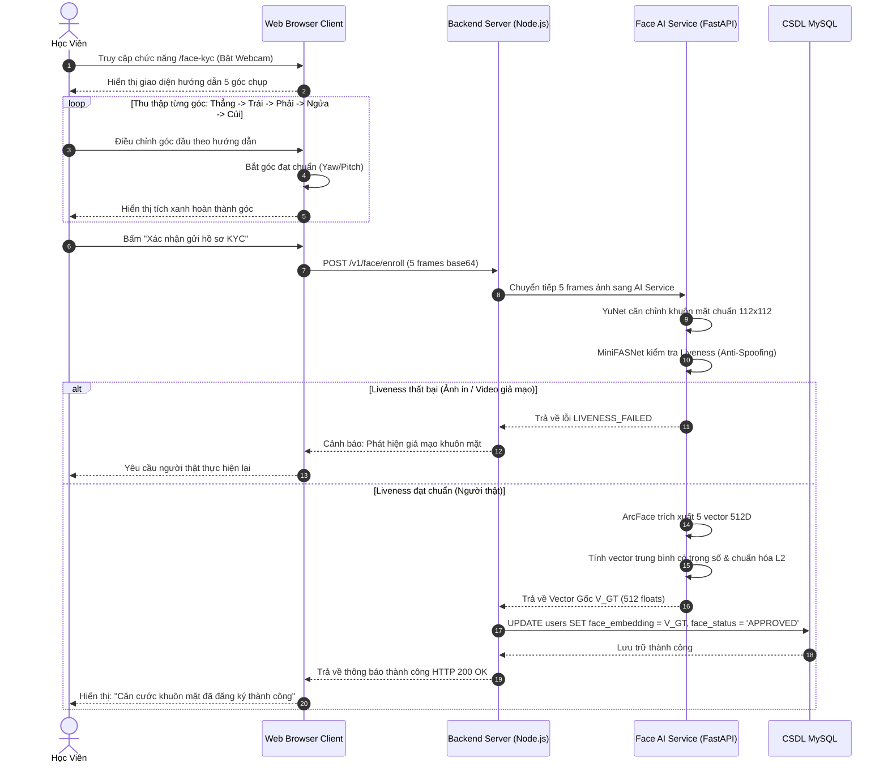
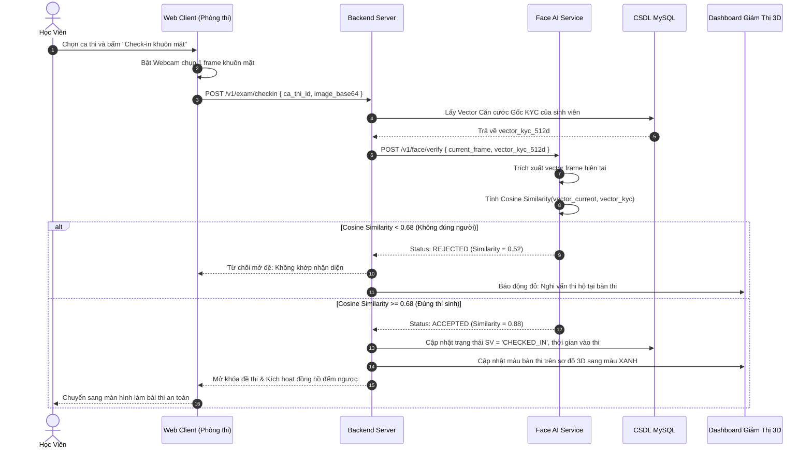
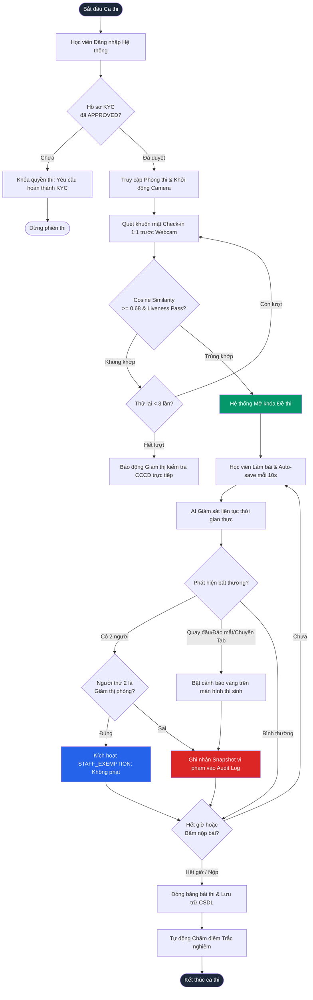
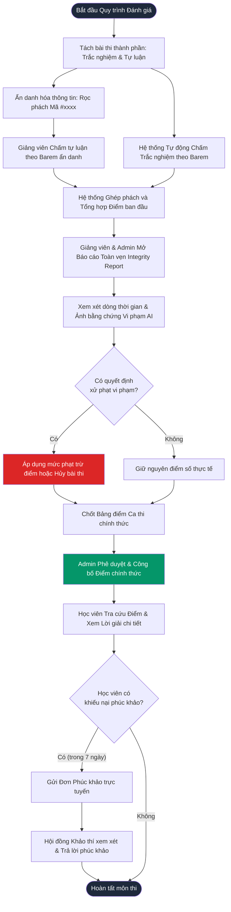

# CHƯƠNG 2: KHẢO SÁT VÀ PHÂN TÍCH HỆ THỐNG
### ĐỀ TÀI: HỆ THỐNG QUẢN LÝ THI & HỌC TRỰC TUYẾN TÍCH HỢP XÁC THỰC SINH TRẮC HỌC KHUÔN MẶT
**Sinh viên thực hiện:** Lực Văn Sơn — **MSSV:** 2310900087 — **Lớp:** K23CNT3  

---

## 2.1 CHỨC NĂNG CỦA HỆ THỐNG

### 2.1.1 Mục tiêu và Một số chức năng chính
Hệ thống **ExamGuard AI (Eduface)** là giải pháp chuyển đổi số toàn diện cho công tác khảo thí và đào tạo trực tuyến tại các cơ sở giáo dục đại học. Hệ thống giải quyết triệt để bài toán gian lận thi cử (thi hộ, tráo người, tra cứu tài liệu trái phép) nhờ ứng dụng kiến trúc sinh trắc học khuôn mặt tiên tiến làm căn cước định danh số gốc (*Biometric Ground-Truth Identity*).

Hệ thống cung cấp nền tảng quản trị khép kín từ khâu tổ chức đào tạo, tạo lập ngân hàng đề thi, cấu hình phòng thi 3D, điểm danh check-in sinh trắc học 1:1, giám sát thi trực tuyến thời gian thực đa tầng, đến chấm thi rọc phách ẩn danh, hậu kiểm vi phạm và công bố bảng điểm minh bạch.

**Bảng 2.1. Một số chức năng chính của hệ thống**

| STT | Tên nhóm chức năng | Mô tả chức năng mức cao | Đối tượng sử dụng |
| :---: | :--- | :--- | :--- |
| **1** | **Xác thực & Quản trị tài khoản** | Đăng nhập hệ thống bảo mật bằng tài khoản do nhà trường cấp; phân quyền chặt chẽ theo vai trò (RBAC); quản lý thông tin cá nhân. | Tất cả người dùng (Admin, Giảng viên, Học viên) |
| **2** | **Định danh sinh trắc học (Face KYC)** | Thu thập 5 góc khuôn mặt (Thẳng, Trái, Phải, Ngửa, Cúi); kiểm tra thực thể sống chống giả mạo (Liveness); trích xuất và mã hóa vector 512 chiều chuẩn hóa L2 làm căn cước gốc. | Học viên, Giảng viên, Admin |
| **3** | **Quản lý Cơ cấu & Phòng thi 3D** | Quản lý cây tổ chức đào tạo (Khoa – Khóa học – Lớp học); mô hình hóa sơ đồ phòng thi không gian 3D Isometric; cấu hình luồng camera giám sát CCTV RTSP và vùng quét ROI. | Admin Hệ thống, Giảng viên |
| **4** | **Soạn thảo & Quản lý Đề thi** | Assessment Studio hỗ trợ đa dạng loại câu hỏi (Trắc nghiệm đơn/đa đáp án, Tự luận, Lập trình code test cases, Điền khuyết); nhập đề từ Word/Excel; trộn đề tự động. | Giảng viên, Admin Hệ thống |
| **5** | **Xem lịch thi & Cấp Số báo danh** | Tự động xếp chỗ ngẫu nhiên trên sơ đồ 3D; cấp Số Báo Danh (SBD) và mã Seat PIN; học viên tra cứu thời gian, phòng thi và vị trí bàn ngồi trước giờ thi. | Học viên |
| **6** | **Khảo thí trực tuyến & Giám sát AI** | Check-in sinh trắc học 1:1 mở đề thi; giám sát liên tục qua webcam (góc quay đầu, đảo mắt, phát hiện người lạ/vắng mặt); cơ chế Staff Exemption miễn trừ giám thị; tự động lưu bài (Auto-save). | Học viên, Giảng viên giám thị, Face AI Service |
| **7** | **Đấu trường trắc nghiệm (Quiz Arena)** | Khởi tạo phòng thi trắc nghiệm tương tác nhanh theo mã PIN 6 số (phong cách Kahoot); thi đấu trực tiếp theo thời gian thực; tính điểm tốc độ (Speed Bonus) và vinh danh Top 3 Podium. | Giảng viên (Host), Học viên (Player) |
| **8** | **Chấm điểm, Rà soát & Hậu kiểm** | Chấm tự động trắc nghiệm ngay khi nộp bài; chấm tự luận/code trong chế độ rọc phách ẩn danh (Anonymous Hashing); rà soát bảng điểm và thẩm định snapshot vi phạm AI (Integrity Report). | Giảng viên chấm thi, Admin Hệ thống |
| **9** | **Công bố điểm & Phúc khảo** | Phê duyệt và công bố bảng điểm chính thức kèm đáp án và lời giải thích chi tiết; tiếp nhận và xử lý đơn phúc khảo trực tuyến của học viên trong thời hạn 7 ngày. | Admin, Giảng viên, Học viên |

---

### 2.1.2 Yêu cầu phi chức năng (Non-Functional Requirements)

**Bảng 2.2. Yêu cầu phi chức năng của hệ thống**

| Tiêu chuẩn | Nội dung yêu cầu kỹ thuật | Chỉ số mục tiêu |
| :--- | :--- | :--- |
| **Hiệu năng (Performance)** | - Thời gian xử lý trích xuất vector khuôn mặt AI (YuNet + ArcFace):<br/>- Thời gian phản hồi Check-in 1:1 qua camera:<br/>- Tần suất tự động lưu bài làm (Auto-save):<br/>- Tần suất AI xác thực ngầm liên tục (Continuous Verification): | ~70ms – 150ms / frame<br/>Dưới 1.5 giây<br/>Định kỳ 10 giây & khi click<br/>Chu kỳ 20 giây / lần |
| **Khả năng tải (Scalability)** | - Quy mô quản lý dữ liệu đào tạo toàn trường:<br/>- Khả năng phục vụ đồng thời trong giờ cao điểm ca thi (CCU):<br/>- Độ trễ truyền thông điệp thời gian thực (Socket.IO): | 10.000 học viên<br/>1.000 – 1.500 người dùng<br/>Dưới 100ms |
| **Bảo mật (Security & Zero-Trust)** | - Mã hóa toàn bộ đường truyền dữ liệu qua HTTPS (TLS 1.3) và WSS.<br/>- Xác thực Token JWT có chữ ký điện tử HMAC-SHA256.<br/>- Nguyên tắc rọc phách bài thi: mã hóa ẩn danh ID sinh viên khi chấm.<br/>- Bắt buộc tài khoản có trạng thái `Face KYC = APPROVED` mới được xếp chỗ và thi.<br/>- Nhật ký vi phạm AI và ảnh bằng chứng lưu trữ bất biến (Immutable Audit Log). | Chuẩn OWASP Top 10<br/>Rọc phách SHA-256<br/>Anti-Spoofing Liveness ≥ 0.55 |
| **Độ tin cậy (Reliability)** | - Sẵn sàng hoạt động (Uptime) của hệ thống trong các đợt thi tập trung:<br/>- Cơ chế lưu đệm bài làm tại Local Storage trình duyệt, chống mất bài khi mất mạng. | 99.9% khả dụng<br/>Không mất bài làm khi rớt mạng |
| **Tính tương thích (Compatibility)** | - Hoạt động ổn định trên các trình duyệt hiện đại: Google Chrome, Microsoft Edge, Mozilla Firefox, Apple Safari.<br/>- Tương thích tốt với Webcam chuẩn laptop thông dụng (độ phân giải từ 720p HD).<br/>- Hỗ trợ khóa trình duyệt an toàn qua Safe Exam Browser (SEB) khi thi hình thức BYOD. | Responsive Web UI<br/>Webcam 720p tiêu chuẩn |
| **Giao diện & Trải nghiệm (Usability)** | - Giao diện tối ưu công thái học (Dark Mode / Light Mode hạn chế mỏi mắt).<br/>- Mô phỏng phòng thi 3D trực quan với màu sắc bàn thi phản ánh trạng thái thời gian thực. | Trực quan, thân thiện |

---

### 2.1.3 Quy trình nghiệp vụ trong hệ thống (Business Workflows)

Hoạt động nghiệp vụ của hệ thống được tổ chức thành 4 giai đoạn logic khép kín:

```
[ Giai đoạn 1: Chuẩn bị & Cấp tài khoản ]
  Admin cấp tài khoản --> Học viên & Giảng viên Đăng ký Face KYC 5 góc --> AI trích xuất Vector 512D
         |
[ Giai đoạn 2: Khởi tạo Ca thi & Đề thi ]
  Giảng viên soạn đề thi --> Admin cấu hình Phòng 3D & Lập lịch ca thi --> Tự động xếp chỗ & cấp SBD
         |
[ Giai đoạn 3: Khảo thí & Giám sát Trực tuyến ]
  Học viên Check-in Face 1:1 --> Vào làm bài thi --> AI & CCTV giám sát liên tục 20s --> Nộp bài
         |
[ Giai đoạn 4: Đánh giá, Hậu kiểm & Công bố ]
  Chấm tự động trắc nghiệm & Chấm rọc phách tự luận --> Rà soát bảng điểm & Log vi phạm --> Công bố điểm --> Phúc khảo
```

1. **Quy trình Khởi tạo Định danh Căn cước số (Face KYC Workflow):**
   - Học viên/Giảng viên đăng nhập bằng tài khoản được cấp.
   - Hệ thống yêu cầu chụp 5 góc khuôn mặt (Thẳng, Trái, Phải, Ngửa, Cúi).
   - Hệ thống gửi khung hình sang `Face AI Service` để kiểm tra độ thật Liveness (chống dùng ảnh/video giả mạo) và trích xuất vector ArcFace 512 chiều.
   - Vector được chuẩn hóa và lưu vào CSDL làm "Căn cước sinh trắc học gốc".

2. **Quy trình Tổ chức & Chuẩn bị Ca thi (Exam Preparation Workflow):**
   - Giảng viên biên soạn ngân hàng câu hỏi và tạo đề thi trên Assessment Studio.
   - Admin thiết lập cấu hình phòng thi 3D (kích thước lưới hàng-cột, camera CCTV) và lập lịch ca thi.
   - Hệ thống tự động kiểm tra điều kiện sinh viên (chỉ các sinh viên đã KYC thành công), sau đó xáo trộn xếp bàn và cấp Số Báo Danh (SBD).

3. **Quy trình Khảo thí & Giám sát Trực tuyến (Examination & Proctoring Workflow):**
   - Học viên tra cứu SBD, đăng nhập vào phòng thi trực tuyến.
   - Tại cổng vào, học viên thực hiện Check-in xác thực khuôn mặt 1:1 trước webcam. AI đối chiếu khuôn mặt trực tiếp với Vector Gốc KYC đã lưu. Nếu trùng khớp (Cosine Similarity $\ge$ 0.68) và đạt chuẩn người thật, đề thi tự động mở khóa.
   - Trong suốt thời gian làm bài, AI thực hiện giám sát 2 tầng: client-side (bắt góc quay đầu, liếc mắt, chuyển tab) và server-side (chụp ngầm mỗi 20s đối chiếu chống tráo người).
   - Nếu Giảng viên giám thị đi lại kiểm tra bàn thi của học viên, AI nhận diện mặt Giám thị qua danh sách Staff Whitelist và tự động kích hoạt cơ chế miễn trừ phạt (`STAFF_EXEMPTION`), không trừ điểm uy tín oan cho học viên.

4. **Quy trình Chấm điểm, Hậu kiểm & Công bố Kết quả (Grading & Audit Workflow):**
   - Khi hết giờ hoặc học viên nộp bài, hệ thống tự động chấm điểm các câu trắc nghiệm.
   - Các câu hỏi tự luận/code được chuyển vào giao diện chấm rọc phách ẩn danh cho Giảng viên.
   - Giảng viên và Admin đối soát bảng điểm, mở Báo cáo toàn vẹn (Integrity Report) để thẩm định các mốc vi phạm AI ghi nhận kèm ảnh snapshot chứng cứ.
   - Sau khi rà soát và xác nhận hợp lệ, Admin phê duyệt công bố điểm chính thức kèm lời giải chi tiết. Học viên tra cứu kết quả và có quyền gửi đơn phúc khảo trực tuyến trong 7 ngày.

---

### 2.1.4 Các tác nhân tham gia hệ thống (System Actors)

Hệ thống xác định 4 tác nhân chính tham gia tương tác trực tiếp và gián tiếp:

**Bảng 2.3. Danh mục các tác nhân tham gia hệ thống**

| Tác nhân (Actor) | Phân loại | Vai trò, mục đích sử dụng và trách nhiệm trong hệ thống |
| :--- | :--- | :--- |
| **Học Viên (Student)** | Tác nhân chính (Primary Actor - Human) | - Đăng nhập hệ thống bằng tài khoản được cấp.<br/>- Đăng ký căn cước khuôn mặt gốc (Face KYC 5 góc).<br/>- Xem lịch thi cá nhân, số báo danh, phòng thi và vị trí bàn 3D.<br/>- Thực hiện xác thực check-in và làm bài thi trực tuyến dưới sự giám sát của AI.<br/>- Tham gia đấu trường trắc nghiệm tương tác Quiz Arena.<br/>- Tra cứu kết quả điểm thi chính thức, xem lời giải chi tiết và nộp đơn phúc khảo. |
| **Giảng Viên (Teacher / Proctor)** | Tác nhân chính (Primary Actor - Human) | - Đăng nhập hệ thống, đăng ký khuôn mặt để nạp vào danh sách giám thị hợp lệ (Staff Whitelist).<br/>- Soạn thảo ngân hàng câu hỏi và quản lý cấu trúc đề thi.<br/>- Đăng ký/duyệt khuôn mặt ngoại lệ cho học viên khi cần.<br/>- Điều hành và giám sát phòng thi 3D thời gian thực qua giao diện Dashboard.<br/>- Chấm điểm bài thi tự luận/lập trình theo chế độ rọc phách ẩn danh.<br/>- Rà soát bảng điểm và hậu kiểm vi phạm thi cử.<br/>- Khởi tạo và điều khiển phiên Đấu trường Quiz tương tác. |
| **Admin Hệ Thống (System Administrator)** | Tác nhân chính (Primary Actor - Human) | - Nắm toàn quyền quản trị kỹ thuật và tổ chức trên hệ thống.<br/>- Cấp phát tài khoản học viên và giảng viên từ dữ liệu đào tạo.<br/>- Quản lý cây cơ cấu đào tạo (Khoa, Khóa, Lớp) và thiết lập sơ đồ phòng thi 3D, camera CCTV.<br/>- Phê duyệt và công bố bảng điểm chính thức toàn trường.<br/>- Hậu kiểm biên bản vi phạm và xử lý khiếu nại phúc khảo cấp hội đồng. |
| **Face AI Service** | Tác nhân hỗ trợ / Tác nhân hệ thống ngoài (Supporting / Secondary Actor) | - Microservice dịch vụ trí tuệ nhân tạo độc lập chạy nền (FastAPI/Python).<br/>- Thực hiện trích xuất và mã hóa đặc trưng khuôn mặt thành Vector ArcFace 512 chiều.<br/>- Kiểm tra thực thể sống chống giả mạo (MiniFASNet Liveness Detection).<br/>- Thực hiện tính toán so khớp vector khuôn mặt (Cosine Similarity) cho các tác vụ Check-in 1:1, giám sát ngầm liên tục và so khớp Staff Whitelist. |

---

### 2.1.5 Biểu đồ Use Case tổng quát và Giải thích quan hệ

Dưới đây là biểu đồ Use Case tổng quát của hệ thống khảo thí và học trực tuyến tích hợp khuôn mặt (được thiết kế chuẩn theo sơ đồ kiến trúc nghiệp vụ):

```
+------------------------------------------------------------------------------------------------------------------------------------+
|                                    HỆ THỐNG QUẢN LÝ THI & HỌC TRỰC TUYẾN TÍCH HỢP KHUÔN MẶT                                         |
|                                                                                                                                    |
|     +----------------------------------+          <<include>>          +---------------------+                                     |
|     | Đăng ký khuôn mặt                |------------------------------>| Xác thực khuôn mặt  |                                     |
|     | (Face KYC 5 góc)                 |                               +---------------------+                                     |
|     +----------------------------------+                                  |          |                                             |
|        |                               \                            <<include>>  <<include>>                                       |
|        |                                \                                 |          |                                             |
|        |                                 \                                v          v                                             |
|        | <<include>>                      \                            +---------------------+       <<include>>                   |
|        |                                   --------------------------->| Đối chiếu khuôn mặt |-------------------------\           |
|        |                                                               +---------------------+                          \          |
|        |                                                                                                                 v         |
|        |                                                               +---------------------+                     +-------------+ |
|        |                                                               | Đăng ký khuôn mặt   |----<<include>>----->| Mã hoá      | | ===> [ Face AI Service ]
|        v                                                               | cho học viên/SV     |                     | khuôn mặt   | |
|     +----------------------------------+                               +---------------------+                     | vector 512D | |
|     | Làm bài Kiểm tra (Quiz Arena)    |                                  |               \                        +-------------+ |
|     +----------------------------------+                                  |                \ <<include>>                           |
|        |                                                                  |                 \                                      |
|        | <<include>>                                                      |                  v                                     |
|        v                                                                  |            +---------------------------------+         |
|     +----------------------------------+                                  |            |                                 |         |
|     | Làm bài thi trực tuyến           |-----------<<include>>------------|----------->|            ĐĂNG NHẬP            |<--------|
|     +----------------------------------+                                  |            |                                 |         |
|        |                                                                  |            +---------------------------------+         |
|        | <<include>>                                                      |                 ^       ^         ^                    |
|        v                                                                  |                 |       |         |                    |
|     +----------------------------------+                                  |                 |       |         |                    |
|     | Xem lịch thi & Số báo danh       |-----------<<include>>------------+                 |       |         |                    |
|     +----------------------------------+                                                    |       |         |                    |
|                                                                                             |       |         |                    |
|                                                                   +---------------------+   |       |         |                    |
|                                                                   | Quản lý Cơ cấu      |---+       |         |                    |
|                                                                   | & Phòng 3D          |           |         |                    |
|                                                                   +---------------------+           |         |                    |
|                                                                                                     |         |                    |
|                                                                   +---------------------+           |         |                    |
|                                                                   | Soạn thảo &         |-----------+         |                    |
|                                                                   | Quản lý Đề thi      |                     |                    |
|                                                                   +---------------------+                     |                    |
|                                                                                                               |                    |
|                                                                   +---------------------+                     |                    |
|                                                                   | Cấp tài khoản       |---------------------+                    |
|                                                                   | cho học viên/SV     |                                          |
|                                                                   +---------------------+                                          |
|                                                                                                                                    |
|     +----------------------------------+          <<include>>          +---------------------------------+                         |
|     | Tra cứu kết quả & Phúc khảo      |------------------------------>| Công bố Điểm & Lời giải chi tiết|                         |
|     +----------------------------------+                               +---------------------------------+                         |
|                                                                           ^               ^          \                             |
|                                                              <<include>>  |  <<include>>  |           \ <<include>>                |
|                                                                           |               |            v                           |
|                                      +------------------------------------+               |       +-----------+                    |
|                                      | Rà soát bảng điểm & Hậu kiểm vi phạm               |       | Đăng nhập |                    |
|                                      +----------------------------------------------------+       +-----------+                    |
|                                      | Chấm điểm & Đối chiếu Đáp án                       |                                        |
|                                      +----------------------------------------------------+                                        |
+------------------------------------------------------------------------------------------------------------------------------------+
```

#### Phân tích chi tiết các kết nối và quan hệ `<<include>>`:
1. **Quan hệ với Use Case Trung tâm `Đăng nhập`:**
   - Hầu hết các Use Case nghiệp vụ của người dùng (`Đăng ký khuôn mặt KYC`, `Làm bài thi trực tuyến`, `Làm bài kiểm tra Quiz Arena`, `Xem lịch thi & SBD`, `Quản lý Cơ cấu & Phòng 3D`, `Soạn thảo & Quản lý Đề thi`, `Cấp tài khoản cho học viên/SV`) đều có quan hệ phụ thuộc bắt buộc `<<include>>` tới Use Case `Đăng nhập`.
   - **Bản chất nghiệp vụ:** Hệ thống khảo thí áp dụng nguyên tắc kiểm soát truy cập định danh nghiêm ngặt. Bất kỳ thao tác nghiệp vụ nào đều đòi hỏi người dùng phải hoàn thành việc định danh bằng tài khoản hợp lệ do nhà trường cấp.
2. **Chuỗi quy trình xử lý Sinh trắc học Khuôn mặt:**
   - `Đăng ký khuôn mặt (Face KYC 5 góc)` $\xrightarrow{<<include>>}$ `Xác thực khuôn mặt`: Khi học viên thu thập các góc chụp, hệ thống bắt buộc phải kiểm tra xác thực chất lượng ảnh và kiểm tra thực thể sống Liveness.
   - `Xác thực khuôn mặt` $\xrightarrow{<<include>>}$ `Đối chiếu khuôn mặt`: Để xác thực danh tính sinh trắc học, hệ thống bắt buộc phải đối chiếu khuôn mặt thời gian thực với vector đã lưu trữ.
   - `Đối chiếu khuôn mặt` $\xrightarrow{<<include>>}$ `Mã hoá khuôn mặt dưới dạng vector 512D`: Để so sánh được độ tương đồng, khuôn mặt bắt buộc phải được trích xuất thành vector 512D thông qua tác nhân `Face AI Service`.
   - `Đăng ký khuôn mặt cho học viên/sinh viên` (thực hiện bởi Admin/Giảng viên) cũng $\xrightarrow{<<include>>}$ `Mã hoá khuôn mặt dưới dạng vector 512D` nhằm chuyển đổi ảnh hồ sơ thành căn cước số gốc.
3. **Chuỗi nghiệp vụ Đánh giá, Chấm điểm & Công bố Kết quả:**
   - Các Use Case: `Chấm điểm & Đối chiếu Đáp án`, `Rà soát bảng điểm & Hậu kiểm vi phạm`, và `Tra cứu kết quả & Phúc khảo` đều liên kết `<<include>>` với Use Case `Công bố Điểm & Lời giải chi tiết`.
   - **Bản chất nghiệp vụ:** Sau khi chấm điểm và rà soát các vi phạm AI, bảng điểm được chuyển sang trạng thái chính thức `PUBLISHED`. Chỉ khi điểm đã được công bố chính thức, học viên mới có thể thực hiện tra cứu kết quả kèm lời giải chi tiết và kích hoạt quyền nộp đơn phúc khảo trong 7 ngày.

---

## 2.2 BIỂU ĐỒ USE CASE PHÂN RÃ CHỨC NĂNG (FUNCTIONAL DECOMPOSITION)

### 2.2.1 Sơ đồ Phân rã Chức năng Hệ thống (Functional Decomposition Diagram - FDD)

Kỹ thuật phân rã chức năng (Functional Decomposition) chia nhỏ hệ thống thành các nhóm phân hệ nghiệp vụ độc lập, từ đó ánh xạ trực tiếp sang các Use Case chi tiết:

```mermaid
graph TD
    System["HỆ THỐNG THI & HỌC TRỰC TUYẾN TÍCH HỢP KHUÔN MẶT<br/>(EXAMGUARD AI / EDUFACE)"]
    
    System --> F1["1. PHÂN HỆ XÁC THỰC & QUẢN TRỊ TÀI KHOẢN"]
    System --> F2["2. PHÂN HỆ SINH TRẮC HỌC KHUÔN MẶT & AI ENGINE"]
    System --> F3["3. PHÂN HỆ CƠ CẤU PHÒNG THI 3D & ĐỀ THI"]
    System --> F4["4. PHÂN HỆ KHẢO THÍ TRỰC TUYẾN & QUIZ ARENA"]
    System --> F5["5. PHÂN HỆ CHẤM THI, HẬU KIỂM & PHÚC KHẢO"]

    F1 --> F11["1.1 Đăng nhập hệ thống (SSO/JWT)"]
    F1 --> F12["1.2 Cấp tài khoản học viên & giảng viên"]
    F1 --> F13["1.3 Quản lý thông tin & Đổi mật khẩu"]

    F2 --> F21["2.1 Thu thập ảnh chân dung Face KYC 5 góc"]
    F2 --> F22["2.2 Xác thực khuôn mặt & Liveness Anti-Spoofing"]
    F2 --> F23["2.3 Đối chiếu khuôn mặt Cosine Similarity"]
    F2 --> F24["2.4 Mã hoá vector ArcFace 512D"]
    F2 --> F25["2.5 Đăng ký/duyệt khuôn mặt quản trị viên"]

    F3 --> F31["3.1 Quản lý Cây cơ cấu đào tạo (Khoa/Lớp)"]
    F3 --> F32["3.2 Thiết lập Sơ đồ phòng thi 3D & Camera CCTV"]
    F3 --> F33["3.3 Soạn thảo & Quản lý Ngân hàng đề thi"]
    F3 --> F34["3.4 Xếp chỗ thí sinh & Cấp Số báo danh"]

    F4 --> F41["4.1 Tra cứu Lịch thi cá nhân & SBD"]
    F4 --> F42["4.2 Điểm danh Check-in 1:1 mở đề thi"]
    F4 --> F43["4.3 Làm bài thi trực tuyến & Giám sát AI"]
    F4 --> F44["4.4 Làm bài kiểm tra tương tác (Quiz Arena)"]

    F5 --> F51["5.1 Tự động chấm điểm trắc nghiệm"]
    F5 --> F52["5.2 Chấm rọc phách ẩn danh (Tự luận/Code)"]
    F5 --> F53["5.3 Rà soát bảng điểm & Hậu kiểm vi phạm AI"]
    F5 --> F54["5.4 Công bố điểm & Lời giải chi tiết"]
    F5 --> F55["5.5 Tra cứu kết quả thi & Nộp đơn phúc khảo"]

    style System fill:#1E293B,stroke:#0F172A,stroke-width:2px,color:#fff
    style F1 fill:#2563EB,color:#fff
    style F2 fill:#7C3AED,color:#fff
    style F3 fill:#059669,color:#fff
    style F4 fill:#D97706,color:#fff
    style F5 fill:#DC2626,color:#fff
```



---

### 2.2.2 Bảng Cấu trúc Phân rã Chức năng Chi tiết (Functional Decomposition Table)

**Bảng 2.4. Bảng Phân rã chức năng nghiệp vụ của hệ thống**

| Mã Phân hệ | Mã Chức năng | Tên Chức năng Chi tiết | Ánh xạ Use Case trên Sơ đồ | Tác nhân chính | Tác nhân hỗ trợ |
| :---: | :---: | :--- | :--- | :--- | :--- |
| **F1** | F1.1 | Đăng nhập hệ thống bằng tài khoản được cấp | `Đăng nhập` | Tất cả người dùng | Cổng xác thực JWT |
| | F1.2 | Khởi tạo và cấp phát tài khoản học viên/SV | `Cấp tài khoản cho học viên/sinh viên` | Admin Hệ Thống, Giảng Viên | Hệ thống Mail / Database |
| | F1.3 | Quản lý hồ sơ cá nhân và đổi mật khẩu | `Đăng nhập` (Profile extension) | Người dùng | CSDL MySQL |
| **F2** | F2.1 | Thu thập 5 góc khuôn mặt chuẩn KYC | `Đăng ký khuôn mặt (Face KYC 5 góc)` | Học Viên | Web Camera Client |
| | F2.2 | Kiểm tra người thật (Liveness) & tính hợp lệ | `Xác thực khuôn mặt` | Hệ thống | Face AI Service |
| | F2.3 | So khớp vector khuôn mặt (Cosine Similarity) | `Đối chiếu khuôn mặt` | Hệ thống | Face AI Service |
| | F2.4 | Trích xuất và mã hóa vector khuôn mặt 512D | `Mã hoá khuôn mặt dưới dạng vector 512D` | `Face AI Service` | ArcFace ONNX Model |
| | F2.5 | Cán bộ đăng ký/duyệt khuôn mặt ngoại lệ | `Đăng ký khuôn mặt cho học viên/sinh viên`| Admin Hệ Thống, Giảng Viên | Face AI Service |
| **F3** | F3.1 | Khai báo cơ cấu tổ chức (Khoa, Khóa, Lớp) | `Quản lý Cơ cấu & Phòng 3D` | Admin Hệ Thống | CSDL MySQL |
| | F3.2 | Thiết lập sơ đồ phòng thi 3D và cấu hình CCTV | `Quản lý Cơ cấu & Phòng 3D` | Admin Hệ Thống, Giảng Viên | Camera RTSP Engine |
| | F3.3 | Soạn thảo ngân hàng câu hỏi và tạo đề thi | `Soạn thảo & Quản lý Đề thi` | Giảng Viên, Admin Hệ Thống | Assessment Studio |
| | F3.4 | Lập lịch ca thi, tự động xếp chỗ và cấp SBD | `Xem lịch thi & Số báo danh` (Admin side)| Admin Hệ Thống | Thuật toán xếp chỗ |
| **F4** | F4.1 | Tra cứu lịch thi, phòng thi và SBD cá nhân | `Xem lịch thi & Số báo danh` | Học Viên | CSDL MySQL |
| | F4.2 | Xác thực khuôn mặt Check-in 1:1 mở đề | `Xác thực khuôn mặt` | Học Viên | Face AI Service |
| | F4.3 | Làm bài thi an toàn có AI giám sát liên tục | `Làm bài thi trực tuyến` | Học Viên | Face AI, Giám thị |
| | F4.4 | Tham gia Đấu trường trắc nghiệm tương tác | `Làm bài Kiểm tra (Quiz Arena)` | Học Viên | Giảng Viên (Host) |
| **F5** | F5.1 | Chấm điểm tự động trắc nghiệm & đối chiếu | `Chấm điểm & Đối chiếu Đáp án` | Hệ thống / Giảng Viên | CSDL MongoDB |
| | F5.2 | Chấm bài tự luận/code trong chế độ rọc phách | `Chấm điểm & Đối chiếu Đáp án` | Giảng Viên, Admin | Barem chấm điểm |
| | F5.3 | Rà soát bảng điểm & thẩm định biên bản vi phạm | `Rà soát bảng điểm & Hậu kiểm vi phạm` | Giảng Viên, Admin Hệ Thống | AI Integrity Report |
| | F5.4 | Phê duyệt và công bố bảng điểm chính thức | `Công bố Điểm & Lời giải chi tiết` | Admin Hệ Thống, Giảng Viên | Hệ thống thông báo |
| | F5.5 | Tra cứu điểm, đối chiếu lời giải và phúc khảo | `Tra cứu kết quả & Phúc khảo` | Học Viên | Hội đồng Khảo thí |

---

## 2.3 ĐẶC TẢ CHI TIẾT CÁC USE CASE QUAN TRỌNG NHẤT

Căn cứ theo yêu cầu đồ án, nhóm nghiên cứu lựa chọn **10 Use Case cốt lõi nhất** trong sơ đồ tổng quát để tiến hành đặc tả chi tiết.

---

### 2.3.1 Đặc tả Use Case UC-01: Đăng nhập hệ thống (Authentication)

**Bảng 2.5. Đặc tả Use Case UC-01: Đăng nhập hệ thống**

| Thuộc tính | Chi tiết mô tả |
| :--- | :--- |
| **Tên Use Case** | **Đăng nhập hệ thống** |
| **Mã Use Case** | **UC-01** |
| **Tác nhân chính** | Học Viên, Giảng Viên, Admin Hệ Thống |
| **Tác nhân hỗ trợ** | Cổng xác thực bảo mật JWT, CSDL MySQL |
| **Mô tả tóm tắt** | Người dùng nhập thông tin định danh (Email/Tên đăng nhập và Mật khẩu) do nhà trường cấp để xác thực quyền truy cập vào hệ thống theo phân quyền tương ứng. |
| **Tiền điều kiện** | Người dùng đã được cấp tài khoản trong hệ thống và tài khoản đang ở trạng thái kích hoạt (`status = ACTIVE`). |
| **Hậu điều kiện** | Hệ thống tạo phiên làm việc bảo mật (JWT Token), điều hướng người dùng tới Dashboard tương ứng với vai trò (Student, Teacher, hoặc Admin). |

**Luồng sự kiện chính (Basic Flow):**

| Bước | Tác nhân (Actor) | Hành động của Hệ thống (System Response) |
| :---: | :--- | :--- |
| 1 | Người dùng truy cập vào trang đăng nhập hệ thống (`/login`). | Hiển thị biểu mẫu đăng nhập gồm ô nhập Email/Tài khoản và Mật khẩu. |
| 2 | Người dùng nhập chính xác Email và Mật khẩu, sau đó nhấn nút "Đăng nhập". | Tiếp nhận dữ liệu, thực hiện mã hóa kiểm tra và so khớp với thông tin trong CSDL. |
| 3 | — | Hệ thống xác thực thành công, sinh mã phiên bảo mật JWT Token (chứa thông tin `user_id`, `role`, `face_status`). |
| 4 | — | Lưu Token vào bộ nhớ bảo mật trình duyệt (HttpOnly Cookie hoặc Local Storage). |
| 5 | — | Tự động điều hướng người dùng về màn hình làm việc tương ứng (Sinh viên $\rightarrow$ `/student/dashboard`; Giảng viên $\rightarrow$ `/teacher/dashboard`; Admin $\rightarrow$ `/admin/dashboard`). |

**Luồng sự kiện phát sinh & Ngoại lệ (Alternative & Exception Flows):**
- **E1: Sai thông tin đăng nhập:** Nếu Email hoặc Mật khẩu không chính xác, hệ thống hiển thị thông báo lỗi: *"Tài khoản hoặc mật khẩu không chính xác"*. Cho phép nhập lại tối đa 5 lần trước khi tạm khóa 15 phút chống tấn công Brute-force.
- **E2: Tài khoản bị vô hiệu hóa:** Nếu tài khoản có trạng thái `status = LOCKED` hoặc `DISABLED`, hệ thống chặn đăng nhập và hiển thị thông báo: *"Tài khoản của bạn đã bị khóa. Vui lòng liên hệ Phòng Khảo thí/Quản trị viên để được hỗ trợ"*.

---

### 2.3.2 Đặc tả Use Case UC-02: Đăng ký khuôn mặt (Face KYC 5 góc)

**Bảng 2.6. Đặc tả Use Case UC-02: Đăng ký khuôn mặt (Face KYC 5 góc)**

| Thuộc tính | Chi tiết mô tả |
| :--- | :--- |
| **Tên Use Case** | **Đăng ký khuôn mặt (Face KYC 5 góc)** |
| **Mã Use Case** | **UC-02** |
| **Tác nhân chính** | Học Viên (hoặc Giảng Viên khi nạp Staff Whitelist) |
| **Tác nhân hỗ trợ** | Face AI Service, Web Camera Client |
| **Quan hệ Use Case**| `<<include>> Đăng nhập`, `<<include>> Xác thực khuôn mặt` |
| **Mô tả tóm tắt** | Học viên thực hiện thu thập dữ liệu sinh trắc học qua webcam với 5 tư thế góc đầu (Thẳng, Trái, Phải, Ngửa, Cúi) để khởi tạo căn cước sinh trắc học gốc phục vụ thi cử. |
| **Tiền điều kiện** | Học viên đã đăng nhập hệ thống; tài khoản có `face_status = NOT_ENROLLED` hoặc `REJECTED`; thiết bị có webcam hoạt động tốt và môi trường đủ ánh sáng. |
| **Hậu điều kiện** | Dữ liệu 5 góc khuôn mặt được AI kiểm tra hợp lệ; CSDL cập nhật `face_status = APPROVED`; vector ArcFace 512D được lưu trữ; học viên được mở khóa quyền xếp chỗ và dự thi. |

**Luồng sự kiện chính (Basic Flow):**

| Bước | Tác nhân (Actor) | Hành động của Hệ thống (System Response) |
| :---: | :--- | :--- |
| 1 | Học viên truy cập chức năng "Đăng ký khuôn mặt KYC" (`/face-kyc`). | Yêu cầu cấp quyền truy cập Camera; hiển thị khung hình kèm quy chuẩn (ngồi thẳng 50–70cm, không đeo khẩu trang/kính râm). |
| 2 | Học viên đồng ý cấp quyền webcam và nhấn "Bắt đầu thu thập". | Bật camera, kích hoạt mô hình phát hiện khuôn mặt thời gian thực và hiển thị vòng cung hướng dẫn góc đầu thứ nhất (Góc Thẳng). |
| 3 | Học viên nhìn thẳng vào tâm vòng tròn webcam. | AI bắt đúng góc Thẳng ($Yaw \approx 0^\circ, Pitch \approx 0^\circ$), kiểm tra độ sắc nét và Liveness, phát âm thanh báo thành công và chuyển sang góc tiếp theo. |
| 4 | Học viên lần lượt thực hiện theo chỉ dẫn: quay đầu sang Trái ($Yaw \le -25^\circ$), sang Phải ($Yaw \ge +25^\circ$), ngửa đầu lên ($Pitch \ge +15^\circ$), và cúi đầu xuống ($Pitch \le -15^\circ$). | Hệ thống tự động bắt khoảnh khắc của từng góc khi đạt góc chuẩn, hiển thị dấu tích xanh tương ứng (1/5 $\rightarrow$ 5/5). |
| 5 | Hoàn thành 5 góc, học viên bấm "Xác nhận gửi hồ sơ KYC". | Client đóng gói 5 frame ảnh base64 gửi sang backend gọi API của `Face AI Service`. |
| 6 | — | `Face AI Service` gọi Use Case `Mã hoá khuôn mặt vector 512D` để sinh vector căn cước gốc hợp nhất. |
| 7 | — | CSDL cập nhật `face_status = APPROVED`, lưu trữ đường dẫn ảnh và vector đặc trưng. |
| 8 | Học viên nhận thông báo thành công. | Màn hình hiển thị: *"Đăng ký căn cước khuôn mặt thành công. Bạn đã đủ điều kiện tham gia các ca thi chính thức"*. |

**Luồng sự kiện phát sinh & Ngoại lệ (Alternative & Exception Flows):**
- **E1: Phát hiện giả mạo (Liveness Failed):** Nếu phát hiện sử dụng ảnh chụp lại từ điện thoại, video phát lại hoặc mặt nạ, hệ thống từ chối ngay lập tức, phát cảnh báo vi phạm sinh trắc học và yêu cầu người thật thực hiện lại.
- **E2: Ảnh mờ hoặc thiếu sáng:** Nếu độ phân giải khuôn mặt thấp hoặc môi trường quá tối, hệ thống yêu cầu: *"Chất lượng ảnh không đạt. Vui lòng di chuyển đến nơi đủ ánh sáng và thử lại"*.

---

### 2.3.3 Đặc tả Use Case UC-03: Xác thực khuôn mặt (Face Verification)

**Bảng 2.7. Đặc tả Use Case UC-03: Xác thực khuôn mặt**

| Thuộc tính | Chi tiết mô tả |
| :--- | :--- |
| **Tên Use Case** | **Xác thực khuôn mặt** |
| **Mã Use Case** | **UC-03** |
| **Tác nhân chính** | Học Viên |
| **Tác nhân hỗ trợ** | Face AI Service, CSDL MySQL |
| **Quan hệ Use Case**| `<<include>> Đăng nhập`, `<<include>> Đối chiếu khuôn mặt` |
| **Mô tả tóm tắt** | Quy trình xác minh sinh trắc học thời gian thực tại cổng phòng thi (Check-in 1:1) để chứng minh người đang ngồi trước camera chính là chủ sở hữu của tài khoản dự thi. |
| **Tiền điều kiện** | Học viên đã đăng nhập; có lịch thi hợp lệ trong khung giờ check-in ($T_{start} - 15$ phút đến $T_{start} + 15$ phút); hồ sơ KYC đã được duyệt `APPROVED`. |
| **Hậu điều kiện** | Xác thực thành công: hệ thống cấp quyền vào phòng thi, mở khóa đề thi và cập nhật trạng thái bàn thi trên Dashboard của Giám thị thành màu xanh. |

**Luồng sự kiện chính (Basic Flow):**

| Bước | Tác nhân (Actor) | Hành động của Hệ thống (System Response) |
| :---: | :--- | :--- |
| 1 | Học viên chọn ca thi tương ứng và nhấn "Check-in vào phòng thi". | Hệ thống kiểm tra khung giờ thi hợp lệ và khởi động giao diện quét khuôn mặt. |
| 2 | Học viên điều chỉnh khuôn mặt vào giữa khung tròn quét trên màn hình. | Web camera chụp khung hình và gửi yêu cầu xác thực `POST /v1/face/verify` tới hệ thống. |
| 3 | — | Hệ thống gọi Use Case `Đối chiếu khuôn mặt` để so khớp khuôn mặt hiện tại với Vector Gốc KYC trong CSDL. |
| 4 | — | AI trả về kết quả: độ tương đồng Cosine Similarity đạt $0.85 \ge 0.68$ và Liveness hợp lệ. |
| 5 | — | Hệ thống ghi nhận trạng thái check-in thành công: cập nhật thời gian vào thi, tọa độ vị trí bàn thi 3D. |
| 6 | Học viên nhấn "Bắt đầu làm bài". | Hệ thống kích hoạt giao diện làm bài thi trực tuyến và khởi động tiến trình giám sát ngầm liên tục. |

**Luồng sự kiện phát sinh & Ngoại lệ (Alternative & Exception Flows):**
- **E1: Không trùng khớp khuôn mặt (Nghi vấn thi hộ):** Nếu độ tương đồng Cosine Similarity $< 0.68$, hệ thống từ chối mở đề, hiển thị: *"Xác thực không thành công. Khuôn mặt không khớp với hồ sơ KYC"*. Học viên được thử lại tối đa 3 lần. Nếu vẫn thất bại, hệ thống phát tín hiệu cảnh báo đỏ tới Giám thị để can thiệp xác minh bằng CCCD trực tiếp.
- **E2: Đến muộn quá thời gian quy định:** Nếu học viên check-in muộn quá 15 phút sau khi ca thi bắt đầu, hệ thống khóa quyền truy cập và thông báo: *"Bạn đã đến muộn quá thời gian cho phép vào phòng thi"*.

---

### 2.3.4 Đặc tả Use Case UC-04: Mã hoá khuôn mặt dưới dạng vector 512D

**Bảng 2.8. Đặc tả Use Case UC-04: Mã hoá khuôn mặt dưới dạng vector 512D**

| Thuộc tính | Chi tiết mô tả |
| :--- | :--- |
| **Tên Use Case** | **Mã hoá khuôn mặt dưới dạng vector 512D** |
| **Mã Use Case** | **UC-04** |
| **Tác nhân chính** | Face AI Service |
| **Tác nhân hỗ trợ** | Backend Server (FastAPI / Node.js) |
| **Quan hệ Use Case**| Được `<<include>>` bởi `Đối chiếu khuôn mặt` và `Đăng ký khuôn mặt cho học viên/sinh viên` |
| **Mô tả tóm tắt** | Tiến trình thị giác máy tính nhận ảnh đầu vào, định vị khuôn mặt, căn chỉnh chuẩn hóa toạ độ và sử dụng mạng nơ-ron sâu trích xuất vector đặc trưng toán học 512 chiều chuẩn hóa L2. |
| **Tiền điều kiện** | Nhận payload chứa ảnh khuôn mặt hợp lệ (định dạng base64 hoặc raw frame RGB). |
| **Hậu điều kiện** | Trả về mảng 512 số thực float32 biểu diễn vị trí khuôn mặt trong không gian siêu phẳng n chiều. |

**Luồng sự kiện chính (Basic Flow):**

| Bước | Tác nhân (Actor) | Hành động của Hệ thống (System Response) |
| :---: | :--- | :--- |
| 1 | Hệ thống Backend gửi ảnh khuôn mặt sang `Face AI Service`. | Nhận ảnh, kiểm tra định dạng và giải mã ma trận điểm ảnh (Numpy array). |
| 2 | — | Mô hình **YuNet ONNX** tiến hành Face Detection: xác định hộp bao (bounding box) và 5 điểm mốc đặc trưng (2 mắt, đỉnh mũi, 2 khóe miệng). |
| 3 | — | Thực hiện căn chỉnh hình học (Affine Transformation / Warp Alignment) đưa khuôn mặt về kích thước chuẩn 112x112 pixel. |
| 4 | — | Đưa ảnh chuẩn hóa qua mô hình **ArcFace ResNet-50**, trích xuất vector đặc trưng $V = [e_1, e_2, ..., e_{512}]$. |
| 5 | — | Áp dụng chuẩn hóa Euclid (L2-Normalization): $V_{norm} = \frac{V}{\|V\|_2}$ để đưa độ dài vector về 1. |
| 6 | `Face AI Service` trả kết quả về Backend. | Đóng gói JSON trả về: `{ success: true, embedding: [512 floats], execution_time: 85ms }`. |

**Luồng sự kiện phát sinh & Ngoại lệ (Alternative & Exception Flows):**
- **E1: Không tìm thấy khuôn mặt trong ảnh:** Nếu ảnh không có người hoặc mặt bị che khuất quá 50%, AI trả về mã lỗi `NO_FACE_DETECTED`.
- **E2: Phát hiện nhiều khuôn mặt cùng lúc:** Nếu ảnh có từ 2 khuôn mặt trở lên trong khung hình đăng ký, AI từ chối và trả về mã lỗi `MULTIPLE_FACES_DETECTED`.

---

### 2.3.5 Đặc tả Use Case UC-05: Làm bài thi trực tuyến (Online Examination)

**Bảng 2.9. Đặc tả Use Case UC-05: Làm bài thi trực tuyến**

| Thuộc tính | Chi tiết mô tả |
| :--- | :--- |
| **Tên Use Case** | **Làm bài thi trực tuyến** |
| **Mã Use Case** | **UC-05** |
| **Tác nhân chính** | Học Viên |
| **Tác nhân hỗ trợ** | Face AI Service, Giảng viên Giám thị, Trình duyệt Web Client |
| **Quan hệ Use Case**| `<<include>> Đăng nhập` |
| **Mô tả tóm tắt** | Học viên làm bài thi trong môi trường bảo mật; hệ thống tự động lưu từng câu trả lời và kích hoạt AI giám sát liên tục qua webcam để phát hiện các hành vi gian lận. |
| **Tiền điều kiện** | Học viên đã hoàn thành check-in xác thực khuôn mặt 1:1; đề thi đã được mở khóa; ca thi đang diễn ra. |
| **Hậu điều kiện** | Bài thi được ghi nhận và nộp vào CSDL; tự động chấm điểm trắc nghiệm; ghi nhận toàn bộ log vi phạm vào Báo cáo toàn vẹn (Integrity Report). |

**Luồng sự kiện chính (Basic Flow):**

| Bước | Tác nhân (Actor) | Hành động của Hệ thống (System Response) |
| :---: | :--- | :--- |
| 1 | Học viên vào giao diện làm bài thi trực tuyến. | Hiển thị thông tin ca thi, đồng hồ đếm ngược thời gian, danh sách câu hỏi và khung webcam giám sát góc nhỏ. |
| 2 | Học viên đọc câu hỏi và lựa chọn/nhập đáp án. | Hệ thống lưu tạm đáp án ngay khi bấm chọn và kích hoạt cơ chế tự động lưu (Auto-save) định kỳ 10 giây một lần lên server. |
| 3 | Trong suốt quá trình làm bài, webcam ghi nhận hình ảnh thí sinh. | Tiến trình AI chạy song song: kiểm tra góc nghiêng đầu, phát hiện liếc mắt ra ngoài màn hình, phát hiện chuyển tab hoặc rời khỏi vị trí làm bài. |
| 4 | — | Định kỳ mỗi 20 giây, hệ thống ngầm chụp 1 frame gửi về `Face AI Service` để so sánh với Vector Gốc KYC nhằm ngăn chặn việc tráo người thi hộ. |
| 5 | Học viên hoàn thành tất cả câu hỏi và nhấn nút "Nộp bài". | Hiển thị bảng tóm tắt: số câu đã làm, số câu chưa trả lời và hộp thoại xác nhận nộp bài. |
| 6 | Học viên bấm "Xác nhận nộp bài". | Khóa toàn bộ quyền chỉnh sửa bài làm; ghi nhận mốc thời gian nộp bài; tự động chấm điểm các câu trắc nghiệm và hiển thị thông báo nộp bài thành công. |

**Luồng sự kiện phát sinh & Ngoại lệ (Alternative & Exception Flows):**
- **A1: Kích hoạt cơ chế Miễn trừ Giám thị (Staff Exemption):** Khi Giám thị tiến lại gần bàn học viên để kiểm tra, camera ghi nhận có 2 khuôn mặt. AI tự động so khớp khuôn mặt thứ 2 với danh sách `Staff Whitelist`. Vì nhận diện đúng là Giám thị, hệ thống tự động miễn trừ phạt (`STAFF_EXEMPTION`), không trừ điểm uy tín của học viên.
- **E1: Học viên cố tình chuyển tab hoặc thu nhỏ trình duyệt:** Hệ thống phát hiện sự kiện mất tiêu điểm (blur event), lập tức bật thông báo cảnh báo toàn màn hình: *"Cảnh báo: Bạn đang rời khỏi màn hình thi. Hành vi này đã được ghi vào biên bản vi phạm"*.
- **E2: Mất kết nối Internet trong khi làm bài:** Hệ thống lưu bài làm vào Local Storage của trình duyệt; hiển thị thông báo vàng mất mạng và tự động đồng bộ lại khi có kết nối trở lại.
- **E3: Hết thời gian làm bài:** Đồng hồ đếm ngược về 00:00:00, hệ thống tự động khóa đề và tự động nộp bài làm hiện tại của học viên lên máy chủ mà không cần thao tác bấm nộp.

---

### 2.3.6 Đặc tả Use Case UC-06: Làm bài Kiểm tra tương tác (Quiz Arena)

**Bảng 2.10. Đặc tả Use Case UC-06: Làm bài Kiểm tra (Quiz Arena)**

| Thuộc tính | Chi tiết mô tả |
| :--- | :--- |
| **Tên Use Case** | **Làm bài Kiểm tra (Quiz Arena)** |
| **Mã Use Case** | **UC-06** |
| **Tác nhân chính** | Học Viên |
| **Tác nhân hỗ trợ** | Giảng Viên (Host), Máy chủ WebSocket (Socket.IO) |
| **Quan hệ Use Case**| `<<include>> Đăng nhập` |
| **Mô tả tóm tắt** | Học viên tham gia phòng thi trắc nghiệm tương tác nhanh theo thời gian thực (phong cách Gamification/Kahoot) bằng mã PIN 6 số do Giảng viên khởi tạo để ôn tập và kiểm tra định kỳ. |
| **Tiền điều kiện** | Học viên đã đăng nhập; Giảng viên đã khởi tạo phòng Quiz và công bố mã PIN 6 số. |
| **Hậu điều kiện** | Học viên hoàn thành lượt thi đấu; điểm số và thứ hạng được lưu trữ và vinh danh trên bảng vàng Podium Top 3. |

**Luồng sự kiện chính (Basic Flow):**

| Bước | Tác nhân (Actor) | Hành động của Hệ thống (System Response) |
| :---: | :--- | :--- |
| 1 | Học viên truy cập mục "Đấu trường Quiz Arena" (`/quiz-arena/join`). | Hiển thị màn hình nhập mã PIN 6 số và Tên hiển thị (Nickname). |
| 2 | Học viên nhập đúng mã PIN phòng và nhấn "Tham gia". | Kết nối Socket.IO tới phòng thi, đưa học viên vào phòng chờ (Lobby); tên học viên xuất hiện trên màn hình máy chiếu của Giảng viên. |
| 3 | Giảng viên bấm "Bắt đầu trận đấu". | Hệ thống đồng loạt đếm ngược 3-2-1 trên thiết bị của toàn bộ học viên và hiển thị câu hỏi số 1. |
| 4 | Học viên đọc câu hỏi và chọn 1 trong 4 khối đáp án màu sắc tương ứng. | Tiếp nhận đáp án; tính điểm dựa trên độ chính xác kết hợp thời gian phản hồi (Speed Bonus) và chuỗi đúng liên tiếp (Streak Bonus). |
| 5 | Hết thời gian từng câu hỏi, Giảng viên bấm chuyển tiếp. | Hiển thị kết quả đúng/sai trên máy học viên và hiển thị Bảng xếp hạng Top 10 trực tiếp trên màn hình Host. |
| 6 | Trận đấu kết thúc sau câu hỏi cuối cùng. | Kích hoạt hiệu ứng âm thanh và đồ họa bục vinh danh Podium Top 3 người đạt điểm cao nhất; lưu kết quả vào CSDL môn học. |

**Luồng sự kiện phát sinh & Ngoại lệ (Alternative & Exception Flows):**
- **E1: Nhập sai mã PIN phòng:** Hệ thống thông báo: *"Mã phòng không tồn tại hoặc phiên thi đấu đã kết thúc"*.
- **E2: Rớt mạng giữa trận đấu:** Khi kết nối lại, hệ thống tự động tái lập phiên Socket.IO và đưa học viên tiếp tục làm bài ở câu hỏi hiện tại của phòng.

---

### 2.3.7 Đặc tả Use Case UC-07: Soạn thảo & Quản lý Đề thi (Assessment Studio)

**Bảng 2.11. Đặc tả Use Case UC-07: Soạn thảo & Quản lý Đề thi**

| Thuộc tính | Chi tiết mô tả |
| :--- | :--- |
| **Tên Use Case** | **Soạn thảo & Quản lý Đề thi** |
| **Mã Use Case** | **UC-07** |
| **Tác nhân chính** | Giảng Viên, Admin Hệ Thống |
| **Tác nhân hỗ trợ** | Trình soạn thảo Rich Text, CSDL MongoDB |
| **Quan hệ Use Case**| `<<include>> Đăng nhập` |
| **Mô tả tóm tắt** | Giảng viên khởi tạo, biên tập ngân hàng câu hỏi đa dạng loại hình, nhập đề tự động từ tài liệu ngoài và đóng gói đề thi chuẩn hóa cho ca thi. |
| **Tiền điều kiện** | Giảng viên/Admin đã đăng nhập và có quyền phụ trách môn học tương ứng. |
| **Hậu điều kiện** | Ngân hàng câu hỏi được lưu trữ; đề thi được mã hóa gán vào ca thi ở trạng thái sẵn sàng (`READY`). |

**Luồng sự kiện chính (Basic Flow):**

| Bước | Tác nhân (Actor) | Hành động của Hệ thống (System Response) |
| :---: | :--- | :--- |
| 1 | Giảng viên truy cập chức năng "Assessment Studio" (`/teacher/exams`). | Hiển thị danh sách đề thi hiện có và các tùy chọn: Tạo mới, Nhập từ file, hoặc Tạo từ ngân hàng câu hỏi. |
| 2 | Giảng viên chọn "Tạo đề thi mới", nhập thông tin chung (Tên môn, thời gian làm bài, điểm đạt, cấu hình đảo câu/đáp án). | Khởi tạo cấu trúc đề thi rỗng trong CSDL. |
| 3 | Giảng viên thêm các câu hỏi vào đề bằng cách tự soạn hoặc nhập tự động từ file Word/Excel/JSON. | Hệ thống phân tích cú pháp (parser), tự động nhận diện nội dung câu hỏi, danh sách đáp án, đáp án đúng và điểm số cho từng câu. |
| 4 | Giảng viên cấu hình các tham số bảo mật: yêu cầu webcam, chặn đổi tab, cấu hình mã PIN mở đề. | Lưu cấu hình bảo mật vào siêu dữ liệu (metadata) của đề thi. |
| 5 | Giảng viên xem trước (Preview) đề thi dưới góc nhìn học viên và bấm "Lưu & Xuất bản". | Hệ thống kiểm tra tính toàn vẹn (tổng điểm = 10, mọi câu đều có đáp án đúng), lưu đề thi vào MongoDB và cấp mã định danh đề. |

**Luồng sự kiện phát sinh & Ngoại lệ (Alternative & Exception Flows):**
- **E1: Lỗi cú pháp khi import file Word/Excel:** Hệ thống báo lỗi chi tiết dòng bị sai định dạng: *"Dòng số 12: Câu hỏi chưa có đáp án đúng quy định (*)"* và cho phép tải file mẫu chuẩn về sửa lại.

---

### 2.3.8 Đặc tả Use Case UC-08: Quản lý Cơ cấu & Phòng thi 3D

**Bảng 2.12. Đặc tả Use Case UC-08: Quản lý Cơ cấu & Phòng 3D**

| Thuộc tính | Chi tiết mô tả |
| :--- | :--- |
| **Tên Use Case** | **Quản lý Cơ cấu & Phòng 3D** |
| **Mã Use Case** | **UC-08** |
| **Tác nhân chính** | Admin Hệ Thống, Giảng Viên |
| **Tác nhân hỗ trợ** | Three.js / Canvas 3D Engine, RTSP Stream Server |
| **Quan hệ Use Case**| `<<include>> Đăng nhập` |
| **Mô tả tóm tắt** | Quản lý cây phân cấp tổ chức đào tạo và thiết lập mô hình phòng thi 3D không gian thực (Isometric grid: số hàng, số cột, bục giảng, vị trí camera CCTV và vùng quét ROI). |
| **Tiền điều kiện** | Admin/Giảng viên đã đăng nhập và có quyền quản trị cơ sở vật chất. |
| **Hậu điều kiện** | Sơ đồ phòng thi 3D được lưu trữ; sẵn sàng cho việc xếp chỗ tự động và hiển thị trạng thái thi thời gian thực. |

**Luồng sự kiện chính (Basic Flow):**

| Bước | Tác nhân (Actor) | Hành động của Hệ thống (System Response) |
| :---: | :--- | :--- |
| 1 | Người dùng truy cập phân hệ "Cơ cấu & Phòng thi" (`/admin/rooms`). | Hiển thị cây cơ cấu (Khoa $\rightarrow$ Khóa $\rightarrow$ Lớp) và danh sách phòng thi vật lý/trực tuyến. |
| 2 | Người dùng chọn "Thiết lập phòng thi mới", nhập thông tin phòng (Tên phòng máy, số hàng ghế, số cột ghế, khoảng cách an toàn). | Khởi tạo lưới tọa độ 3D (Grid Layout $R \times C$). |
| 3 | Người dùng kéo thả bố trí vị trí bục giảng, cửa ra vào và các bàn thi không khả dụng (bàn hỏng). | Cập nhật ma trận tọa độ bàn thi trên giao diện 3D tương tác. |
| 4 | Người dùng cấu hình thông số Camera CCTV: nhập URL luồng RTSP và vẽ đa giác vùng giám sát (ROI Polygon) trên khung hình camera. | Kiểm tra tính kết nối của luồng RTSP và lưu trữ tọa độ điểm vùng quét. |
| 5 | Người dùng nhấn "Lưu cấu hình phòng thi". | Lưu sơ đồ vào CSDL MySQL; khởi tạo sẵn sàng cho các ca thi sắp diễn ra. |

---

### 2.3.9 Đặc tả Use Case UC-09: Chấm điểm, Rà soát bảng điểm & Hậu kiểm vi phạm

**Bảng 2.13. Đặc tả Use Case UC-09: Chấm điểm, Rà soát & Hậu kiểm vi phạm**

| Thuộc tính | Chi tiết mô tả |
| :--- | :--- |
| **Tên Use Case** | **Chấm điểm, Rà soát bảng điểm & Hậu kiểm vi phạm** |
| **Mã Use Case** | **UC-09** |
| **Tác nhân chính** | Giảng Viên, Admin Hệ Thống |
| **Tác nhân hỗ trợ** | Động cơ chấm thi tự động, Báo cáo toàn vẹn AI (Integrity Report) |
| **Quan hệ Use Case**| `<<include>> Công bố Điểm & Lời giải chi tiết` |
| **Mô tả tóm tắt** | Giảng viên chấm các phần tự luận/code theo cơ chế rọc phách bảo mật; đối soát điểm trắc nghiệm và thẩm định các cảnh báo gian lận AI ghi nhận trước khi chốt điểm. |
| **Tiền điều kiện** | Ca thi đã kết thúc; toàn bộ bài thi của sinh viên đã được nộp vào hệ thống. |
| **Hậu điều kiện** | Toàn bộ bài thi có điểm số hoàn chỉnh; các trường hợp vi phạm được phân loại xử lý (trừ điểm, hủy bài hoặc miễn trừ); bảng điểm sẵn sàng công bố. |

**Luồng sự kiện chính (Basic Flow):**

| Bước | Tác nhân (Actor) | Hành động của Hệ thống (System Response) |
| :---: | :--- | :--- |
| 1 | Giảng viên truy cập ca thi đã kết thúc tại màn hình "Hậu kiểm & Chấm thi". | Hiển thị bảng tổng hợp: số bài đã nộp, điểm trắc nghiệm tự động, số bài tự luận cần chấm tay và số lượng cảnh báo vi phạm AI. |
| 2 | Giảng viên vào mục "Chấm thi rọc phách": hệ thống ẩn danh toàn bộ họ tên, MSSV, chỉ hiển thị "Mã phách #xxxx". | Giảng viên đọc bài làm, chấm điểm từng câu theo thang barem chuẩn và nhập nhận xét. |
| 3 | Chấm xong, Giảng viên chuyển sang tab "Rà soát vi phạm AI & Toàn vẹn ca thi". | Hiển thị dòng thời gian (timeline) và các ảnh snapshot vi phạm (quay ngang, có người lạ, dùng điện thoại) kèm độ tin cậy AI. |
| 4 | Giảng viên xem xét từng trường hợp nghi vấn: nếu hợp lý thì xác nhận vi phạm (áp dụng mức phạt trừ 10%, 50% hoặc hủy kết quả); nếu là Giám thị đi qua hoặc hiểu lầm thì bấm "Bỏ qua/Miễn trừ". | Hệ thống cập nhật điểm phạt và điều chỉnh điểm tổng kết cuối cùng của học viên. |
| 5 | Giảng viên rà soát toàn bộ bảng điểm lần cuối và bấm "Xác nhận bảng điểm ca thi". | Đóng băng dữ liệu chấm thi; chuyển trạng thái ca thi sang sẵn sàng công bố. |

---

### 2.3.10 Đặc tả Use Case UC-10: Công bố Điểm & Tra cứu kết quả / Phúc khảo

**Bảng 2.14. Đặc tả Use Case UC-10: Công bố Điểm & Phúc khảo**

| Thuộc tính | Chi tiết mô tả |
| :--- | :--- |
| **Tên Use Case** | **Công bố Điểm & Tra cứu kết quả / Phúc khảo** |
| **Mã Use Case** | **UC-10** |
| **Tác nhân chính** | Admin Hệ Thống (Công bố), Học Viên (Tra cứu & Phúc khảo) |
| **Tác nhân hỗ trợ** | Cổng thông báo, Hội đồng Khảo thí |
| **Quan hệ Use Case**| `<<include>> Đăng nhập` |
| **Mô tả tóm tắt** | Admin phê duyệt công bố bảng điểm chính thức toàn trường kèm đáp án và lời giải chi tiết. Học viên tra cứu kết quả cá nhân và có quyền nộp đơn phúc khảo trực tuyến trong thời hạn 7 ngày. |
| **Tiền điều kiện** | Ca thi đã hoàn tất quá trình chấm điểm và rà soát vi phạm; Admin có quyền phê duyệt công bố. |
| **Hậu điều kiện** | Điểm số được hiển thị công khai tới học viên; hệ thống mở cổng tiếp nhận đơn phúc khảo trong vòng 7 ngày kể từ thời điểm công bố. |

**Luồng sự kiện chính (Basic Flow):**

| Bước | Tác nhân (Actor) | Hành động của Hệ thống (System Response) |
| :---: | :--- | :--- |
| 1 | Admin kiểm tra bảng điểm ca thi và bấm nút "Phê duyệt & Công bố Điểm thi". | Chuyển trạng thái điểm thi sang `PUBLISHED`; gửi thông báo kết quả tới email và cổng sinh viên. |
| 2 | Học viên đăng nhập hệ thống, truy cập mục "Kết quả thi cá nhân" (`/student/results`). | Hiển thị điểm số chi tiết của ca thi: điểm trắc nghiệm, điểm tự luận, điểm trừ vi phạm (nếu có) và điểm tổng kết. |
| 3 | Học viên nhấn "Xem lời giải chi tiết". | Hiển thị bài làm của học viên song song với đáp án chuẩn và giải thích chi tiết cho từng câu hỏi. |
| 4 | Nếu có thắc mắc về điểm số, học viên bấm "Nộp đơn phúc khảo". | Hiển thị biểu mẫu phúc khảo gồm: Lựa chọn câu hỏi cần khiếu nại, Lý do phúc khảo và tải tài liệu/hình ảnh chứng minh. |
| 5 | Học viên điền đầy đủ lý do và nhấn "Gửi đơn phúc khảo". | Hệ thống kiểm tra thời hạn (còn trong 7 ngày), tiếp nhận đơn và sinh mã biên nhận khiếu nại gửi tới Hội đồng Khảo thí. |
| 6 | Hội đồng Khảo thí xem xét đơn, tiến hành chấm phúc khảo và trả lời kết quả trực tiếp trên hệ thống cho học viên. | Cập nhật điểm mới (nếu có thay đổi) và gửi thông báo hoàn tất phúc khảo. |

**Luồng sự kiện phát sinh & Ngoại lệ (Alternative & Exception Flows):**
- **E1: Hết thời hạn 7 ngày phúc khảo:** Nút "Nộp đơn phúc khảo" bị khóa tự động; hệ thống thông báo: *"Đã hết thời hạn tiếp nhận đơn phúc khảo trực tuyến cho môn thi này"*.

---

## 2.4 BIỂU ĐỒ TUẦN TỰ (SEQUENCE DIAGRAMS)

### 2.4.1 Biểu đồ Tuần tự: Quy trình Đăng ký Căn cước Khuôn mặt Gốc (Face KYC Enrollment)

Biểu đồ mô tả sự tương tác giữa Học viên, Giao diện Client, Backend Server, Microservice AI và CSDL khi thực hiện đăng ký 5 góc khuôn mặt:



---

### 2.4.2 Biểu đồ Tuần tự: Quy trình Xác thực Khuôn mặt Check-in 1:1 vào Phòng thi

Biểu đồ mô tả quy trình học viên quét mặt tại cổng phòng thi để mở khóa đề thi:



---

## 2.5 BIỂU ĐỒ HOẠT ĐỘNG (ACTIVITY DIAGRAMS)

### 2.5.1 Biểu đồ Hoạt động: Toàn bộ Quy trình Thi Trực tuyến & Giám sát AI Đa tầng



---

### 2.5.2 Biểu đồ Hoạt động: Quy trình Chấm thi, Rà soát Toàn vẹn & Công bố Điểm



---

## 2.6 KẾT LUẬN CHƯƠNG 2
Chương 2 đã thực hiện khảo sát toàn diện và phân tích nghiệp vụ sâu sắc cho Hệ thống Khảo thí và Học trực tuyến tích hợp nhận diện khuôn mặt sinh trắc học **ExamGuard AI (Eduface)**. Thông qua phương pháp **Phân rã chức năng (Functional Decomposition)** và xây dựng **Mô hình Use Case chuẩn mực** (bao gồm Use Case tổng quát phản ánh chính xác kiến trúc hệ thống, phân rã 5 phân hệ lớn, và 10 bảng đặc tả Use Case chi tiết kèm Sequence/Activity Diagrams), hệ thống đã làm rõ từng luồng tương tác giữa 4 tác nhân: Học Viên, Giảng Viên, Admin Hệ Thống và Face AI Service. Đây là cơ sở khoa học và kỹ thuật vững chắc để bước sang các giai đoạn Thiết kế Kiến trúc Cơ sở dữ liệu và Hiện thực hóa Phần mềm trong các chương tiếp theo.
