# PHÂN TÍCH HỆ THỐNG — EXAMGUARD AI v3.3
### Báo cáo Khảo sát & Phân tích Nghiệp vụ Toàn diện

> **Vai trò người phân tích:** Chuyên gia Phân tích Hệ thống  
> **Nguồn tham chiếu:** `SYSTEM_BLUEPRINT.md` v3.3 + Khảo sát cấu trúc mã nguồn thực tế  
> **Ngày phân tích:** 26/10/2026

---

## I. TỔNG QUAN HỆ THỐNG

**ExamGuard AI** là hệ thống quản lý thi trực tuyến tích hợp xác thực khuôn mặt sinh trắc học tiên tiến, được thiết kế phục vụ quy mô **10.000 sinh viên** với khả năng **1.000–1.500 người dùng đồng thời (CCU)**.

### Triết lý cốt lõi: *"Biometric Ground-Truth Identity First"*

Hệ thống xây dựng toàn bộ nghiệp vụ khảo thí xoay quanh nguyên tắc: **khuôn mặt là căn cước sinh trắc học số gốc**, được dùng để xác thực danh tính tại mọi điểm tiếp xúc nghiệp vụ — từ xếp chỗ, check-in, đến giám sát liên tục trong suốt ca thi.

### Các hình thức thi được hỗ trợ

| Mã | Hình thức | Đặc điểm bảo mật & trải nghiệm |
|---|---|---|
| `LAB_PC` | Thi máy phòng Lab | Trình duyệt khóa cứng + Webcam PC + Camera CCTV tập trung |
| `BYOD_LAPTOP` | Thi Laptop cá nhân | SEB + IP VLAN + Seat PIN 6 số + Webcam + Camera CCTV |
| `ONLINE_QUIZ` | Thi Trắc nghiệm Chuẩn | AI Face Tracking + Anti-tab switch + Đếm ngược câu hỏi + Auto-save |
| `QUIZ_ARENA` | Đấu trường Quiz Tương tác | Trắc nghiệm trực tiếp phong cách Kahoot + Socket.IO + Bảng xếp hạng |

---

## II. CHỨC NĂNG CHÍNH CỦA HỆ THỐNG

**Bảng 2.1. Một số chức năng chính của hệ thống**

| **Yêu cầu chức năng** | **Mô tả** |
| :--- | :--- |
| **Định danh sinh trắc học khuôn mặt (Face KYC)** | Thu thập chân dung 5 tư thế góc đầu (Thẳng, Trái, Phải, Ngửa, Cúi). Kiểm tra thực thể sống chống giả mạo (Liveness Anti-Spoofing). Trích xuất vector ArcFace 512 chiều chuẩn hóa lưu vào cơ sở dữ liệu làm căn cước số gốc và quy trình phê duyệt hồ sơ KYC. |
| **Check-in phòng thi sinh trắc học 1:1** | Đối chiếu khuôn mặt trực tiếp trước camera với Vector Căn cước Gốc KYC đã lưu (Cosine Similarity kết hợp kiểm tra Liveness). Chỉ cho phép thí sinh hợp lệ vào làm bài và tự động cập nhật vị trí bàn thi trên sơ đồ 3D. |
| **Giám sát phòng thi thời gian thực (Realtime Proctoring)** | Giám sát đa tầng: client-side qua Webcam (MediaPipe, 30 FPS phát hiện góc nghiêng mặt, đảo mắt, vắng mặt, chuyển tab) và server-side (AI định kỳ xác thực sinh trắc học liên tục mỗi 20s bắt tráo người, CCTV YOLOv8 quét phòng thi 5 FPS). Cơ chế STAFF_EXEMPTION miễn trừ giám thị không trừ điểm oan khi cán bộ đi kiểm tra bàn. |
| **Khởi tạo & Chuẩn bị ca thi** | Thiết lập sơ đồ phòng thi 3D (số hàng, số cột, bục giảng), cấu hình camera CCTV gắn với luồng RTSP và vùng giám sát ROI Polygon. Lập lịch ca thi (Gantt Chart), tự động xếp chỗ ngẫu nhiên, cấp Số Báo Danh (SBD) và phân công cán bộ coi thi. |
| **Ngân hàng đề thi & Soạn đề (Assessment Studio)** | Soạn thảo đa dạng loại câu hỏi (MCQ đơn/đa đáp án, Tự luận, Code kèm test cases, Điền khuyết, Hình ảnh, Âm thanh). Nhập đề tự động từ Word/PDF/Excel/JSON, bộ công cụ Studio kéo thả khối câu hỏi và mã hóa đề thi vào ca thi. |
| **Chấm thi, Rà soát & Công bố điểm** | Tự động chấm điểm tuyệt đối các câu hỏi trắc nghiệm ngay khi nộp bài. Hỗ trợ chấm tay bài thi Tự luận/Code trong chế độ rọc phách ẩn danh (Anonymous Hashing). Quy trình rà soát bảng điểm 1 lần, phê duyệt và công bố điểm thi kèm đáp án giải thích chi tiết. |
| **Quản trị tổ chức & người dùng** | Quản lý cây tổ chức phân cấp đào tạo: Khoa → Khóa học → Lớp học → Sinh viên và Giảng viên. Hỗ trợ nhập danh sách hàng loạt từ Excel, quản lý hồ sơ và khóa/mở khóa tài khoản theo phân quyền. |
| **Hậu kiểm, Báo cáo toàn vẹn & Phúc khảo** | Tự động tổng hợp Báo cáo toàn vẹn (Integrity Report) kèm dòng thời gian (timeline) và ảnh chụp snapshot vi phạm làm chứng cứ bất biến. Tiếp nhận và xử lý đơn phúc khảo trực tuyến của sinh viên trong thời hạn 7 ngày. |
| **Đấu trường Quiz tương tác (Gamified Quiz Arena)** | Khởi tạo phòng thi trắc nghiệm tương tác nhanh bằng mã PIN 6 số (phong cách Kahoot). Hỗ trợ tùy biến luật chơi (Speed Bonus, Streak Bonus, Survival 3 Tim), bảng xếp hạng Top 10 trực tiếp và bục vinh danh Podium Top 3. |
---

## III. YÊU CẦU PHI CHỨC NĂNG

**Bảng 2.2. Yêu cầu phi chức năng của hệ thống**

| **Yêu cầu** | **Mô tả** |
| :--- | :--- |
| **Hiệu suất (Performance)** | Thời gian nhận diện và trích xuất vector khuôn mặt AI: ~70ms–150ms trên CPU tiêu chuẩn. Thời gian phản hồi Check-in 1:1 hoàn tất: dưới 1.5 giây. Độ trễ truyền thông điệp Socket.IO: dưới 100ms. Webcam client-side: 15–30 FPS (Web Worker, không block UI). Tự động lưu bài làm (Auto-save): định kỳ 10 giây và ngay khi chọn đáp án. |
| **Bảo mật (Security & Zero-Trust)** | Mã hóa toàn diện qua HTTPS/WSS và HMAC-SHA256 nội bộ. 5 quy tắc Zero-Trust: (1) Phân tách soạn đề–coi thi; (2) Rọc phách điện tử khi chấm Essay/Code; (3) Khóa quyền giám thị ngoài khung giờ [T_start−15p, T_end+15p]; (4) Nhật ký vi phạm AI bất biến (Immutable); (5) Bắt buộc KYC APPROVED mới được cấp SBD và vào phòng thi. |
| **Tương thích (Compatibility)** | Giao diện Web Responsive, tương thích tối ưu trên Chrome, Edge, Firefox, Safari. Tương thích Safe Exam Browser (SEB) qua header X-SEB-Key và giới hạn IP subnet VLAN. Hoạt động ổn định trên webcam laptop tiêu chuẩn độ phân giải 720p HD. |
| **Dễ sử dụng (Usability)** | Dark Mode / Light Mode hạn chế mỏi mắt. Sơ đồ phòng thi 3D Isometric với avatar định hướng góc đầu thực tế và màu bàn theo trạng thái. Hệ thống âm thanh phản hồi Web Audio API tổng hợp trực tiếp từ trình duyệt, không phụ thuộc tải file mp3. |
| **Khả năng mở rộng (Scalability)** | Kiến trúc Microservices phân tầng (examguard-core + examguard-ai + examguard-flask). Polyglot Persistence: MySQL cho dữ liệu quan hệ; MongoDB cho đề thi động, log vi phạm. FastAPI async/multiprocessing cho N luồng RTSP camera song song. Thiết kế phục vụ 10.000 sinh viên và 1.000–1.500 CCU. |

**Bảng 2.2b. Đối chiếu thông số kỹ thuật lý thuyết và thực tế triển khai trong mã nguồn**

| STT | Tham số / Chỉ số kỹ thuật | Thiết kế Lý thuyết | Thực tế trong Mã nguồn | Vị trí định nghĩa |
| :---: | :--- | :--- | :--- | :--- |
| 1 | Quy mô người dùng | 10.000 sinh viên | ~50–100 SV (môi trường kiểm thử) | CSDL MySQL `examguard_db` |
| 2 | Người dùng đồng thời (CCU) | 1.000–1.500 CCU | 5–20 phiên (Localhost) | Node.js / Socket.IO |
| 3 | Độ dài Vector Khuôn mặt | 512-D float32 | **Chính xác 512 chiều** | `config.py` (`EMBEDDING_DIM=512`) |
| 4 | Mô hình AI | YuNet + ArcFace | YuNet ONNX (~337 KB) + ArcFace ONNX | `examguard-ai/data/models/` |
| 5 | Ngưỡng Cosine Similarity Check-in | ≥ 0.75 | **≥ 0.65–0.68** (thực tế webcam 720p) | `config.py` (`SIMILARITY_THRESHOLD=0.68`) |
| 6 | Ngưỡng Liveness Anti-Spoofing | ≥ 0.90 | **≥ 0.55** (hiệu chỉnh cho webcam laptop) | `config.py` (`LIVENESS_THRESHOLD=0.55`) |
| 7 | Thời gian xử lý AI | < 2.0 giây | **~70ms–150ms/frame** (YuNet ~25ms + ArcFace ~60ms) | FastAPI `/v1/face/verify` |
| 8 | Thời gian vào muộn tối đa | 15 phút | **Chính xác 15 phút** (`lateThresholdMs=15*60*1000`) | `exam.controller.js` |
| 9 | Tần suất Auto-save | 10 giây | **Chính xác 10 giây** + khi bấm chọn đáp án | `TakeExam.tsx` |
| 10 | Cổng dịch vụ (Service Ports) | Microservices phân tán | Frontend: 3011 / Flask: 5000 / FastAPI: 8000 / MySQL: 3306 / MongoDB: 27017 | `run_system.bat` |

---

## IV. CÁC TÁC NHÂN THAM GIA HỆ THỐNG (ACTORS)

### 4.1 Bản chất "Admin Hệ thống" trong Thực tế Đào tạo là ai?

Trong các đồ án phần mềm thông thường, tác nhân **"Admin"** thường bị hiểu một cách mơ hồ là người quản trị máy chủ, người cài đặt hệ điều hành hoặc chính bạn sinh viên phát triển phần mềm. Tuy nhiên, trong nghiệp vụ tổ chức thi đại học chuẩn mực của Bộ Giáo dục & Đào tạo, sự nhầm lẫn này sẽ **phá vỡ hoàn toàn tính bảo mật và tính pháp lý của kỳ thi**.

#### 4.1.1 Phân biệt rạch ròi: "Quản trị viên IT Hạ tầng" vs. "Cán bộ Phòng Khảo thí & Đảm bảo Chất lượng"
- **Quản trị viên IT Hạ tầng (IT Infrastructure / SysAdmin):** Chỉ chịu trách nhiệm về mạng máy tính, cấp điện, máy chủ vật lý và bảo trì phần cứng phòng máy Lab. Nhân viên IT **tuyệt đối không được phép can thiệp vào quy trình nghiệp vụ thi cử, không được tiếp cận ngân hàng đề thi, không được phân công giám thị và không có thẩm quyền phê duyệt điểm số** của người học.
- **Admin Hệ thống trong ExamGuard AI = Cán bộ Phòng Khảo thí & Đảm bảo Chất lượng Đào tạo (Examination & Quality Assurance Officer):** Đây là đơn vị hành chính chuyên trách độc lập cao nhất của nhà trường, chịu trách nhiệm pháp lý toàn diện về sự công bằng, minh bạch và an toàn của mọi kỳ thi số.

#### 4.1.2 Cơ sở Pháp lý & Nguyên tắc Phân tách Quyền hạn (Segregation of Duties)
Theo Quy chế Khảo thí Đại học, nhằm triệt tiêu hoàn toàn khả năng tiêu cực, thiên vị hoặc lộ lọt đề thi, hệ thống ExamGuard AI bắt buộc thực thi nguyên tắc **Tách biệt độc lập giữa Đơn vị Giảng dạy và Đơn vị Khảo thí**:
- **Khoa / Bộ môn chuyên môn (Giảng viên):** Chịu trách nhiệm giảng dạy, xây dựng đề cương, biên soạn các câu hỏi thô nạp vào Ngân hàng đề thi và thực hiện chấm thi các bài tập tự luận/lập trình theo cơ chế phách ẩn danh.
- **Phòng Khảo thí (Admin hệ thống):** Nắm quyền độc quyền tổ chức thi, niêm phong bảo mật ngân hàng câu hỏi, thiết lập phòng thi số, lập lịch thi, phân công cán bộ coi thi độc lập, điều hành hạ tầng CCTV, rà soát tính toàn vẹn và chính thức công bố bảng điểm ra toàn trường.

#### 4.1.3 5 Thẩm quyền & Trách nhiệm Độc quyền của Admin Khảo thí trong ExamGuard AI
1. **Quản trị Danh mục Người dùng & Cấp phát Tài khoản Tập trung (No Public Self-Registration):**
   - Hệ thống **không cho phép người ngoài tự đăng ký tài khoản tự do (No Sign Up)**.
   - Admin Khảo thí thực hiện đồng bộ hoặc import hàng loạt danh sách sinh viên, giảng viên chính quy từ Cơ sở dữ liệu Quản lý Đào tạo nhà trường (qua file Excel/API nội bộ) và cấp phát tài khoản (Email nhà trường + Mật khẩu khởi tạo). Điều này đảm bảo 100% người dùng trên hệ thống đều được xác định rõ danh tính và tư cách pháp nhân đào tạo.
2. **Độc quyền Khởi tạo Ca thi Chính thức & Sơ đồ Phòng thi 3D:**
   - **Chỉ có Admin Khảo thí mới có thẩm quyền tạo ca thi chính thức**, thiết lập lịch biểu Gantt, cấu hình ma trận kích thước bàn thi (Row $\times$ Col), gán Số Báo Danh (SBD) và sinh mã bảo mật chỗ ngồi ngẫu nhiên (**Seat PIN 6 số**).
   - **Giảng viên bị CẤM TUYỆT ĐỐI tự ý tạo ca thi chính thức** nhằm ngăn ngừa triệt để tình trạng tự tổ chức thi, tự phát tán đề thi và tự chấm điểm cho sinh viên của mình.
3. **Cấu hình Hạ tầng & Phối hợp Giám sát Camera CCTV:**
   - Thiết lập thông số hạ tầng phòng máy: Khai báo luồng video RTSP của hệ thống Camera IP phòng thi, kéo vẽ đa giác vùng quan sát bàn thi (**ROI Polygon**) trên không gian 3D để kết nối luồng phân tích hình ảnh AI.
4. **Phân công Giám thị Độc lập & Tự động Nạp Staff Face Whitelist:**
   - Phân công cán bộ coi thi theo nguyên tắc vàng: *"Giảng viên giảng dạy môn học nào tuyệt đối không được phân công làm Giám thị coi thi môn học đó"*.
   - Khi phân công, hệ thống tự động đồng bộ vector khuôn mặt của Giám thị vào danh sách **Staff Proctor Whitelist** của phòng thi, phục vụ cơ chế miễn trừ vi phạm thông minh (`STAFF_EXEMPTION`).
5. **Thẩm định Hồ sơ KYC Ngoại lệ & Kiểm soát Toàn vẹn Công bố Bảng điểm:**
   - Tiếp nhận và trực tiếp thẩm định đối chiếu CCCD/Thẻ sinh viên gốc đối với các trường hợp sinh viên quét khuôn mặt KYC thất bại do chấn thương, phẫu thuật thẩm mỹ hoặc biến dạng nhận diện.
   - Sau khi giảng viên chấm xong bài thi rọc phách, Admin tiến hành rà soát bảng điểm 1 lần (One-time Review), kiểm tra phân phối phổ điểm và bấm lệnh **"Phê duyệt & Công bố Điểm chính thức"** cho toàn trường tra cứu, đồng thời kích hoạt cổng nhận đơn phúc khảo trực tuyến trong thời hạn 7 ngày.

---

### 4.2 Các Tác nhân (Actors) THẬT SỰ Tham gia Hệ thống

Theo chuẩn đặc tả OMG UML 2.5: *"Một tác nhân (Actor) là một thực thể bên ngoài hệ thống (con người, hệ thống phần mềm khác hoặc thiết bị phần cứng) tương tác trực tiếp với hệ thống để thực hiện một mục tiêu nghiệp vụ cụ thể."*

Trong hệ thống ExamGuard AI, các tác nhân thực sự tham gia được phân định chặt chẽ thành 2 nhóm: **Tác nhân Con người Trực tiếp (Human Primary Actors)** và **Tác nhân Hệ thống & Hạ tầng Hỗ trợ (Supporting / Secondary Actors)**.

#### 4.2.1 Nhóm Tác nhân Con người Trực tiếp (Human Primary Actors)

```
                            +-------------------------------------+
                            |      <<Abstract>> System User       |
                            |       (Người dùng hệ thống)         |
                            +-------------------------------------+
                                               ^
                                               | (Generalization / Kế thừa)
                 +-----------------------------+-----------------------------+
                 |                                                           |
  +------------------------------+             +------------------------------+  +------------------------------+
  |    Admin / Khảo thí          |             |         Giảng viên           |  |          Sinh viên           |
  | (Examination Administrator)  |             |     (Teacher / Proctor)      |  |     (Student / Examinee)     |
  |      [DB Role: 'admin']      |             |     [DB Role: 'teacher']     |  |     [DB Role: 'student']     |
  +------------------------------+             +------------------------------+  +------------------------------+
```

1. **Admin Hệ thống / Cán bộ Khảo thí (Examination Administrator - DB Role: `admin`):**
   - Nắm giữ toàn bộ quyền điều phối và quản trị kỳ thi cấp trường: khởi tạo tài khoản, thiết lập phòng thi 3D, lập lịch ca thi, phân công giám thị độc lập, thẩm định hồ sơ KYC ngoại lệ, giám sát toàn cảnh đa phòng thi và công bố bảng điểm chính thức.
2. **Giảng viên (Teacher / Proctor / Examiner - DB Role: `teacher`):**
   - Đảm nhiệm nghiệp vụ sư phạm chuyên môn và điều hành phòng thi, luân chuyển linh hoạt qua **3 phân vai ngữ cảnh (Contextual Sub-roles)**:
     - **(a) Giảng viên Bộ môn (Course Instructor / Examiner):** Quản lý ngân hàng câu hỏi, biên soạn đề thi trong Assessment Studio; thực hiện chấm bài thi Tự luận (Essay) và Lập trình (Code) theo cơ chế **Rọc phách Ẩn danh (Anonymous Hashing)** — chỉ nhìn thấy mã phách `#xxxx`, tuyệt đối không thấy họ tên hay MSSV của thí sinh.
     - **(b) Cán bộ Coi thi / Giám thị (Exam Proctor):** Bắt buộc phải hoàn thành Face KYC để được nạp vào `Staff Whitelist`. Trong giờ thi, Giám thị mở Dashboard Giám sát 3D Realtime (Socket.IO), theo dõi tiến độ thí sinh check-in vào bàn, quan sát cảnh báo AI vi phạm theo thời gian thực (webcam + CCTV), thực hiện nhắc nhở, lập biên bản, hỗ trợ đổi máy/đổi chỗ ngồi và ký đóng ca thi bằng xác thực khuôn mặt sinh trắc học.
     - **(c) Chủ trì Quiz (Quiz Host):** Khởi tạo và điều khiển phòng thi đấu trắc nghiệm tương tác nhanh trực tiếp (phong cách Kahoot) thông qua mã PIN 6 số.
3. **Sinh viên (Student / Candidate / Examinee - DB Role: `student`):**
   - Tác nhân trung tâm của quy trình đánh giá khảo thí, hoạt động qua **2 phân vai ngữ cảnh**:
     - **(a) Học viên (Enrolled Student):** Đăng nhập cổng portal, quản lý thông tin cá nhân, thực hiện thu thập Căn cước số Khuôn mặt gốc (**Face KYC 5 góc: Thẳng, Trái, Phải, Ngửa, Cúi**) để đủ điều kiện thi cử; luyện tập trắc nghiệm và tham gia Đấu trường Quiz.
     - **(b) Thí sinh Ca thi (Exam Candidate / Examinee):** Khi bước vào kỳ thi chính thức: Tra cứu SBD và phòng thi; thực hiện **Check-in sinh trắc học 1:1** trước webcam và nhập Seat PIN 6 số tại đúng vị trí bàn được chỉ định; làm bài thi trực tuyến dưới sự bảo vệ của AI Continuous Biometric Proctoring (quét 20s/lần) và phần mềm khóa màn hình SEB; nộp bài thi; xem điểm thi đã công bố và nộp đơn phúc khảo trực tuyến trong thời hạn 7 ngày.
4. **Khách Vãng Lai (Guest / Anonymous User - Cổng thông tin Portal):**
   - Người dùng chưa đăng nhập, chỉ có quyền xem Quy chế thi công khai, lịch thi chung toàn trường hoặc tham gia trải nghiệm phòng thi Demo Đấu trường Quiz mở qua mã QR.

#### 4.2.2 Nhóm Tác nhân Hệ thống & Hạ tầng Hỗ trợ (Supporting / Secondary Actors)

Trong phân tích kiến trúc phần mềm hướng dịch vụ (Microservices / SOA), các thành phần chạy độc lập trên các tiến trình riêng, giao tiếp qua Network Protocol (REST API, RTSP, WebSockets) và kích hoạt các phản ứng hệ thống tự động đều được chuẩn hóa là **Tác nhân Thứ cấp / Tác nhân Hỗ trợ (Secondary / Supporting Actors)**:

5. **`<<Hệ thống>> HT_FaceAI` (Face Biometric & Vision AI Microservice - FastAPI Port 8000):**
   - Dịch vụ AI độc lập viết bằng Python/FastAPI, thực hiện các tác vụ thị giác máy tính và sinh trắc học:
     - Trích xuất đặc trưng khuôn mặt thành **Vector ArcFace 512 chiều chuẩn hóa**.
     - Kiểm tra thực thể sống chống giả mạo **Liveness Anti-Spoofing (MiniFASNet)** (chống ảnh in màu, video phát lại, mặt nạ silicon).
     - Đối chiếu **Cosine Similarity xác thực 1:1** khi thí sinh Check-in mở đề thi.
     - Vòng lặp giám sát liên tục định kỳ 20s/lần (**Continuous Biometric Verification**) bắt tráo người thi hộ.
     - Phân tích luồng CCTV phòng thi qua mô hình **YOLOv8 Pose (17 keypoints)** phát hiện quay đầu, nhìn bài, rời vị trí.
     - Nhận diện và tự động kích hoạt cơ chế **Miễn trừ Giám thị (`STAFF_EXEMPTION`)** khi cán bộ coi thi ghé bàn kiểm tra.
6. **`<<Hạ tầng>> Camera CCTV Phòng thi` (IP Surveillance Camera):**
   - Thiết bị phần cứng camera IP lắp cố định tại các góc trần phòng thi, liên tục truyền luồng video RTSP/WebRTC vào AI Engine để phục vụ giám sát toàn cảnh không gian phòng thi.
7. **`<<Phần mềm>> SEB Lockdown Agent` (Safe Exam Browser Desktop Client):**
   - Ứng dụng Desktop bảo mật chạy trên laptop cá nhân của thí sinh (khi thi chế độ BYOD), khóa cứng hệ điều hành, chặn phím tắt (Alt+Tab, Windows, PrintScreen), ngăn chặn ứng dụng chạy ngầm, phát hiện máy ảo, kiểm soát màn hình thứ 2 và gửi chuỗi mã băm xác thực an toàn (`X-SEB-Key`) về máy chủ.
8. **Hội đồng Phúc khảo (Examination Appeal Board - Tác nhân Nghiệp vụ Ngoài):**
   - Hội đồng chuyên môn độc lập tiếp nhận các đơn khiếu nại điểm thi của thí sinh, chỉ định giảng viên chấm thẩm định lại bài thi rọc phách và phê duyệt điểm điều chỉnh chính thức.

---

### 4.3 Phân cấp Tác nhân & Quan hệ Kế thừa (Actor Generalization Hierarchy)

Để tránh việc phải vẽ hàng chục đường quan hệ phụ thuộc giả tạo và loại bỏ Anti-pattern chia nhỏ chức năng vụn vặt, ExamGuard AI thiết kế cây kế thừa tác nhân chuẩn UML 2.x:

- **Tác nhân Trừu tượng Cấp cao nhất: `Người dùng hệ thống (System User)`:**
  - Đại diện cho bất kỳ cá nhân nào sở hữu tài khoản hợp lệ trên hệ thống.
  - Sở hữu 2 ca sử dụng nền tảng:
    1. **(UC-G01) Đăng nhập hệ thống (Authenticate / Log In)** qua màn hình `Login.tsx` bằng Email và Mật khẩu do Admin cấp.
    2. **(UC-G02) Quản lý thông tin cá nhân & Đổi mật khẩu (Manage Profile & Password)**.
- **3 Tác nhân Con Kế thừa Trực tiếp (Concrete Primary Actors):**
  - `Admin / Khảo thí`, `Giảng viên`, và `Sinh viên` đều trực tiếp kế thừa từ `System User`, đương nhiên sở hữu quyền Đăng nhập và Quản lý hồ sơ, đồng thời mở rộng các ca sử dụng nghiệp vụ chuyên biệt của riêng mình.

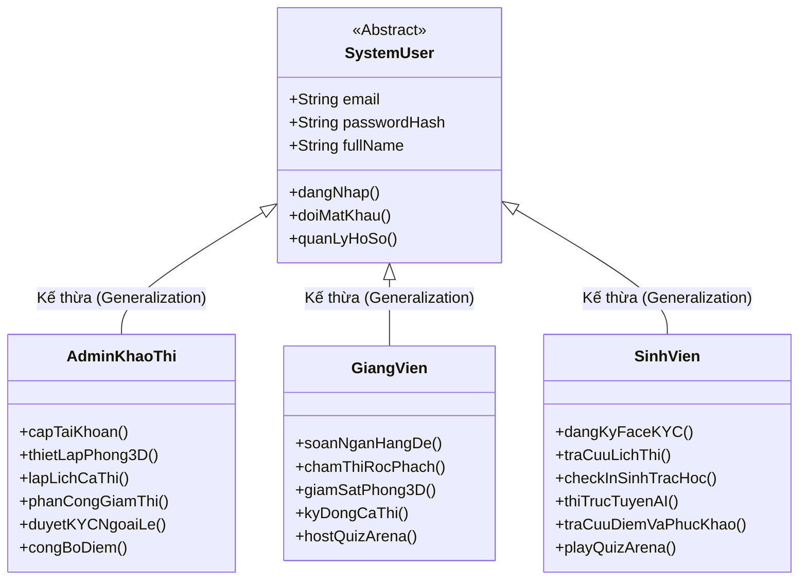

---

### 4.4 Bảng Đối chiếu Danh xưng & Ngữ cảnh Tác nhân (Role-Context Mapping Matrix)

Bảng đối chiếu dưới đây giải quyết triệt để sự băn khoăn về mặt thuật ngữ: *"Tại sao trong tài liệu và sơ đồ Use Case lại có nhiều danh xưng như 'Thí sinh', 'Học viên', 'Giám thị', 'Giảng viên bộ môn'?"*:

| Danh xưng Thao tác (Contextual Name) | Tác nhân UML Chuẩn (UML Actor) | Quyền CSDL (`users.role`) | Ngữ cảnh Nghiệp vụ Cụ thể | Trách nhiệm Cốt lõi & Hành động Điển hình |
|---|---|:---:|---|---|
| **Cán bộ Khảo thí** | `Admin / Khảo thí` | `admin` | Tổ chức & Điều phối kỳ thi chính thức | Tạo ca thi, thiết lập ma trận phòng 3D, chia ca, gán SBD & Seat PIN, duyệt KYC ngoại lệ. |
| **Admin Hệ thống** | `Admin / Khảo thí` | `admin` | Quản trị vận hành hệ thống số | Import tài khoản SV/GV từ Excel, cấu hình luồng RTSP camera CCTV, phân quyền hệ thống. |
| **Giảng viên Bộ môn** | `Giảng viên` | `teacher` | Chuẩn bị học liệu & Chấm bài thi | Biên soạn ngân hàng câu hỏi, tạo đề thi trong Assessment Studio; chấm bài thi tự luận/code rọc phách. |
| **Cán bộ Coi thi / Giám thị** | `Giảng viên` | `teacher` | Điều hành trực tiếp tại phòng thi | KYC nạp Staff Whitelist; mở Dashboard 3D giám sát realtime, xử lý gian lận, ký đóng ca thi. |
| **Quiz Host** | `Giảng viên` (hoặc Admin) | `teacher` / `admin` | Đấu trường kiến thức tương tác | Tạo phòng thi đấu trắc nghiệm trực tiếp dạng Kahoot, điều khiển câu hỏi và bảng xếp hạng live. |
| **Học viên** | `Sinh viên` | `student` | Chuẩn bị trước kỳ thi & Rèn luyện | Đăng nhập tài khoản, thực hiện thu thập Căn cước số Face KYC 5 góc, tham gia minigame ôn tập. |
| **Thí sinh (Candidate)** | `Sinh viên` | `student` | Tham gia ca thi chính thức | Check-in 1:1 bằng khuôn mặt, nhập Seat PIN, làm bài thi dưới sự bảo vệ của AI và SEB, nộp bài. |
| **Thí sinh Phúc khảo** | `Sinh viên` | `student` | Hậu kiểm kết quả bài thi | Tra cứu bảng điểm đã công bố, đối chiếu đáp án, gửi đơn khiếu nại trực tuyến trong 7 ngày. |

---

### 4.5 Ma trận Phân quyền Chức năng Nghiệp vụ (RBAC Matrix) & 3 Nguyên tắc Bất biến

#### 4.5.1 Ma trận Phân quyền RBAC Chi tiết

| Nhóm Nghiệp vụ Chức năng | Admin Khảo thí | Giảng viên | Sinh viên | Ràng buộc Bảo mật Kỹ thuật |
|---|:---:|:---:|:---:|---|
| **Đăng nhập hệ thống (`Login.tsx`)** | ✅ | ✅ | ✅ | Bắt buộc cho mọi người dùng, dùng Email/Mật khẩu do Admin cấp |
| **Quản lý Người dùng & Cấp tài khoản** | **✅ (Độc quyền)** | ❌ | ❌ | Thêm, sửa, khóa tài khoản, import Excel, cấp mật khẩu ban đầu |
| **Quản lý Cơ cấu Đào tạo (Khoa / Lớp)** | ✅ | ❌ | ❌ | Thiết lập phân cấp đào tạo phục vụ tổ chức thi cử |
| **Đăng ký Căn cước số Face KYC** | ❌ | ✅ (chính mình) | ✅ (chính mình) | Bắt buộc 5 góc: Thẳng, Trái, Phải, Ngửa, Cúi (ArcFace 512-D + Liveness) |
| **Quản lý Ngân hàng Đề thi** | ✅ | ✅ (môn phụ trách) | ❌ | Assessment Studio đa dạng loại câu hỏi (MCQ, Essay, Code) |
| **Tạo Ca thi Chính thức & Xếp chỗ** | **✅ (Độc quyền)** | **❌ (Cấm)** | ❌ | Lịch biểu Gantt, phòng thi 3D, cấp SBD & Seat PIN 6 số |
| **Cấu hình Phòng thi 3D & Camera CCTV** | ✅ | ❌ | ❌ | Khai báo luồng RTSP camera IP và đa giác quan sát ROI Polygon |
| **Phân công Giám thị Ca thi** | ✅ | ❌ | ❌ | Phân công độc lập; tự động nạp vector vào `Staff Proctor Whitelist` |
| **Tham gia Thi Trực tuyến Chính thức** | ❌ | ❌ | **✅** | Check-in 1:1, làm bài có AI bảo vệ, Auto-save 10s, nộp bài an toàn |
| **Giám sát Phòng thi 3D Realtime** | ✅ (toàn trường) | ✅ (phòng được gán) | ❌ | Dashboard 3D Socket.IO, nhận diện gian lận, miễn trừ Staff Exemption |
| **Chấm thi Tự luận / Code (Rọc phách)** | ❌ | ✅ (GV được gán) | ❌ | Anonymous Hashing: Chỉ thấy mã phách `#xxxx`, ẩn danh tính sinh viên |
| **Công bố Điểm Chính thức** | ✅ | ❌ | ❌ | Phê duyệt sau quy trình rà soát bảng điểm 1 lần (One-time review) |
| **Tra cứu Điểm & Nộp đơn Phúc khảo** | ❌ | ❌ | ✅ (trong 7 ngày) | Tra cứu điểm, xem lời giải đối chiếu, gửi đơn phúc khảo trực tuyến |
| **Tổ chức & Tham gia Đấu trường Quiz** | ✅ (Host) | ✅ (Host) | ✅ (Player) | Tạo phòng live qua PIN 6 số phong cách Kahoot, tính điểm tốc độ |

#### 4.5.2 3 Nguyên tắc Bất biến Bảo đảm Tính Liêm chính của Kỳ thi Đại học
1. **Nguyên tắc Độc lập Khảo thí (Examination Independence):**
   - Phòng thi chính thức là **độc quyền khởi tạo bởi Admin Khảo thí**. Giảng viên tuyệt đối không được phép tự tạo Ca thi chính thức để đảm bảo tính khách quan. Đồng thời, giảng viên soạn đề môn X không được coi thi môn X.
2. **Nguyên tắc Rọc phách Ẩn danh (Anonymous Grading):**
   - Khi giảng viên chấm bài tự luận hoặc bài tập lập trình, hệ thống tự động băm mã hóa thông tin cá nhân (`MSSV`, `Họ tên`, `Lớp`) thành **Mã phách điện tử (`#xxxx`)**. Giảng viên chỉ được chấm điểm dựa trên chất lượng bài thi thuần túy.
3. **Nguyên tắc Zero-Trust Sinh trắc học (Biometric Zero-Trust Pre-requisite):**
   - Mọi quyền tham gia kỳ thi (đối với Sinh viên) hoặc quyền coi thi (đối với Giảng viên) đều gắn liền với điều kiện tiên quyết: Hồ sơ Face KYC phải ở trạng thái **`APPROVED`**. Nếu chưa có Căn cước số hợp lệ, hệ thống tự động chặn xếp chỗ và từ chối cấp đề thi.

---

### 4.6 Cẩm nang Trả lời Phản biện Bảo vệ Đồ án trước Hội đồng Chuyên môn (Defense Q&A Guide)

Dưới đây là các câu hỏi "bẫy" kinh điển của Hội đồng phản biện về Tác nhân (Actor) và cách trả lời thuyết phục:

> **Q1: Tại sao hệ thống ExamGuard AI không có tính năng Đăng ký tài khoản (Sign Up) cho người dùng?**
> - **Trả lời:** ExamGuard AI là hệ thống khảo thí số nội bộ của cơ sở đào tạo chính quy, không phải mạng xã hội hay website thương mại điện tử. Nếu cho phép người dùng tự do đăng ký, người ngoài có thể tạo tài khoản giả mạo để xâm nhập phòng thi hoặc làm lộ đề thi. Toàn bộ tài khoản Sinh viên và Giảng viên đều phải do **Cán bộ Khảo thí import từ CSDL Quản lý Đào tạo chính thức**, đảm bảo 100% người dùng trên hệ thống đều có tư cách pháp nhân đào tạo hợp lệ.

> **Q2: Admin trong hệ thống của em thực chất là ai? Có phải là bạn sinh viên làm đồ án hay nhân viên IT phòng máy không?**
> - **Trả lời:** Dạ không. Admin trong ExamGuard AI là **Cán bộ Phòng Khảo thí & Đảm bảo Chất lượng Đào tạo** của nhà trường. Trong thực tế giáo dục đại học, nhân viên IT chỉ phụ trách máy chủ và đường truyền vật lý, tuyệt đối không có quyền can thiệp vào đề thi, lịch thi, giám thị hay điểm số. Toàn bộ 5 quyền hạn tối cao trong hệ thống (tạo ca thi, duyệt KYC ngoại lệ, phân công giám thị, rà soát phách và công bố bảng điểm) đều thuộc thẩm quyền pháp lý độc quyền của Phòng Khảo thí.

> **Q3: Tại sao Giảng viên không được phép tự tạo Ca thi chính thức?**
> - **Trả lời:** Đây là nguyên tắc cốt lõi về **Phân tách Quyền hạn (Segregation of Duties)** trong quy chế thi cử. Nếu giảng viên vừa giảng dạy, vừa tự tạo ca thi, vừa phát đề và tự chấm cho sinh viên của mình thì sẽ nảy sinh nguy cơ tiêu cực, thiên vị hoặc lộ đề thi. Giảng viên chỉ được phân quyền quản lý Ngân hàng đề thi và tổ chức Đấu trường Quiz tương tác ôn tập; còn Ca thi chính thức bắt buộc phải do Phòng Khảo thí độc lập khởi tạo và điều phối.

> **Q4: Tại sao trong Biểu đồ Use Case của em lại có các Tác nhân là "HT_FaceAI" và "Camera CCTV"? Chúng có phải là con người đâu mà được gọi là Actor?**
> - **Trả lời:** Theo đặc tả chuẩn **OMG UML 2.5**, Tác nhân (Actor) không chỉ đại diện cho con người (Human Actor) mà còn bao gồm bất kỳ hệ thống phần mềm bên ngoài (External System) hoặc thiết bị phần cứng (Hardware Entity) nào trực tiếp trao đổi tín hiệu, cung cấp dữ liệu đầu vào hoặc nhận dữ liệu đầu ra từ hệ thống. `HT_FaceAI` là một Microservice độc lập chạy trên cổng 8000 (Python FastAPI), liên tục cung cấp kết quả phân tích ArcFace 512-D và Liveness cho hệ thống chính. Tương tự, `Camera CCTV` là hạ tầng phần cứng độc lập truyền luồng video RTSP vào server. Việc mô hình hóa chúng thành Tác nhân Hỗ trợ (Supporting / Secondary Actors) hoàn toàn chuẩn mực theo lý thuyết phân tích thiết kế hướng dịch vụ (SOA / Microservices).

---


## V. BIỂU ĐỒ USE CASE TỔNG QUÁT & MÔ HÌNH PHÂN CẤP KẾ THỪA ACTOR

### 5.1 Phân tích Chuyên sâu: Mô hình Kế thừa Actor & Bài học từ Sơ đồ Mẫu

#### 5.1.1 Giải mã Biểu đồ Use Case Tham chiếu (Hệ thống Học trực tuyến Eduface)
Từ biểu đồ Use Case mẫu tích hợp khuôn mặt (Eduface), chúng ta nhận diện được quy luật thiết kế chuẩn mực sau:
1. **Bố cục Phân vùng Tiêu chuẩn (Three-Tier UML Layout):**
   - **Bên trái (Human Actors):** Tập trung các tác nhân con người tương tác trực tiếp với giao diện người dùng.
   - **Ở giữa (System Boundary):** Đóng gói toàn bộ các Use Case nghiệp vụ và đặc biệt là cụm **Lõi Sinh trắc học Khuôn mặt (Face Biometric Core)**.
   - **Bên phải (Supporting / Secondary Actors):** Các hệ thống dịch vụ ngoài và AI Engine phụ trợ (`Face AI Service`, `Cổng Thanh Toán PayOS`,...).
2. **Actor nào đang kế thừa? Ai là Actor Cha trong sơ đồ mẫu?**
   - **Actor Cha:** `Khách Vãng Lai (Guest / Anonymous User)`.
   - **Actor Kế thừa (Con):** `Học Viên (Student / Enrolled User)`.
   - **Bản chất kế thừa (Generalization):** Khách vãng lai chỉ có quyền truy cập công khai (*"Xem danh sách khoá học"*, *"Mua khoá học"*). Khi người dùng mua khoá học hoặc đăng ký tài khoản thành công, họ trở thành `Học Viên`. Do đó, `Học Viên` kế thừa toàn bộ các Use Case của `Khách Vãng Lai` và được bổ sung các Use Case nghiệp vụ học tập nâng cao (*"Đăng ký khuôn mặt"*, *"Tham gia ôn tập trực tuyến"*, *"Quản lý tiến trình học"*).
   > *Lưu ý về chuẩn hoá UML:* Trong sơ đồ mẫu, tác giả đã kẻ 2 đường liên kết song song từ cả `Khách Vãng Lai` và `Học Viên` vào 2 Use Case *"Xem danh sách khoá học"* và *"Mua khoá học"*. Theo chuẩn UML 2.x, cách vẽ chuẩn mực và tinh gọn nhất là thiết lập mũi tên kế thừa rỗng nét tam giác: `Học Viên --|> Khách Vãng Lai`. Khi đó, `Học Viên` tự động sở hữu các quyền này mà không cần nối thêm đường dây liên kết, loại bỏ hoàn toàn sự rối rắm trên biểu đồ.

---

#### 5.1.2 Cây Phân cấp Kế thừa Actor trong Hệ thống ExamGuard AI (Theo SYSTEM_BLUEPRINT.md)

Áp dụng bài học trên kết hợp với tài liệu kiến trúc đặc thù đại học trong [`SYSTEM_BLUEPRINT.md`](file:///d:/K23CNT3-LucVanSon-2310900087/DATN/SYSTEM_BLUEPRINT.md), hệ thống ExamGuard AI định nghĩa mô hình **Kế thừa Actor Đa cấp (Multi-level Actor Generalization Hierarchy)** như sau:

```
+---------------------------------------------------------------------------------------------------+
|                                 Người Dùng Hệ Thống (System User)                                 |  <--- [ACTOR CHA TRỪU TƯỢNG]
|   - (UC-G01) Đăng nhập hệ thống qua Login.tsx (SSO / Email-Password do Admin cấp)                  |
|   - (UC-G02) Quản lý thông tin hồ sơ & Đổi mật khẩu cá nhân                                       |
|   - (UC-CORE01) ĐĂNG KÝ CĂN CƯỚC KHUÔN MẶT GỐC (Face KYC 5 góc: Thẳng, Trái, Phải, Ngửa, Cúi)      |
+---------------------------------------------------------------------------------------------------+
                                                  ^
                                                  |  <<generalization>> (Kế thừa trực tiếp)
         +----------------------------------------+----------------------------------------+
         |                                        |                                        |
+--------------------------------+       +--------------------------------+       +--------------------------------+
|    Admin / Cán bộ Khảo thí     |       |      Giảng viên (Teacher)      |       |      Sinh viên (Student)       |
|        (Administrator)         |       |      (Teacher / Proctor)       |       |      (Student / Examinee)      |
|      [DB Role: 'admin']        |       |      [DB Role: 'teacher']      |       |      [DB Role: 'student']      |
| - Quản trị tài khoản & Lớp     |       | - KYC nạp Staff Whitelist ca thi|      | - Tra cứu lịch thi, SBD & bàn  |
| - Thiết lập phòng thi 3D & CCTV|       | - Điểm danh & Ký đóng ca Face  |       | - Check-in sinh trắc học 1:1   |
| - Lập lịch ca thi & Phê duyệt đề|      | - Khởi tạo & Host Quiz Arena   |       | - Làm bài thi & Giám sát AI    |
| - Xếp chỗ SV & Gán Giám thị    |       +--------------------------------+       | - Tra cứu điểm & Phúc khảo     |
| - Thẩm định KYC ngoại lệ       |                       ^                        | - Tranh tài Đấu trường Quiz    |
| - Phê duyệt & Công bố điểm     |                       | <<specialization>>     +--------------------------------+
+--------------------------------+                       | (Phân vai Ngữ cảnh)
                                        +----------------+----------------+
                                        |                                 |
                               +------------------+              +------------------+
                               |  Cán bộ Coi thi  |              | Giảng viên Bộ môn|
                               |  (Exam Proctor)  |              | (Instructor)     |
                               | - Giám sát 3D    |              | - Soạn đề thi    |
                               | - Xử lý vi phạm  |              | - Chấm rọc phách |
                               +------------------+              +------------------+
                                        |                                 |
                               +------------------+              +------------------+
                               | Cán bộ Thanh tra |              |  Cố vấn Học tập  |
                               | - Giám sát đa    |              | - Theo dõi điểm  |
                               |   phòng & Audit  |              |   rèn luyện lớp  |
                               +------------------+              +------------------+
```

**Bảng 2.4. Ma trận Phân cấp Kế thừa và Vai trò Chuyên biệt (Actor Hierarchy Matrix)**

| Cấp bậc Actor | Tên Actor | Mối quan hệ Kế thừa | Use Case sở hữu / Kế thừa | Lý do Thiết kế Kiến trúc |
|---|---|---|---|---|
| **Actor Cha (Root)** | **Người Dùng Hệ Thống (System User)** | *Tác nhân trừu tượng cấp cao nhất* | • `(UC-G01) Đăng nhập hệ thống (SSO / Portal)`<br/>• `(UC-G02) Quản lý thông tin & Đổi mật khẩu`<br/>• **`(UC-CORE01) Đăng ký Căn cước Khuôn mặt Gốc (Face KYC 5 góc)`** | **Điểm mấu chốt của toàn hệ thống:** Cả Sinh viên và Giảng viên đều phải đăng ký KYC khuôn mặt 5 góc gốc. Đưa KYC lên Actor Cha giúp tái sử dụng hoàn toàn quy trình và loại bỏ dư thừa mô hình hoá. |
| **Actor Con 1** | **Sinh Viên (Student)** | `Kế thừa (Generalizes) System User` | • Kế thừa toàn bộ Use Case của `System User`<br/>• `(UC-S01) Xem lịch thi cá nhân, SBD & phòng thi`<br/>• `(UC-S02) Check-in Sinh trắc học 1:1`<br/>• `(UC-S03) Tham gia Thi trực tuyến & Giám sát AI`<br/>• `(UC-S04) Xem kết quả thi & Nộp đơn phúc khảo`<br/>• `(UC-S05) Tham gia Đấu trường Quiz bằng mã PIN` | Sinh viên sử dụng Vector Gốc để: (1) Điểm danh Check-in 1:1 mở đề thi; (2) Giám sát liên tục Continuous Biometric mỗi 20s chống tráo người thi hộ. |
| **Actor Con 2** | **Giảng Viên (Teacher)** | `Kế thừa (Generalizes) System User` | • Kế thừa toàn bộ Use Case của `System User`<br/>• `(UC-T01) Nạp Vector vào Staff Proctor Whitelist`<br/>• `(UC-T02) Điểm danh nhận phòng & Ký đóng ca thi`<br/>• `(UC-T03) Quản lý Ngân hàng câu hỏi & Đề thi`<br/>• `(UC-T04) Giám sát Phòng thi 3D Realtime`<br/>• `(UC-T05) Chấm thi Rọc phách Ẩn danh (Essay/Code)`<br/>• `(UC-T06) Khởi tạo & Điều khiển Đấu trường Quiz` | **Quy tắc Nghiệp vụ `RULE-SEC-01` & `RULE-SEC-04`:** Giảng viên bắt buộc KYC để nạp vào Staff Whitelist. Khi Giám thị kiểm tra bàn, AI nhận diện mặt Giám thị $\rightarrow$ kích hoạt `STAFF_EXEMPTION` (0 điểm phạt). |
| **Actor Con 3** | **Admin / Cán bộ Khảo thí** | `Kế thừa (Generalizes) System User` | • Kế thừa `Đăng nhập` & `Thông tin cá nhân`<br/>• `(UC-A01) Quản trị Tổ chức & Cấp tài khoản`<br/>• `(UC-A02) Thiết lập Phòng thi 3D & Camera CCTV`<br/>• `(UC-A03) Lập lịch Ca thi Gantt & Duyệt đề`<br/>• `(UC-A04) Xếp chỗ Thí sinh & Gán Giám thị`<br/>• `(UC-A05) Thẩm định Phê duyệt KYC Ngoại lệ`<br/>• `(UC-A06) Kiểm soát Toàn vẹn & Công bố Điểm` | Giữ quyền hạn tối cao về cơ sở vật chất, phân công giám thị (chỉ gán GV đã KYC) và xếp chỗ sinh viên (chỉ xếp SV đã KYC APPROVED). |
| **Actor Bổ trợ** | **Khách Vãng Lai (Guest)** | *Tác nhân tự do chưa xác thực* | • `(UC-P01) Tra cứu Quy chế & Lịch thi công khai`<br/>• `(UC-P02) Trải nghiệm Demo Đấu trường Quiz mở` | Người ngoài hoặc sinh viên chưa đăng nhập truy cập portal tìm hiểu thông tin hoặc quét QR tham gia minigame khởi động. |

---

### 5.2 Kiến trúc Lõi Sinh trắc học (Face Biometric AI Core) & Các Quan hệ Phụ thuộc

#### 5.2.1 Nguyên lý "Cùng một Lõi AI — Khác biệt về Miền Nghiệp vụ"
Nếu như trong hệ thống học trực tuyến mẫu (Eduface), Lõi AI chỉ phục vụ điểm danh bài học và chống tua video; thì trong **ExamGuard AI**, Lõi Sinh trắc học được nâng cấp thành **Hạ tầng Phòng vệ Đa tầng (Defense-in-Depth Biometric Infrastructure)** phục vụ phòng thi thực tế:
- **Lõi Sinh trắc học (Face Biometric AI Core Use Cases):**
  1. `(UC-AI-CORE01) Mã hoá khuôn mặt thành Vector ArcFace 512-D`: Chuẩn hoá toạ độ và vector hoá đặc trưng sinh trắc học bất biến.
  2. `(UC-AI-CORE02) Kiểm tra Thực thể sống Liveness Anti-Spoofing (MiniFASNet)`: Ngăn chặn 100% giả mạo qua ảnh in màu, video phát lại (replay), màn hình iPad hay mặt nạ 3D silicon.
  3. `(UC-AI-CORE03) Đối chiếu Khuôn mặt Cosine Similarity (Threshold >= 0.75)`: Xác minh tương đồng 1:1 giữa khuôn mặt thời gian thực và Vector Gốc KYC đã lưu.
  4. `(UC-AI-CORE04) So khớp Staff Proctor Whitelist (Miễn trừ Vi phạm)`: Tự động so sánh khuôn mặt thứ 2 xuất hiện trong camera với danh sách Giám thị ca thi để kích hoạt cơ chế miễn trừ phạt `STAFF_EXEMPTION`.

#### 5.2.2 Bản đồ Quan hệ `<<include>>` và `<<extend>>` Chặt chẽ
- **Các quan hệ `<<include>>` (Bắt buộc phải thực thi):**
  - `Đăng ký Căn cước KYC 5 góc` $\xrightarrow{<<include>>}$ `Mã hoá Vector ArcFace 512-D`
  - `Đăng ký Căn cước KYC 5 góc` $\xrightarrow{<<include>>}$ `Kiểm tra Liveness Anti-Spoofing`
  - `Check-in Phòng thi 1:1` $\xrightarrow{<<include>>}$ `Đối chiếu Cosine Similarity với Vector Gốc`
  - `Check-in Phòng thi 1:1` $\xrightarrow{<<include>>}$ `Kiểm tra Liveness Anti-Spoofing`
  - `Tham gia Thi trực tuyến & Giám sát AI` $\xrightarrow{<<include>>}$ `Đối chiếu Cosine Similarity liên tục (mỗi 20s)`
  - `Điều hành Phòng thi 3D Realtime` $\xrightarrow{<<include>>}$ `Ký đóng ca thi bằng Face Biometric Auth` $\xrightarrow{<<include>>}$ `Đối chiếu Cosine Similarity`
- **Các quan hệ `<<extend>>` (Mở rộng theo điều kiện nghiệp vụ):**
  - `(UC-S03) Tham gia Thi trực tuyến` $\xleftarrow{<<extend>>}$ `(UC-EX01) Miễn trừ vi phạm Giám thị (STAFF_EXEMPTION)`: Kích hoạt khi AI phát hiện đa khuôn mặt (`MULTIPLE_FACES`) nhưng khuôn mặt thứ 2 trùng khớp với Staff Whitelist.
  - `(UC-S03) Tham gia Thi trực tuyến` $\xleftarrow{<<extend>>}$ `(UC-EX02) Cảnh báo / Đình chỉ thi / Bù giờ`: Kích hoạt bởi Cán bộ coi thi khi phát hiện gian lận nghiêm trọng hoặc sinh viên gặp sự cố máy móc.
  - `(UC-S04) Tra cứu Kết quả thi` $\xleftarrow{<<extend>>}$ `(UC-EX03) Nộp đơn Phúc khảo bài thi`: Kích hoạt khi sinh viên có thắc mắc về điểm thi trong thời hạn 7 ngày kể từ khi công bố điểm.
  - `(UC-A04) Xếp chỗ Thí sinh` $\xleftarrow{<<extend>>}$ `(UC-EX04) Chặn Thí sinh Chưa KYC APPROVED`: Ràng buộc an toàn hệ thống (RULE-SEC-05), tự động đẩy thí sinh vào danh sách chờ nếu chưa có Căn cước Gốc.

---

### 5.3 Biểu đồ Use Case Tổng quát Chuẩn UML 2.x

#### 5.3.1 Sơ đồ Không gian Use Case ExamGuard AI (Định dạng ASCII Art Trực quan)

**Hình 2.1. Biểu đồ Use Case tổng quát hệ thống ExamGuard AI (Chuẩn UML 2.x)**

```
========================================================================================================================
                                     HE THONG GIAM SAT THI THONG MINH EXAMGUARD AI
========================================================================================================================

    [ACTORS CON NGUOI (LEFT)]                                      [HE THONG & LOI SINH TRAC HOC]               [SUPPORTING ACTORS (RIGHT)]
                                                              +---------------------------------------------+
   +---------------------------+                              |           BIOMETRIC AI CORE LAYER           |
   |    <<Abstract Root>>      |                              |                                             |
   |  NGUOI DUNG HE THONG      |                              |  +---------------------------------------+  |
   |        (User)             |                              |  | (UC-AI01) Ma hoa Vector ArcFace 512-D |  |
   +---------------------------+                              |  +---------------------------------------+  |
     |         |         |                                    |         ^                    ^          |
     |         |         +-----> (UC-G01) Dang nhap Portal    |         | <<include>>        | <<inc>>  |
     |         |                 (SSO / Email-Password)       |  +----------------+  +-------------------+  |
     |         |                                              |  | (UC-AI02)      |  | (UC-AI03)         |  |
     |         +---------------> (UC-G02) Quan ly Ho so,      |  | Kiem tra       |  | Doi chieu Cosine  |<---------+
     |                           Doi mat khau ca nhan         |  | Liveness       |  | Similarity >=0.75 |  |   |
     |                                                        |  | Anti-Spoofing  |  +-------------------+  |   |
     | <<generalization>>                                     |  +----------------+            ^            |   |
     +-----------------------------------------+              |         ^                      | <<inc>>    |   |
     |                                         |              |         | <<include>>          |            |   |
+----+----------------------+   +--------------+----------+   |  +---------------------------------------+  |   |
|    SINH VIEN (Student)    |   |  GIANG VIEN (Teacher)   |   |  | (UC-AI04) Staff Whitelist Matching    |  |   |
+---------------------------+   +-------------------------+   |  | (Mien tru vi pham STAFF_EXEMPTION)    |  |   |
  |  |  |  |                      |  |  |                     +--+---------------------------------------+--+   |
  |  |  |  +-- [KYC 5 GOC] -------+--+--+------------------------|---------> (UC-CORE01) Dang ky Can cuoc   |   |
  |  |  |     (Bat buoc 2 ben)    |  |                           |           Khuon mat Goc (KYC 5 goc)      |   |
  |  |  |                         |  |                           |              | <<include>>   | <<include>>   |
  |  |  |                         |  |                           |              +---------------+---------------+
  |  |  +-------------------------+--|---------------------------|----------------------+       |               |
  |  |  |                         |  |                           |                      v       v               |
  |  |  |  +----------------------+  |                           |                   [UC-AI01] [UC-AI02]        |
  |  |  |  | (Phan vai Coi thi)      |                           |                                              |
  |  |  |  v                         |                           +----------------------------------------------+
  |  |  | (UC-T01) Dieu hanh Phong   |                                                                          |
  |  |  |  thi 3D & Dashboard Realtime                                                                          |
  |  |  |    |                                                                                                  |
  |  |  |    +--- <<include>> -------> (UC-T02) Ky dong ca thi bang Face Auth ---> [UC-AI03]                    |
  |  |  |    |                                                                                                  |
  |  |  |    +--- <<extend>> --------> (UC-T03) Canh bao / Dinh chi / Bu gio                                    |
  |  |  |                                                                                                       |
  |  |  |                                                                                                       |
  |  |  +----------------------------> (UC-S02) Check-in Phong thi 1:1 ----------------> [UC-AI03] & [UC-AI02]  |
  |  |                                    |                                                                     |
  |  +-------------------------------> (UC-S03) Tham gia Thi truc tuyen & Giam sat AI -> [UC-AI03 Continuous]   |
  |                                       |                                                                     |
  |                                       +--- <<extend>> (Neu mat 2 la Giam thi) --> [UC-AI04 STAFF_EXEMPTION] |
  |                                       |                                                                     |
  |                                       +--- <<extend>> --------------------------> [UC-T03 Canh bao/Dinh chi]|
  |                                                                                                             |
  +----------------------------------> (UC-S04) Tra cuu Ket qua thi & Bang diem                                 |
                                          |                                                                     |
                                          +--- <<extend>> (Trong 7 ngay) -----------> (UC-S05) Nop don Phuc khao|
                                                                                                                |
  (Dau truong Quiz)                                                                                             |
  GIANG VIEN (Host) -----------------> (UC-Q01) Khoi tao & Dieu khien Quiz Arena (PIN 6 so)                     |
  SINH VIEN  (Player) ---------------> (UC-Q02) Tham gia Dau truong Quiz bang ma PIN                           |
                                                                                                                |
  (Nghiep vu Cham thi & De thi)                                                                                 |
  GIANG VIEN (Bo mon) ---------------> (UC-T04) Quan ly Ngan hang cau hoi & Soan de                             |
  GIANG VIEN (Cham thi) -------------> (UC-T05) Cham thi Roc phach An danh (Essay/Code)                         |
                                                                                                                |
+---------------------------+                                                                                   |
|  ADMIN / KHAO THI (Admin) |                                                                                   |
+---------------------------+                                                                                   |
  |-----> (UC-A01) Quan ly Co cau To chuc & Cap tai khoan Nguoi dung                                            |
  |-----> (UC-A02) Thiet lap Phong thi 3D, Gan Camera CCTV & Cau hinh ROI                                       |
  |-----> (UC-A03) Lap lich Ca thi (Gantt Chart) & Phe duyet De thi                                             |
  |-----> (UC-A04) Xep cho Thi sinh & Phan cong Giam thi                                                        |
  |          |                                                                                                  |
  |          +--- <<extend>> (RULE-SEC-05) -----------------------------> (UC-EX04) Chan Thi sinh chua KYC      |
  |-----> (UC-A05) Tham dinh & Phe duyet Ho so KYC Ngoai le                                                     |
  |-----> (UC-A06) Kiem soat Toan ven & Cong bo Diem chinh thuc                                                 |
                                                                                                                |
+---------------------------+                                                                                   |
|    KHACH VANG LAI (Guest) |                                                                                   |
+---------------------------+                                                                                   |
  |-----> (UC-P01) Xem Quy che thi, Huong dan & Tra cuu cong khai                                               |
  |-----> (UC-P02) Trai nghiem Demo Dau truong Quiz mo                                                          |
                                                                                                                |
================================================================================================================+
  SUPPORTING / SECONDARY ACTORS (EXTERNAL SERVICES):                                                            |
  - [Face AI Service (Python FastAPI)]: Phuc vu ArcFace 512-D, MiniFASNet Liveness, Cosine Matching             |
  - [CCTV AI Streaming Engine]: Nhan luong RTSP, phan tich YOLOv8 Pose, quet ROI ban thi                        |
  - [Client Lockdown Agent (SEB)]: Khoa man hinh desktop, chan VM, phat hien da man hinh                       |
=================================================================================================================
```

---

#### 5.3.2 Mã nguồn Biểu đồ PlantUML Chuẩn Quốc tế (Render Đồ họa Vector)

Để phục vụ sinh ảnh đồ hoạ chất lượng cao (SVG/PNG) tương thích 100% chuẩn UML 2.x, mã nguồn PlantUML sau đây được xây dựng đồng bộ với cấu trúc trên:

```plantuml
@startuml ExamGuard_AI_UseCase_Diagram
skinparam packageStyle rectangle
skinparam roundcorner 12
skinparam shadowing true
skinparam Handdrawn false
skinparam actorStyle awesome

skinparam sequenceArrowThickness 2
skinparam usecase {
    BackgroundColor #F8FAFC
    BorderColor #3B82F6
    ArrowColor #2563EB
}

' ==========================================
' ACTORS DEFINITION
' ==========================================
actor "Người Dùng Hệ Thống\n(System User)" as User <<Abstract>>
actor "Sinh Viên\n(Student)" as Student
actor "Giảng Viên\n(Teacher)" as Teacher
actor "Cán Bộ Khảo Thí / Admin\n(Admin)" as Admin
actor "Khách Vãng Lai\n(Guest)" as Guest

actor "Face AI Service\n(FastAPI)" as FaceAI <<Secondary>>
actor "CCTV Camera Engine\n(YOLOv8)" as CCTV <<Secondary>>
actor "Client Lockdown\n(SEB Agent)" as SEB <<Secondary>>

' Actor Inheritance
User <|-- Student
User <|-- Teacher
User <|-- Admin
Guest <|.. User : <<registers>>

' ==========================================
' SYSTEM BOUNDARY
' ==========================================
rectangle "Hệ Thống Giám Sát Thi Thông Minh ExamGuard AI" {

    ' User Generic Use Cases
    package "Xác Thực & Tài Khoản" {
        usecase "(UC-G01) Đăng nhập hệ thống\n(SSO / Portal)" as UC_Login
        usecase "(UC-G02) Quản lý thông tin\n& Đổi mật khẩu" as UC_Profile
    }

    ' Biometric AI Core
    package "Biometric AI Core Layer" #EFF6FF {
        usecase "(UC-AI01) Mã hoá khuôn mặt\ndưới dạng Vector 512-D" as UC_Vector
        usecase "(UC-AI02) Kiểm tra Liveness\nAnti-Spoofing (MiniFASNet)" as UC_Liveness
        usecase "(UC-AI03) Đối chiếu Khuôn mặt\nCosine Similarity >= 0.75" as UC_Cosine
        usecase "(UC-AI04) So khớp Staff Whitelist\n(Miễn trừ STAFF_EXEMPTION)" as UC_StaffWhitelist
    }

    ' KYC
    usecase "(UC-CORE01) Đăng ký Căn cước\nKhuôn mặt Gốc (KYC 5 góc)" as UC_KYC

    ' Student Use Cases
    package "Nghiệp Vụ Sinh Viên" {
        usecase "(UC-S01) Tra cứu Lịch thi cá nhân,\nSBD & Vị trí phòng" as UC_S_Schedule
        usecase "(UC-S02) Check-in Phòng thi\nSinh trắc học 1:1" as UC_S_Checkin
        usecase "(UC-S03) Tham gia Thi trực tuyến\n& Giám sát AI Chống gian lận" as UC_S_Exam
        usecase "(UC-S04) Tra cứu Kết quả thi\n& Đáp án giải thích" as UC_S_Result
        usecase "(UC-S05) Nộp đơn Phúc khảo bài thi\n(trong 7 ngày)" as UC_S_Appeal
    }

    ' Proctoring Extensions
    usecase "(UC-EX01) Miễn trừ vi phạm\nGiám thị kiểm tra bàn" as UC_Exempt
    usecase "(UC-EX02) Cảnh báo / Đình chỉ\n/ Bù giờ cho Thí sinh" as UC_Penalty

    ' Teacher Use Cases
    package "Nghiệp Vụ Giảng Viên & Coi Thi" {
        usecase "(UC-T01) Điều hành & Giám sát\nPhòng thi 3D Realtime" as UC_T_Proctor
        usecase "(UC-T02) Điểm danh & Ký đóng ca\nbằng Face Biometric Auth" as UC_T_Signoff
        usecase "(UC-T03) Soạn & Quản lý\nNgân hàng Câu hỏi/Đề thi" as UC_T_Question
        usecase "(UC-T04) Chấm thi Rọc phách\nẨn danh (Essay/Code)" as UC_T_Grade
    }

    ' Live Quiz Arena
    package "Đấu Trường Quiz Gamification" {
        usecase "(UC-Q01) Khởi tạo & Điều khiển\nQuiz Arena (PIN 6 số)" as UC_Q_Host
        usecase "(UC-Q02) Tham gia Đấu trường\nQuiz bằng mã PIN" as UC_Q_Play
    }

    ' Admin Use Cases
    package "Quản Trị Khảo Thí & Tổ Chức" {
        usecase "(UC-A01) Quản trị Tổ chức\n& Cấp tài khoản Người dùng" as UC_A_Users
        usecase "(UC-A02) Thiết lập Phòng thi 3D,\nCamera CCTV & Vùng ROI" as UC_A_Room
        usecase "(UC-A03) Lập lịch Ca thi Gantt\n& Phê duyệt Đề thi" as UC_A_Schedule
        usecase "(UC-A04) Xếp chỗ Thí sinh\n& Phân công Giám thị" as UC_A_Seating
        usecase "(UC-EX04) Tự động Chặn Thí sinh\nChưa KYC APPROVED" as UC_A_BlockNoKYC
        usecase "(UC-A05) Thẩm định & Phê duyệt\nHồ sơ KYC Ngoại lệ" as UC_A_ApproveKYC
        usecase "(UC-A06) Kiểm soát Toàn vẹn\n& Công bố Điểm chính thức" as UC_A_Audit
    }
}

' ==========================================
' RELATIONSHIPS & ASSOCIATIONS
' ==========================================
User --> UC_Login
User --> UC_Profile

' KYC Connection (Mandatory for Student & Teacher)
Student --> UC_KYC
Teacher --> UC_KYC
UC_KYC ..> UC_Vector : <<include>>
UC_KYC ..> UC_Liveness : <<include>>
UC_KYC ..> UC_Login : <<include>>

' Student Flow
Student --> UC_S_Schedule
Student --> UC_S_Checkin
Student --> UC_S_Exam
Student --> UC_S_Result
Student --> UC_Q_Play

UC_S_Checkin ..> UC_Cosine : <<include>>
UC_S_Checkin ..> UC_Liveness : <<include>>
UC_S_Exam ..> UC_Cosine : <<include (mỗi 20s)>>
UC_S_Exam <.. UC_Exempt : <<extend>>
UC_S_Exam <.. UC_Penalty : <<extend>>
UC_S_Result <.. UC_S_Appeal : <<extend>>
UC_Exempt ..> UC_StaffWhitelist : <<include>>

' Teacher Flow
Teacher --> UC_T_Proctor
Teacher --> UC_T_Question
Teacher --> UC_T_Grade
Teacher --> UC_Q_Host
UC_T_Proctor ..> UC_T_Signoff : <<include>>
UC_T_Signoff ..> UC_Cosine : <<include>>
Teacher ..> UC_Penalty : <<triggers>>

' Admin Flow
Admin --> UC_A_Users
Admin --> UC_A_Room
Admin --> UC_A_Schedule
Admin --> UC_A_Seating
Admin --> UC_A_ApproveKYC
Admin --> UC_A_Audit
UC_A_Seating <.. UC_A_BlockNoKYC : <<extend (RULE-SEC-05)>>

' Guest Flow
Guest --> UC_Login : <<proceeds>>

' Supporting Actor Links
FaceAI <-- UC_Vector
FaceAI <-- UC_Liveness
FaceAI <-- UC_Cosine
FaceAI <-- UC_StaffWhitelist
CCTV <-- UC_T_Proctor
SEB <-- UC_S_Exam

@enduml
```

---

#### 5.3.3 Biểu đồ Mermaid Tương thích Trực tiếp Trình duyệt

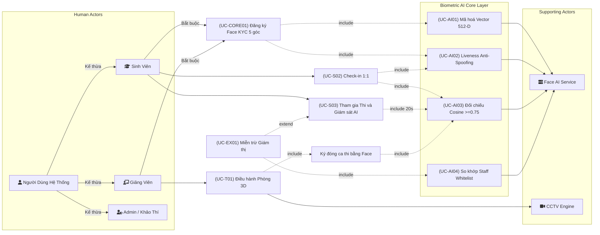

---

### 5.4 Danh mục Use Case Cốt lõi & Bảng Phân bổ Mức độ Ưu tiên

**Bảng 2.4c. Bảng Danh mục Use Case Hệ thống theo Mức độ Cốt lõi (Tier Classification)**

| STT | Mã Use Case | Tên Use Case | Tác nhân chính (Primary) | Tác nhân hỗ trợ (Secondary) | Quan hệ Phụ thuộc | Mức độ Cốt lõi |
|:---:|---|---|---|---|---|:---:|
| 1 | **UC-CORE01** | **Đăng ký Căn cước Khuôn mặt Gốc (Face KYC)** | Người dùng (`SV`, `GV`) | Face AI Service, Admin duyệt ngoại lệ | `<<include>>` UC-AI01, UC-AI02, UC-G01 | ⭐⭐⭐⭐⭐ (Tier 1) |
| 2 | **UC-S02** | **Check-in Phòng thi Sinh trắc học 1:1** | Sinh viên | Face AI Service, Giám thị | `<<include>>` UC-AI03, UC-AI02 | ⭐⭐⭐⭐⭐ (Tier 1) |
| 3 | **UC-S03** | **Tham gia Thi trực tuyến & Giám sát AI** | Sinh viên | Face AI Service, SEB Agent, Giám thị | `<<include>>` UC-AI03; `<<extend>>` UC-EX01, UC-EX02 | ⭐⭐⭐⭐⭐ (Tier 1) |
| 4 | **UC-T01** | **Điều hành & Giám sát Phòng thi 3D Realtime** | Giảng viên (Giám thị) | CCTV Engine, Redis Pub/Sub, Socket.IO | `<<include>>` UC-T02; `<<triggers>>` UC-EX02 | ⭐⭐⭐⭐⭐ (Tier 1) |
| 5 | **UC-A04** | **Xếp chỗ Thí sinh & Phân công Giám thị** | Admin / Khảo thí | Hệ thống tự động gán SBD & Random Bàn | `<<extend>>` UC-EX04 (Chặn chưa KYC) | ⭐⭐⭐⭐ (Tier 2) |
| 6 | **UC-T04** | **Chấm thi Rọc phách Ẩn danh (Essay & Code)** | Giảng viên chấm thi | Trưởng bộ môn phê duyệt | Kích hoạt ghép phách sau duyệt | ⭐⭐⭐⭐ (Tier 2) |
| 7 | **UC-Q01** | **Khởi tạo & Điều khiển Đấu trường Quiz (Host)**| Giảng viên | Redis In-memory, Web Audio API | Đồng bộ điểm sang bảng điểm ca thi | ⭐⭐⭐ (Tier 3) |
| 8 | **UC-Q02** | **Tham gia Đấu trường Quiz Tương tác (Player)**| Sinh viên | Socket.IO Server | Nhận câu hỏi, tính tốc độ & vinh danh | ⭐⭐⭐ (Tier 3) |
| 9 | **UC-A06** | **Kiểm soát Toàn vẹn & Công bố Điểm chính thức**| Admin / Khảo thí | Hệ thống bảo mật điểm | Mở khoá quyền tra cứu và phúc khảo | ⭐⭐⭐ (Tier 3) |
| 10| **UC-S05** | **Nộp đơn Phúc khảo bài thi / Điểm uy tín** | Sinh viên | Hội đồng Khảo thí, Giám thị đối soát | `<<extend>>` UC-S04 (Thời hạn 7 ngày) | ⭐⭐ (Tier 4) |
| 11| **UC-A01** | **Quản trị Cơ cấu Tổ chức & Cấp tài khoản** | Admin / Khảo thí | Cổng xác thực SSO | Điều kiện tiên quyết cấp tài khoản | ⭐⭐ (Tier 4) |

---

## VI. BIỂU ĐỒ USE CASE PHÂN RÃ & ĐẶC TẢ CHI TIẾT

*Các use case được lựa chọn và đặc tả chi tiết theo thứ tự mức độ cốt lõi giảm dần.*

---

### UC-01: Đăng ký Căn cước Khuôn mặt Gốc (Face KYC Enrollment)

> **Mức độ:** ⭐⭐⭐⭐⭐ — QUAN TRỌNG NHẤT (Điều kiện tiên quyết toàn hệ thống)

**Bảng 2.5. Đặc tả Use Case UC-01: Đăng ký KYC Khuôn mặt Gốc**

| Trường | Nội dung |
| :--- | :--- |
| **Tên Use Case** | Đăng ký Căn cước Khuôn mặt Gốc (Face KYC Enrollment) |
| **Mã Use Case** | **UC-CORE01** (Kế thừa từ `System User`: áp dụng cho cả Sinh viên & Giảng viên) |
| **Actor chính** | **Người dùng Hệ thống** (`Sinh viên`, `Giảng viên`) |
| **Actor hỗ trợ** | AI Service (FastAPI), Admin (duyệt ngoại lệ) |
| **Mô tả ngắn** | Người dùng thu thập 5 góc khuôn mặt dưới sự hướng dẫn của hệ thống; AI trích xuất và lưu trữ vector ArcFace 512-D làm Căn cước Sinh trắc học Số Gốc. |
| **Tiền điều kiện** | Người dùng đã có tài khoản; `face_status ∈ {NOT_ENROLLED, REJECTED}`; webcam đạt 720p; môi trường đủ sáng (≥ 300 lux). |
| **Hậu điều kiện** | `face_status = APPROVED`; vector ArcFace 512-D lưu vào `face_embedding`; ảnh gốc HD lưu vào Storage; SV: mở quyền xếp chỗ + check-in; GV: mở quyền Giám thị + nạp Staff Whitelist. |
| **Tần suất** | 1 lần duy nhất khi nhập học / nhận việc (hoặc cập nhật lại khi có thẩm định Hội đồng Khảo thí). |

**Luồng sự kiện chính:**

| Bước | Tác nhân | Hành động |
| :---: | :--- | :--- |
| 1 | Người dùng | Truy cập `/face-kyc`, đọc hướng dẫn chuẩn: ngồi thẳng 50–70cm, không kính râm, không khẩu trang. |
| 2 | Hệ thống | Bật webcam, hướng dẫn lần lượt 5 tư thế: Thẳng → Trái → Phải → Ngửa → Cúi. |
| 3 | Người dùng | Điều chỉnh đầu theo hướng dẫn; hệ thống tự động nhận diện đúng góc và chụp ảnh. |
| 4 | AI Service | Kiểm tra Liveness (MiniFASNet): Score ≥ 0.90; Laplacian Variance ≥ 100; Mean Intensity ∈ [80, 200]. |
| 5 | AI Service | Trích xuất 5 vector ArcFace 512-D; hợp nhất có trọng số: `V_GT = Normalize(0.4×V_straight + 0.15×(V_left + V_right + V_up + V_down))`. |
| 6 | Hệ thống | Cập nhật `face_status = APPROVED`; lưu embedding; kích hoạt quyền hạn nghiệp vụ tương ứng. |
| 7 | Người dùng | Nhận thông báo KYC hoàn thành; sinh viên thấy lịch thi được mở khóa. |

**Luồng sự kiện phát sinh:**

| Kịch bản | Điều kiện | Xử lý |
| :--- | :--- | :--- |
| **F1: Liveness thất bại** | MiniFASNet phát hiện ảnh in, video phát lại, hoặc mặt nạ 3D | Từ chối; cảnh báo "Phát hiện giả mạo"; log suspicious event; thử lại tối đa 3 lần/24h. |
| **F2: Chất lượng ảnh kém** | Laplacian Variance < 100 hoặc thiếu sáng | Yêu cầu chụp lại góc đó; gợi ý cải thiện ánh sáng / khoảng cách webcam. |
| **F3: Thiếu góc** | Chưa thu đủ 5 góc hợp lệ | Trạng thái `ENROLLING`; người dùng quay lại thu nốt các góc còn thiếu. |
| **F4: Admin từ chối** | Vector không đạt chuẩn sau thẩm định thủ công | `face_status = REJECTED`; người dùng nhận thông báo và thực hiện lại quy trình. |

---

### UC-02: Check-in Phòng thi Sinh trắc học 1:1

> **Mức độ:** ⭐⭐⭐⭐⭐ — QUAN TRỌNG NHẤT (Cửa ngõ vào ca thi)

**Bảng 2.6. Đặc tả Use Case UC-02: Check-in Phòng thi Sinh trắc học 1:1**

| Trường | Nội dung |
| :--- | :--- |
| **Tên Use Case** | Check-in Phòng thi Sinh trắc học 1:1 |
| **Mã Use Case** | **UC-S02** |
| **Actor chính** | Sinh viên |
| **Actor hỗ trợ** | AI Service (FastAPI), Giám thị (force check-in) |
| **Mô tả ngắn** | Sinh viên xác thực danh tính bằng khuôn mặt trước camera, AI so khớp 1:1 với Vector KYC Gốc và Liveness để mở đề thi. Ngăn chặn 100% thi hộ tại cổng vào. |
| **Tiền điều kiện** | `ca_thi.trang_thai = ACTIVE`; SV có `face_status = APPROVED`; SV có `sinh_vien_ca_thi.trang_thai = not_checkin`; đúng trong khung giờ (T_start → T_start + 15 phút). |
| **Hậu điều kiện** | `trang_thai = checkin`; bàn 3D bật xanh trên Dashboard Giám thị; đề thi mở khóa; AI kích hoạt vòng lặp Continuous Biometric Verification. |

**Luồng sự kiện chính (chế độ LAB_PC):**

| Bước | Tác nhân | Hành động |
| :---: | :--- | :--- |
| 1 | Sinh viên | Ngồi vào PC lab, mở trình duyệt khóa sẵn; nhập SBD hoặc để AI tự nhận diện. |
| 2 | Hệ thống | `POST /v1/checkin/verify {image_base64, sinh_vien_ca_thi_id}`. |
| 3 | AI Service | Liveness check (MiniFASNet) → Trích xuất vector ArcFace → Tính Cosine Similarity với Vector Gốc. |
| 4 | AI Service | Nếu `similarity >= 0.75` + Liveness pass → Trả về `{status: "OK", similarity_score}`. |
| 5 | Hệ thống | `UPDATE trang_thai = checkin`; ghi `checkin_time`, `similarity_score`, `captured_image_url`. |
| 6 | Hệ thống | Publish Socket.IO event `proctor:student_update` → Bàn bật XANH trên Dashboard 3D giám thị. |
| 7 | Sinh viên | Giao diện làm bài thi mở ra; đồng hồ đếm ngược bắt đầu. |

**Luồng sự kiện phát sinh:**

| Kịch bản | Điều kiện | Xử lý |
| :--- | :--- | :--- |
| **F1: Không khớp** | `similarity < 0.75` hoặc Liveness fail | Màn hình đỏ "Xác thực không trùng khớp". Cho phép thử lại tối đa 3 lần. |
| **F2: Hỏng camera / 3 lần fail** | Thử 3 lần vẫn thất bại | Cờ `CHECKIN_FAILED` đỏ trên Dashboard Giám thị; Giám thị kiểm tra CCCD → Force check-in kèm Audit Log. |
| **F3: Phát hiện giả mạo** | Liveness Fail (ảnh in, video replay) | Log `suspicious_checkin` vào MongoDB; từ chối dứt khoát; bắn cảnh báo lên Dashboard Giám thị. |
| **F4: Vào muộn** | Thời điểm > T_start + 15 phút | Hệ thống chặn hoàn toàn; hiển thị "Đã quá giờ cho phép vào phòng"; Giám thị có thể mở đặc cách. |
---

### UC-03: Giám sát AI Thời gian thực (Realtime Proctoring)

> **Mức độ:** ⭐⭐⭐⭐⭐ — QUAN TRỌNG NHẤT (Lõi chống gian lận trong ca thi)

**Bảng 2.7. Đặc tả Use Case UC-03: Giám sát AI Thời gian thực**

| Trường | Nội dung |
| :--- | :--- |
| **Tên Use Case** | Tham gia Thi Trực tuyến & Giám sát AI Thời gian thực |
| **Mã Use Case** | **UC-S03 / UC-T01** (kết hợp `UC-AI03`, mở rộng `UC-EX01`, `UC-EX02`) |
| **Actor chính** | Sinh viên (làm bài), Giảng viên (điều hành giám sát) |
| **Actor hỗ trợ** | Face AI Service (FastAPI Engine), CCTV Camera Engine, SEB Agent |
| **Mô tả ngắn** | Hệ thống AI chạy song song 2 nhánh: Webcam client-side (MediaPipe, 30 FPS) và CCTV server-side (YOLOv8 Pose, 5 FPS). Mỗi vi phạm được ghi nhận, trừ điểm uy tín và phát sóng cảnh báo realtime. |
| **Tiền điều kiện** | `ca_thi.trang_thai = ACTIVE`; SV đã `checkin`; Camera webcam và CCTV đang hoạt động. |
| **Hậu điều kiện** | Log vi phạm ghi vào MongoDB (bất biến); điểm uy tín cập nhật MySQL; Dashboard Giám thị nhận cảnh báo; Sinh viên nhận popup cảnh báo. |

**Luồng sự kiện chính:**

| Bước | Tác nhân | Hành động |
| :---: | :--- | :--- |
| 1 | AI (Web Worker) | Chạy MediaPipe FaceLandmarker 30 FPS trong Web Worker, không block UI sinh viên. |
| 2 | AI | Phân tích góc đầu (Yaw, Pitch), hướng mắt (Gaze), số khuôn mặt, trạng thái Tab. |
| 3 | AI (FastAPI) | Song song: Đọc N luồng RTSP camera; YOLOv8n-pose phát hiện 17 keypoints; Shapely kiểm tra ROI bàn thi. |
| 4 | AI | Phát hiện vi phạm → Chụp frame JPEG 30KB → `POST /v1/proctor/report-violation`. |
| 5 | FastAPI Engine | Ghi MongoDB `ai_proctoring_logs` (async); `UPDATE diem_uy_tin -= diem_tru` (MySQL). |
| 6 | FastAPI Engine | Kiểm tra ngưỡng: `diem_uy_tin < 50 → suspicious`; `diem_uy_tin = 0 → suspended`. |
| 7 | Redis Pub/Sub | Publish cảnh báo → Socket.IO broadcast. |
| 8 | Dashboard Giám thị | Bàn vi phạm đổi ĐỎ + nhấp nháy; Avatar 3D xoay theo Yaw/Pitch; Sidebar hiện thẻ vi phạm kèm ảnh. |
| 9 | Màn hình Sinh viên | Popup overlay đỏ "⚠️ Cảnh báo vi phạm"; hiện điểm uy tín còn lại; Countdown 5 giây tự đóng. |

**Bảng 2.8. Bảng điểm trừ theo loại vi phạm:**

| Loại vi phạm | Điểm trừ | Mức độ | Điều kiện kỹ thuật |
| :--- | :---: | :--- | :--- |
| **Tráo người thi hộ (IMPERSONATION_DETECTED)** | **−50** | **CRITICAL** | Cosine < 0.70 với Vector Gốc liên tục > 15 giây |
| Mở Developer Tools (DEVTOOLS_OPEN) | −30 | CRITICAL | Bấm F12, Ctrl+Shift+I |
| Phát hiện máy ảo (VM_DETECTED) | −20 | CRITICAL | SEB / OS Agent phát hiện môi trường ảo hóa |
| Cúi đầu xem điện thoại (PHONE_LOOK_DOWN) | −20 | HIGH | Pitch ≤ −22° gập mặt xem màn hình phụ |
| 2 người lạ xuất hiện (MULTI_FACE_UNKNOWN) | −15 | HIGH | Không khớp với Staff Proctor Whitelist |
| Màn hình thứ 2 (SECONDARY_MONITOR) | −15 | HIGH | Phát hiện mở rộng desktop ra màn hình ngoài |
| Chuyển Tab / Ẩn ứng dụng (TAB_SWITCH) | −10 | MEDIUM | Sự kiện `visibilitychange` của trình duyệt |
| Rời vị trí / che webcam (NO_FACE) | −10 | MEDIUM | Mất dấu khuôn mặt quá 10 giây |
| Liếc bài bên cạnh (SUSPICIOUS_SIDE) | −10 | MEDIUM | Yaw >= 30 độ |
| Xoay vai sang bên (SHOULDER_TURN) | −8 | MEDIUM | YOLOv8 Pose phát hiện xoay lệch người |
| Quay đầu sang bên (HEAD_TURN) | −5 | LOW | 15° ≤ Yaw < 30° |
| Liếc mắt rời màn hình (GAZE_OFF) | −3 | LOW | Mống mắt lệch > 4 giây |
| **Giám thị ghé bàn (STAFF_EXEMPTION)** | **0** | **INFO** | **Khớp ArcFace với Staff Whitelist → Miễn trừ phạt** |

**Luồng sự kiện phát sinh:**

| Kịch bản | Điều kiện | Xử lý |
| :--- | :--- | :--- |
| **F1: Giám thị đi quanh bàn** | Camera phát hiện ≥ 2 khuôn mặt, 1 khớp Staff Whitelist | STAFF_EXEMPTION: 0 điểm trừ; hiện badge "Cán bộ coi thi đang kiểm tra bàn". |
| **F2: Tráo người** | Cosine < 0.70 liên tục > 15 giây | IMPERSONATION_DETECTED: −50 điểm; báo động đỏ; Giám thị xác nhận → Khóa bài thi ngay lập tức. |
| **F3: Điểm uy tín = 0** | Tích lũy vi phạm đến 0 | `trang_thai = suspended`; khóa toàn bộ giao diện thi. |
| **F4: Giám thị bác bỏ cảnh báo nhầm** | Giám thị click "Bỏ qua (Dismiss)" | Đánh cờ `is_dismissed = true` kèm ID người bấm và lý do; log giữ nguyên cho hội đồng phúc khảo. |

---

### UC-04: Khởi tạo Ca thi & Xếp chỗ Sinh viên

> **Mức độ:** ⭐⭐⭐⭐ — RẤT QUAN TRỌNG (Nền tảng tổ chức ca thi)

**Bảng 2.9. Đặc tả Use Case UC-04: Khởi tạo Ca thi & Xếp chỗ Sinh viên**

| Trường | Nội dung |
| :--- | :--- |
| **Tên Use Case** | Khởi tạo Ca thi & Xếp chỗ Sinh viên |
| **Mã Use Case** | **UC-A04** (kết hợp `UC-A02`, `UC-A03`; mở rộng `UC-EX04`) |
| **Actor chính** | Admin / Cán bộ Khảo thí |
| **Actor hỗ trợ** | Hệ thống (tự động xếp chỗ và cấp SBD) |
| **Mô tả ngắn** | Admin thiết lập phòng thi 3D, gắn camera CCTV kèm vùng ROI, tạo ca thi và lịch biểu, import danh sách sinh viên để hệ thống tự động xếp chỗ ngẫu nhiên và cấp SBD. |
| **Tiền điều kiện** | Đã có dữ liệu `khoa`, `mon_hoc`, `hoc_ky`, `giang_vien`; các GV được gán Giám thị đã có `face_status = APPROVED`. |
| **Hậu điều kiện** | `ca_thi.trang_thai = UPCOMING`; N bản ghi `sinh_vien_ca_thi` với `trang_thai = not_checkin`, `diem_uy_tin = 100`; mỗi sinh viên có SBD duy nhất, tọa độ bàn R-C và `seat_pin_code` 6 số. |
| **Ràng buộc nghiệp vụ** | RULE-SEC-05: Chỉ SV có `face_status = APPROVED` mới được xếp chỗ. RULE-SEC-01: GV soạn đề môn X bị loại trừ khỏi coi thi môn X. |

**Luồng sự kiện chính:**

| Bước | Tác nhân | Hành động |
| :---: | :--- | :--- |
| 1 | Admin | Khai báo phòng thi: campus_id, mã phòng, loại phòng, số hàng × số cột, lối đi, bục giảng, allowed_ip_subnet. |
| 2 | Admin | Gắn camera CCTV: rtsp_url, vị trí lắp đặt. Kéo vẽ ROI Polygon trên canvas (4 đỉnh) ánh xạ mỗi bàn thi vào vùng camera. |
| 3 | Admin | Tạo ca thi: mon_hoc_id, hinh_thuc_thi, de_thi_mongo_id, ngay_thi, gio_bat_dau, thoi_luong_phut. Lịch biểu hiển thị dạng Gantt Chart. |
| 4 | Admin | Import danh sách SV (Excel hoặc chọn từ lớp). Hệ thống kiểm tra `face_status = APPROVED`, lọc SV chưa KYC. |
| 5 | Hệ thống | Shuffle ngẫu nhiên → Gán SBD (YYYYMMDD-001...) → Gán tọa độ R-C → Sinh seat_pin_code 6 số (unique trong ca thi). |
| 6 | Admin | Phân công Giám thị 1, Giám thị 2, Thanh tra (chỉ GV đã KYC APPROVED). |
| 7 | Hệ thống | Nạp vector ArcFace Giám thị vào Staff Face Whitelist (Redis Cache) trước giờ thi 15 phút. |

---

### UC-05: Chấm thi, Rà soát & Công bố Điểm

> **Mức độ:** ⭐⭐⭐⭐ — RẤT QUAN TRỌNG (Kết thúc vòng đời ca thi)

**Bảng 2.10. Đặc tả Use Case UC-05: Chấm thi, Rà soát & Công bố Điểm**

| Trường | Nội dung |
| :--- | :--- |
| **Tên Use Case** | Chấm thi, Rà soát & Công bố Điểm |
| **Mã Use Case** | **UC-T04 / UC-A06** (Giảng viên chấm rọc phách & Khảo thí công bố điểm) |
| **Actor chính** | Giảng viên (chấm thi), Admin (công bố điểm) |
| **Actor hỗ trợ** | Hệ thống (auto-grade MCQ) |
| **Mô tả ngắn** | MCQ được chấm tự động ngay khi nộp bài. Essay/Code được chấm tay trong chế độ rọc phách ẩn danh. Sau rà soát bảng điểm 1 lần, Admin công bố điểm kèm đáp án và lời giải. |
| **Tiền điều kiện** | Ca thi ở trạng thái `FINISHED`; tất cả bài làm đã chốt trong MongoDB. |
| **Hậu điều kiện** | Điểm chính thức được chốt; SV xem được kết quả và đáp án; SV có 7 ngày gửi đơn phúc khảo. |
| **Ràng buộc nghiệp vụ** | RULE-SEC-02: Khi chấm Essay/Code, hệ thống ẩn hoàn toàn Họ tên, MSSV, Lớp; thay bằng "Mã phách #7A3F..." (Anonymous Hash). Chỉ sau khi Trưởng bộ môn duyệt, hệ thống mới ghép phách trả về danh tính thực. |

**Luồng sự kiện chính:**

| Bước | Tác nhân | Hành động |
| :---: | :--- | :--- |
| 1 | Hệ thống | Ngay khi SV nộp bài → Auto-grade MCQ: đối chiếu đáp án `de_thi` → Ghi điểm MCQ tức thì. |
| 2 | Giảng viên | Truy cập giao diện chấm Essay/Code. Hệ thống chỉ hiển thị "Mã phách #xxxx" — không có thông tin nhận dạng. |
| 3 | Giảng viên | Nhập điểm từng câu Essay/Code; có thể xem lại đề bài nhưng không thấy danh tính thí sinh. |
| 4 | Trưởng bộ môn | Phê duyệt bảng điểm (Approve) → Hệ thống ghép phách, gán điểm về đúng sinh viên. |
| 5 | Admin / GV | Rà soát bảng điểm 1 lần (thống kê, phân tích đề: điểm TB, phân phối, tỷ lệ đúng/sai từng câu). |
| 6 | Admin | Phê duyệt và Công bố điểm chính thức → SV nhận thông báo xem kết quả + đối chiếu đáp án kèm giải thích. |

---

### UC-06: Tổ chức Đấu trường Quiz Gamification (Live Quiz Arena)

> **Mức độ:** ⭐⭐⭐ — QUAN TRỌNG (Tính năng đặc thù tạo khác biệt)

**Bảng 2.11. Đặc tả Use Case UC-06: Đấu trường Quiz Gamification**

| Trường | Nội dung |
| :--- | :--- |
| **Tên Use Case** | Tổ chức & Điều khiển Đấu trường Quiz Gamification |
| **Mã Use Case** | **UC-Q01 (Host) / UC-Q02 (Player)** |
| **Actor chính** | Giảng viên (Host), Sinh viên (Player) |
| **Actor hỗ trợ** | Socket.IO Server, Redis |
| **Mô tả ngắn** | Giảng viên khởi tạo phòng Quiz tức thì bằng PIN 6 số, điều khiển trực tiếp từng câu hỏi; Sinh viên tham gia và thi đua điểm số tốc độ theo thời gian thực. |
| **Tiền điều kiện** | Ca thi Quiz đã tạo với đề thi hợp lệ (`isQuizArena: true`); Giảng viên có quyền Host. |
| **Hậu điều kiện** | Kết quả trận đấu được ghi nhận; Giảng viên có thể đồng bộ điểm Quiz sang bảng điểm chính thức. |

**Luồng sự kiện chính:**

| Bước | Tác nhân | Hành động |
| :---: | :--- | :--- |
| 1 | Giảng viên | `POST /api/quiz-arena/create-room` với examSessionId và Custom Rules; nhận pinCode 6 số (VD: 824915). |
| 2 | Giảng viên | Chia sẻ PIN; mở Host Cockpit `/quiz-arena/host`, quan sát số SV tham gia qua live counter. |
| 3 | Sinh viên | Truy cập `/quiz-arena/player`, nhập PIN 6 số; gia nhập Room `arena_{pinCode}` qua Socket.IO. |
| 4 | Giảng viên | Bấm "Bắt đầu" → Socket.IO Broadcast `arena:new_question` kèm text, 4 đáp án, timeLimit. |
| 5 | Sinh viên | Nhận câu hỏi; đồng hồ đếm ngược đồng bộ; Web Audio phát tiếng nhịp tích tắc. Click chọn 1/4 màu. |
| 6 | Giảng viên | Thấy Live Bar Chart cập nhật tỷ lệ A/B/C/D theo thời gian thực. |
| 7 | Hệ thống | Hết giờ → Broadcast `arena:question_ended` kèm correctIndex + explanation; tính Speed Bonus + Streak Bonus; Survival trừ 1 tim nếu sai. |
| 8 | Hệ thống | Broadcast bảng xếp hạng Top 10; lặp lại từ Bước 4 đến hết bộ câu hỏi. |
| 9 | Hệ thống | Broadcast `arena:game_over` → Bục vinh danh Podium Top 3 (Vàng, Bạc, Đồng). |
---

## VII. BIỂU ĐỒ TUẦN TỰ (SEQUENCE DIAGRAM — ĐỦ 8 BIỂU ĐỒ CHUẨN BCE & ACTIVATION BARS)

> **Quy chuẩn Thiết kế Tuân thủ OMG UML 2.5 & Tương thích 100% Mermaid 10.9.8:**
> - **Mô hình Phân lớp BCE (Boundary - Control - Entity):** Phân định rạch ròi giữa Lớp Giao diện (`«Boundary»`), Lớp Điều khiển Nghiệp vụ (`«Control»`), Lớp Dữ liệu Thực thể (`«Entity»`), Lớp Hệ thống ngoài (`«System»`) và Tác nhân con người (`«Actor»`).
> - **Đường sống & Thanh kích hoạt (Lifeline & Activation Bars / Execution Occurrences):** Mọi đối tượng khi tiếp nhận thông điệp xử lý đều có **Thanh kích hoạt hình chữ nhật đứng (Activation Bar)** trên đường gióng nét đứt (`activate` / `deactivate`), biểu thị chính xác khoảng thời gian chiếm giữ tài nguyên CPU/xử lý.
> - **Cú pháp Thông điệp Chuẩn (UML Message Signatures):** Mọi lời gọi đồng bộ (`->>`) đều mang tên phương thức và tham số rõ ràng (`method(params)`), lời gọi tự thân (`self-call`) tạo thanh kích hoạt lồng nhau, và phản hồi kết quả mang nét đứt (`-->>`).
> - **Khung Tương tác Điều kiện (Interaction Fragments):** Thể hiện rõ ràng các khối `loop`, `alt` / `else`, và `opt` chuẩn cú pháp, bảo đảm tính cân bằng kích hoạt tuyệt đối.

---

### 7.1 Biểu đồ tuần tự UC-01: Đăng ký Căn cước Khuôn mặt Gốc (Face KYC 5 góc)

**Hình 2.2. Biểu đồ tuần tự — Đăng ký Căn cước Khuôn mặt Gốc (Face KYC 5 góc)**

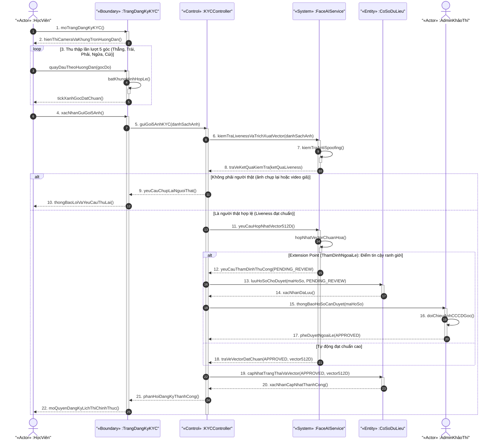

---

### 7.2 Biểu đồ tuần tự UC-02: Điểm danh Sinh trắc học Check-in 1:1 Mở Đề thi

**Hình 2.3. Biểu đồ tuần tự — Điểm danh Sinh trắc học Check-in 1:1 Mở Đề thi**

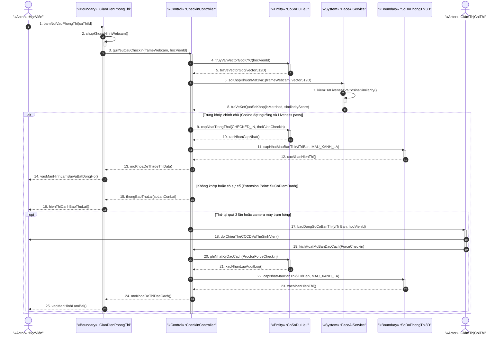

---

### 7.3 Biểu đồ tuần tự UC-03: Làm bài thi Trực tuyến, Tự lưu bài & Giám sát AI Realtime

**Hình 2.4. Biểu đồ tuần tự — Làm bài thi Trực tuyến, Tự lưu bài & Giám sát AI Realtime**

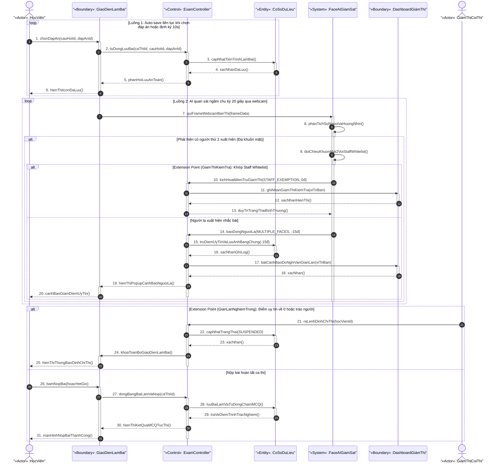

---

### 7.4 Biểu đồ tuần tự UC-04: Khởi tạo & Điều khiển Đấu trường Quiz Tương tác (Quiz Arena)

**Hình 2.5. Biểu đồ tuần tự — Khởi tạo & Điều khiển Đấu trường Quiz Tương tác (Quiz Arena)**

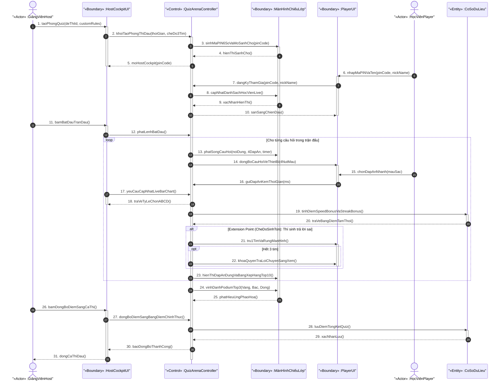

---

### 7.5 Biểu đồ tuần tự UC-05: Lập lịch Ca thi, Phân bổ Sơ đồ Phòng 3D & Xếp chỗ SBD

**Hình 2.6. Biểu đồ tuần tự — Lập lịch Ca thi, Phân bổ Sơ đồ Phòng 3D & Xếp chỗ SBD**

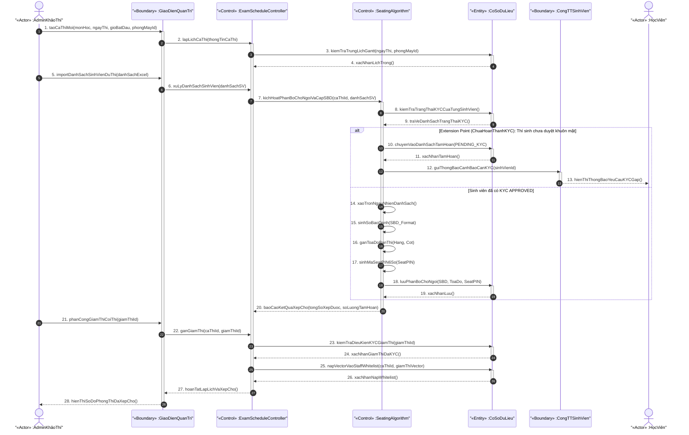

---

### 7.6 Biểu đồ tuần tự UC-06: Soạn đề thi & Quản lý Ngân hàng câu hỏi (Assessment Studio)

**Hình 2.7. Biểu đồ tuần tự — Soạn đề thi & Quản lý Ngân hàng câu hỏi (Assessment Studio)**

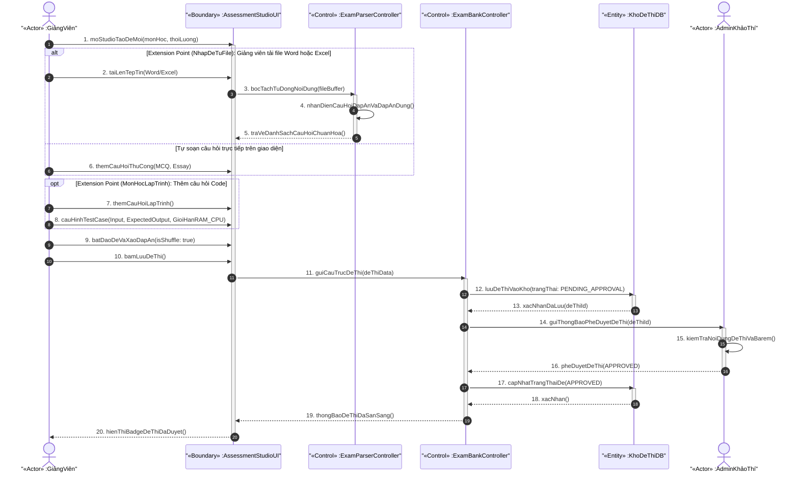

---

### 7.7 Biểu đồ tuần tự UC-07: Khởi tạo Cây Cơ cấu Đào tạo & Thiết lập Phòng thi 3D / Camera CCTV

**Hình 2.8. Biểu đồ tuần tự — Khởi tạo Cây Cơ cấu Đào tạo & Thiết lập Phòng thi 3D / Camera CCTV**

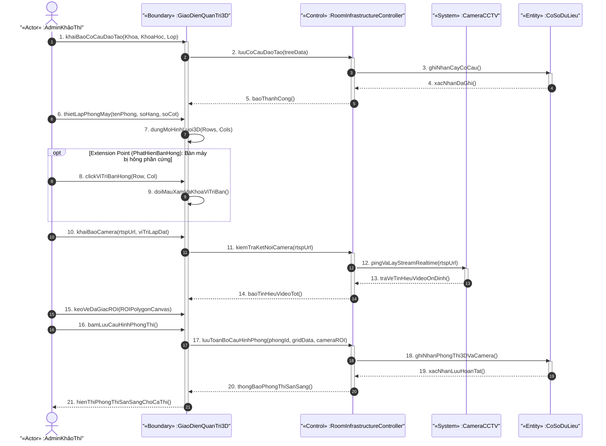

---

### 7.8 Biểu đồ tuần tự UC-08: Chấm thi Rọc phách Ẩn danh, Hậu kiểm Bằng chứng AI & Công bố Điểm

**Hình 2.9. Biểu đồ tuần tự — Chấm thi Rọc phách Ẩn danh, Hậu kiểm Bằng chứng AI & Công bố Điểm**

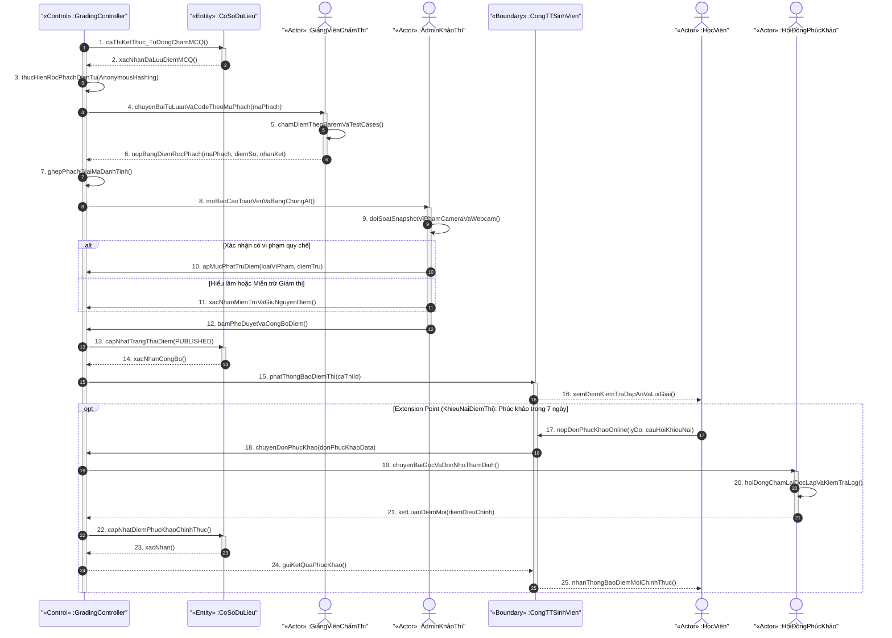

---

## VIII. BIỂU ĐỒ HOẠT ĐỘNG (ACTIVITY DIAGRAM)

### 8.1 Biểu đồ hoạt động: Quy trình KYC & Check-in Phòng thi

**Hình 2.5. Biểu đồ hoạt động — Quy trình từ KYC đến Check-in phòng thi**

```
                          SINH VIEN

                              O (Bat dau)
                              |
                              v
                    [Dang nhap he thong]
                              |
                              v
               < face_status = APPROVED? >
              /                            \
           Khong                            Co
            /                               \
           v                                 v
  [Truy cap /face-kyc]           [Xem lich thi ca nhan]
  [Studio KYC Enrollment]         [SBD, vi tri ban]
           |                                 |
           v                                 v
  [Thu thap 5 goc khuon mat]    [Cho den gio vao phong]
  Thang/Trai/Phai/Ngua/Cui               |
           |                              v
           v                  < Con trong khung gio? >
   < Liveness + Quality >      /                    \
     dat chuan?              Co                    Khong
    /          \              /                      \
 Khong         Co            v                        v
  /             \  [Check-in 1:1 Camera-Vector Goc] [Bi chan "Qua gio"]
 v               |            |
[Yeu cau chup    |            v
 lai (<=3 lan)]  |  < Similarity >= 0.75 + Liveness? >
                 |   /                          \
                 |  Co                        Khong
                 |   /                           \
                 |  v                             v
                 | [Mo giao dien lam bai]  [Canh bao "Khong khop"]
                 | [AI kich hoat CBV 20s]  [Lan 3: Giam thi Force]
                 |            |
                 |            v
                 +---------- X (Ket thuc)
```

---

### 8.2 Biểu đồ hoạt động: Giám sát Vi phạm & Xử lý trong Ca thi (Phân làn)

**Hình 2.6. Biểu đồ hoạt động — Quy trình giám sát và xử lý vi phạm**

```
     AI SERVICE               GIAM THI                SINH VIEN
         |                        |                        |
         O                        |                        O (Dang lam bai)
         |                        |                        |
         v                        |                        |
[Webcam: MediaPipe 30FPS]         |                        |
[CCTV: YOLOv8 5FPS]              |                        |
         |                        |                        |
         v                        |                        |
[Phan tich frame:                 |                        |
 - Goc Yaw / Pitch                |                        |
 - Dem khuon mat                  |                        |
 - Pose keypoints CCTV]           |                        |
         |                        |                        |
         v                        |                        |
 < Phat hien vi pham? >           |                        |
  /              \                |                        |
Khong            Co               |                        |
  |               \               |                        |
  |    < Co >= 2 khuon mat? >     |                        |
  |      /             \          |                        |
  |    Co             Khong       |                        |
  |     |               \         |                        |
  |  < Khop Staff? >     \        |                        |
  |  /         \      [Ghi log MongoDB]                    |
  | Co         Khong  [Tru diem_uy_tin]                    |
  |  \           \    [Kiem tra nguong]-->[Nhan CB vi pham]|
  | STAFF_EX MULTI_FACE     |          | Ban doi mau DO    |
  | (0 diem)  (-15d)        |          | Avatar 3D xoay    |
  |             |            |          | Feed vi pham+anh  |
  |             v            |          |         |         |
  |    < diem_uy_tin < 50? > |          | < Giam thi xu ly?>|
  |      /            \      |          | /       |      \  |
  |    Co            Khong   |          |Bo qua CB    Dinh chi
  |     |              |     |          |  |      |      |  |
  |     v              |     |          |  |      |      v  |
  | [Broadcast         |     |          |is_dismissed [Khoa bai]
  |  suspicious]       |     |          |=true+log     |  |
  |     |              |     |          |              v  |
  |     v              |     |          |         [Giao dien bi khoa]
  |  < = 0? >          |     |          |              [Popup do]
  |  /       \         |     |          |              [Diem uy tin]
  | Co       Khong     |     |          |                        |
  | [SUSPENDED]        |     |          |                        |
  | [Khoa ngay]        |     |          |                        |
         |                   |                                   |
         X                   |                                   X
```

---

### 8.3 Biểu đồ hoạt động: Chấm thi & Công bố Điểm (Phân làn)

**Hình 2.7. Biểu đồ hoạt động — Quy trình chấm thi và công bố điểm**

```
       HE THONG                   GIANG VIEN                  ADMIN
            |                          |                         |
            O                          |                         |
            |                          |                         |
            v                          |                         |
  [Ca thi ket thuc (het gio/nop bai)]  |                         |
            |                          |                         |
            v                          |                         |
  [AUTO-GRADE MCQ                      |                         |
   Doi chieu dap an de_thi             |                         |
   Ghi diem MCQ tuc thi]              |                         |
            |                          |                         |
            v                          |                         |
  < Co cau Essay/Code? >              |                         |
   /                  \               |                         |
 Khong                 Co             |                         |
   |                    |             |                         |
   |            [Bat giao dien cham   |                         |
   |             Roc phach an danh]-->|                         |
   |                    |             |                         |
   |                    |         [GV nhap diem tung cau        |
   |                    |          Essay/Code -- chi thay       |
   |                    |          Ma phach #xxxx]              |
   |                    |             |                         |
   |                    |         [Truong bo mon Phe duyet      |
   |                    |          He thong ghep phach]         |
   |                    |             |                         |
   +--------------------+             |                         |
                        |             |                         |
                        v             |                         |
              [Ra soat bang diem 1 lan: thong ke, phan tich]-->|
                                                                |
                                                                v
                                                    [Admin Phe duyet &
                                                     Cong bo diem chinh
                                                     thuc + Dap an /
                                                     Giai thich]
                                                                |
                                                                v
                                                    [SV xem ket qua thi
                                                     + doi chieu dap an]
                                                                |
                                                     [SV co 7 ngay gui
                                                      don Phuc khao]
                                                                |
                                                                X
```
---

## IX. KIẾN TRÚC KỸ THUẬT

### 9.1 Stack công nghệ

**Bảng 2.12. Bảng stack công nghệ hệ thống ExamGuard AI**

| Lớp | Công nghệ |
|---|---|
| **Frontend** | React 19 + TypeScript + Vite 6 + TailwindCSS v4 |
| **State Management** | Zustand (authStore, examStore, proctorStore) |
| **Realtime Client** | Socket.IO Client |
| **Audio Engine** | Web Audio API (Synthesizer âm thanh động trực tiếp) |
| **AI Client-side** | MediaPipe FaceLandmarker (Web Worker, 30 FPS) |
| **Backend Gateway** | Node.js + Express 5 (Port 3011) |
| **Realtime Server** | Socket.IO Server + Redis Pub/Sub |
| **ORM / DB Client** | Mongoose (MongoDB) + mysql2 (MySQL) |
| **Legacy Service** | Python Flask (Port 5000) — Registry/Governance Service |
| **AI Microservice** | Python FastAPI + Uvicorn (Port 8000) |
| **Face Detection** | YuNet (ONNX Runtime, ~337 KB) |
| **Face Recognition** | ArcFace 512-D (ONNX Runtime) |
| **Anti-Spoofing** | MiniFASNet (Silent-Face-Anti-Spoofing) |
| **Pose Estimation** | YOLOv8n-pose (17 keypoints) |
| **ROI Mapping** | Shapely (geometry library) |
| **CCTV** | OpenCV + RTSP |
| **Database Quan hệ** | MySQL 8.0 (Port 3306) — examguard_db |
| **Database Tài liệu** | MongoDB 7.0 (Port 27017) — examguard_ai_db |
| **Message Broker** | Redis (Pub/Sub cho Socket.IO broadcast) |
| **Security** | JWT Auth, bcrypt, HMAC-SHA256, SEB Lockdown, IP VLAN |
| **Storage** | S3 / Local Vault (ảnh KYC, bằng chứng vi phạm) |

### 9.2 Sơ đồ Microservices & Giao tiếp

**Hình 2.8. Sơ đồ kiến trúc Microservices ExamGuard AI**

```
[Browser Client]
      | HTTP / WebSocket (WSS)
      v
[examguard-core :3011]  <---- JWT Auth / RBAC
      |    |
      |    +-- Socket.IO Server ---> Redis Pub/Sub <--- [examguard-ai :8000]
      |              |
      |         +----+------------------------------------------+
      |         v                                               v
      |    Room: exam_{ca_thi_id}                      Room: arena_{pinCode}
      |         |                                               |
      |    +----+---------------+                    +----------+-----------+
      |    v                   v                    v                      v
      |  [Proctor]        [TakeExam]          [Host Cockpit]         [Quiz Player]
      |
      +-- HTTP --> [examguard-flask :5000]  --> MySQL :3306
      |            (Registry / Governance)
      |
      +-- HTTP --> [examguard-ai :8000]    --> MongoDB :27017
                   (Face AI Microservice)        (embeddings + logs)
```

**Lưu ý kỹ thuật:**
- `examguard-core` là API Gateway duy nhất mà Frontend giao tiếp.
- `examguard-ai` (FastAPI) hoạt động độc lập, nhận yêu cầu từ `examguard-core` và tự đọc RTSP stream CCTV.
- Redis là message broker trung tâm cho mọi sự kiện realtime giữa `examguard-ai` và Socket.IO clients.
- `examguard-flask` giữ vai trò legacy Registry (quản lý metadata, governance), sẽ được migrate dần vào `examguard-core`.

---

## X. VÒNG ĐỜI TRẠNG THÁI HỆ THỐNG (STATE MACHINE)

### 10.1 Vòng đời Face KYC

**Hình 2.9. Biểu đồ trạng thái Face KYC**

```
NOT_ENROLLED --> ENROLLING --> PENDING_APPROVAL --> APPROVED (OK)
                                       |
                                       +--> REJECTED  --> (Chup lai --> ENROLLING)
```

**Bảng 2.13. Chuyển trạng thái Face KYC**

| Trạng thái | Sinh viên | Giảng viên | Điều kiện kích hoạt |
|---|---|---|---|
| `NOT_ENROLLED` | Không được xếp ca thi | Không được phân công Giám thị | Mặc định khi tạo tài khoản |
| `ENROLLING` | Đang quét 5 góc | Đang quét 5 góc | Bật camera KYC |
| `PENDING_APPROVAL` | Chờ thẩm định | Chờ thẩm định | Đã gửi đủ 5 góc & vector 512-D |
| `APPROVED` | ✅ Xếp chỗ, cấp SBD, check-in, dự thi | ✅ Coi thi, nạp Staff Whitelist | Vector đạt chất lượng + Liveness pass |
| `REJECTED` | Bị chặn thi; thông báo chụp lại | Bị chặn phân công; thông báo chụp lại | Phát hiện giả mạo / ảnh mờ / Admin từ chối |

### 10.2 Vòng đời Sinh viên trong Ca thi

**Hình 2.10. Biểu đồ trạng thái Sinh viên trong Ca thi**

```
BLOCKED_NO_KYC --> not_checkin --> checkin <--> suspicious --> suspended
                                      |
                                      +------------------------------------------> checkout
```

**Bảng 2.14. Chuyển trạng thái Sinh viên trong Ca thi**

| Trạng thái | Mô tả | Điều kiện chuyển |
|---|---|---|
| `BLOCKED_NO_KYC` | Bị chặn, chưa KYC | `face_status != APPROVED` |
| `not_checkin` | Chờ vào phòng | Xếp chỗ thành công, `diem_uy_tin = 100` |
| `checkin` | Đang làm bài | Check-in sinh trắc học thành công |
| `suspicious` | Nghi ngờ vi phạm | `diem_uy_tin < 50` |
| `suspended` | Đình chỉ thi | `diem_uy_tin = 0` hoặc Giám thị đình chỉ |
| `checkout` | Đã nộp bài | Tự nộp hoặc hết giờ |

---

## XI. ĐÁNH GIÁ TỔNG HỢP

### 11.1 Điểm mạnh của hệ thống

1. **Bảo mật đa tầng xuất sắc:** Kết hợp sinh trắc học (ArcFace + Liveness), bảo mật trình duyệt (SEB), giới hạn mạng (IP VLAN), và kiểm soát thiết bị (device fingerprint). Không có điểm đơn lẻ nào có thể bị tấn công để gian lận.

2. **Chống gian lận toàn diện với cơ chế thông minh STAFF_EXEMPTION:** Từ thi hộ (IMPERSONATION), nhắc bài, dùng thiết bị ngoài, đến thao tác trình duyệt. Đặc biệt, cơ chế STAFF_EXEMPTION giải quyết bài toán thực tế: Giám thị đi kiểm tra bàn mà không gây cảnh báo nhầm — một vấn đề mà hầu hết hệ thống proctoring không xử lý được.

3. **Trải nghiệm UX đa vai trò phân biệt rõ ràng:** Mỗi actor có luồng nghiệp vụ và giao diện riêng biệt phù hợp ngữ cảnh thực tế; không có giao diện chung gây nhầm lẫn.

4. **Kiến trúc mở rộng được, sẵn sàng scale:** Microservices, Redis Pub/Sub, cô lập đa phòng thi hoàn toàn qua Room Socket.IO riêng biệt.

5. **Zero-Trust thực chất ở cấp kiến trúc:** 5 quy tắc bảo mật tuyệt đối không thể bypass bằng phân quyền (RBAC), không chỉ là policy document.

6. **Tính trung thực học thuật cao:** Rọc phách điện tử, phân tách soạn đề–coi thi, audit log bất biến MongoDB tạo ra hệ sinh thái tin cậy cho khảo thí.

7. **Gamification tích hợp:** Đấu trường Quiz Arena không chỉ là tính năng phụ trợ mà là công cụ học tập chủ động, tạo sự khác biệt hoàn toàn so với LMS truyền thống.

### 11.2 Rủi ro & Thách thức

| # | Rủi ro | Mức độ | Giải pháp đề xuất |
|:---:|---|---|---|
| 1 | Độ chính xác AI thấp trong điều kiện thực tế (ánh sáng yếu, kính cận, góc camera xấu) | CAO | Hiệu chỉnh ngưỡng `SIMILARITY_THRESHOLD` linh hoạt theo môi trường; thêm pre-check ánh sáng trước KYC |
| 2 | Phụ thuộc hạ tầng mạng (IP VLAN cho BYOD, RTSP cho CCTV) | CAO | Chuẩn bị fallback mode: BYOD offline token; CCTV offline → tăng tần suất Webcam CBV |
| 3 | Tải AI đồng thời khi 1.000+ CCU gửi frame | TRUNG BÌNH | Queue FastAPI với Celery/worker pool; tách GPU instance riêng cho AI |
| 4 | Quy trình KYC phụ thuộc hoàn toàn hành chính | TRUNG BÌNH | Nhắc nhở tự động qua email; deadline KYC ít nhất 3 ngày trước ngày thi |
| 5 | False positive CCTV: bóng, chuyển động không liên quan | THẤP | Tăng ROI precision; thêm confidence threshold cho YOLOv8 keypoints |

---

## XII. KẾT LUẬN

ExamGuard AI là hệ thống khảo thí tích hợp sinh trắc học đầu tiên tại Việt Nam được thiết kế theo triết lý **"Biometric Ground-Truth Identity First"** — nơi khuôn mặt không chỉ là phương tiện xác thực mà là **căn cước số gốc** xuyên suốt toàn bộ vòng đời ca thi.

Hệ thống giải quyết đồng thời 3 thách thức lớn của khảo thí hiện đại:

1. **Xác thực danh tính**: KYC 5 góc + ArcFace 512-D + Liveness → Không thể giả mạo.
2. **Giám sát liên tục**: Webcam 30FPS + CCTV 5FPS + Continuous Biometric Verification 20s → Không thể tráo người.
3. **Tính trung thực học thuật**: 5 quy tắc Zero-Trust ở cấp kiến trúc → Không thể mua điểm hay can thiệp hệ thống.

Với kiến trúc Microservices phân tầng (React + Node.js + FastAPI + Python Flask), Polyglot Persistence (MySQL + MongoDB + Redis), và pipeline AI end-to-end (YuNet + ArcFace + MiniFASNet + YOLOv8), ExamGuard AI đặt nền tảng vững chắc cho một hệ sinh thái khảo thí số minh bạch, công bằng và đáng tin cậy.

---

*Tài liệu phân tích này được xây dựng từ **SYSTEM_BLUEPRINT.md v3.3** và cập nhật theo phiên bản mới nhất của **ExamGuard AI & Assessment Studio v3.5**. Các biểu đồ UML (Use Case, Sequence, Activity, State Machine) được trình bày theo chuẩn UML 2.x với cú pháp loop/alt/opt trong Sequence Diagram và phân làn (swimlane) trong Activity Diagram.*
