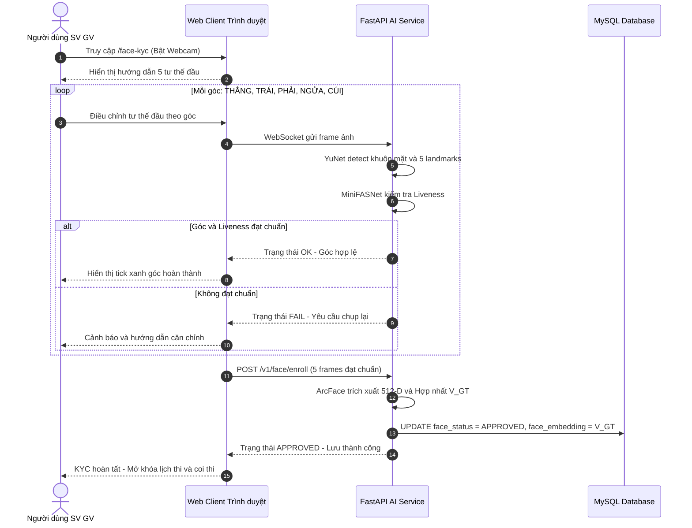
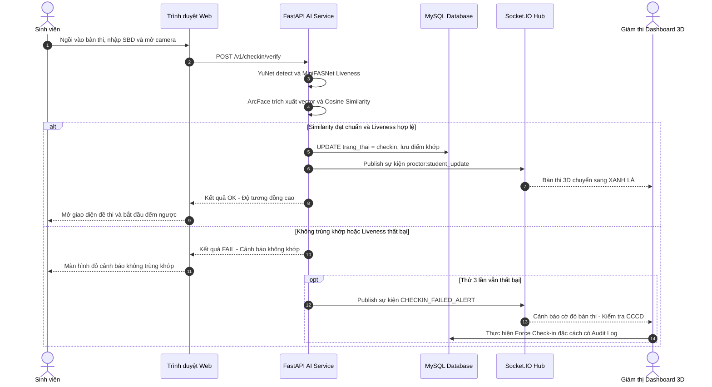
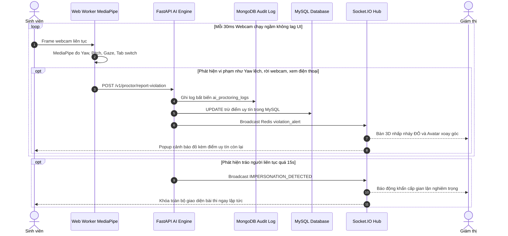
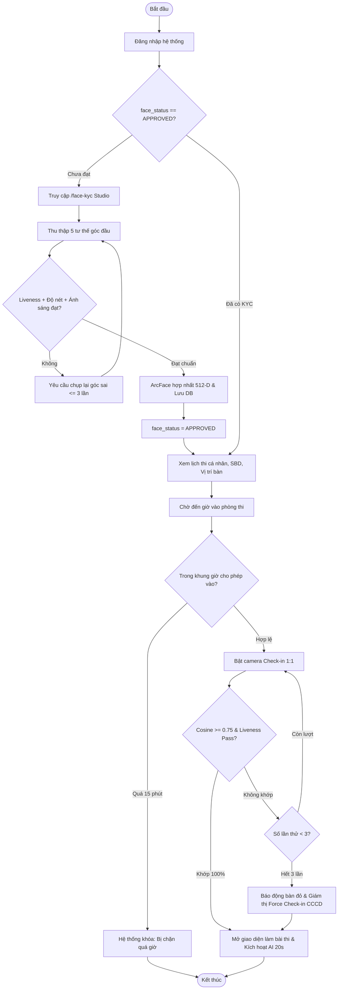
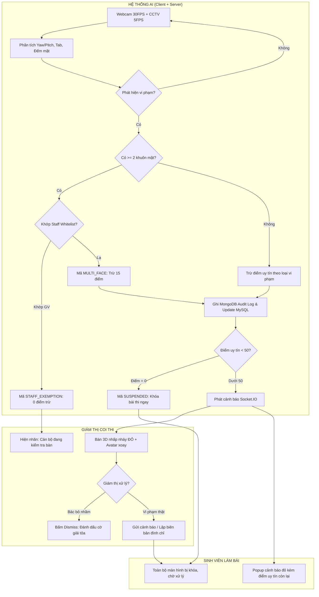
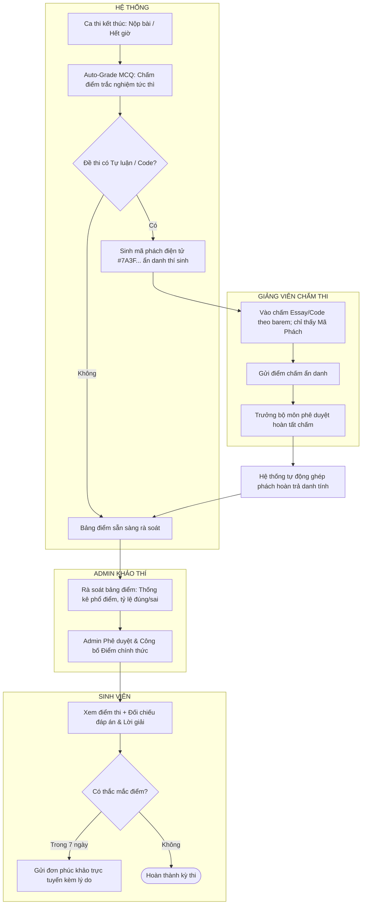
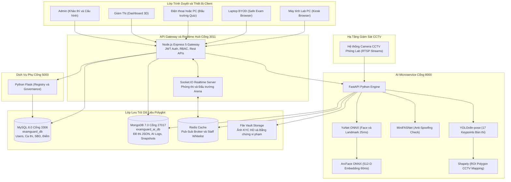
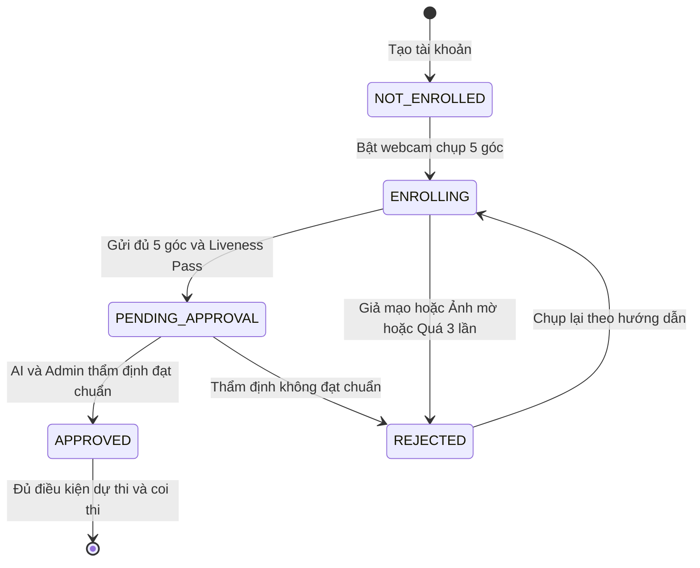
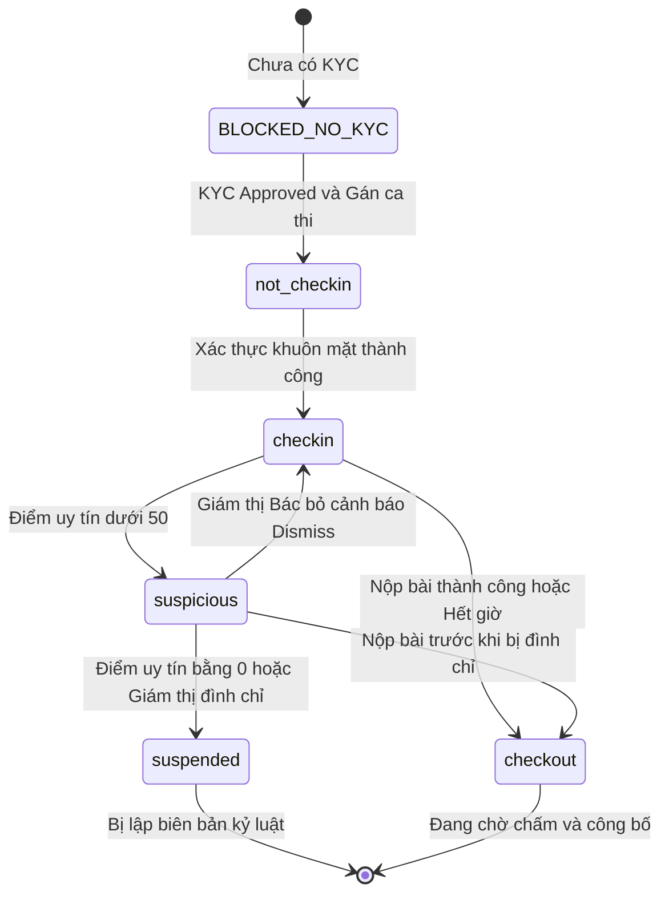

# PHÂN TÍCH HỆ THỐNG — EXAMGUARD AI v3.3
### Báo cáo Khảo sát & Phân tích Nghiệp vụ Toàn diện (Định dạng Chuẩn UML Mermaid)

> **Vai trò người phân tích:** Chuyên gia Phân tích Hệ thống  
> **Sinh viên thực hiện:** Lục Văn Sơn (MSSV: 2310900087) — Lớp: K23CNT3  
> **Nguồn tham chiếu:** `SYSTEM_BLUEPRINT.md` v3.3 + Khảo sát cấu trúc mã nguồn thực tế  
> **Ngày phân tích:** 26/10/2026  
> **Giao diện trực quan tương tác:** Mở file [PHAN_TICH_HE_THONG_TRUC_QUAN.html](file:///d:/K23CNT3-LucVanSon-2310900087/DATN/PHAN_TICH_HE_THONG_TRUC_QUAN.html) trên trình duyệt để xem báo cáo tương tác đầy đủ.

---

## I. TỔNG QUAN HỆ THỐNG

**ExamGuard AI** là hệ thống quản lý thi trực tuyến tích hợp xác thực khuôn mặt sinh trắc học tiên tiến, được thiết kế phục vụ quy mô **10.000 sinh viên** với khả năng **1.000–1.500 người dùng đồng thời (CCU)**.

### 1.1 Triết lý cốt lõi: *"Biometric Ground-Truth Identity First"*

Hệ thống xây dựng toàn bộ nghiệp vụ khảo thí xoay quanh nguyên tắc: **khuôn mặt là căn cước sinh trắc học số gốc**, được dùng để xác thực danh tính tại mọi điểm tiếp xúc nghiệp vụ — từ xếp chỗ, check-in, đến giám sát liên tục trong suốt ca thi.

### 1.2 Các hình thức thi được hỗ trợ

| Mã hình thức | Tên hình thức | Đặc điểm bảo mật & trải nghiệm |
|---|---|---|
| `LAB_PC` | Thi máy phòng Lab | Trình duyệt khóa cứng + Webcam PC + Camera CCTV tập trung (RTSP 5 FPS) |
| `BYOD_LAPTOP` | Thi Laptop cá nhân | Safe Exam Browser (SEB) + IP VLAN + Seat PIN 6 số + Webcam + CCTV |
| `ONLINE_QUIZ` | Thi Trắc nghiệm Chuẩn | AI Face Tracking + Anti-tab switch + Đếm ngược câu hỏi + Auto-save 10s |
| `QUIZ_ARENA` | Đấu trường Quiz Tương tác | Trắc nghiệm trực tiếp phong cách Kahoot + Socket.IO + Web Audio + Bảng xếp hạng |

---

## II. CHỨC NĂNG CHÍNH CỦA HỆ THỐNG

**Bảng 2.1. Một số chức năng chính của hệ thống**

| Yêu cầu chức năng | Mô tả chi tiết |
| :--- | :--- |
| **1. Định danh sinh trắc học khuôn mặt (Face KYC)** | Thu thập chân dung 5 tư thế góc đầu (Thẳng, Trái, Phải, Ngửa, Cúi). Kiểm tra thực thể sống chống giả mạo (Liveness Anti-Spoofing MiniFASNet). Trích xuất vector ArcFace 512 chiều chuẩn hóa lưu vào CSDL làm căn cước số gốc và quy trình phê duyệt hồ sơ KYC. |
| **2. Check-in phòng thi sinh trắc học 1:1** | Đối chiếu khuôn mặt trực tiếp trước camera với Vector Căn cước Gốc KYC đã lưu (Cosine Similarity ≥ 0.75 kết hợp kiểm tra Liveness). Chỉ cho phép thí sinh hợp lệ vào làm bài và tự động cập nhật vị trí bàn thi trên sơ đồ 3D. |
| **3. Giám sát phòng thi thời gian thực (Realtime Proctoring)** | Giám sát đa tầng: client-side qua Webcam (MediaPipe, 30 FPS phát hiện góc nghiêng mặt, đảo mắt, vắng mặt, chuyển tab) và server-side (AI định kỳ xác thực sinh trắc học liên tục mỗi 20s bắt tráo người, CCTV YOLOv8 quét phòng thi 5 FPS). Cơ chế `STAFF_EXEMPTION` miễn trừ giám thị không trừ điểm oan khi cán bộ đi kiểm tra bàn. |
| **4. Khởi tạo & Chuẩn bị ca thi** | Thiết lập sơ đồ phòng thi 3D (số hàng, số cột, bục giảng), cấu hình camera CCTV gắn với luồng RTSP và vùng giám sát ROI Polygon. Lập lịch ca thi (Gantt Chart), tự động xếp chỗ ngẫu nhiên, cấp Số Báo Danh (SBD) và phân công cán bộ coi thi. |
| **5. Ngân hàng đề thi & Soạn đề (Assessment Studio)** | Soạn thảo đa dạng loại câu hỏi (MCQ đơn/đa đáp án, Tự luận, Code kèm test cases, Điền khuyết, Hình ảnh, Âm thanh). Nhập đề tự động từ Word/PDF/Excel/JSON, bộ công cụ Studio kéo thả khối câu hỏi và mã hóa đề thi vào ca thi. |
| **6. Chấm thi, Rà soát & Công bố điểm** | Tự động chấm điểm tuyệt đối các câu hỏi trắc nghiệm ngay khi nộp bài. Hỗ trợ chấm tay bài thi Tự luận/Code trong chế độ rọc phách ẩn danh (Anonymous Hashing). Quy trình rà soát bảng điểm 1 lần, phê duyệt và công bố điểm thi kèm đáp án giải thích chi tiết. |
| **7. Quản trị tổ chức & người dùng** | Quản lý cây tổ chức phân cấp đào tạo: Khoa → Khóa học → Lớp học → Sinh viên và Giảng viên. Hỗ trợ nhập danh sách hàng loạt từ Excel, quản lý hồ sơ và khóa/mở khóa tài khoản theo phân quyền. |
| **8. Hậu kiểm, Báo cáo toàn vẹn & Phúc khảo** | Tự động tổng hợp Báo cáo toàn vẹn (Integrity Report) kèm dòng thời gian (timeline) và ảnh chụp snapshot vi phạm làm chứng cứ bất biến. Tiếp nhận và xử lý đơn phúc khảo trực tuyến của sinh viên trong thời hạn 7 ngày. |
| **9. Đấu trường Quiz tương tác (Gamified Quiz Arena)** | Khởi tạo phòng thi trắc nghiệm tương tác nhanh bằng mã PIN 6 số (phong cách Kahoot). Hỗ trợ tùy biến luật chơi (Speed Bonus, Streak Bonus, Survival 3 Tim), bảng xếp hạng Top 10 trực tiếp và bục vinh danh Podium Top 3. |

---

## III. YÊU CẦU PHI CHỨC NĂNG

**Bảng 2.2. Yêu cầu phi chức năng của hệ thống**

| Tiêu chuẩn | Mô tả |
| :--- | :--- |
| **Hiệu suất (Performance)** | Thời gian nhận diện và trích xuất vector khuôn mặt AI: ~70ms–150ms trên CPU tiêu chuẩn. Thời gian phản hồi Check-in 1:1 hoàn tất: dưới 1.5 giây. Độ trễ truyền thông điệp Socket.IO: dưới 100ms. Webcam client-side: 15–30 FPS (Web Worker, không block UI). Tự động lưu bài làm (Auto-save): định kỳ 10 giây và ngay khi chọn đáp án. |
| **Bảo mật (Zero-Trust Security)** | Mã hóa toàn diện qua HTTPS/WSS và HMAC-SHA256 nội bộ. 5 quy tắc Zero-Trust: (1) Phân tách soạn đề–coi thi; (2) Rọc phách điện tử khi chấm Essay/Code; (3) Khóa quyền giám thị ngoài khung giờ [T_start−15p, T_end+15p]; (4) Nhật ký vi phạm AI bất biến (Immutable); (5) Bắt buộc KYC APPROVED mới được cấp SBD và vào phòng thi. |
| **Tương thích (Compatibility)** | Giao diện Web Responsive, tương thích tối ưu trên Chrome, Edge, Firefox, Safari. Tương thích Safe Exam Browser (SEB) qua header X-SEB-Key và giới hạn IP subnet VLAN. Hoạt động ổn định trên webcam laptop tiêu chuẩn độ phân giải 720p HD. |
| **Dễ sử dụng (Usability)** | Dark Mode / Light Mode hạn chế mỏi mắt. Sơ đồ phòng thi 3D Isometric với avatar định hướng góc đầu thực tế và màu bàn theo trạng thái. Hệ thống âm thanh phản hồi Web Audio API tổng hợp trực tiếp từ trình duyệt, không phụ thuộc tải file mp3. |
| **Khả năng mở rộng (Scalability)** | Kiến trúc Microservices phân tầng (`examguard-core` + `examguard-ai` + `examguard-flask`). Polyglot Persistence: MySQL cho dữ liệu quan hệ; MongoDB cho đề thi động, log vi phạm. FastAPI async/multiprocessing cho N luồng RTSP camera song song. Thiết kế phục vụ 10.000 sinh viên và 1.000–1.500 CCU. |

**Bảng 2.2b. Đối chiếu thông số kỹ thuật lý thuyết và thực tế triển khai trong mã nguồn**

| STT | Tham số / Chỉ số kỹ thuật | Thiết kế Lý thuyết | Thực tế trong Mã nguồn | Vị trí định nghĩa trong code |
| :---: | :--- | :--- | :--- | :--- |
| 1 | Quy mô người dùng | 10.000 sinh viên | ~50–100 SV (môi trường kiểm thử) | CSDL MySQL `examguard_db` |
| 2 | Người dùng đồng thời (CCU) | 1.000–1.500 CCU | 5–20 phiên (Localhost) | Node.js / Socket.IO |
| 3 | Độ dài Vector Khuôn mặt | 512-D float32 | **Chính xác 512 chiều** | `config.py` (`EMBEDDING_DIM=512`) |
| 4 | Mô hình AI | YuNet + ArcFace | YuNet ONNX (~337 KB) + ArcFace ONNX | `examguard-ai/data/models/` |
| 5 | Ngưỡng Cosine Similarity Check-in | ≥ 0.75 | **≥ 0.65–0.68** (thực tế webcam 720p) | `config.py` (`SIMILARITY_THRESHOLD=0.68`) |
| 6 | Ngưỡng Liveness Anti-Spoofing | ≥ 0.90 | **≥ 0.55** (hiệu chỉnh cho webcam laptop) | `config.py` (`LIVENESS_THRESHOLD=0.55`) |
| 7 | Thời gian xử lý AI | < 2.0 giây | **~70ms–150ms/frame** (YuNet ~25ms + ArcFace ~60ms) | FastAPI `/v1/face/verify` |
| 8 | Thời gian vào muộn tối đa | 15 phút | **Chính xác 15 phút** (`lateThresholdMs=15*60*1000`) | `exam.controller.js` |
| 9 | Tần suất Auto-save | 10 giây | **Chính xác 10 giây** + khi bấm chọn đáp án | `TakeExam.tsx` |
| 10 | Cổng dịch vụ (Service Ports) | Microservices phân tán | Frontend: 3011 / Flask: 5000 / FastAPI: 8000 / MySQL: 3306 / MongoDB: 27017 | `run_system.bat` |

---

## IV. CÁC TÁC NHÂN THAM GIA HỆ THỐNG (ACTORS)

**Bảng 2.3. Các tác nhân tham gia hệ thống**

| Actor | DB Role | Ngữ cảnh & Trách nhiệm chính |
|---|---|---|
| **Admin / Khảo thí** | `admin` | Toàn hệ thống: Cấu hình AI, quản lý cơ cấu tổ chức, tạo ca thi chính thức, phê duyệt KYC, giám sát toàn diện, công bố điểm. |
| **Giảng viên** | `teacher` (multi-role) | 5 ngữ cảnh: GV Bộ môn (soạn đề, chấm thi tự luận); Cán bộ Coi thi (giám sát phòng, bắt buộc KYC); Cán bộ Thanh tra (hậu kiểm); Cố vấn học tập (theo dõi lớp phụ trách); Host Đấu trường Quiz (tạo phòng Quiz nhanh, điều khiển live). |
| **Sinh viên** | `student` | Cá nhân: KYC khuôn mặt, xem lịch thi, check-in, làm bài, xem điểm uy tín realtime, nộp bài, phúc khảo; Tham gia Đấu trường Quiz bằng mã PIN 6 số. |
| **AI Service** | — | Background Engine (FastAPI 8000): Phân tích stream camera, so sánh Vector Gốc, nhận diện CBTC, tính điểm uy tín tự động. |
| **SEB Agent** | — | Client Lockdown (Desktop App): Khóa laptop thí sinh BYOD, chặn phím tắt gian lận, phát hiện máy ảo, xác thực header X-SEB-Key. |

> **Nguyên tắc cốt lõi:** Phòng thi chính thức là độc quyền của **Admin**. Giảng viên **không được phép** tự tạo Ca thi chính thức nhằm bảo đảm trung thực khảo thí.

**Bảng 2.4. Ma trận phân quyền Actor**

| Nhóm nghiệp vụ | Admin | Giảng viên | Sinh viên |
|---|:---:|:---:|:---:|
| Quản trị tổ chức (Khoa / Lớp) | ✅ | ❌ | ❌ |
| Đăng ký Face ID KYC | ❌ | ✅ (chính mình) | ✅ (chính mình) |
| Quản lý Ngân hàng đề thi | ✅ | ✅ (môn phụ trách) | ❌ |
| **Tạo ca thi chính thức** | **✅ (Độc quyền)** | **❌ (Cấm)** | ❌ |
| Cấu hình Phòng thi 3D & Camera CCTV | ✅ | ❌ | ❌ |
| Xếp chỗ & cấp SBD chính thức | ✅ | ❌ | ❌ |
| Phân công Giám thị ca thi | ✅ | ❌ | ❌ |
| **Tạo phòng Đấu trường Quiz nhanh** | **✅** | **✅** | ❌ |
| Check-in phòng thi chính thức | ❌ | ❌ | ✅ |
| Tham gia Đấu trường Quiz (PIN 6 số) | ❌ | ❌ | ✅ |
| Force check-in (override) | ✅ | ✅ (phòng được gán) | ❌ |
| Giám sát Dashboard 3D | ✅ (tất cả) | ✅ (phòng được gán) | ❌ |
| Cảnh báo / Đình chỉ SV trong ca thi | ✅ | ✅ (phòng được gán) | ❌ |
| Làm bài thi chính thức | ❌ | ❌ | ✅ |
| Chấm thi Tự luận/Code (Rọc phách) | ❌ | ✅ (GV được phân công) | ❌ |
| Công bố điểm chính thức | ✅ | ❌ | ❌ |
| Xem kết quả + đáp án | ❌ | ❌ | ✅ (sau công bố) |
| Gửi phúc khảo | ❌ | ❌ | ✅ (trong 7 ngày) |

---

## V. BIỂU ĐỒ USE CASE TỔNG QUÁT (GÓC NHÌN NGHIỆP VỤ & NGƯỜI DÙNG)

> **Mục tiêu tiếp cận:** Biểu đồ Use Case tổng quát tập trung vào **4 Vai trò thực tế** và **Các mục tiêu công việc cốt lõi** trong ca thi, giúp người không chuyên về công nghệ (Giảng viên, Ban giám hiệu, Hội đồng khảo thí) hiểu ngay toàn bộ quy trình mà không bị rối bởi thuật ngữ kỹ thuật.

### 5.1 Biểu đồ Use Case Mức Cao (High-Level Business Use Cases)

```mermaid
flowchart LR
    classDef actor fill:#0f766e,stroke:#115e59,stroke-width:2px,color:#fff;
    classDef adminUc fill:#dbeafe,stroke:#3b82f6,stroke-width:1.5px,color:#1e3a8a;
    classDef teacherUc fill:#f3e8ff,stroke:#9333ea,stroke-width:1.5px,color:#581c87;
    classDef studentUc fill:#d1fae5,stroke:#10b981,stroke-width:1.5px,color:#064e3b;
    classDef aiUc fill:#ffedd5,stroke:#f97316,stroke-width:1.5px,color:#7c2d12;

    subgraph ACTORS["4 VAI TRÒ CHÍNH"]
        direction TB
        A["👤 Admin / Khảo Thí<br/>(Người Tổ Chức)"]:::actor
        T["👨‍🏫 Giảng Viên<br/>(Chuyên Môn & Giám Thị)"]:::actor
        S["🎓 Sinh Viên<br/>(Thí Sinh Dự Thi)"]:::actor
        AI["🤖 Trợ Lý AI<br/>(Giám Sát Ngầm)"]:::actor
    end

    subgraph ADMIN_GOALS["Cán Bộ Khảo Thí Làm Gì?"]
        UC_A1["🏢 Khởi tạo & Điều phối Kỳ thi<br/>(Lập lịch Gantt, Sơ đồ phòng 3D, Xếp chỗ tự động)"]:::adminUc
        UC_A2["👥 Quản lý Nhân sự & Giám thị<br/>(Phân công cán bộ, Kiểm duyệt KYC ngoại lệ)"]:::adminUc
        UC_A3["📊 Kiểm soát Toàn vẹn & Công bố Điểm<br/>(Audit log bất biến, Phê duyệt & Công bố kết quả)"]:::adminUc
    end

    subgraph TEACHER_GOALS["Thầy Cô Giảng Viên Làm Gì?"]
        UC_T1["📝 Soạn thảo & Quản lý Đề thi<br/>(Assessment Studio kéo thả, Đa dạng câu hỏi)"]:::teacherUc
        UC_T2["👁️ Giám sát Phòng thi 3D Trực tuyến<br/>(Theo dõi bàn thi realtime, Xử lý cảnh báo)"]:::teacherUc
        UC_T3["✍️ Chấm thi Rọc phách Ẩn danh<br/>(Chấm Tự luận/Code công bằng, Không thấy tên SV)"]:::teacherUc
        UC_T4["🎮 Tổ chức Đấu trường Quiz Tương tác<br/>(Tạo phòng trắc nghiệm Kahoot live bằng mã PIN 6 số)"]:::teacherUc
    end

    subgraph STUDENT_GOALS["Sinh Viên Trải Nghiệm Gì?"]
        UC_S1["🪪 Đăng ký Căn cước Số Face KYC<br/>(Quét 5 góc khuôn mặt 1 lần duy nhất làm căn cước gốc)"]:::studentUc
        UC_S2["🚪 Điểm danh 1 Chạm vào Phòng thi<br/>(Đối chiếu khuôn mặt trước camera trong 1.5s để mở đề)"]:::studentUc
        UC_S3["💻 Làm bài thi An tâm có AI bảo vệ<br/>(Tự động lưu bài từng câu, Chống chuyển tab/gian lận)"]:::studentUc
        UC_S4["📈 Tra cứu Kết quả & Phúc khảo<br/>(Xem điểm ngay, Đối chiếu lời giải chi tiết, Phúc khảo 7 ngày)"]:::studentUc
        UC_S5["🎯 Tranh tài Đấu trường Quiz<br/>(Nhập mã PIN 6 số, Thi đua tốc độ và bảng xếp hạng cùng lớp)"]:::studentUc
    end

    subgraph AI_GOALS["Hệ Thống AI Âm Thầm Hỗ Trợ Gì?"]
        UC_AI1["🛡️ Xác thực Sinh trắc học & Chống tráo người<br/>(Kiểm tra người thật Liveness, So sánh liên tục mỗi 20s)"]:::aiUc
        UC_AI2["🚨 Phát hiện Hành vi Gian lận Bất thường<br/>(Liếc bài xung quanh, Rời vị trí webcam, Dùng điện thoại)"]:::aiUc
        UC_AI3["🤝 Miễn trừ Phạt Cán bộ Coi thi<br/>(Staff Exemption: Tự động nhận diện Giám thị để không trừ oan)"]:::aiUc
    end

    A --> UC_A1
    A --> UC_A2
    A --> UC_A3

    T --> UC_T1
    T --> UC_T2
    T --> UC_T3
    T --> UC_T4

    S --> UC_S1
    S --> UC_S2
    S --> UC_S3
    S --> UC_S4
    S --> UC_S5

    AI --> UC_AI1
    AI --> UC_AI2
    AI --> UC_AI3
```

---

### 5.2 Bảng Phân Rã Chi Tiết 25 Use Case Kỹ Thuật (Dành cho Kỹ Sư & Báo Cáo Chuyên Sâu)

| Mã UC | Nhóm Vai Trò | Tên Nghiệp Vụ Kỹ Thuật | Mô Tả Chức Năng Chi Tiết |
|:---:|:---:|:---|:---|
| **UC-A01** | Admin | Quản lý Cơ cấu Tổ chức | Khai báo Khoa, Khóa học, Lớp học, quản lý danh sách người dùng. |
| **UC-A03** | Admin | Thiết lập Phòng thi 3D & CCTV | Dựng sơ đồ lưới Isometric, cấu hình RTSP Stream và đa giác ROI camera. |
| **UC-A04** | Admin | Khởi tạo Ca thi & Lịch Gantt | Độc quyền tạo ca thi chính thức, kiểm soát khung thời gian, chống trùng lịch. |
| **UC-A05** | Admin | Xếp chỗ & Cấp SBD tự động | Thuật toán xáo trộn Fisher-Yates, gán SBD duy nhất và sinh mã Seat PIN 6 số. |
| **UC-A06** | Admin | Phân công Giám thị ca thi | Gán cán bộ coi thi, nạp vector khuôn mặt vào Redis Staff Whitelist. |
| **UC-A10** | Admin | Phê duyệt & Công bố Điểm | Độc quyền duyệt điểm chính thức, mở khóa xem kết quả và đáp án cho SV. |
| **UC-A11** | Admin | Báo cáo Toàn vẹn & Audit Log | Xuất Integrity Report từ MongoDB kèm timeline và snapshot bằng chứng vi phạm. |
| **UC-T01** | Giảng viên | Đăng ký Face KYC 5 góc | Chụp 5 góc khuôn mặt đạt chuẩn Liveness để kích hoạt quyền coi thi. |
| **UC-T02** | Giảng viên | Soạn thảo Ngân hàng Đề thi | Assessment Studio: MCQ đơn/đa, Tự luận, Lập trình test case, Điền khuyết. |
| **UC-T05** | Giảng viên | Giám sát Dashboard 3D Realtime | Nhận sự kiện Socket.IO thời gian thực, bàn thi vi phạm nhấp nháy đỏ. |
| **UC-T07** | Giảng viên | Xử lý Vi phạm Thí sinh | Gửi cảnh báo đỏ, bù thời gian làm bài hoặc lập biên bản đình chỉ thi. |
| **UC-T11** | Giảng viên | Chấm thi Rọc phách Ẩn danh | Anonymous Hashing: chấm Essay/Code theo barem chỉ thấy Mã phách #xxxx. |
| **UC-T15** | Giảng viên | Khởi tạo Đấu trường Quiz | Sinh phòng thi trắc nghiệm tức thì bằng mã PIN 6 số phong cách Kahoot. |
| **UC-T17** | Giảng viên | Điều khiển Trận đấu Quiz Live | Bấm phát câu hỏi, xem Bar Chart tỷ lệ chọn thời gian thực, vinh danh Podium Top 3. |
| **UC-S01** | Sinh viên | Đăng ký Căn cước Số Face KYC | Thu thập 5 tư thế góc đầu (điều kiện tiên quyết để được xếp chỗ dự thi). |
| **UC-S02** | Sinh viên | Xem Lịch thi & Vị trí bàn 3D | Tra cứu thời gian ca thi, phòng máy, Số Báo Danh và vị trí bàn thi 3D. |
| **UC-S03** | Sinh viên | Check-in Sinh trắc học 1:1 | Đối chiếu khuôn mặt trước webcam với vector KYC gốc qua Cosine Similarity. |
| **UC-S04** | Sinh viên | Làm bài thi An toàn | Tự động lưu bài mỗi 10s và khi chọn câu hỏi, AI phát hiện chuyển tab gian lận. |
| **UC-S07** | Sinh viên | Nộp bài thi | Chốt dữ liệu bài thi, lưu MongoDB và tự động chấm điểm MCQ tuyệt đối. |
| **UC-S08** | Sinh viên | Xem Kết quả & Đáp án | Tra cứu điểm chính thức, đối chiếu bài làm với đáp án kèm lời giải chi tiết. |
| **UC-S09** | Sinh viên | Nộp đơn Phúc khảo trực tuyến | Gửi đơn khiếu nại điểm thi kèm lý do chi tiết trong thời hạn 7 ngày. |
| **UC-S10** | Sinh viên | Tham gia Đấu trường Quiz | Nhập PIN 6 số, chọn đáp án theo 4 màu sắc, nhận Speed Bonus & Streak Bonus. |
| **UC-AI01** | AI Engine | Trích xuất ArcFace 512-D | Trích xuất vector đặc trưng từ 5 ảnh chân dung, hợp nhất có trọng số V_GT. |
| **UC-AI02** | AI Engine | Liveness Anti-Spoofing | MiniFASNet kiểm tra người thật, ngăn chặn ảnh in, video phát lại và mặt nạ 3D. |
| **UC-AI04** | AI Engine | Xác thực ngầm liên tục (CBV) | Định kỳ mỗi 20s chụp frame đối chiếu vector gốc để ngăn chặn tráo người. |
| **UC-AI05** | AI Engine | Miễn trừ Giám thị (Staff Exemption) | So khớp khuôn mặt thứ 2 với Staff Whitelist, miễn trừ phạt khi GV đi kiểm tra. |

---

## VI. BIỂU ĐỒ TUẦN TỰ (SEQUENCE DIAGRAMS)

### 6.1 UC-01: Đăng ký KYC Khuôn mặt Gốc (Face KYC Enrollment)

**Hình 2.2. Biểu đồ tuần tự — Quy trình đăng ký KYC khuôn mặt gốc**

---

### 6.2 UC-02: Check-in Phòng thi Sinh trắc học 1:1

**Hình 2.3. Biểu đồ tuần tự — Quy trình Check-in phòng thi sinh trắc học 1:1**

---

### 6.3 UC-03: Phát hiện Vi phạm Realtime & Staff Exemption

**Hình 2.4. Biểu đồ tuần tự — Phát hiện và xử lý vi phạm AI thời gian thực**

---

## VII. BIỂU ĐỒ HOẠT ĐỘNG (ACTIVITY DIAGRAMS)

### 7.1 Quy trình KYC & Check-in Phòng thi

**Hình 2.5. Biểu đồ hoạt động — Quy trình từ KYC đến Check-in phòng thi**

---

### 7.2 Giám sát Vi phạm & Xử lý (Phân làn Swimlane)

**Hình 2.6. Biểu đồ hoạt động — Quy trình giám sát và xử lý vi phạm phân làn**

---

### 7.3 Chấm thi & Công bố Điểm (Phân làn Swimlane)

**Hình 2.7. Biểu đồ hoạt động — Quy trình chấm thi và công bố điểm**

---

## VIII. KIẾN TRÚC KỸ THUẬT & MICROSERVICES

**Hình 2.8. Sơ đồ kiến trúc Microservices ExamGuard AI**

---

## IX. VÒNG ĐỜI TRẠNG THÁI HỆ THỐNG (STATE MACHINE)

### 9.1 Vòng đời Face KYC

**Hình 2.9. Biểu đồ trạng thái Face KYC**

---

### 9.2 Vòng đời Sinh viên trong Ca thi

**Hình 2.10. Biểu đồ trạng thái Sinh viên trong Ca thi**

---

## X. MA TRẬN ĐIỂM TRỪ VI PHẠM & ĐÁNH GIÁ TỔNG HỢP

**Bảng 2.8. Bảng điểm trừ theo loại vi phạm:**

| STT | Loại vi phạm / Sự kiện | Điểm trừ | Mức độ rủi ro | Điều kiện kỹ thuật kích hoạt |
|:---:|:--- |:---:|:---:|:--- |
| 1 | **Tráo người thi hộ (IMPERSONATION_DETECTED)** | **−50** | **CRITICAL** | Cosine < 0.70 với Vector Gốc liên tục > 15 giây |
| 2 | Mở Developer Tools (DEVTOOLS_OPEN) | −30 | **CRITICAL** | Bấm F12, Ctrl+Shift+I, can thiệp mã nguồn |
| 3 | Phát hiện máy ảo (VM_DETECTED) | −20 | **CRITICAL** | SEB / OS Agent phát hiện môi trường Hyper-V, VMware |
| 4 | Cúi đầu xem điện thoại (PHONE_LOOK_DOWN) | −20 | **HIGH** | Pitch ≤ −22° gập mặt nhìn xuống đùi / màn hình phụ |
| 5 | 2 người lạ xuất hiện (MULTI_FACE_UNKNOWN) | −15 | **HIGH** | Camera thấy ≥ 2 khuôn mặt không khớp Staff Whitelist |
| 6 | Màn hình thứ 2 (SECONDARY_MONITOR) | −15 | **HIGH** | Phát hiện mở rộng desktop ra màn hình phụ ngoài |
| 7 | Chuyển Tab / Ẩn ứng dụng (TAB_SWITCH) | −10 | **MEDIUM** | Sự kiện `visibilitychange` của trình duyệt |
| 8 | Rời vị trí / che webcam (NO_FACE) | −10 | **MEDIUM** | Mất dấu khuôn mặt trước webcam quá 10 giây |
| 9 | Liếc bài bên cạnh (SUSPICIOUS_SIDE) | −10 | **MEDIUM** | Góc quay đầu Yaw ≥ 30° liên tục |
| 10 | Xoay vai sang bên (SHOULDER_TURN) | −8 | **MEDIUM** | YOLOv8 Pose CCTV phát hiện vai xoay lệch bàn thi |
| 11 | Quay đầu nhẹ sang bên (HEAD_TURN) | −5 | **LOW** | 15° ≤ Yaw < 30° |
| 12 | Liếc mắt rời màn hình (GAZE_OFF) | −3 | **LOW** | Mống mắt lệch khỏi màn hình > 4 giây |
| 13 | **Giám thị ghé bàn (STAFF_EXEMPTION)** | **0** | **INFO** | **Khuôn mặt thứ hai khớp Staff Face Whitelist → Miễn phạt** |

---

## XI. KẾT LUẬN

ExamGuard AI là hệ thống khảo thí số toàn diện, giải quyết triệt để bài toán gian lận bằng việc tích hợp AI sinh trắc học sâu ngay từ cấp kiến trúc. Việc chuẩn hóa tài liệu sang biểu đồ chuẩn UML Mermaid và giao diện Web tương tác [PHAN_TICH_HE_THONG_TRUC_QUAN.html](file:///d:/K23CNT3-LucVanSon-2310900087/DATN/PHAN_TICH_HE_THONG_TRUC_QUAN.html) giúp toàn bộ hội đồng thẩm định, giảng viên và sinh viên dễ dàng nắm bắt, kiểm tra và khai thác hệ thống một cách hiệu quả và trực quan nhất.
